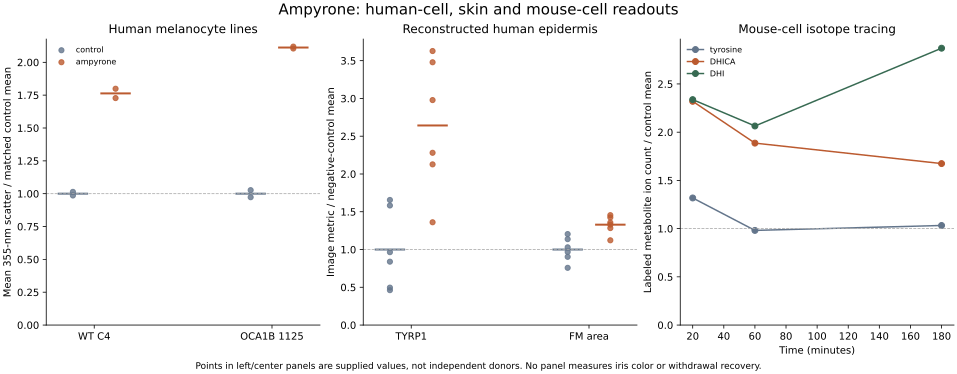

# Ampyrone: what the public measurements show

## Result for the cosmetic research question

Ampyrone remains a production-increase probe. The supplied values support increased pigment-associated signals across several systems. They do not yet specify an iris effect, withdrawal response or repeatable color cycle. The most useful next distinction is **increased synthesis versus changed downstream product handling or optical signal yield**.

The [primary study](https://doi.org/10.1172/jci.insight.202947), [supplement](https://doi.org/10.1172/jci.insight.202947DS1) and [numerical workbook](https://insight.jci.org/articles/view/202947/sd/2) are the sources. This is a descriptive reanalysis of selected public values. No new significance tests or kinetic fits were performed.

## Values extracted

Every number below is a ratio of the ampyrone mean to its matched control mean, calculated here from the workbook. It is not a fold change in eye color or mature melanin mass.

| Population and endpoint | Source cells | Ratio | Replication limit |
| --- | --- | ---: | --- |
| Human normal C4 melanocytes, reported mean 355-nm scatter | Figure 5!AK2:AL3 | 1.763 | Two supplied mean-signal values per condition |
| Human OCA1B-1125 melanocytes, same optical endpoint | Figure 5!AR2:AS3 | 2.112 | Two supplied mean-signal values per condition |
| Reconstructed human epidermis, TYRP1 image metric | Figure 6!B3:C8 | 2.642 | Six values; source describes duplicates and three replicates, without nesting labels |
| Reconstructed human epidermis, Fontana-Masson stained area | Figure 6!E3:F8 | 1.329 | Same nesting limitation |
| Mouse melan-ink4a-null cells, labeled DHICA at 20/60/180 minutes | Figure 5!M3:T5, occupied cells | 2.320 / 1.886 / 1.674 | Three or four supplied values per condition |
| Same mouse cells, labeled DHI | Figure 5!W3:AD5 | 2.338 / 2.064 / 2.871 | Four values per condition; duplicated entries flagged below |

The isotope experiment is in mouse cells according to Methods. The human-focused Results heading must not change that attribution. TYRP1 is a protein-expression image metric, scatter is an optical signal, and isotope tracing measures labeled precursor/intermediate pools. Fontana-Masson area is a staining endpoint. Concordance across these measurements is informative, while their meanings remain distinct.

Points in the first two panels are supplied values divided by their control-group mean. Short horizontal lines show group means. The right panel connects descriptive timepoint ratios, with no inferred continuous kinetics. The source's positive skin control is retained in the exported values but omitted from this focused figure.

## Product chemistry and controls

The recombinant-enzyme screen and kinetic measurements use absorbance at 475 nm. Reading baseline color and subtracting an enzyme-free blank can address pre-existing or enzyme-independent color. They do not by themselves exclude a compound reacting with products generated by the enzyme. Derived catalytic constants also depend on the signal-to-product assumption.

This is a concrete question because a separate [primary analytical study](https://doi.org/10.1039/D4AN01203H), Figure 2, deliberately uses 4-aminoantipyrine to form a colored product with a tyrosinase-generated catechol quinone. It does not demonstrate the same reaction or interference under the human-TYR study's conditions. Treating the entire ampyrone study as an optical artifact would also leave its isotope and tissue evidence unexplained. Docking does not resolve product identity.

Supplement S11 subtracts no-enzyme blanks in an absorbance-based stability readout. S12A gives raw scatter corresponding to Figure 5B. S12B adds other human lines and S12C mouse OCA2 cells. S13 includes histology and TUNEL with a DNase-I positive control. These controls answer specific assay questions; they do not establish iris selectivity, long-term exposure or recovery.

## Source-data limits retained

- Figure 5 has exact equalities Y4=Z4, AC4=AD4, Y5=Z5 and AC5=AD5 in DHI values. All entries are retained. The file does not establish whether these are repeated measurements, processing choices or transcription. Four entries cannot therefore be assumed to establish four independent samples.
- Figure 5 labels both AG2 and AH2 as `control 2` in the histogram block. No replacement sample labels were invented.
- Figure S12 supplies one histogram block. It does not separately label numerical mean summaries for its additional panels B/C. Those extra lines were not reconstructed or pooled into the headline result.
- The isotope workbook and figure show 20/60/180 minutes, while the Methods paragraph states 20/40/60 minutes. This extraction follows the explicit workbook labels; the timing conflict remains unresolved.
- Figure 2 provides mean curves and adjacent dispersion columns rather than replicate-level kinetic curves. The [26 supplied curve points](ampyrone-data-run-2026-10-17/enzyme_curve_means.csv) are exported without refitting. WT diphenolase catalytic efficiency and WT monophenolase efficiency respond differently in the authors' analysis; no universal activity multiplier is justified.

## Next

Keep the production-up branch and reversible production-inhibition branch separate until their activity and withdrawal behavior can be compared. For ampyrone, prioritize a product-specific human-cell readout and direct enzyme product identity over additional docking. For both directions, look for serial measurements after withdrawal that separate free compound, labeled newly made pigment, older stored pigment and appearance. Source availability can narrow this work; no candidate-specific turnover, binding or recovery rate has yet been fitted.

Reproduction uses [extract_ampyrone_data.py](extract_ampyrone_data.py) and its [read-only XLSX reader](read_source_xlsx.py). [Exact cells and values](ampyrone-data-run-2026-10-17/observations.csv), [summary](ampyrone-data-run-2026-10-17/summary.json), [source hashes](ampyrone-data-run-2026-10-17/sources.json), [flags](ampyrone-data-run-2026-10-17/source_issues.json) and [receipt](ampyrone-data-run-2026-10-17/receipt.json) are retained. The original 11,204,898-byte workbook remains unchanged in ignored local literature storage.
