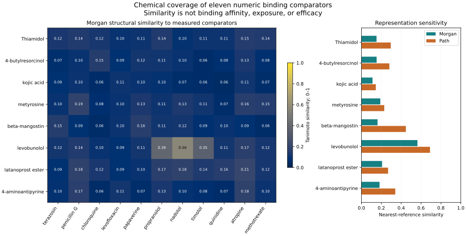

# What measured pigment-binding compounds tell us about the probes

*October 17, 2026. AI-run public-data and molecular-structure analysis. No binding predictor was fitted.*

## Result that changes the next step

The measured panel offers a relevant structural comparison for **levobunolol**, but provides much weaker matches for the other seven probes under the declared Morgan fingerprint. It cannot supply their missing melanin-binding or withdrawal parameters.

Thiamidol remains a useful reversible production-down reference, and ampyrone remains a production-up mechanism lead. This analysis does not establish whether either binds pigment strongly or weakly. It shows why substituting a reference drug's measured values into their exposure models would be unjustified.

## The completed comparison

Eleven compounds with numeric source-reported MST estimates were compared with eight probes. All **19 public structures** resolved to a single returned record each; **88 probe/reference pairs** were evaluated. Original structures, CIDs, standardized parent graphs and source snapshots are retained. The calculation uses binary Morgan fingerprints with radius 2 and 2,048 bits, plus chirality and path-fingerprint sensitivity comparisons.

| Probe | Closest Morgan reference | Morgan similarity | Closest path-fingerprint reference | Path similarity |
| --- | --- | ---: | --- | ---: |
| Thiamidol | Atropine named-parent record | 0.152 | Levofloxacin | 0.295 |
| 4-Butylresorcinol | Chloroquine | 0.153 | Nadolol | 0.281 |
| Kojic acid | Atropine named-parent record | 0.111 | Levofloxacin | 0.145 |
| Metyrosine | Penicillin G | 0.190 | Nadolol | 0.229 |
| Beta-mangostin | Papaverine | 0.162 | Levofloxacin | 0.447 |
| Levobunolol | Nadolol | 0.564 | Nadolol | 0.690 |
| Latanoprost ester | Atropine named-parent record | 0.208 | Atropine named-parent record | 0.268 |
| Ampyrone / 4-aminoantipyrine | Atropine named-parent record | 0.182 | Levofloxacin | 0.340 |

Similarity describes the encoded molecular graph. The numbers are not probabilities, affinity estimates or a calibrated boundary for prediction. A nearest neighbor in this small set need not be a useful analogue. Values from different fingerprint definitions should not be averaged into a confidence score.

### The levobunolol comparison is more specific now

Nadolol is its closest comparator under all three encodings: Morgan 0.564, Morgan with chirality 0.517, and path 0.690. Timolol is only the third Morgan neighbor, at 0.354, behind propranolol at 0.386. Sharing an ocular drug class did not make timolol the closest measured structure.

This makes nadolol worth keeping in a comparison of pigment binding. It does not establish levobunolol's affinity or make its earlier iris-color association causal. The human-TYR functional evidence and pigment-control rationale remain separate questions.

### Broad descriptor ranges do not solve the coverage gap

Thiamidol falls within all seven individual descriptor ranges represented by the references, while its closest Morgan similarity is only 0.152. A broad range of molecular weights, calculated logP or polar surface areas does not ensure coverage of a particular scaffold.

The [feature-by-feature export](descriptor_coverage.csv) retains individual range departures. For example, beta-mangostin's neutral calculated logP exceeds this panel's maximum, while several smaller probes fall below its minimum molecular weight. These observations do not establish binding or formulation performance. Calculated neutral logP is not a measured distribution coefficient at assay pH.

## Source qualification

The 2020 article's Table 2 contains **12 rows and 11 numeric MST estimates**. Its narrative reports 13 tested compounds, while Table 1 names 14. Diclofenac has no determined MST Kd; pazopanib's solubility-limited fit is excluded from the numeric panel; ciprofloxacin appears in Table 1 without a numeric Table 2 outcome. The discrepancy is preserved rather than repaired by inventing data. **Five** reported confidence values exceed their estimates. These software 68% confidence values are not standard errors. [Primary source, Tables 1–2](https://doi.org/10.3390/pharmaceutics12060554).

The same source's MST and conventional Sips parameters describe different assays and binding models. Its Table 4 unbound fractions are calculated; the human RPE–choroid column is a prediction. Those values are stored separately and were not treated as measured human exposure or used to label the probes.

The 2022 source supplies release observations for four shared compounds. Its binding parameters are reused from earlier studies, so this is not independent replication of the affinity measurements. Particle release and apparent organelle release are distinct endpoints; cellular release concerns timolol and levofloxacin. Some reported Sips uncertainties differ between the two publications: levofloxacin Bmax SE is 11 versus 23, and papaverine is 8 versus 6. Both source versions are retained. [Primary source, Tables 2–3](https://doi.org/10.1016/j.jconrel.2022.05.059).

No affinity-to-release relationship was fitted. Apparent organelle release includes transport effects; it is not interchangeable with molecular dissociation from isolated pigment.

## Identity and representation limits

All returned structures in this run were single neutral graphs, and FragmentParent/Uncharger left their canonical parent graphs unchanged. This does not establish charge at assay pH or verify the original purchased forms. Vendor/catalog identifiers are retained for that future identity check.

- The latanoprost **ester** is retained. It was not converted to the active acid during standardization.
- Ampyrone resolves to 4-aminoantipyrine, CID 2151; aminopyrine is a different molecule.
- The beta-mangostin identity is retained separately from alpha-mangostin.
- Atropine's name query returns CID 174174, titled `Npc209773`, with two unspecified stereocenters in the returned graph. Nadolol also has partly specified stereochemistry. The chirality sensitivity therefore concerns database representations, not verified assayed mixtures. The primary nonchiral comparison does not resolve that identity uncertainty.

No canonical tautomer enumeration or pH-speciation calculation was performed. Source SMILES, stereochemistry flags and transformation indicators allow a future comparison to change one representation choice at a time.

## What to do next

Keep the direct production-up/down hypotheses and add **candidate-specific pigment binding and intracellular free exposure** to their missing-parameter lists. For further public-data work, search for measured phenolic/resorcinol and pyrazolone comparators that better cover the leading probes, and inspect the production-up study's underlying readouts and withdrawal evidence. A larger unrelated compound collection would not by itself close this gap.

A revised 2026 nanoparticle/MST source was identified, but its compound-level table and shortlist overlap were not verified during this iteration. It remains a separate retrieval lead, not extra benchmark rows. [Primary record](https://pubmed.ncbi.nlm.nih.gov/42103108/).

## Reproduce and inspect

- [Inputs](inputs.json): declared source values, exclusions, compound identities and fingerprint settings.
- [Binding data](binding_2020.csv), [release data](release_2022.csv), [calculated fractions](calculated_fu_2020.csv): source-specific endpoints.
- [Identities](identities.csv): returned and standardized structures with descriptors and flags.
- [All similarities](similarities.csv), [three nearest neighbors](nearest_neighbors.csv), [reference-only comparisons](reference_leave_one_out_neighbors.csv).
- [Summary](summary.json), [receipt](receipt.json): source URLs, hashes, software version and analysis-source hash.

The runner verifies the eleven manually declared MST estimates and confidence values against the fetched XML table. Other source values are explicitly transcribed, with their preparation and provenance retained. Raw XML/PDF sources stay in ignored local workbench literature data; public PubChem snapshots are included here. No software tests were added or run for this analysis.
