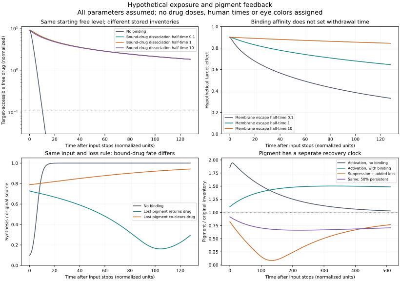

# Stopping drug input, ending drug activity, and recovering pigment

*October 17, 2026. AI-run hypothetical calculation. No compound-specific eye parameters were fitted.*

## What changed in the reasoning

A chemically reversible pigment controller can still have a long tissue memory. A drug may detach from melanin, remain inside an organelle, and bind again before escaping. A growing pigment inventory could create more storage capacity; a shrinking inventory could release stored drug or carry it away. These are distinct possibilities to model.

This calculation separates cytosolic free drug, melanosomal free drug, drug bound to mobile pigment, and drug bound to persistent pigment. The target responds to melanosomal **free concentration**, rather than total tissue accumulation. It also follows pigment production and loss, so drug activity and appearance-related inventory can have different clocks.

## Conditional results

All times below are normalized units: **one unit equals an assumed cytosolic free-drug elimination half-life**. They are not hours, days or years for a shortlisted compound. A normalized target-effect threshold is not an eye color.

| Fixed-pigment example | Time to fall below 50% target effect | Time to fall below 10% target effect |
| --- | ---: | ---: |
| No binding; nominal membrane escape half-time 1 | 5.76 | 10.18 |
| Binding capacity 100, Kd 1; escape half-time 0.1 | 57.35 | 410.28 |
| Same binding; escape half-time 1 | 303.26 | Not below by 512 |
| Same binding; escape half-time 10 | Not below by 512 | Not below by 512 |

These cases start at the same free concentration, **with different total drug inventories**. They isolate withdrawal from an assumed preloaded state. They do not compare equal applied doses or reproduce an actual loading history.

At capacity 100 and escape half-time 1, changing the individual binding dissociation half-time from 0.1 to 10 changes the 50%-effect crossing only from approximately 303.16 to 304.23 units. Affinity is held fixed, so association changes with dissociation. In this assumed regime, repeated binding and membrane escape dominate; faster individual dissociation alone provides little improvement.

The second comparison starts with no drug and uses the **same input history into the modeled cytosol**. Free exposure then differs because binding, transport and pigment feedback differ. This input is not an administered dose or an eye-drop delivery model.

With constant input, no bound-drug co-clearance and a reached steady state, cytosolic free drug equals input/ke and the two free concentrations equilibrate. Binding can change loading and withdrawal without changing that limiting free level. The finite input histories below should not be mistaken for this steady-state limit; sustained maintenance over a longer period remains a distinct case.

- With activation and binding, pigment rises from **1.108 at withdrawal to a sampled peak of 1.503 approximately 330 units later**. Without binding, the activation example peaks much earlier, approximately 8.1 units after withdrawal. Both changes are consequences of assumed rates, not observed iris outcomes.
- With suppression plus added pigment loss, returning pigment-associated drug locally produces a delayed target-effect peak after withdrawal. Co-clearing that drug with the lost pigment produces a different trajectory under the same input and loss rules. The chemical fate of the attached drug is therefore part of the control question.
- A persistent pigment fraction also supplies persistent binding capacity in this hypothesis. It is an inventory assumption within one modeled cell environment, **not a representation of the posterior iris or another anatomical layer**.



The upper panels compare preloaded withdrawal; the lower panels compare matched input histories. The upper-left vertical axis is logarithmic. Different panels answer different questions and should not be read as a single treatment sequence.

## What measured research supports

A 2022 study compared isolated porcine ocular pigment, intact melanosomes and repigmented ARPE-19 cells. Its particle and organelle release rates differ; cellular retention is slower still. Its binding table uses a heterogeneous Sips model. These measurements motivate separate affinity, capacity, membrane-escape and dissociation parameters; they do not calibrate our single-site hypothetical model. [Primary study, Tables 2–3](https://doi.org/10.1016/j.jconrel.2022.05.059).

| Reference compound | Sips Kd (micromolar) | Capacity (nmol/mg pigment) | Heterogeneity n | Particle release koff (per hour) | Apparent melanosome release koff (per hour) |
| --- | ---: | ---: | ---: | ---: | ---: |
| Timolol | 120 | 39 | 0.95 | 7.23 | 0.97 |
| Levofloxacin | 157 | 72 | 0.73 | 0.47 | 0.32 |
| Papaverine | 66 | 66 | 0.72 | 0.46 | 0.36 |
| Terazosin | 46 | 112 | 0.64 | 0.46 | 0.20 |

These are source table means, not new measurements; binding parameters were collected from earlier studies, while release was fitted in the 2022 work. Do not combine Sips Kd and n with a single-site kon = koff/Kd formula.

A 2025 carbonic-anhydrase-inhibitor study separately reports bound and operationally unbound radioactivity in combined rat iris–ciliary body. For its A01 comparator, pigmented/albino exposure ratios were 18 for total, 9.3 for unbound and about 150 for bound drug. This supports distinguishing accumulation from available exposure. The tissue measurement does not resolve anterior iris cells or directly measure living melanosomal free concentration. Its Table 3 association/dissociation kinetics concern **carbonic anhydrase II**, not melanin, and were not imported as pigment-binding rates. [Primary study](https://doi.org/10.1021/acs.molpharmaceut.4c00694).

The focused search did not identify measured ocular binding, transport and withdrawal parameters for thiamidol or ampyrone. No reference-compound number above was assigned to either probe.

## Model definition

Let FC and FL be free drug amounts in cytosol and melanosomes; BM and BP are amounts bound to mobile and persistent pigment. M is mobile pigment, and P is persistent pigment. Volumes are fixed, with VC = 1 and VL = 0.1 in normalized volume units. Concentrations are cC = FC/VC and cL = FL/VL.

The placeholder target response is E = cL/(1+cL). Suppression multiplies baseline pigment synthesis by 1-E; activation multiplies it by 1+4E. This fivefold maximum source is a declared assumption, not an ampyrone effect estimate. At E = 0.1, synthesis is 0.9 times baseline under suppression and 1.4 times baseline under activation.

Binding capacities are CM = C*M and CP = C*P. The model assumes that accessible binding capacity scales with pigment inventory and that bound drug is unavailable to the target. Neither relationship has been established for these probes in adult iris.

```text
JM = kon*cL*(CM-BM) - koff*BM
JP = kon*cL*(CP-BP) - koff*BP
T  = G*(cC-cL)
lambda = k0 + a*E

dFC/dt = input - ke*FC - T
dFL/dt = T - JM - JP + q*lambda*BM
dBM/dt = JM - lambda*BM
dBP/dt = JP
dM/dt  = k0*M0*source_factor - lambda*M
```

q is the fraction of drug carried by lost pigment that returns locally to free drug. The remaining fraction exits the modeled compartment with pigment. It is not necessarily chemically destroyed. Loss uses **gross pigment turnover**, so disappearance of occupied binding sites is accounted for even if new pigment maintains the same total capacity. No extra capacity-shrinkage release term is added.

The input/exit accounting is:

```text
dENTER/dt = input
dEXIT/dt  = ke*FC + (1-q)*lambda*BM
FC + FL + BM + BP + EXIT - ENTER = constant
```

ke = ln(2) per time unit. G = ln(2)*VL/h_transport, where h_transport is the nominal luminal escape half-time **with cytosolic concentration clamped at zero**. It is not an observed whole-cell half-life. The model keeps membrane exchange separate from elimination out of cytosol.

For hypothetical pigment feedback, native pigment half-time is 100 units; the optional additional loss pathway has a maximum half-time of 20 units. Untreated synthesis is fixed at k0*M0, rather than silently increasing when added loss is introduced. The input phase lasts 40 units and withdrawal is followed for 512 units. All values and solver settings are retained in the run receipt.

## Limits and numerical accounting

The run contains **23 fixed-capacity cases and 9 matched-history cases**. Radau integration uses an explicit Jacobian. The maximum recorded relative drug-accounting residual is approximately **2.82 × 10^-15** at integration nodes, and the declared nonnegativity/capacity bounds held within numerical tolerance. These checks address arithmetic consistency, not the biological validity of the assumptions. No new software test suite was run.

Threshold times are the last downward crossings within the finite withdrawal window. Null means the case remains above the threshold at the window end. A zero accompanied by `already_below_at_withdrawal` means no crossing occurred because the response was already below that threshold. Peak times are sampled on a 0.125-unit grid and are approximate.

One effective cytosolic exit cannot resolve all tissue/plasma transport. The model omits heterogeneous binding sites, drug metabolites, changing organelle volume or number, distinct ocular cell populations, target occupancy kinetics, toxicity, and pigment optical composition or distribution. It cannot forecast brown, green or blue appearance. These omissions define which measurements could change the conclusion.

## Next research decision

Compare the production-up and production-down probes by **intact-cell response, free intracellular exposure, pigment binding/release and withdrawal**, rather than picking the highest total accumulation. A deliberate long-lasting effect and a controllable return to baseline are separate design objectives.

The immediate computational next step is to inspect existing measured compound-binding datasets for chemical neighbors of the probes, retain assay-system differences, and report how far each probe lies outside the measured chemical domain. A similarity estimate would remain a hypothesis; candidate-specific binding and transport measurements would determine whether these feedback cases are relevant.

Outputs: [fixed-capacity summary](fixed_capacity_summary.csv), [matched-history summary](matched_history_summary.csv), [selected trajectories](selected_trajectories.csv), [numerical accounting](numerical_accounting.json), [complete assumptions and hashes](receipt.json). The saved curves are selected samples; event times and displayed figure curves use the continuous numerical solutions.
