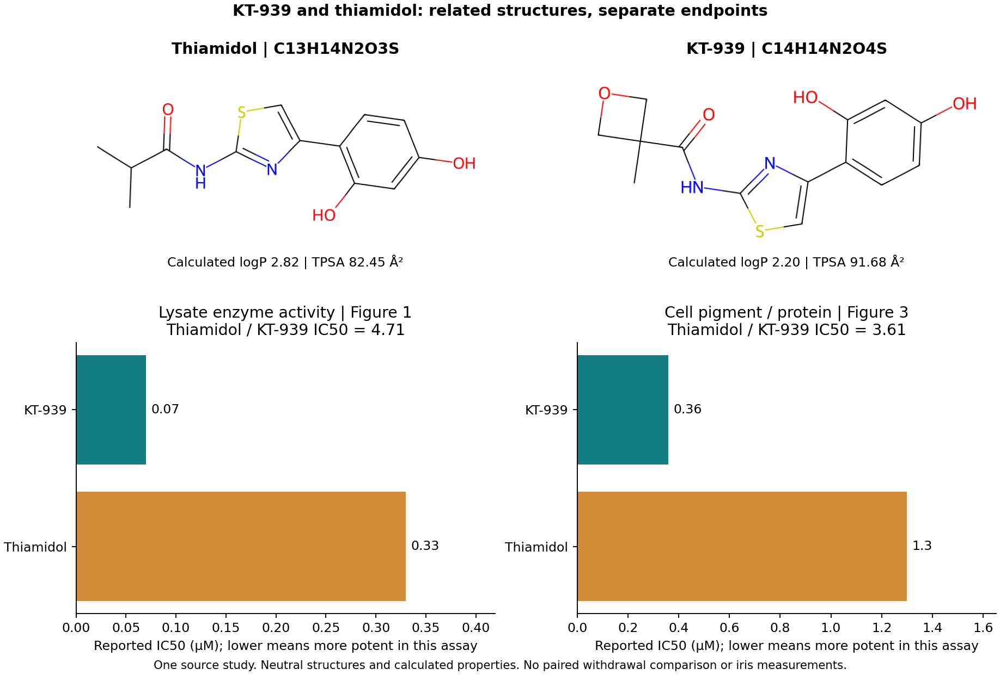

# KT-939 and thiamidol: a paired production-control comparison

*October 22, 2026. Personal learning project; AI-run source extraction and structural calculations. No new biological experiments.*

KT-939 is a useful additional production-down probe: one study compares it directly with thiamidol in both human melanoma-cell lysate and intact cells. The comparison supports keeping both compounds in the research set. It does not establish which would be more controllable in an iris.

## What the same study actually compares

| Endpoint | KT-939 IC50 | Thiamidol IC50 | Thiamidol / KT-939 IC50 |
| --- | ---: | ---: | ---: |
| MNT-1 crude-lysate L-DOPA oxidation, Figure 1 | 0.07 μM | 0.33 μM | 4.71 |
| Six-day MNT-1 accumulated pigment / protein, Figure 3 | 0.36 μM | 1.3 μM | 3.61 |

These ratios use rounded point estimates extracted from Results 3.1 and 3.3. Lower IC50 means a lower concentration produced the half-maximal effect in that particular assay. Raw concentration-response data were not available for a new fit, uncertainty interval or significance test. The two ratios remain separate. [Primary study](https://doi.org/10.1111/jocd.70510).

Methods 2.3 uses crude human MNT-1 melanoma-cell lysate, L-DOPA and an optical activity readout at 475 nm. It is not purified human enzyme. Methods 2.4 measures accumulated pigment at 405 nm against a synthetic-melanin standard, normalized to protein after six days. This is not a direct measurement of newly synthesized pigment or clearance of previously stored pigment. Figure 1 specifies three independent experiments; Figure 3's caption does not specify replication.

The within-study comparison avoids treating thiamidol values from different enzyme preparations as interchangeable. It does not remove effects of substrate, protein binding, optical chemistry or cellular exposure on the observed IC50. No biochemical IC50 has been converted into a binding constant or living-eye concentration.

## Related structures, with an exposure question

Methods 2.1 names KT-939 as N-(4-(2,4-dihydroxyphenyl)thiazol-2-yl)-3-methyloxetane-3-carboxamide. We manually transcribed that name into a neutral molecular graph. RDKit accepted the graph, checked the expected formula and shared core, and compared it with the existing [thiamidol PubChem snapshot](binding-benchmark-run-2026-10-17/pubchem/thiamidol.pubchem.json).

| Calculated neutral-structure property | Thiamidol | KT-939 |
| --- | ---: | ---: |
| Formula | C13H14N2O3S | C14H14N2O4S |
| Molecular weight, g/mol | 278.33 | 306.34 |
| Calculated logP | 2.82 | 2.20 |
| Topological polar surface area, Ų | 82.45 | 91.68 |
| Hydrogen-bond donors / acceptors | 3 / 5 | 3 / 6 |
| Ring count | 2 | 3 |

Both retain a resorcinol–thiazole core and amide linkage. KT-939 replaces the isopropyl acyl side group with a methyl-substituted oxetane side group: the net formula change is +CO, including one additional ether oxygen and ring. Its calculated logP is lower and polar surface area higher under this neutral representation. Those differences motivate measuring free exposure and retention in the same system; they do not demonstrate improved solubility, melanosome access, lower melanin binding or ocular delivery.

The declared binary Morgan fingerprint gives a Tanimoto similarity of 0.608 (radius 2, 2,048 bits, no chirality). It describes structural overlap under that encoding, without predicting affinity or performance. It is not used to transfer a pigment-binding constant from thiamidol or any prior comparator.

The paper reports LCMS [M+H]+ of 307.05. The transcribed formula gives a calculated exact [M+H]+ of 307.0747. Source precision and calibration are unspecified, so both values are retained without claiming an exact-mass match. A name-derived graph check does not independently verify the experimental material. The proposed extra oxetane contact in Figure 2 comes from docking, not measured binding.

## What remains missing for reversible iris control

The [earlier withdrawal review](withdrawal-and-recovery.md) remains applicable. Figure 4 follows KT-939 alone after withdrawal: there is no paired thiamidol recovery arm. KT-939's recovery phenotype therefore cannot establish faster washout or more complete reversibility than thiamidol. Pigment content alone also does not distinguish free-drug clearance, renewed synthesis, stored-pigment loss or changing cell populations.

The study's viability observations cover 72 hours, shorter than the six-day pigmentation exposure and the later recovery observations. They do not supply cell-population accounting across that full sequence. Most authors have affiliations with the developer, Kintor Pharmaceutical; the article declares no conflicts and offers underlying datasets upon request. This project has not independently reproduced the experiments. The separate skin study uses a finished lotion in a single-arm before/after design, without a vehicle, thiamidol or withdrawal comparison; it is not evidence of comparative iris efficacy.

The next useful evidence would compare both compounds in one human pigment-cell system while measuring free compound, target activity, pigment content, and cell number over action and withdrawal. Separately tracking new synthesis and pigment present before exposure would address the ambiguity demonstrated in the [identifiability calculation](withdrawal-and-recovery.md#a-calculation-that-changes-what-to-measure-next). Adult iris pigment turnover, compartment-specific exposure, optical change and preserved function remain unresolved.

## Reproduction and actual checks

The [runner](compare_kt939_thiamidol.py) reuses the primary XML fetched during the previous withdrawal review and the committed thiamidol identity snapshot. No new retrieval is claimed. It requires the XML's previously recorded SHA-256, checks the source DOI/name and extracts the four IC50 values from their source paragraphs. The graph/formula checks are computational consistency checks, not experimental identity validation.

The [paired values](kt939-comparison-run-2026-10-22/paired_assays.csv), [structures and descriptors](kt939-comparison-run-2026-10-22/structures.csv), [summary and limits](kt939-comparison-run-2026-10-22/summary.json), [source records](kt939-comparison-run-2026-10-22/sources.json) and [run receipt](kt939-comparison-run-2026-10-22/receipt.json) retain the calculation. The existing development container ran the analysis with RDKit 2023.09.3, and the figure was inspected visually. The receipt records actual software versions and byte hashes. This is a separate run from the older RDKit 2026.03.6 comparisons.

The repository now disables Git newline conversion because the archived receipts cover exact bytes, including LF reports and CRLF CSV rows. Existing analysis files and receipt hashes remain unchanged. See [analysis methods](README.md) for the command and validation results.
