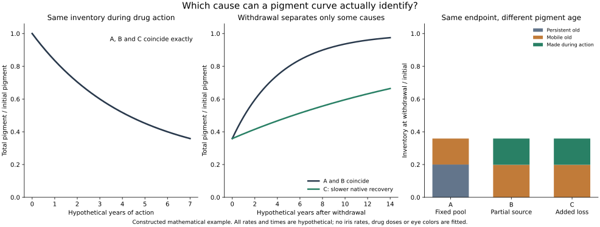

# Withdrawal, pigment recovery and the cosmetic goal

## What progressed

There are usable cellular withdrawal observations for production inhibitors. They support pursuing reversible pigment modulation. The new calculation identifies which parts of the iris question those observations can answer: **a returning pigment signal does not uniquely identify drug clearance, synthesis recovery or old-pigment turnover**.

The original drug-only goal remains a controlled change in visible iris pigment followed by recovery. Its main unresolved requirement is a workable balance between making pigment and losing stored pigment. Genome editing and whole-cell replacement are not required by that balance equation. No iris parameter has been inferred from skin or melanoma cells here.

## Withdrawal evidence, with readout meanings preserved

| Source | What was observed | What it can inform |
| --- | --- | --- |
| [Thiamidol, 2018](https://doi.org/10.1016/j.jid.2018.01.019), Figure 3B | Donor-derived human melanocyte cultures, two weeks of exposure followed by two weeks without compound. Microplate melanin content reported as percent control. Text describes recovery within one week. | Reversible cultured-cell pigment phenotype. It does not isolate new synthesis flux. |
| [KT-939, 2025](https://doi.org/10.1111/jocd.70510), Figure 4 | MNT-1 human melanoma cells after six days of exposure; multiple pigment-content observations after withdrawal. | A more detailed coupled recovery phenotype in a transformed human cell line. |
| [Thiamidol clinical regression, 2021](https://doi.org/10.1111/1346-8138.16080) | Melasma severity followed at one variable-time visit 13–20 weeks after all treatment stopped. | Human appearance persistence/recurrence under that study's conditions, without a resolved washout time course. |

### Thiamidol cultured-cell source qualification

The detailed 2018 endpoint was inspected in a [publicly rehosted accepted manuscript](https://www.scribd.com/document/1055152473/j-jid-2018-01-019); its title, authors and bibliographic identity match the primary record. Publisher full-text access failed during this run, so final-version equivalence is not asserted. Figure 3B says microplate melanin **content**, despite the narrative calling it production. It reports means and SEM, n=5, without establishing five independent donors. Detailed culture and normalization methods are deferred to a supplement that was not retrieved. No exact graph coordinates or synthesis-recovery rates were reconstructed.

### KT-939 numerical extraction

The [primary XML](https://www.ebi.ac.uk/europepmc/webservices/rest/PMC12569736/fullTextXML) supplies these text values after withdrawal:

| Prior cell-exposure condition | Day 3 | Day 5 | Day 7 | Day 9 | Qualitative return report |
| --- | ---: | ---: | ---: | ---: | --- |
| Lower | 38% inhibition | 28.3% | — | — | Baseline by day 7 |
| Higher | 66.6% | 52.7% | 21.3% | 20% | Normal by day 11 |

The endpoint is bulk pigment absorbance at 405 nm, calibrated against synthetic melanin and normalized to protein. The inhibition denominator is not explicit. The return statements have not been converted into exact zero-inhibition measurements. Cell division, protein content and cell loss could affect interpretation. Separate short-term viability data do not resolve the full withdrawal sequence. Free intracellular compound, enzyme recovery and old pigment were not separately tracked. The paper's enzyme assay uses crude MNT-1 lysate, so its potency numbers cannot be ranked directly against a different purified-enzyme assay.

### Clinical regression is a different observation

From the 2021 primary text, the difference between mean MASI changes in the thiamidol-regimen and vehicle-regimen arms was **−1.9 points at week 24**, and **−0.1 points at follow-up**. These are descriptive differences calculated here. They are not a compound half-life. Follow-up timing varied, analysis populations changed, all treatment including sunscreen stopped, and follow-up did not include the optical ITA measurement or clinical photography. Participant-level linked trajectories were unavailable. The authors' attribution to reversible TYR inhibition remains an interpretation of these observations.

[Extracted KT-939 points](withdrawal-evidence-run-2026-10-17/kt939_reported_points.csv), [clinical mean contrasts](withdrawal-evidence-run-2026-10-17/clinical_descriptive_contrasts.csv), [summary and limits](withdrawal-evidence-run-2026-10-17/summary.json), and [source hashes](withdrawal-evidence-run-2026-10-17/sources.json) retain the distinctions. The clinical numbers were transcribed from publisher text inspected through the web tool; its direct download failed, and no downloaded full-text snapshot is claimed.

## A calculation that changes what to measure next

Use the existing hypothetical balance:

    dm/dt = f*k0 - (k0+a)*m
    P = p + (1-p)*m

Here m is mobile pigment relative to its own starting inventory; p is the fixed fraction of total initial pigment; f is production relative to its own baseline; k0 is native loss; a is added loss. Let lambda be an arbitrary positive rate. These three distinct causes produce the same total curve:

| Constructed case | p | f | k0 | a | On-action total inventory |
| --- | ---: | ---: | ---: | ---: | --- |
| A: fixed persistent pool, complete production suppression | 0.2 | 0 | lambda | 0 | 0.2 + 0.8 exp(−lambda t) |
| B: partial production suppression | 0 | 0.2 | lambda | 0 | 0.2 + 0.8 exp(−lambda t) |
| C: added loss, original production maintained | 0 | 1 | 0.2 lambda | 0.8 lambda | 0.2 + 0.8 exp(−lambda t) |

Even a perfect total-pigment curve during action cannot distinguish these cases. With immediate withdrawal and restoration of each case's original balance:

    P(T+s) = 1 - [1-P(T)]*exp(-k0*s)

A and B still coincide. C recovers five times more slowly. Repeating the same on/off observations of total inventory cannot distinguish A from B within this model.

The diagram chooses lambda = ln(2)/3 per hypothetical year, with seven hypothetical years of action. All cases reach 0.35874 of initial inventory. Seven hypothetical years after withdrawal, A/B reach 0.87276 and C reaches 0.53596. These illustrate a mathematical ambiguity; the chosen years are not estimates for a living iris. Immediate switching excludes the drug-retention effects already explored in the [exposure model](exposure-run-2026-10-17/MODEL_REPORT.md).

At withdrawal, A's remaining pigment is all old, including its fixed pool. B/C have the same surviving old fraction but also newly made pigment. Their equal pigment burdens therefore hide different material histories. Tracking pigment already present at the start can expose this difference. Labeling an organelle membrane or an enzyme does not automatically label the old polymer.

## Which added observations answer which question?

| Observation | Information supplied |
| --- | --- |
| New synthesis measured relative to its own pretreatment baseline | Separates f=0, 0.2 and 1 in these examples. Absolute synthesis alone cannot distinguish B from C here, because their active total inputs happen to match. |
| Pigment present before the intervention, tracked separately from new pigment | Distinguishes a fixed old pool from a similar-looking inventory sustained by replacement. |
| Free active compound and target activity after withdrawal | Checks whether drug action has actually stopped. Pigment recovery alone cannot establish this. |
| Cell number, division, protein and extracellular pigment accounting | Helps separate pigment change per surviving cell from population change, dilution or export. |
| Standardized iris appearance and preserved function | Addresses the cosmetic objective and its optical relationship to inventory. Skin color or total tissue pigment is not that relationship. |

## Next

Prioritize compound comparisons that combine synthesis, accumulated pigment and withdrawal in the same human-cell system. Thiamidol is a useful existing reversible reference; KT-939 adds a related production-down probe with a source-defined withdrawal phenotype. Its public chemical identity can support a declared structural comparison without transferring potency between assays. Ampyrone remains the separate production-up probe, with its product-identity question retained.

Before fitting any iris recovery parameter, seek paired observations capable of separating the terms above. More total-pigment points alone would leave some mechanisms exactly indistinguishable. The practical objective is to establish controllable production **and** a measured route from stored pigment back toward the person's baseline.

Reproduce the counterexample with [demonstrate_recovery_identifiability.py](demonstrate_recovery_identifiability.py) and [declared assumptions](recovery_identifiability_assumptions.json). The [trajectories](recovery-identifiability-run-2026-10-17/trajectories.csv), [calculation residuals](recovery-identifiability-run-2026-10-17/summary.json) and [receipt](recovery-identifiability-run-2026-10-17/receipt.json) preserve the actual run. These are agent-run calculations, not biological experiments.
