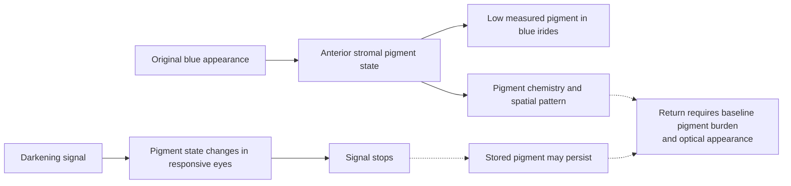

# Bidirectional iris melanin modulation and reversibility

*Theoretical cosmetic research; evidence reviewed October 11, 2026.*

## Intended scenario

**A person's blue baseline → dark brown appearance → return to that person's original blue appearance**, without contacts or surgery.

This is a hypothetical research objective. It is more demanding than demonstrating a one-way pigment change or showing that a biochemical signal can be switched off.

Human chemical analysis found very low pigment content in blue irides and differences in both melanin type and pigment profile across iris color groups. Separate histology found no significant difference in stromal melanocyte counts among blue, hazel, and brown groups. The relevant target is therefore the pigment state of the visible anterior stroma, not melanocyte count or total pigment across the whole eye. The literature does not specify a measured threshold for a chosen shade. [Human iris histology](https://pubmed.ncbi.nlm.nih.gov/8602782/), [human iris pigment chemistry](https://pubmed.ncbi.nlm.nih.gov/9778410/), [MedlinePlus Genetics](https://medlineplus.gov/genetics/understanding/traits/eyecolor/)

**Inference:** a true return to an individual's blue baseline likely requires restoration of the anterior stroma's low-pigment state and its optical presentation. Merely stopping new melanin production would not establish either outcome. This requirement follows from the observed pigment differences and persistence of medication-associated iris darkening; it has not been demonstrated as an intervention.

## Evidence for increasing pigmentation

Clinical experience with latanoprost shows that adult iris pigmentation can increase in some eyes, through more melanin in existing stromal melanocytes. The effect has occurred mainly in mixed-color irides. Current UK product information reports no observed change in uniformly blue eyes in the cited studies.

This supports the ability of some adult irides to respond to a pigment-increasing signal. It does not establish a reliable conversion of uniformly blue eyes to dark brown, control of the final shade, or reversibility. [Current Xalatan product information](https://www.medicines.org.uk/emc/product/1616/smpc)

## Evidence for returning to baseline

U.S. prescribing information describes the added iris pigmentation as likely permanent after treatment is discontinued. Human follow-up reports support persistence: a latanoprost clinical report found no change in induced pigmentation in patients followed for two years after stopping, and a separate case with serial photographs found no appreciable fading over five years. These are withdrawal observations, not tests of a future pigment-removal intervention; the five-year report is one patient.

An adjacent-tissue comparison underscores why this cannot be generalized across the body. In one case, latanoprost-associated periocular skin darkening visibly improved within a month of stopping and was significantly lighter by two months, consistent with the turnover of the epidermis. That single skin case neither demonstrates iris reversal nor a treatment for it. [U.S. label](https://dailymed.nlm.nih.gov/dailymed/drugInfo.cfm?setid=f4e73059-5ba0-4d73-9ea1-09d8d654e844), [Wistrand et al., 1997](https://pubmed.ncbi.nlm.nih.gov/9154289/), [Camras et al., 2000](https://pubmed.ncbi.nlm.nih.gov/10708238/), [Wand et al., 2001](https://jamanetwork.com/journals/jamaophthalmology/fullarticle/265847).

These observations show why stopping an increase in synthesis and reducing an existing pigment pool must be treated as different endpoints. They do not prove that every conceivable future reversal is impossible. They do show that withdrawal of a known pigment-increasing stimulus is not an established blue → brown → blue mechanism.

Other human pigment trajectories vary by tissue. In a melasma trial, all 21 participants who completed follow-up had reappearance by 12 weeks after treatment; this was disease recurrence, not a direct measure of stored-pigment restoration. Gingival repigmentation was common after surgical removal of pigmented epithelium. By contrast, alkaptonuria treatment was associated with partial regression of eye/ear ochronotic pigmentation and a lower ear-cartilage pigment measurement; this involves a different pigment chemistry. None establishes a clearance route for iris melanin. [Tissue-specific human trajectory comparison](tissue-pigment-atlas.md#19-human-pigment-trajectories-after-intervention).

Skin shedding is not a demonstrated iris-reversal route. Human studies measured melanin in surface corneocytes and eumelanin/pheomelanin in the outer stratum corneum, a surface compartment that normally leaves through epidermal desquamation. The anterior iris stroma has no comparable shedding layer. In one human histology study, no PCNA- or Ki-67-positive nuclei were found in the adult iris specimens examined; that snapshot neither proves zero lifetime turnover nor identifies pigment disposal. The surface-skin findings cannot fill that iris-specific gap. [Lu et al., 1996](https://pubmed.ncbi.nlm.nih.gov/8881670/), [Matsunaka et al., 2017](https://doi.org/10.1111/srt.12309), [Pfeiffer et al., 2001](https://jamanetwork.com/journals/jamaophthalmology/fullarticle/265260), [tissue pigment atlas](tissue-pigment-atlas.md).

## The conceptual control problem

**Existing pigment = accumulated synthesis minus normal turnover or clearance.**

Measure iris appearance and pigment burden separately. A small in-situ human skin comparison found that visible tanning could occur without a significant increase in measured melanin under UVA alone. That result illustrates the distinction between color and pigment mass; it does not establish an iris optical mechanism. A future iris claim would need standardized appearance measurements alongside a direct pigment endpoint. [Choi et al., 2010](https://pubmed.ncbi.nlm.nih.gov/20147966/).

Reversing a regulatory signal is not necessarily enough to reverse this accumulated pigment. A theoretical system would need evidence for both the pigment-increasing direction and a nondestructive route back to the starting pigment state.

The implementation is left unspecified. Permanent DNA alteration is not a prerequisite; reversible regulation is a conceptual possibility whose tissue effects and pigment kinetics would still need to be demonstrated.

## Requirements for a genuine reversible system

| Requirement | What would have to be established |
| --- | --- |
| Increase | A predictable increase in visible pigmentation from the person's actual baseline, including an initially uniformly blue iris |
| Decrease | Reduction of pigment already present while preserving cells and ocular function |
| Baseline recovery | Return to the original appearance within a defined tolerance under comparable lighting |
| Tissue selectivity | Intended iris effects with preservation of other ocular tissues and systemic function |
| Pigment disposition | Reduce pigment burden without harmful redistribution to aqueous-outflow or neighboring ocular tissues |
| Spatial control | Acceptable uniformity within each iris and between eyes |
| Repeated reversibility | Multiple changes without residual pigment accumulation or accumulating injury |
| Time control | Characterized onset, persistence, and recovery, rather than an assumed rapid switch |

These are conceptual evidence requirements, not a procedure or clinical protocol. No safe time course, number of cycles, or selectable palette is established here.

## Working conclusion

The research scope is **reversible bidirectional iris pigmentation**, rather than lightening alone. Existing evidence is stronger for increased pigmentation in susceptible eyes than for a controlled reduction of established pigment. The complete blue → dark brown → blue sequence remains unproven.

FDA states that there are no approved eye drops to change eye color. [FDA consumer guidance](https://www.fda.gov/drugs/buying-using-medicine-safely/what-you-should-know-about-eye-drops)
