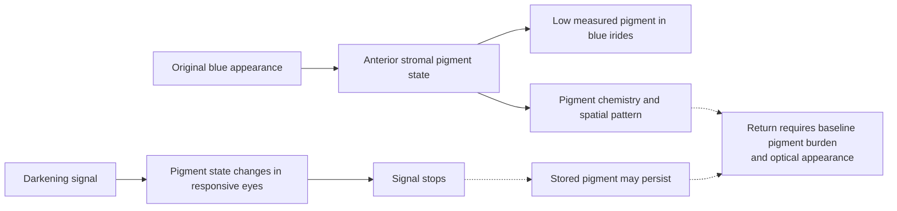
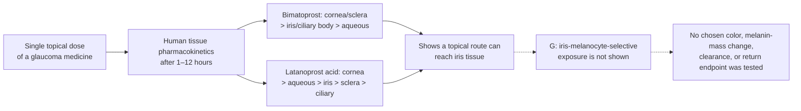
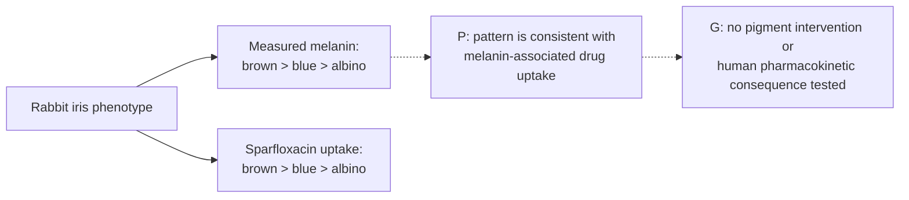
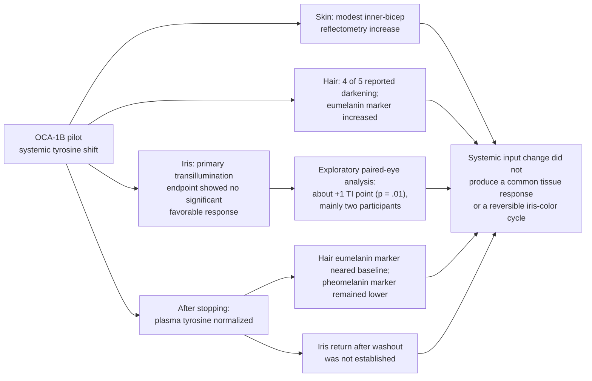
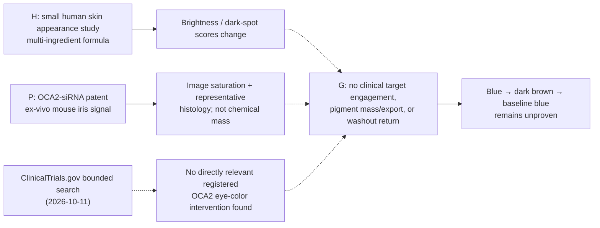
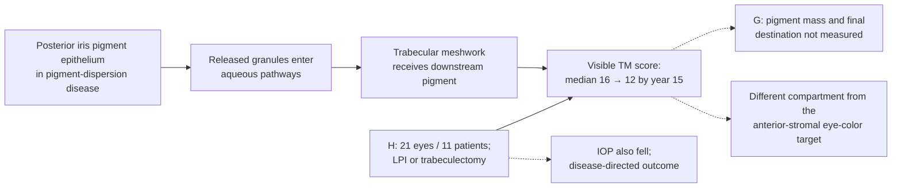

# Bidirectional iris melanin modulation and reversibility

*Theoretical cosmetic research; evidence reviewed October 11, 2026.*

## Intended scenario

**A person's blue baseline → dark brown appearance → return to that person's original blue appearance**, without contacts or surgery.

This is a hypothetical research objective. It is more demanding than demonstrating a one-way pigment change or showing that a biochemical signal can be switched off.

Human chemical analysis found very low pigment content in blue irides and differences in melanin type across iris color groups. Two quantitative donor studies do not give the same headline result for whole-iris melanin: Menon et al. (1992) reported no statistically significant blue–brown difference in iris melanin, while Wielgus and Sarna (2005) reported about 40% more measured melanin in the brown-eye group than in the other sampled color groups. Both combine iris compartments and do not isolate the visible anterior stroma; the accessible Menon abstract lacks sample counts and enough assay detail to reconcile the difference. Neither defines an anterior-stromal threshold for a dark-brown target. The 2005 age-associated result concerned a small decrease in iron normalized to melanin in light-blue donor irides, not a measured decline in total iris melanin. Separate histology found no significant difference in stromal melanocyte counts among blue, hazel, and brown groups. Electron-microscopic morphometry nevertheless found color-group differences in melanosome area and number per perinuclear area in superficial stromal melanocytes, mainly between uniform-blue and the other groups; mean granule size did not differ significantly. This cross-sectional cell-level result does not measure whole-iris mass, turnover, or pigment fate. The relevant target is the pigment state of the visible anterior stroma, not melanocyte count or total pigment across the whole eye. [Imesch et al., 1996](https://pubmed.ncbi.nlm.nih.gov/8602783/). The literature does not specify a measured threshold for a chosen shade. [Human iris histology](https://pubmed.ncbi.nlm.nih.gov/8602782/), [human iris pigment chemistry](https://pubmed.ncbi.nlm.nih.gov/9778410/), [Menon et al., 1992](https://pubmed.ncbi.nlm.nih.gov/1402293/), [Wielgus and Sarna, 2005](https://pubmed.ncbi.nlm.nih.gov/16280011/), [MedlinePlus Genetics](https://medlineplus.gov/genetics/understanding/traits/eyecolor/)

**Inference:** a true return to an individual's blue baseline likely requires restoration of the anterior stroma's low-pigment state and its optical presentation. Merely stopping new melanin production would not establish either outcome. This requirement follows from the observed pigment differences and persistence of medication-associated iris darkening; it has not been demonstrated as an intervention.

An inherited HERC2–OCA2 regulatory variant strongly predicts natural blue/brown iris-color differences, but the functional enhancer study used cultured epidermal melanocytes and the same locus also associates with skin and hair pigmentation. This is explanatory genetics, not evidence of an adult iris-specific reversible switch. [Atlas diagram and evidence](tissue-pigment-atlas.md#5-the-original-iris-cycle).

## Topical access to the iris is demonstrated; pigment selectivity is not

Human pharmacokinetics confirms that an eye drop can expose the iris without an intraocular delivery procedure. In a tissue-distribution study, 31 patients undergoing enucleation for tumors that did not affect the anterior globe received a single topical dose of bimatoprost or latanoprost 1, 3, 6, or 12 hours before surgery. LC-MS/MS found bimatoprost distributed across sampled tissues in the order cornea/sclera > iris/ciliary body > aqueous humor; latanoprost acid followed cornea >> aqueous humor > iris > sclera > ciliary body. These were glaucoma agents, and the study measured drug concentrations, not color or melanin. The tissue samples came from enucleation, and the study did not test repeated use in healthy eyes, selective delivery to iris melanocytes, pigment clearance, or washout return. [Ichhpujani et al., 2012](https://pubmed.ncbi.nlm.nih.gov/22136089/).

### Baseline iris melanin may also change drug uptake

In a rabbit comparison, measured iris-ciliary melanin was highest in brown irides (47.43 μg/mg), lower in blue irides (34.73 μg/mg), and below detection in whitish albino eyes. Uptake of the melanin-affine fluoroquinolone sparfloxacin followed the same order: 15.46, 8.53, and 1.9 μg/g, respectively. This is a cross-phenotype animal pharmacokinetic comparison, not a melanin-changing intervention or a human clinical finding; it suggests that changing pigment could also change how some drugs partition into ocular tissue, a possibility that has not been tested in a reversible pigment cycle. [Fukuda and Sasaki, 1994](https://pubmed.ncbi.nlm.nih.gov/8090430/).

## Evidence for increasing pigmentation

Direct experiments in cultured human uveal melanocytes show that new melanin synthesis is signal-responsive; α-methyl-p-tyrosine prevented a latanoprost-induced synthesis increase. A seven-day human donor-iris organ culture found increased tyrosinase mRNA in 6 of 30 culture sets, with no response in blue-iris cultures. A small six-month rabbit study reported lower end-point total melanin in one inhibitor-plus-inducer cohort than in its inducer-only fellow eyes (three rabbits in that cohort), but the abstract conflicts with the results table and the cohort's “blue” label referred to an ear mark, not iris color. No baseline tissue-pigment assay or post-withdrawal return was measured. [Drago et al., 1999](https://pubmed.ncbi.nlm.nih.gov/9986745/), [Lindsey et al., 2001](https://pubmed.ncbi.nlm.nih.gov/11405836/), [Sadiq et al., 2022](https://pmc.ncbi.nlm.nih.gov/articles/PMC9674870/).

Clinical experience with latanoprost shows that adult iris pigmentation can increase in some eyes, through more melanin in existing stromal melanocytes. The effect has occurred mainly in mixed-color irides. Current UK product information reports no observed change in uniformly blue eyes in the cited studies. A separate POAG surgical-tissue study found no latanoprost-associated increase in trabecular-meshwork pigmentation, including in four specimens with documented iris darkening. This selected, cross-sectional sample does not trace pigment from the iris or establish eye-wide exit. [Cracknell et al., 2006](https://pubmed.ncbi.nlm.nih.gov/16297910/).

A small human albinism pilot adds a cross-tissue comparator. Five adults with OCA-1B received a systemic tyrosine-pathway intervention intended to increase pigmentation. Plasma tyrosine rose roughly tenfold; inner-bicep skin reflectometry rose modestly, and four participants reported hair darkening. The iris did not follow that pattern: the primary iris-transillumination endpoint was summarized as showing no significant favorable change, while an exploratory analysis pooling both eyes showed about a one-point increase in transillumination (p=.01), directionally consistent with less iris pigment and concentrated in two participants. Transillumination is an optical proxy, not chemical pigment mass; the authors treated all analyses as exploratory and did not adjust for multiple comparisons. The study was a small OCA-1B pilot, not a controlled color-change experiment in healthy eyes.

The endpoint has an important compartment limit: the pilot captured both diffuse-light anterior-segment photos and back-illuminated iris-transillumination (TI) images, but its primary iris outcome was the 8-point TI grade. The TI beam was centered on the pupil with diffuse/background light off. The authors say TI likely reflects pigment deficiency in the posterior iris pigment epithelium and use it as a surrogate for retinal pigment epithelium pigmentation. The exploratory TI shift therefore does not establish a visible anterior-stromal color change or chemical iris melanin reduction; the paper does not report a separate quantitative anterior-color result from the diffuse-light photos. The compartments and measurement endpoints are mapped in the [atlas diagram](tissue-pigment-atlas.md#iris-appearance-transillumination-and-pigment-mass-are-different-endpoints). [Wang et al., 2018](https://pmc.ncbi.nlm.nih.gov/articles/PMC6009845/), [Adams et al., 2019](https://pmc.ncbi.nlm.nih.gov/articles/PMC6413781/). [One-year nitisinone pilot in OCA-1B](https://insight.jci.org/articles/view/124387).

Together, the cell, organ-culture, animal, and clinical observations support a pigment-production pathway that can be modulated in some ocular models. They do not establish a reliable conversion of uniformly blue human eyes to dark brown, control of a chosen shade, reduction of stored pigment, or reversibility. [Current Xalatan product information](https://www.medicines.org.uk/emc/product/1616/smpc)

Small human iris-morphometry studies offer a candidate explanation for the appearance endpoint: two latanoprost-darkened eyes and a later series of 15 darkened cases had larger melanin granules in the anterior border, without a demonstrated increase in total granule number. The studies did not measure total melanin mass, identify chemical degradation, or test a way to reverse granule size. This makes color appearance and pigment amount separate targets. [Cracknell et al., 2003](https://pubmed.ncbi.nlm.nih.gov/14609560/), [Cracknell et al., 2007](https://pubmed.ncbi.nlm.nih.gov/17292473/).

A separate 36-month serial-photography study of 22 latanoprost-treated patients reported increasing red/blue iris-density slopes in 8 irides, decreasing slopes in 9, and no significant slope in 6 subjects. This is an interesting report of heterogeneous appearance trajectories during treatment, but photo-density is not direct melanin quantification. It did not measure pigment disposition, follow a planned withdrawal-and-return cycle, or show that any decreasing slope reflected pigment clearance. [Schwartz et al., 2008](https://pubmed.ncbi.nlm.nih.gov/18370880/).

## Evidence for returning to baseline

U.S. prescribing information describes the added iris pigmentation as likely permanent after treatment is discontinued. Human follow-up reports support persistence: a latanoprost clinical report found no change in induced pigmentation in patients followed for two years after stopping, and a separate case with serial photographs found no appreciable fading over five years. These are withdrawal observations, not tests of a future pigment-removal intervention; the five-year report is one patient.

### OCA2 modulation has not yet shown a reversible iris cycle

Two recent OCA2 lines of evidence remain incomplete and tissue-specific. A 2024 skin study reported short-term facial lightness and spot-score changes with a multi-ingredient topical formula described as OCA2-regulating, but it did not verify clinical target engagement, measure pigment mass/export, or assess return after withdrawal. Its cell assays were mainly in B16F10 mouse melanoma cells and did not distinguish reduced new synthesis from degradation of pre-existing pigment. Separately, an OCA2-siRNA patent reports a small ex-vivo mouse-iris image-saturation/histology signal; it is RNA interference, not DNA editing, and the reported color experiment lacks a chemical melanin assay, same-sample OCA2 knockdown, living-animal/human outcomes, and post-withdrawal return. The patent's human trial descriptions are proposed study designs, not results. [Cho et al., 2024](https://pmc.ncbi.nlm.nih.gov/articles/PMC11506640/), [WO2024201471A1](https://patents.google.com/patent/WO2024201471A1/en).

A bounded ClinicalTrials.gov API check on 2026-10-11 searched full-text OCA2, intervention OCA2, and titles matching “iris color.” The returned records were unrelated to intentional OCA2 eye-pigment modulation. This is a registry search result, not proof that no unregistered study or study in another registry exists. [OCA2 registry search](https://clinicaltrials.gov/search?term=OCA2), [iris-color title search](https://clinicaltrials.gov/search?term=iris%20color).

A different option reported in the literature is cosmetic photoablative laser depigmentation. One clinic's prospective 1,176-eye series reported image-based color change, but it was uncontrolled and did not measure chemical pigment fate or return to the starting color. The treatment cohort ran from 2017 to 2020; the program's stated nine-year history is not nine years of follow-up for every eye. Independent case reports document possible pigmentary glaucoma, maculopathy, marked pressure elevation, and corneal scarring with vision loss. The laser is a procedure, not a reversible biochemical switch, and case reports cannot estimate how often complications occur. Details and a tissue-pathway diagram are in the [atlas section on cosmetic laser depigmentation](tissue-pigment-atlas.md#cosmetic-laser-depigmentation-and-evidence-limits).

A different anterior-eye pigment compartment has a slow human trajectory after disease-directed treatment. In 21 eyes from 11 people with pigment-dispersion disease, visible trabecular-meshwork pigmentation scores declined from a median of 16 at baseline to 12 over 15 years after laser peripheral iridotomy or trabeculectomy; the cohort was small and uncontrolled. Intraocular pressure also fell, but the study graded visible meshwork pigmentation rather than chemically measuring pigment mass or tracking its final destination. The meshwork is a downstream drainage tissue, not the anterior iris stroma that determines visible eye color; these procedures are not a nonsurgical cosmetic reversal route. This observation supports a narrow inference that pigment in a downstream ocular depot can attenuate slowly when the disease process is addressed, while leaving iris-color reversal unanswered. [Zhou et al., 2021](https://pubmed.ncbi.nlm.nih.gov/34397796/).

An adjacent-tissue comparison underscores why this cannot be generalized across the body. In one case, latanoprost-associated periocular skin darkening visibly improved within a month of stopping and was significantly lighter by two months, consistent with the turnover of the epidermis. That single skin case neither demonstrates iris reversal nor a treatment for it. [U.S. label](https://dailymed.nlm.nih.gov/dailymed/drugInfo.cfm?setid=f4e73059-5ba0-4d73-9ea1-09d8d654e844), [Wistrand et al., 1997](https://pubmed.ncbi.nlm.nih.gov/9154289/), [Camras et al., 2000](https://pubmed.ncbi.nlm.nih.gov/10708238/), [Wand et al., 2001](https://jamanetwork.com/journals/jamaophthalmology/fullarticle/265847).

The OCA-1B pilot above followed other tissues after nitisinone stopped: plasma tyrosine returned to baseline, the hair eumelanin marker was near baseline at safety follow-up, and the pheomelanin marker remained lower. One participant restarted during follow-up, and no post-discontinuation iris-transillumination return endpoint was reported. This is partial biochemical follow-up in a disease pilot, not evidence of a reversible iris-color cycle. [One-year nitisinone pilot in OCA-1B](https://insight.jci.org/articles/view/124387).

Natural-history studies report iris-color shifts after childhood, including lightening in some adults. In the Louisville Twin Study, 3.8%–8.6% of white twins changed at least two color-grade units between ages 6 and under 24 across 3–9-year intervals; 9% of a followed adult-mother subset lightened by at least two units. A 27-year follow-up of former schoolchildren reported both lightening and darkening, but the overall change was not statistically significant. These were color grades, not melanin-mass or pigment-fate measurements. Electron microscopy of iris specimens from cataract patients aged 70–84 found melanosome complexes, with clinical significance unresolved. Natural shifts show appearance can vary, but they do not demonstrate active clearance or a controlled return to an earlier color. [Bito et al., 1997](https://pubmed.ncbi.nlm.nih.gov/9152135/), [Meyer-König, 1977](https://doi.org/10.1016/S0047-2484(77)80099-7), [Sugita et al., 1986](https://pubmed.ncbi.nlm.nih.gov/3761741/).

A human ultrastructure study adds a limited mechanistic clue. In 31 peripheral iris specimens from glaucoma patients, investigators saw clump cells and free melanin granules, and graded morphological signs of melanosome formation or degradation as “turnover.” The authors describe clump cells as stromal phagocytes that engulf debris, including free granules. But the granules were rare, unrelated to latanoprost treatment, and possibly released by surgery or processing. The one patient with marked treatment-associated darkening had obvious clump cells, yet a lower turnover score than some other specimens. No study endpoint measured total pigment loss, intracellular degradation, destination, or subsequent lightening. This supports asking whether baseline pigment processing exists; it does not establish a usable clearance route. [Pfeiffer et al., 2003 (Mainz II)](https://jamanetwork.com/journals/jamaophthalmology/fullarticle/414988). A 1993 review similarly concluded that adult vertebrate eye pigment turnover was possible but unquantified. [Schraermeyer, 1993](https://pubmed.ncbi.nlm.nih.gov/8248016/).

A rare disease-associated exception is bilateral acute depigmentation of the iris (BADI). In a retrospective case series of 26 new patients plus four-year follow-up of two previously reported patients, anterior-chamber pigment dispersion resolved over 1–16 weeks (median 9 weeks), and the two earlier patients had repigmentation of the iris stroma after four years. A separate case report found repigmentation had begun by year three but remained below the pre-disease appearance at that point. Heavy pigment deposition in the trabecular meshwork was reported in all patients in the 2009 series; eight steroid-treated eyes had elevated intraocular pressure, controlled with glaucoma medication. A 2024 five-patient mixed BADI/BAIT case series also reported glaucomatous visual-field changes in one BADI patient and a tube-shunt implant in one BAIT patient; its size and mixed syndromes do not support a risk estimate for a hypothetical modulator. These observations show that stromal appearance can recover in a few disease cases, but no pigment mass or destination was measured, and the cause and return mechanism remain unknown. This is not evidence for a safe, controlled cosmetic cycle. [Tugal-Tutkun et al., 2009](https://pubmed.ncbi.nlm.nih.gov/19545903/), [Atilgan et al., 2018](https://pmc.ncbi.nlm.nih.gov/articles/PMC6056785/), [Costa et al., 2024](https://pmc.ncbi.nlm.nih.gov/articles/PMC11623184/).

Mouse studies sharpen this distinction. In a vitiligo model, clump cells with large melanin-containing phagosomes accumulated, yet gross iris pigment did not progressively decline over the animals' lives. In Col18a1-deficient mice, macrophage-like pigmented cells left the iris and sometimes entered the retina, a pathological redistribution route rather than a demonstrated clearance route. Thus phagocytosis or disappearance from the visible iris cannot substitute for measuring melanin degradation, neighboring ocular compartments, and the pigment's destination. [Boissy et al., 1987](https://pubmed.ncbi.nlm.nih.gov/3578491/), [Marneros and Olsen, 2003](https://pubmed.ncbi.nlm.nih.gov/12766032/).

These observations show why stopping an increase in synthesis and reducing an existing pigment pool must be treated as different endpoints. They do not prove that every conceivable future reversal is impossible. They do show that withdrawal of a known pigment-increasing stimulus is not an established blue → brown → blue mechanism.

Other human pigment trajectories vary by tissue. In a melasma trial, all 21 participants who completed follow-up had reappearance by 12 weeks after treatment; this was disease recurrence, not a direct measure of stored-pigment restoration. A phase III long-term extension randomized prior facial F-VASI90 vitiligo responders to ruxolitinib continuation or withdrawal: over the following 52 weeks, 16/56 withdrawal participants (29%) and 8/55 continuing participants (15%) relapsed below F-VASI75; 12/16 withdrawal relapsers regained F-VASI75 after rescue. This measures disease severity in selected responders, not direct pigment mass or restoration to healthy baseline. [TRuE-V randomized withdrawal study](https://doi.org/10.1093/bjd/ljaf519). Gingival repigmentation was common after surgical removal of pigmented epithelium. By contrast, alkaptonuria treatment was associated with partial regression of eye/ear ochronotic pigmentation and a lower ear-cartilage pigment measurement; this involves a different pigment chemistry. None establishes a clearance route for iris melanin. [Tissue-specific human trajectory comparison](tissue-pigment-atlas.md#19-human-pigment-trajectories-after-intervention).

Skin shedding is not a demonstrated iris-reversal route. Human studies measured melanin in surface corneocytes and eumelanin/pheomelanin in the outer stratum corneum, a surface compartment that normally leaves through epidermal desquamation. The anterior iris stroma has no comparable shedding layer. In one human histology study, no PCNA- or Ki-67-positive nuclei were found in the adult iris specimens examined; that snapshot neither proves zero lifetime turnover nor identifies pigment disposal. The surface-skin findings cannot fill that iris-specific gap. [Lu et al., 1996](https://pubmed.ncbi.nlm.nih.gov/8881670/), [Matsunaka et al., 2017](https://doi.org/10.1111/srt.12309), [Pfeiffer et al., 2001](https://jamanetwork.com/journals/jamaophthalmology/fullarticle/265260), [tissue pigment atlas](tissue-pigment-atlas.md).

## The conceptual control problem

**Existing pigment = accumulated synthesis minus normal turnover or clearance.**

Measure iris appearance and pigment burden separately. A small in-situ human skin comparison found that visible tanning could occur without a significant increase in measured melanin under UVA alone. That result illustrates the distinction between color and pigment mass; it does not establish an iris optical mechanism. A future iris claim would need standardized appearance measurements alongside a direct pigment endpoint. [Choi et al., 2010](https://pubmed.ncbi.nlm.nih.gov/20147966/).

A newer candidate for serial iris measurement is PS-AS-OCT. In 88 participants with brown irides, entropy-derived stromal MCR correlated with CIE L*a*b* iris-photo values; a separate cohort of 105 healthy Japanese adults was used to map regional posterior-IPE depolarization. Both are cross-sectional measurements from different iris compartments, not iris change-sensitivity studies. Adjacent ocular evidence shows that entropy can change longitudinally in another tissue: a retrospective 2026 PS-OCT study of 15 eyes from 8 acute VKH patients found choroidal entropy rose from 0.296 ± 0.047 to 0.350 ± 0.075 after one month of treatment (p=.001), while RPE entropy did not significantly change. This small disease cohort does not validate iris MCR; inflammation and treatment-related tissue changes may alter the signal, and it is not a direct chemical pigment assay. The brown-iris cohort also does not demonstrate measurement performance in an initially blue eye. Repeatability evidence exists for older appearance and reflectance methods: computerized iris-photo area/density metrics in 30 eyes had triplicate CVs of 1.0–4.1%, and a hyperspectral pilot in eight healthy men reported between-session repeatability of ±5% for light and ±10% for dark irides. These results establish limited signal repeatability, not melanin mass or response to a pigment-changing intervention. PS-AS-OCT MCR remains cross-sectional and has no serial treatment-response validation. The measurement comparison is in the [atlas section on iris imaging](tissue-pigment-atlas.md#iris-imaging-repeatability-is-not-the-same-as-clearance-sensitivity). [Takamoto et al., 2001](https://pubmed.ncbi.nlm.nih.gov/11584340/), [Di Cecilia et al., 2018](https://doi.org/10.1109/RTSI.2018.8548513). A future claim still needs change-sensitivity, standardized appearance measures, and independent pigment validation where feasible. [Li et al., 2025 online / 2026 print](https://pubmed.ncbi.nlm.nih.gov/41432634/), [Li et al., 2025 IPE mapping](https://pubmed.ncbi.nlm.nih.gov/40131585/), [Oshiro et al., 2026](https://pubmed.ncbi.nlm.nih.gov/41533903/), [Yamanari et al., 2020](https://pmc.ncbi.nlm.nih.gov/articles/PMC7658243/). A 2026 histology-correlated AO-PS-OCT mouse-retina study makes signal interpretation more specific: after laser injury, PS-OCT hyper-reflective foci co-localized with IB4-positive myeloid cells, and probable pigment appeared in the confocal transmission channel, consistent with uptake of melanin-containing RPE debris. This suggests that cell/debris composition can contribute to a retinal polarization signal; it does not quantify pigment mass or clearance and does not validate iris imaging. [Smart et al., 2026](https://pubmed.ncbi.nlm.nih.gov/42311299/). A focused search for this update did not locate a primary study testing IP3R2-mediated melanophagy in human iris stromal melanocytes or iris pigment epithelium. This is a search-bounded evidence gap, not proof the biology is absent, and skin-cell findings should not be assumed to transfer to iris. Human ocular melanocytes and RPE show different pigmentary properties; a separate hypoxic ARPE-19 study found IP3R2 knockdown worsened mitochondrial function and promoted apoptosis under stress, but that is not an iris or normal-eye result. [Smith-Thomas et al., 1996](https://pubmed.ncbi.nlm.nih.gov/8950502/), [Xu et al., 2025](https://doi.org/10.1016/j.bbrc.2025.151857).

Reversing a regulatory signal is not necessarily enough to reverse this accumulated pigment. A theoretical system would need evidence for both the pigment-increasing direction and a nondestructive route back to the starting pigment state.

The implementation is left unspecified. Permanent DNA alteration is not a prerequisite; reversible regulation is a conceptual possibility whose tissue effects and pigment kinetics would still need to be demonstrated.

## Requirements for a genuine reversible system

| Requirement | What would have to be established |
| --- | --- |
| Measurement validity | Repeatable compartment-specific imaging that is sensitive to longitudinal change and calibrated against independent pigment measures where feasible, alongside standardized appearance photographs | 
| Increase | A predictable increase in visible pigmentation from the person's actual baseline, including an initially uniformly blue iris |
| Decrease | Reduction of pigment already present while preserving cells and ocular function |
| Baseline recovery | Return to the original appearance within a defined tolerance under comparable lighting |
| Tissue selectivity | Intended iris effects with preservation of other ocular tissues and systemic function |
| Pigment disposition | Reduce pigment burden without harmful redistribution to aqueous-outflow or neighboring ocular tissues |
| Spatial control | Acceptable uniformity within each iris and between eyes |
| Repeated reversibility | Multiple changes without residual pigment accumulation or accumulating injury |
| Time control | Characterized onset, persistence, and recovery, rather than an assumed rapid switch |

These are conceptual evidence requirements, not a procedure or clinical protocol. No safe time course, number of cycles, or selectable palette is established here.

## Working conclusion

The research scope is **reversible bidirectional iris pigmentation**, rather than lightening alone. A small OCA-1B pilot shows that a systemic precursor shift can produce different skin, hair, and iris outcomes, but it did not demonstrate a favorable primary iris response or post-washout iris return. Existing evidence remains stronger for a drug-associated darkening signal in susceptible eyes and modulation of new pigment in models than for a controlled reduction of established pigment. The complete blue → dark brown → blue sequence remains unproven.

FDA states that there are no approved eye drops to change eye color. [FDA consumer guidance](https://www.fda.gov/drugs/buying-using-medicine-safely/what-you-should-know-about-eye-drops)
