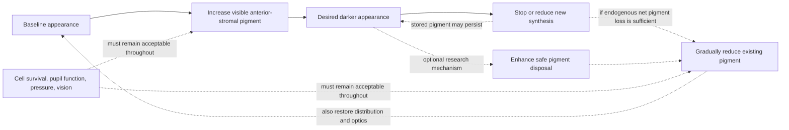
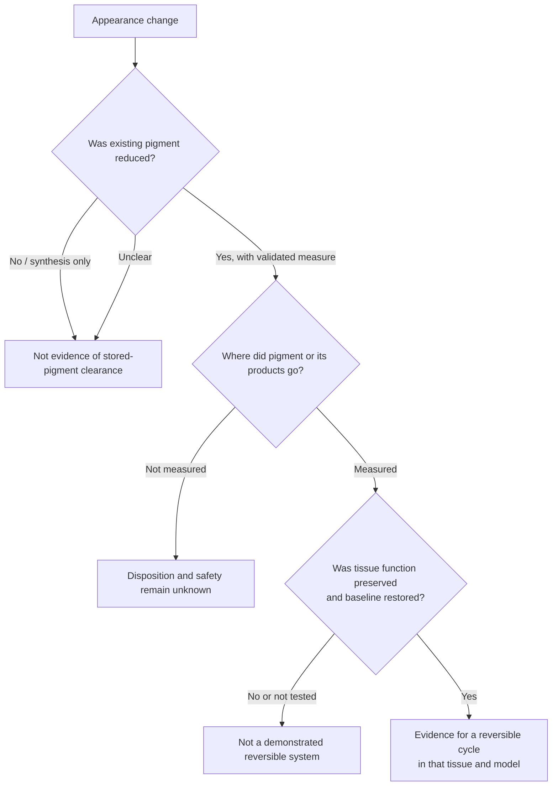

# Bidirectional iris melanin modulation and reversibility

*Theoretical cosmetic research; focused drug review updated October 17, 2026.*

## Intended scenario

**A person's blue baseline → dark-brown appearance → return to that person's original blue appearance**, without contacts or surgery.

The lead track now also considers a naturally brown iris becoming lighter through sustained drug modulation, followed by repigmentation after withdrawal. Slow onset and maintenance over years are within scope. The [chronic drug-modulation note](chronic-pharmacologic-modulation.md) sets out the evidence, turnover uncertainty, and a hypothetical seven-year model.

Lower synthesis could reduce existing pigment if endogenous net pigment loss continues. That does not require replacing iris cells or adding an active pigment-destruction treatment. Whether loss is sufficient in adult human anterior iris, and whether the original appearance returns, remain open questions.

The relevant visible target is mainly the anterior iris stroma. Whole-iris pigment assays combine compartments; melanocyte counts, melanin synthesis, granule morphology, transillumination, and visible color are related but distinct endpoints. Donor studies report differing whole-iris blue–brown melanin comparisons, and no validated pigment threshold defines a chosen shade. The [tissue atlas](tissue-pigment-atlas.md) maps the ocular compartments and evidence; study-level details are in the [evidence register](pigment-evidence-register.md).

## The two directions are different problems

The arrows from a darker state back to baseline are requirements, not demonstrated transitions.

### Increasing pigmentation: evidence for modulation, not a cosmetic controller

Adult iris darkening is a documented side effect of some prostaglandin glaucoma medicines, mainly in susceptible mixed-color eyes. That establishes that visible iris pigmentation can change in some adults; it does not establish predictable control, a target shade, or safe selectivity. Product information describes added pigmentation as likely permanent, and human follow-up reports persistence after treatment stops. [U.S. prescribing information](https://dailymed.nlm.nih.gov/dailymed/drugInfo.cfm?setid=f4e73059-5ba0-4d73-9ea1-09d8d654e844), [two-year follow-up](https://pubmed.ncbi.nlm.nih.gov/9154289/), [five-year case](https://pubmed.ncbi.nlm.nih.gov/10708238/).

Human uveal-cell and donor-iris experiments show that new melanin synthesis can respond to biological signals. A small rabbit study reported lower endpoint iris melanin in one inhibitor-plus-inducer group, but it had only three rabbits in that group, an abstract/table discrepancy, and no baseline tissue assay or washout follow-up. Adult mouse iris cells can form new melanosomes, but that finding does not establish human pigment turnover or clearance. These are mechanistic leads, not evidence of a reversible human color cycle. [Drago et al., 1999](https://pubmed.ncbi.nlm.nih.gov/9986745/), [Lindsey et al., 2001](https://pubmed.ncbi.nlm.nih.gov/11405836/), [Sadiq et al., 2022](https://pmc.ncbi.nlm.nih.gov/articles/PMC9674870/), [Lindquist et al., 1998](https://pubmed.ncbi.nlm.nih.gov/9778406/).

A topical drug can reach iris tissue, but measured eye-drop distribution is not iris-melanocyte-selective delivery. Pigment may also affect uptake of some drugs, so a change in pigment could alter tissue pharmacokinetics. These are separate access and safety questions, not evidence for an intervention. [Ichhpujani et al., 2012](https://pubmed.ncbi.nlm.nih.gov/22136089/), [Fukuda and Sasaki, 1994](https://pubmed.ncbi.nlm.nih.gov/8090430/).

### Lightening during treatment and recovery after withdrawal

The reviewed evidence does not establish controlled cosmetic iris lightening followed by return to the same person's baseline. Drug-associated lightening reports and synthesis-modulation studies belong in the research map; the [focused drug review](chronic-pharmacologic-modulation.md#what-drug-evidence-actually-exists) describes their evidence and limitations. The OCA2-siRNA patent reports a small ex-vivo mouse-iris image signal; it does not report a chemically measured pigment decrease, living-animal or human outcome, or post-withdrawal return. RNA interference is not DNA editing. Its additional suggestion that light could accelerate pigment loss is also untested in human iris; the atlas summarizes the shade-dependent human iridal-melanosome chemistry and why separate RPE photobleaching evidence cannot validate that claim. A small skin appearance study does not establish iris delivery or iris clearance. [WO2024201471A1](https://patents.google.com/patent/WO2024201471A1/en), [Cho et al., 2024](https://pmc.ncbi.nlm.nih.gov/articles/PMC11506640/).

Repigmentation in rare iris-disease case reports is not a safe reversal model: the disease involves abnormal pigment release and can be associated with ocular hypertension and glaucoma. Natural color changes and a few lighter color grades in a periocular drug trial also do not establish pigment loss. See the [atlas](tissue-pigment-atlas.md) and [evidence register](pigment-evidence-register.md) for these distinct evidence classes and limitations.

Procedural reports remain background in the [atlas](tissue-pigment-atlas.md#cosmetic-laser-depigmentation-and-evidence-limits); they do not define the intended intervention.

## What a genuine reversible system would have to show

These are evidence requirements, not a protocol:

- **Target definition:** a standardized visible-color endpoint tied to the intended anterior iris compartment.
- **Existing-pigment reduction:** distinguish lower synthesis from loss of pigment already present; separately measure pigment chemistry, burden, and distribution.
- **Disposition:** determine whether pigment is degraded, transferred, or exported, and assess the safety of products and destination tissue.
- **Selectivity and function:** preserve melanocytes and other ocular compartments, pupil function, pressure regulation, retinal function, and vision.
- **Control:** achieve a consistent shade without patchiness or unequal eyes, with defined onset and duration.
- **Reversibility:** show return to each participant's baseline after the induced change, not merely a change in a marker after treatment stops.
- **Repeatability:** demonstrate that another cycle does not accumulate pigment, injury, or functional change.

This framework is tissue-specific. Skin, gingiva, retinal pigment epithelium, and anterior iris differ in cell turnover, pigment handling, optical role, and safety constraints. Evidence from one cannot fill another's gap. The wider comparison is in the [tissue atlas](tissue-pigment-atlas.md) and [selective-clearance framework](selective-clearance-framework.md).

### Optional mechanism and measurement support

Standardized serial living-eye color measurements can assess the cosmetic endpoint without claiming a chemical melanin concentration. A donor-tissue calibration study is an optional mechanism-support project, rather than a required first step for evaluating pharmacological appearance change.

The previously reviewed evidence forms two largely separate streams: noninvasive image-derived signals—including cross-sectional PS-AS-OCT and older optical-model estimates—and destructive human-iris chemistry by compartment. I found no study pairing standardized optical measurement of an intact human iris with chemical assay of the **same eye's** anterior stroma and posterior iris pigment epithelium (IPE). This is a gap in the reviewed literature, not proof that no unindexed work exists. [Imaging studies](tissue-pigment-atlas.md#iris-imaging-repeatability-is-not-the-same-as-clearance-sensitivity), [Prota et al., 1998](https://pubmed.ncbi.nlm.nih.gov/9778410/).

The optional design, including paired optical acquisition, compartment-specific chemical assays, confounder controls, analysis, and stop/advance rules, is in the [donor-eye measurement-validation proposal](iris-measurement-validation-proposal.md). A successful result would validate a cross-sectional measurement only; it would not establish serial sensitivity in living eyes, safe pigment clearance, or return to baseline.

## Working conclusion

Drug modulation of synthesis is the lead research direction. Suppression plus endogenous pigment loss could, conditionally, lighten an iris over years; the human rate and achievable appearance are unresolved. The literature supports adult drug-associated darkening and contains limited lightening signals, but does not establish a controlled reversible cosmetic system or the complete blue → dark brown → same-blue cycle. The next work starts with pigment balance and optics, explores explicitly hypothetical combinations, then uses targeted questions and searches to check the premises that change the conclusion. Drug trajectories and withdrawal records are supporting evidence selected for those questions.

*This note synthesizes the literature; the [evidence register](pigment-evidence-register.md) is the compact source for study-level models and endpoints.*
