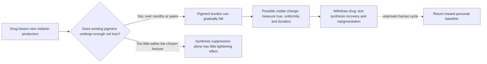

# Chronic drug modulation of cosmetic iris color

*Priority reset: October 17, 2026. Theoretical research; no administration or formulation instructions.*

## Research question

Could a drug reversibly reduce melanin synthesis in surviving anterior iris melanocytes, lightening a brown iris over months or years if enough endogenous net pigment loss occurs, with repigmentation after withdrawal? The project accepts a slow onset and ongoing maintenance as possibilities. It also retains the earlier blue → brown → original-blue goal, which adds an induction step and need not have the same kinetics as lightening a naturally brown iris.

This is the lead research track. Surgery is outside the intended intervention. Donor-eye dissection is an optional way to answer a particular mechanism or measurement question, rather than a prerequisite for considering drug effects in living eyes.

## Why cell replacement is not the clock

Cell lifespan, melanosome turnover, pigment degradation, and visible-color change are different quantities. A surviving melanocyte can change pigment production; replacing the cell is not required. Conversely, replacing a pigment-containing cell need not eliminate its pigment if another cell takes up the material.

There is no established seven-year renewal schedule for the whole eye. Radiocarbon measurements found that lens-nucleus crystallins largely date to around birth and persist through life. That lens result does not measure iris turnover. Seven years is retained here as an illustrative treatment horizon, not a biological renewal interval. [Lynnerup et al., 2008](https://pubmed.ncbi.nlm.nih.gov/18231610/).

Human iris electron microscopy has shown features compatible with both new melanosome formation and pigment-granule degeneration. The authors called turnover inference from morphology crude; they did not measure a clearance rate or pigment half-life. This supports asking about turnover without assigning it a value. [Pfeiffer et al., 2003, Mainz II](https://jamanetwork.com/journals/jamaophthalmology/fullarticle/414988).

## What drug evidence actually exists

| Approach / observation | Direct evidence | What remains unresolved |
| --- | --- | --- |
| Increase melanogenesis through prostaglandin signaling | Latanoprost can darken adult irides by increasing melanin within existing melanocytes. | Predictable shade control, reliable blue-to-brown conversion, and reversal. The label describes iris pigmentation as likely permanent after withdrawal. [Xalatan prescribing information](https://dailymed.nlm.nih.gov/dailymed/lookup.cfm?setid=a98595b3-9f47-48e0-b18d-550a2095f264) |
| Suppress new synthesis | A cultured human uveal-melanocyte study found that alpha-methyl-p-tyrosine prevented latanoprost-induced melanogenesis. | Prevention of induced synthesis is not proof of gradual loss of established pigment, iris-selective pharmacology, or clinical tolerability. [Drago et al., 1999](https://pubmed.ncbi.nlm.nih.gov/9986745/) |
| Slow human lightening associated with a drug | One report describes brown-to-blue change after five years of levobunolol eye drops, with predominantly depigmented stroma. | No satisfactory baseline photographs, control, or withdrawal/recovery cycle; drug causality remains unproven. This is a relevant lead, not a cosmetic treatment result. [Doyle and Liu, 1999](https://pubmed.ncbi.nlm.nih.gov/10660314/) |
| Rabbit synthesis-modulation experiment | A six-month study used 12 rabbits, three per cohort; one co-treatment cohort had lower endpoint melanin than inducer-only fellow eyes. | Inhibitor-only eyes did not show a significant melanin difference. Internal reporting discrepancies, systemic signs, and missing baseline pigment assays and withdrawal data limit interpretation. [Sadiq et al., 2022](https://pmc.ncbi.nlm.nih.gov/articles/PMC9674870/) |
| Temporary OCA2 RNA suppression | A patent reports an image-based change in mouse iris explants exposed to OCA2 siRNA with controlled light exposure. | Human and recovery sections describe proposed work without reported outcomes. The light exposure means this is not evidence for a drug-only effect; no controlled living-human reversible lightening result is supplied. RNA silencing does not edit DNA. [WO2024201471A1, Examples 9–12](https://patents.google.com/patent/WO2024201471A1/en) |
| Adjacent human pigment-modulation trial | A one-year open-label study of five adults with OCA1B found no significant improvement in the iris-transillumination endpoint despite hair/skin pigmentation changes. | Transillumination principally concerns posterior iris pigment; this disease-specific result does not directly test normal anterior-stromal cosmetic lightening. [Adams et al., 2019](https://doi.org/10.1172/jci.insight.124387) |
| Increase normal pigment disposal | Human turnover-like morphology makes endogenous disposal worth investigating. | A validated drug that safely accelerates net clearance specifically in living human anterior iris has not been established by the sources reviewed here. The destination and effects of pigment products matter. See the [evidence register](pigment-evidence-register.md#anterior-iris-and-uveal-melanocytes). |

Tyrosinase, involved in melanin synthesis, is distinct from tyrosine hydroxylase in catecholamine synthesis. Metyrosine's established label mechanism is inhibition of the latter; the ocular findings do not establish a selective iris target. [Metyrosine prescribing information](https://dailymed.nlm.nih.gov/dailymed/lookup.cfm?setid=1b7897b4-7681-4b99-8883-d5dc33f86c01).

These findings justify studying slow pharmacology. They do not establish a particular agent, duration, or reversible cosmetic result. A drug can act temporarily while the pigment it changes persists for much longer.

## The slow-turnover hypothesis, made explicit

The minimal model is a pigment balance in the visible target compartment:

```text
dM/dt = S(t) - kM

M = pigment burden in the target compartment
S = rate of pigment synthesis
k = effective rate of net pigment loss from that compartment
```

This is an analyst-defined sensitivity model, not a fitted human-iris model. Net loss includes the consequences of degradation, export, and any recapture; a new melanosome appearing is not itself evidence that old pigment left.

Assume baseline steady state, M0 = S0/k, a constant fractional synthesis rate f during treatment, and unchanged positive k. Then:

```text
M(t)/M0 = f + (1 - f) × 2^(-t/h)
h = ln(2)/k = effective pigment half-life
```

Here f is the fraction of baseline synthesis remaining, not a drug concentration or dose. The model assumes one homogeneous pigment pool, constant effects, no injury, and no adaptation. Actual iris kinetics may have multiple pools and changing rates.

### What seven years would mean under different assumptions

**Every half-life below is hypothetical. No row is a measured adult-human iris forecast.**

| Assumed effective pigment half-life | Pigment remaining after 7 years if synthesis fully suppressed | Remaining if synthesis falls to 5% of baseline |
| --- | ---: | ---: |
| 1 year | 0.8% | 5.7% |
| 3 years | 19.8% | 23.9% |
| 7 years | 50.0% | 52.5% |
| 20 years | 78.5% | 79.5% |

If existing pigment has effectively no net loss over the observation period, suppressing synthesis alone would not appreciably lighten it. The steady-state formula above is not defined at k = 0; in that limiting scenario, stopping synthesis simply leaves the stored pool in place. If loss is appreciable, a separate drug that actively destroys pigment is not logically required.

The table reports pigment, not color. It cannot say when an iris becomes green or blue. For the same model after withdrawal, restoring baseline synthesis would move pigment toward M0 on the same assumed timescale. That is a conditional mathematical recovery, not evidence of biological reversibility.



## Brown, green, and blue

Green or hazel could be an intermediate appearance, but a predictable brown → green → blue sequence is not established. Human iris chemistry varies in pigment composition as well as amount; anatomy and pigment distribution also matter. Blue is an optical appearance, not the production of a blue melanin pigment. No validated conversion maps the percentages above to a shade in a particular person. [Prota et al., 1998](https://pubmed.ncbi.nlm.nih.gov/9778410/), [Imesch et al., 1996](https://pubmed.ncbi.nlm.nih.gov/8602783/).

The target is the visible anterior iris, while preserving the posterior iris pigment epithelium, retinal pigment epithelium, melanocyte health, and pupil function. A brown appearance becoming lighter through tissue injury would not satisfy this cosmetic objective.

## Next work

1. **Build a focused drug and withdrawal evidence map.** Retrieve the separate 2006 ARVO abstract, [Acquired Iris Depigmentation with Chronic Levobunolol Usage](https://iovs.arvojournals.org/article.aspx?articleid=2395402); its primary text was inaccessible in this review, so patient counts, durations, and detailed findings remain unverified. Prioritize longitudinal human records, including the levobunolol report, prostaglandin-associated darkening, persistence after stopping, and any further independently documented lightening. Keep observed outcomes separate from proposed mechanisms.
2. **Assess appearance directly.** Examine whether existing standardized serial photographs can quantify color change over years. Control illumination, white balance, pupil size, viewing angle, corneal clarity, camera settings, and image processing. Report uniformity and differences between eyes. A validated color endpoint measures cosmetic benefit without claiming chemical melanin mass.
3. **Constrain turnover rather than inventing it.** Use appearance trajectories to describe onset, persistence, and recovery. Color alone cannot identify a pigment half-life: synthesis, pigment loss, distribution, and optics may be confounded. If those mechanisms remain indistinguishable, retain ranges instead of a fitted biological claim.
4. **Rank mechanisms by the specific missing evidence.** Compare reversible synthesis inhibition, upstream signaling modulation, and transient RNA suppression for human-iris evidence, target selectivity, durability, recovery, and feasibility of sustained exposure. Cell or donor-tissue studies may answer narrow mechanistic questions; neither is a substitute for a living-eye result.
5. **Evaluate the full chronic-use objective.** A candidate would need evidence for visible benefit, preservation of ocular function, tolerability over the intended duration, recovery after withdrawal, and consistent outcomes. Longer treatment broadens the possible timescale; it does not establish efficacy or safety.

A scoped October 17, 2026 ClinicalTrials.gov search did not locate a registered controlled human trial of drug-mediated cosmetic iris lightening. Exact term searches: [iris lightening](https://clinicaltrials.gov/search?term=%22iris%20lightening%22), [iris depigmentation](https://clinicaltrials.gov/search?term=%22iris%20depigmentation%22), [eye color](https://clinicaltrials.gov/search?term=%22eye%20color%22), and [OCA2](https://clinicaltrials.gov/search?term=OCA2). Registry absence does not rule out unregistered or unpublished work.

An existing clinical image archive or longitudinal dataset is a useful first resource to investigate. A new procurement or dissection program is optional and should follow a defined question that available data cannot answer. The [donor-eye calibration proposal](iris-measurement-validation-proposal.md) and [automation concept](automated-lab-operating-model.md) remain supporting options.

## Research-priority claims

The reason for emphasizing drugs is the stated cosmetic goal and the mechanisms above. Claims that insurance policy or political decisions specifically caused surgery to be prioritized over iris-modulating drugs need their own historical, funding, and regulatory evidence; this literature review does not establish that causal account.

A further retrieval task before making broad claims about tissue renewal is [Rinyu et al., 2019 online / 2020 print](https://doi.org/10.1017/RDC.2019.78), which measured radiocarbon in ten eye tissues. The accessible abstract does not identify an iris fraction or provide a stromal pigment turnover rate; bulk tissue carbon would not alone identify melanin kinetics.
