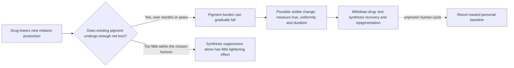

# Reasoning from pigment balance to cosmetic iris drugs

*Method updated October 17, 2026. Hypothetical cosmetic research.*

## Start with the mechanism

The aim is a drug-controlled change in visible iris color, potentially requiring years of maintenance, with recovery after stopping. The earlier blue → brown → original-blue goal remains. A slow onset is acceptable in the question; a specific duration or shade is not presumed.

The workflow is **foundation → explicit assumption → conditional prediction → targeted question → revised model**. Published outcomes check premises and constrain parameters. They do not define the full set of mechanisms worth considering. Simplicity helps us reason, but does not supply missing biological rates or prove clinical performance.

## Foundations and the assumptions they expose

| Starting point | What follows | What still needs an assumption |
| --- | --- | --- |
| Material accumulates when input exceeds output. | Lower production reduces accumulation; existing stores decline only if there is net loss. | How much mature iris melanin is lost while cells remain healthy. |
| Making new pigment and retaining old pigment are separate processes. | Changing synthesis need not remove what is already present. A surviving cell can change its contents without being replaced. | Whether the relevant pigment pool turns over on a useful timescale. |
| Molecules can absorb or scatter light differently. | Appearance depends on optical properties and arrangement, as well as pigment amount. | The map from a change in pigment to a particular person's hue. |
| A temporary input can leave a long-lived result. | Drug activity, visible lightening, and repigmentation can run on different clocks. | Recovery of production and restoration of pigment distribution after withdrawal. |
| A local cosmetic goal concerns a specific tissue and effect. | The desired controller must alter anterior-iris pigmentation while preserving other functions. | How to obtain useful selectivity among iris cells, posterior pigment layers, and other tissues. |

For the inventory calculation, degradation means conversion out of the measured melanin pool; the resulting material still exists. Pigment could also become less absorbing or move without total pigment mass falling. Those are distinct hypotheses and should not be silently counted as clearance.

## Combine the premises into hypotheses

| Hypothesis | Conditional prediction | Main question that could change the plan |
| --- | --- | --- |
| **A. Lower synthesis and wait for ordinary pigment loss.** | If net pigment loss persists, the pigment pool approaches a lower level. Longer treatment matters until a new balance or persistent-pigment floor is reached. | Is mature anterior-iris pigment lost appreciably in healthy surviving cells? |
| **B. Lower synthesis and reversibly increase intracellular pigment disposal.** | If disposal can be increased without harmful byproducts or loss of cell function, lightening could occur sooner than in A. | Can mature pigment itself be processed, rather than only its surrounding organelle markers? |
| **C. Reversibly alter pigment placement or optical behavior.** | Appearance might change without large pigment-mass loss. | Can such a change be stable and reversible while preserving iris structure, pupil function, and tissue health? |
| **D. Use one modulation phase for change and another for maintenance/recovery.** | A low-pigment state might require a different synthesis balance than the transition into it; withdrawal may permit repigmentation if synthesis recovers. | What are the synthesis, loss, and recovery rates, and do they change after prolonged modulation? |

A is the simplest initial hypothesis because it assumes one pharmacological change. That makes it economical to analyze; it does not make it the most effective option. B adds a second mechanism. C remains a broader optical hypothesis. D is a control concept, not a drug regimen.

## The slow-turnover hypothesis, made explicit

The minimal model is a pigment balance in the visible target compartment:

```text
dM/dt = S(t) - kM

M = pigment burden in the target compartment
S = rate of pigment synthesis
k = effective rate of net pigment loss from that compartment
```

This is an analyst-defined sensitivity model, not a fitted human-iris model. Net loss includes the consequences of degradation, export, and any recapture; a new melanosome appearing is not itself evidence that old pigment left.

For the particular phase being modeled, let M0 be its starting steady-state pigment level and S0 its baseline synthesis rate. Assume M0 = S0/k, a constant fractional synthesis rate f during treatment, and unchanged positive k. Then:

```text
M(t)/M0 = f + (1 - f) × 2^(-t/h)
h = ln(2)/k = effective pigment half-life
```

Here f is the fraction of baseline synthesis remaining, not a drug concentration or dose. The model assumes one homogeneous pigment pool, constant effects, no injury, and no adaptation. Actual iris kinetics may have multiple pools and changing rates.

### What seven years would mean under different assumptions

**Every half-life below is hypothetical. No row is a measured adult-human iris forecast.**

| Assumed effective pigment half-life | Pigment remaining after 7 years if synthesis fully suppressed | Remaining if synthesis falls to 5% of baseline |
| --- | ---: | ---: |
| 1 year | 0.8% | 5.7% |
| 3 years | 19.8% | 23.9% |
| 7 years | 50.0% | 52.5% |
| 20 years | 78.5% | 79.5% |

If existing pigment has effectively no net loss over the observation period, suppressing synthesis alone would not appreciably lighten it. The steady-state formula above is not defined at k = 0; in that limiting scenario, stopping synthesis simply leaves the stored pool in place. If loss is appreciable, a separate drug that actively destroys pigment is not logically required.

The table reports pigment, not color. It cannot say when an iris becomes green or blue. For the same model after withdrawal, restoring baseline synthesis would move pigment toward M0 on the same assumed timescale. That is a conditional mathematical recovery toward this phase's starting balance, not evidence of biological reversibility. The full blue → induced-brown → original-blue cycle additionally requires an explicit synthesis-increase phase and restoration of the original blue-state balance; this suppression model alone does not demonstrate that cycle.




## A persistent pool changes the answer

The one-pool model can be too optimistic. Suppose a fraction p of baseline pigment is effectively persistent over the observation horizon, while the remainder follows the model above:

```text
M(t)/M0 = p + (1 - p) × [f + (1 - f) × 2^(-t/h)]
```

This assumes no new supply to the persistent pool during the horizon. Under full suppression, treatment cannot reduce pigment below p while that pool remains persistent. Partial suppression creates a higher floor, p + (1 - p)f. This is why “keep taking it longer” does not solve every hypothetical failure.

For illustration only, with 95% synthesis suppression, a three-year half-life in the mobile pool, and 30% persistent pigment, seven years leaves about **46.7%** of the starting total. The same assumptions with no persistent pool leave **23.9%**. Neither percentage predicts an eye color.

## Appearance and reversibility

Less brown absorption could allow existing scattering and other tissue properties to contribute more strongly to visible color. This makes gradual lightening a coherent optical hypothesis. It does not require a fixed green stage or guarantee that every brown iris will become blue. Pigment composition, depth, spatial distribution, tissue structure, and illumination enter the outcome.

The quantities to track are therefore distinct:

- **Pigment:** amount, composition, location, and loss or conversion.
- **Appearance:** reproducible hue and lightness, including uniformity across the iris.
- **Recovery:** whether stopping the modulation restores production, amount, distribution, and appearance.
- **Function:** whether the changed state and its transition preserve normal ocular function.

A return of synthesis alone would not demonstrate return to the same blue, brown, or mixed baseline. Nor would the absence of rapid recovery prove that a temporary intervention caused a permanently irreversible change.

## Queries driven by the hypotheses

These are planned search strings, not claims that the underlying processes have been demonstrated. Search results should answer the adjacent question.

| Question | Initial query | What to extract or distinguish |
| --- | --- | --- |
| Does the ordinary-loss branch have a drain? | `human iris stromal melanocyte mature melanin turnover pulse chase degradation` | Existing mature pigment loss versus synthesis markers; human anterior stroma versus other pigment compartments. |
| Is disposal limited by melanosome processing or melanin chemistry? | `mature melanin polymer degradation melanocyte melanosome membrane autophagy` | Loss of an organelle marker versus loss of the pigment polymer or its absorption. |
| Can production be reduced reversibly in the intended compartment? | `human iris melanocyte reversible melanogenesis inhibition washout tyrosinase OCA2` | Target effect, recovery, and cell function; enzyme activity versus delivery versus tissue exposure. |
| Can the drug effect be localized? | `anterior iris stromal melanocyte selective delivery posterior pigment epithelium melanin binding` | General ocular exposure versus useful stromal selectivity; exposure changes as pigment falls. |
| Would less pigment yield the desired color? | `iris reflectance optical model melanin scattering spatial distribution` | Absorption and scattering separately; pigment amount versus hue and spatial heterogeneity. |
| Could maintenance and recovery fail after years? | `melanocyte melanogenesis inhibition long term adaptation rebound washout` | Persistent effects, adaptation, altered loss rates, and whether relevant findings transfer to iris cells. |

The initial targeted search found skin-cell autophagy work and human iris-melanosome chemistry, making the distinction between organelle processing and pigment chemistry a useful branch to pursue. Neither result supplies the missing human iris rate. [Skin-cell primary study](https://pubmed.ncbi.nlm.nih.gov/31659857/), [human iris-melanosome primary study](https://pubmed.ncbi.nlm.nih.gov/19618947/).

## Next work

1. Explore synthesis suppression, pigment-loss timescale, persistent fraction, and withdrawal in the model. Record which conclusions hold across assumptions and which depend on one favorable value.
2. Identify the bottleneck in each branch. For A it is net pigment loss; for B it is selective processing of mature pigment; for C it is a reversible optical mechanism; for D it is control of transition, maintenance, and recovery.
3. Run the targeted queries above in that order of relevance. Extract the single needed fact, the model or tissue used, and the alternative explanations. Use records and published studies when they constrain that fact.
4. Rank candidate mechanisms on two separate axes: consistency with the model and strength of support for its biological premises. A mechanism can be coherent and still depend on several untested assumptions.

This next stage is reasoning, modeling, and focused information gathering. A physical study should address a named uncertainty left unresolved by that process. Donor chemistry, archived images, and cell models are options selected by the question.

<details>
<summary>Existing drug evidence and biological checks</summary>

## Evidence checkpoints

| Approach / observation | Direct evidence | What remains unresolved |
| --- | --- | --- |
| Increase melanogenesis through prostaglandin signaling | Latanoprost can darken adult irides by increasing melanin within existing melanocytes. | Predictable shade control, reliable blue-to-brown conversion, and reversal. The label describes iris pigmentation as likely permanent after withdrawal. [Xalatan prescribing information](https://dailymed.nlm.nih.gov/dailymed/lookup.cfm?setid=a98595b3-9f47-48e0-b18d-550a2095f264) |
| Suppress new synthesis | A cultured human uveal-melanocyte study found that alpha-methyl-p-tyrosine prevented latanoprost-induced melanogenesis. | Prevention of induced synthesis is not proof of gradual loss of established pigment, iris-selective pharmacology, or clinical tolerability. [Drago et al., 1999](https://pubmed.ncbi.nlm.nih.gov/9986745/) |
| Slow human lightening associated with a drug | One report describes brown-to-blue change after five years of levobunolol eye drops, with predominantly depigmented stroma. | No satisfactory baseline photographs, control, or withdrawal/recovery cycle; drug causality remains unproven. This is a relevant lead, not a cosmetic treatment result. [Doyle and Liu, 1999](https://pubmed.ncbi.nlm.nih.gov/10660314/) |
| Rabbit synthesis-modulation experiment | A six-month study used 12 rabbits, three per cohort; one co-treatment cohort had lower endpoint melanin than inducer-only fellow eyes. | Inhibitor-only eyes did not show a significant melanin difference. Internal reporting discrepancies, systemic signs, and missing baseline pigment assays and withdrawal data limit interpretation. [Sadiq et al., 2022](https://pmc.ncbi.nlm.nih.gov/articles/PMC9674870/) |
| Temporary OCA2 RNA suppression | A patent reports an image-based change in mouse iris explants exposed to OCA2 siRNA with controlled light exposure. | Human and recovery sections describe proposed work without reported outcomes. The light exposure means this is not evidence for a drug-only effect; no controlled living-human reversible lightening result is supplied. RNA silencing does not edit DNA. [WO2024201471A1, Examples 9–12](https://patents.google.com/patent/WO2024201471A1/en) |
| Adjacent human pigment-modulation trial | A one-year open-label study of five adults with OCA1B found no significant improvement in the iris-transillumination endpoint despite hair/skin pigmentation changes. | Transillumination principally concerns posterior iris pigment; this disease-specific result does not directly test normal anterior-stromal cosmetic lightening. [Adams et al., 2019](https://doi.org/10.1172/jci.insight.124387) |
| Increase normal pigment disposal | Human turnover-like morphology makes endogenous disposal worth investigating. | A validated drug that safely accelerates net clearance specifically in living human anterior iris has not been established by the sources reviewed here. The destination and effects of pigment products matter. See the [evidence register](pigment-evidence-register.md#anterior-iris-and-uveal-melanocytes). |

Tyrosinase, involved in melanin synthesis, is distinct from tyrosine hydroxylase in catecholamine synthesis. Metyrosine's established label mechanism is inhibition of the latter; the ocular findings do not establish a selective iris target. [Metyrosine prescribing information](https://dailymed.nlm.nih.gov/dailymed/lookup.cfm?setid=1b7897b4-7681-4b99-8883-d5dc33f86c01).

These findings justify studying slow pharmacology. They do not establish a particular agent, duration, or reversible cosmetic result. A drug can act temporarily while the pigment it changes persists for much longer.


### The renewal assumption

Cell lifespan, pigment lifetime, and visible-color duration are separate quantities. Seven years is an illustrative horizon. Human lens-nucleus proteins can persist through life, so a universal whole-eye renewal clock cannot be used; that finding does not measure iris kinetics. Human iris morphology has suggested pigment synthesis and degeneration without establishing a loss rate. [Lens radiocarbon study](https://pubmed.ncbi.nlm.nih.gov/18231610/), [Mainz II](https://jamanetwork.com/journals/jamaophthalmology/fullarticle/414988).

The [evidence register](pigment-evidence-register.md) retains the study records. [Bidirectional reversibility](bidirectional-reversibility.md) describes the earlier cycle goal; the [donor-eye proposal](iris-measurement-validation-proposal.md) and [automation concept](automated-lab-operating-model.md) remain supporting options.

</details>
