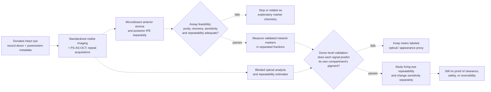

# Proposed donor-eye study: validate iris pigment measurements

*Research concept, not a treatment protocol. Literature review updated October 2026.*

## Decision question

Can standardized noninvasive iris imaging estimate the amount and type of pigment in the **visible anterior stroma**, separately from pigment in the posterior iris pigment epithelium (IPE)? A validated measurement is a prerequisite for evaluating future change; it is not evidence that stored iris pigment can be safely removed or restored.

## Why this is the next step

| Evidence stream | What it establishes | What it does not establish |
| --- | --- | --- |
| **PS-AS-OCT:** 88 participants, all with brown irides | Entropy-derived stromal MCR correlated with photographed CIE L*a*b* values; three-grade classification accuracy was 85%. | Chemical melanin calibration, blue-iris performance, or response to a real pigment change. [Li et al., 2025 online / 2026 print](https://pubmed.ncbi.nlm.nih.gov/41432634/) |
| **Older RGB / reflectance model** | An inverse-Monte-Carlo model produced in-vivo image-based concentration estimates using ex-vivo reflectance inputs. | Direct chemical measurements from the imaged eyes; estimates depend on simplified layer and optical-property assumptions. [Bashkatov et al., 2006](https://doi.org/10.1117/12.659176) |
| **Human iris chemistry** | Chemical degradation quantified eumelanin and pheomelanin in microdissected iris fractions; pigment profiles differed by compartment and color. | A paired optical readout from the same eyes. The accessible abstract also describes an IPE-scraped fraction as mostly stroma plus anterior IPE, so fraction purity and nomenclature need explicit verification. [Prota et al., 1998](https://pubmed.ncbi.nlm.nih.gov/9778410/) |
| **IPE separation** | Enzyme-assisted microdissection separated postmortem human IPE from stroma for cell isolation and culture. | This does not establish chemical purity or pigment recovery in uncultured fractions; cultured IPE pigment diluted during cell division. [Hu et al., 1992](https://pubmed.ncbi.nlm.nih.gov/1634342/) |
| **Melanin marker chemistry** | A five-marker HPLC method for eumelanin and pheomelanin degradation products was evaluated with reference melanins, hair, and human epidermis. | The method has not been validated in iris fractions, and marker specificity depends on degradation chemistry; alkaline peroxide can generate PTCA from pheomelanin. [Ito et al., 2020](https://pmc.ncbi.nlm.nih.gov/articles/PMC7404343/), [Ito and Wakamatsu, 1998](https://pubmed.ncbi.nlm.nih.gov/9585251/) |
| **Donor-eye optical imaging** | Anterior-segment OCT can image structures in human donor eyes before tissue sectioning. | Pigment-specific optical calibration. Postmortem imaging also cannot by itself establish performance in living eyes. [Human donor-eye angle imaging](https://www.nature.com/articles/s41598-023-37248-0) |

The first study should answer **measurement validity**, not treatment feasibility. It should also avoid assuming that iris color categories are chemical standards: whole-iris chemical studies have reported different color-group contrasts, and they do not isolate the visible stromal target. [Menon et al., 1992](https://pubmed.ncbi.nlm.nih.gov/1402293/), [Wielgus and Sarna, 2005](https://pubmed.ncbi.nlm.nih.gov/16280011/).

## Proposed design

### 1. Sample and scope

Use donated human eyes with appropriate tissue-bank authorization. Include a broad range of visible iris colors, including blue/light, mixed, and brown irides. Record relevant donor history, age, postmortem interval, preservation, and ocular pathology. Analyze two eyes from one donor as clustered observations rather than independent donors. Set the sample size after a pilot estimates assay and imaging variability; do not choose it from color categories alone.

### 2. Paired optical measurements

Before dissection, acquire:

- standardized visible-light images suitable for continuous CIE L*a*b* analysis;
- PS-AS-OCT images with prespecified layer segmentation, including separate stromal and IPE signals;
- repeated acquisitions to estimate within-eye and between-session measurement error.

Keep image analysis blinded to the chemical results. Record geometry, illumination, pupil state, corneal clarity, and other acquisition conditions. Define the imaging target anatomically; a whole-iris color score is not a substitute for a stromal measurement.

### 3. Compartment-resolved chemical reference

Microdissect the anterior stromal fraction and posterior IPE separately after optical imaging, using uncultured tissue for pigment quantification. Human postmortem IPE separation has been demonstrated for cell isolation and culture, but that does not establish chemical purity or recovery in fresh fractions. Published iris chemistry also uses an “IPE-scraped” fraction that included mostly stroma plus anterior IPE. Treat each fraction as an operational sample: document its anatomical boundaries and verify identity and carryover before interpreting pigment values. [Hu et al., 1992](https://pubmed.ncbi.nlm.nih.gov/1634342/), [Prota et al., 1998](https://pubmed.ncbi.nlm.nih.gov/9778410/).

Use chemical degradation with HPLC to quantify eumelanin- and pheomelanin-associated markers, normalize to assayed tissue mass, and report raw marker values. A five-marker panel has been evaluated in reference melanins, hair, and human epidermis, but its performance cannot be assumed to transfer to iris fractions. Some alkaline peroxide conditions can also generate PTCA from pheomelanin, so marker choice and conversion to pigment mass require method-specific validation. [Ito et al., 2020](https://pmc.ncbi.nlm.nih.gov/articles/PMC7404343/), [Ito and Wakamatsu, 1998](https://pubmed.ncbi.nlm.nih.gov/9585251/).

If tissue quantity permits, electron-spin resonance may serve as an exploratory whole-iris cross-check; it does not validate stromal or IPE-specific values. [Wielgus and Sarna, 2005](https://pubmed.ncbi.nlm.nih.gov/16280011/).

### 4. Assay feasibility before paired calibration

Before the full optical-chemistry cohort, run a small assay-only feasibility phase on donated eyes. This is an analytical-method gate, not a test of pigment change. It should establish:

- repeatable compartment separation and anatomical labeling, with boundary carryover assessed using registered histology, serial sections, or another validated identity method;
- matrix-specific assay performance at the tissue quantities available, including blanks, reference materials, recovery, replicate precision, marker interference, and limits of detection and quantification;
- whether the light-iris stromal samples and IPE samples can be quantified separately. Values below the validated quantification limit should be reported as below limit, not as zero;
- whether marker-to-pigment conversion is defensible for the observed marker profile. If not, report marker abundance without claiming total melanin mass.

Define acceptance thresholds before the paired validation study, based on the smallest difference the project would need to detect and the pilot's measurement variability. The literature reviewed here does not provide a universal purity, recovery, repeatability, or sensitivity threshold for iris fractions.

**Assay go / no-go:** if fraction carryover or assay performance cannot be bounded at the required scale, stop the calibration study or relabel it as exploratory marker chemistry. Proceed to paired optical calibration only after the assay can separately and reproducibly quantify the target fractions.

### 5. Analysis and decision gates

- Test whether stromal PS-AS-OCT signal predicts chemically measured stromal pigment, and whether the IPE signal predicts IPE pigment; do not pool compartments.
- Compare optical pigment estimates with visible CIE color as separate outcomes.
- Hold out entire donors for validation; keep paired eyes from one donor in the same partition.
- Report calibration slope, bias, prediction error, repeatability, and performance across iris-color ranges, not only a correlation coefficient.
- Predefine acceptable repeatability and prediction error relative to the smallest color change the eventual project would need to detect. The literature reviewed here does not supply a defensible numeric threshold for that goal.

**Stop / relabel rule:** if an optical signal fails donor-level validation, varies mainly with appearance or anatomy, or cannot distinguish stromal from IPE pigment, report it as an optical or appearance proxy—not as measured melanin concentration.

**Advance rule:** if compartment-specific prediction is repeatable and holds in donor-level validation, the next stage is a separate noninterventional study of living-eye repeatability and change sensitivity. Ex-vivo calibration alone cannot establish serial sensitivity, treatment response, safety, pigment disposition, or return to baseline.

## Proposed workflow

All arrows below describe a study to be evaluated, not an established clinical pathway.

## Interpretation limits

This study would be destructive at the chemical-assay stage and cross-sectional by design. It can benchmark an imaging signal against tissue chemistry in donated eyes, but cannot show that a change in a living person tracks chemical pigment loss. Nor can it establish a mechanism for increasing pigment, selective pigment clearance, safe handling of released material, a cosmetic treatment, or the blue → dark brown → same-blue cycle.
