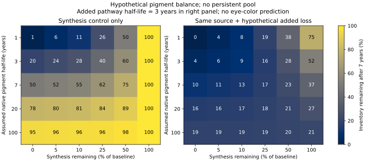
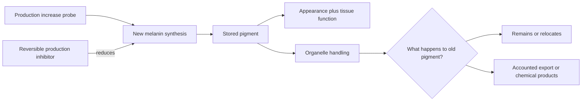

# Mechanism shortlist and computational feasibility

*October 17, 2026. Personal learning project; AI-run calculations and public-data analysis. This ranks research directions, not treatments.*

## Current judgment

The clearest production-control hypothesis is **reversible inhibition of human tyrosinase (TYR)**. The largest unresolved part of the lightening problem is **net loss of existing pigment**. Investigate these as separate controls, then ask whether combining them improves the balance while preserving the target cells.

A synthesis inhibitor could be enough if ordinary turnover is useful. A disposal mechanism becomes more valuable when ordinary turnover is slow. Returning to baseline is a third control question: quickly ending drug activity does not ensure fast repigmentation.

## Priority by mechanism

| Research priority | Why it follows from the goal | Concrete starting point | Main reason it might fail |
| --- | --- | --- | --- |
| **First production controller: reversible human TYR inhibition** | Acts on pigment production without logically requiring cell replacement or permanent genome change. | Thiamidol as a reference scaffold; 4-butylresorcinol as an alternative comparator. | Mature pigment persists, delivery to the relevant intracellular compartment fails, or useful modulation cannot preserve/recover cell function. |
| **Production increase and recovery: human TYR activation** | Could accelerate repigmentation or induce a darker state while preserving an eventual return to baseline. | Ampyrone as a newly identified mechanism probe; evaluate separately from latanoprost. | Enzyme or skin-cell effects fail to translate to iris; stimulation or pigment persists after withdrawal. |
| **First disposal question: selective handling of mature melanosomes/pigment** | Adds an outlet when reducing input is too slow. | OPTN/RCHY1/TBK1-related melanophagy; beta-mangostin and the IP3R2–TRPML1–TFEB pathway as distinct probes. | Organelle proteins disappear while the pigment core persists; products accumulate elsewhere; or selectivity fails in normal iris cells. |
| **Alternative production controller: melanosomal pH regulation** | Pigment synthesis depends on an organelle environment as well as enzyme abundance. | OCA2-related regulation, with TPC2 as an interacting pathway to examine. | Genetic or non-iris effects fail to translate to reversible adult-iris pharmacology, or other pigment compartments are affected. |
| **Indirect signaling comparator** | Could influence production upstream. | Levobunolol-related signaling hypothesis; latanoprost as an opposite-direction comparator. | Pigment response is indirect, inconsistent, or tied to other functions; a temporal association does not identify a controllable mechanism. |

The TYR priority is a mechanism judgment. The 2018 human-enzyme/skin-melanocyte work reports reversible inhibition by thiamidol and substantial human-versus-mushroom enzyme differences. It supplies a useful probe and a specificity check; it does not establish an ocular product. [Primary study](https://doi.org/10.1016/j.jid.2018.01.019), [structure–activity work](https://pmc.ncbi.nlm.nih.gov/articles/PMC5877551/).

The melanophagy lead comes from mouse melanoma-cell work linking beta-mangostin effects to OPTN, RCHY1 and TBK1. This is a reason to examine the machinery in normal human iris cells. Mature polymer fate and tissue function remain separate questions. [Primary study](https://doi.org/10.1073/pnas.2318039121). OCA2's melanosomal role is recorded in [UniProt Q04671](https://www.uniprot.org/uniprotkb/Q04671/entry) and supported by [channel physiology](https://pubmed.ncbi.nlm.nih.gov/25513726/).

## What the workbench actually ran

The existing Research Desk now has an iris-pigment campaign under appearance research. Seven public compound identities resolved to one structure each. RDKit 2026.03.6 calculated these properties from the resolved structures:

| Comparator | Role in this exploration | Molecular weight (g/mol) | Calculated logP |
| --- | --- | ---: | ---: |
| Thiamidol | Direct synthesis reference | 278.33 | 2.82 |
| 4-Butylresorcinol | Alternative synthesis reference | 166.22 | 2.44 |
| Kojic acid | Enzyme-specificity comparator | 142.11 | -0.16 |
| Metyrosine | Catecholamine-versus-melanogenesis comparator | 195.22 | 0.74 |
| Beta-mangostin | Pigment-disposal mechanism probe | 424.49 | 5.39 |
| Levobunolol | Indirect signaling comparator | 291.39 | 2.33 |
| Latanoprost | Opposite-direction comparator | 432.60 | 4.19 |

These are structural calculations, not measured solubility, ionization, corneal penetration, melanosome access, binding, or efficacy. Beta-mangostin's relatively high calculated lipophilicity is a formulation/exposure question to investigate, rather than proof of success or failure. A shared descriptor does not imply shared biological effects.

The [compound table](../analysis/workbench-comparison-2026-10-17/compounds.csv), exact PubChem snapshots, RDKit outputs, and imported hash receipts are retained in the analysis directory. Full original run folders remain in the local workbench. The copied workbench manifests describe those original folders; the comparison receipt hashes the selected files actually copied here.

## What the balance calculation adds

The [720-case sweep](../analysis/feasibility-run-2026-10-17/MODEL_REPORT.md) holds the original source fixed while adding a hypothetical loss pathway. This matters: changing a clearance rate must not silently increase baseline synthesis.

For one deliberately hypothetical case—20-year native pigment half-life, production reduced to 5%, no persistent pool—seven years leaves **79.5%** of initial pigment. Adding a separate three-year loss half-life lowers the model result to **16.1%**. If 30% remains persistent, the combined result is **41.3%** and a 25%-inventory target is unreachable while that pool stays persistent.

The same example takes about **61 years after withdrawal** to return to 90% of baseline if original slow production resumes. A higher recovery-source assumption shortens that in the model, but would require its own controllable mechanism and could overshoot if maintained. These are consequences of assumptions, not human forecasts. The inventory targets have no assigned eye colors.

## Target and structure checks

Public target snapshots identify human TYR as P14679 and OCA2 as Q04671. Checking the TYR cross-reference exposed a useful mismatch: PDB 7RK7 contains a nine-residue TYR-derived peptide in an immune complex, rather than the enzyme's catalytic structure. It is unsuitable as a TYR inhibitor-docking receptor. [RCSB structure record](https://www.rcsb.org/structure/7RK7).

Regen also fetched the predicted AF-P14679-F1 model. A predicted protein scaffold is not a prepared copper-containing catalytic site; no docking score was generated. Any structural comparison needs the correct target, metal/cofactor state, binding-site preparation, and controls before it can inform ranking.

## New functional and source checks

The [human-TYR assay audit](../analysis/tyr-assay-audit-final-2026-10-17/ASSAY_REPORT.md) retrieved 870 activity records from 205 assays. The human target assignment includes explicitly mushroom descriptions and ten records with conflicting species annotations. Of 362 records whose descriptions explicitly mention human systems, 120 come from five identified secondary sources. These are overlapping source flags, not independent experimental confirmations. The exported data retain all rows and endpoint types.

This widens the production-controller comparison to HOPNO aurones and 4-amino/4-amido indanones, while preserving differences between purified enzyme, lysate and intact cells. Thiamidol remains a useful reversible reference rather than an assumed winner. Candidate selection should turn on functional translation and controllability, not the lowest number attached to a target ID.

**The production-up branch now has a direct lead.** A 2026 primary study reports ampyrone effects on recombinant human TYR, normal and OCA1B human melanocyte lines, and human 3D epidermis. Isotope tracing of newly labeled intermediates was performed in mouse cells; human melanocyte results used scattering. Catalytic effects depend on the reaction/substrate. No iris experiment, withdrawal recovery or repeated color cycle was established. This gives the original blue → brown → blue goal a more specific research query: can increased synthesis be turned off while preserving a useful route back to the original pigment inventory? [Primary study and supplement](https://doi.org/10.1172/jci.insight.202947).

**The disposal branch gained a separate pathway.** The 2026 IP3R2 study has a human skin-cell knockdown phenotype and detailed mouse-cell melanophagy experiments. Our [numerical extraction](../analysis/ip3r2-data-run-2026-10-17/DATA_REPORT.md) separates the pigmentation image metric from the mouse-cell energetic cost. Genetic rescue is not drug-withdrawal reversibility. The pathway is a reason to examine downstream pigment handling, rather than immediately prioritizing broad IP3R2 inhibition as an eye drug. [Primary study](https://doi.org/10.1371/journal.pbio.3003971).

Cargo delivery and cargo destruction remain different steps. Pigment can persist after entering a lysosomal compartment, as a primary keratinocyte study illustrates. A separate 2026 keratinocyte study proposes sequential proteolytic and oxidative melanosome processing, but does not identify the complete intracellular pigment-product balance. These support an explicit fate question, not an inference that ocular oxidation is a suitable strategy. [Pigment storage study](https://doi.org/10.1016/j.jid.2024.08.023), [processing study](https://doi.org/10.1111/jocd.70770).

The arrows describe questions and proposed mechanisms. They do not imply a demonstrated treatment sequence.

## Target location and next discriminating work

The fixed-panel check of the existing [human iris atlas](../analysis/iris-atlas-run-2026-10-17/IRIS_TARGET_REPORT.md) is now complete: 57,422 nuclei, including 17,811 author-labeled uveal melanocytes and 15,583 posterior pigment epithelial nuclei. TYR transcripts were detected in 93.3% of melanocyte nuclei and 76.4% of posterior pigment epithelial nuclei; OCA2 in 54.7% and 87.4%, respectively. OPTN, RCHY1 and TBK1 transcripts were also detected in subsets of melanocyte nuclei. These are agent-calculated raw-count detection fractions, not reported drug-response rates.

This supports examining the proposed machinery in iris cells and makes a key distinction explicit: enzyme specificity does not establish specificity for the visible anterior iris. Detection in both target and posterior pigment populations makes compartment-selective exposure a separate question. Nuclear capture, sequencing depth, ambient RNA and dropout complicate interpretation; detection does not establish functional protein or pigment processing. The source has four individually labeled donors plus two overlapping pooled labels, which cannot be counted as six independent donors. [Dataset source](https://cellxgene.cziscience.com/collections/63d03351-06be-478e-a0db-f7a653b6b19b).

Follow the expanded comparator set through intact-cell effects, withdrawal and intracellular exposure. On the disposal side, account separately for old pigment retained inside cells, intact exported pigment, identifiable soluble products, and material associated with lost cells. Optical change might be useful even without complete destruction, but should not be fitted as a mass-loss rate without establishing that relation.

The [exposure and pigment-feedback calculation](../analysis/exposure-run-2026-10-17/MODEL_REPORT.md) is now complete: 23 fixed-capacity withdrawal cases and nine matched-input histories. It separates free drug in cytosol and melanosomes, two pigment-bound pools, membrane escape, and gross pigment turnover. The model makes pigment-associated drug fate explicit: local release versus exit with pigment. Neither is silently treated as disappearance.

Under one activation hypothesis, pigment continues rising after input stops, from 1.108 to a sampled peak of 1.503 times original inventory. Other cases show delayed suppression because lost pigment releases its drug locally. These are conditional model results, not ampyrone or thiamidol predictions. The figure distinguishes preloaded withdrawal from matched input histories, and all times use normalized units.

The practical criterion is a chosen exposure profile, rather than maximum pigment accumulation. The model does not require a fast effect: long maintenance remains within scope. It requires understanding how input, tissue drug activity and pigment recovery relate. Existing ocular retention studies motivate those separate controls but do not fit parameters for these probes. [Primary ocular pharmacokinetic study](https://doi.org/10.1021/acs.molpharmaceut.4c00694).

The [measured-reference benchmark](../analysis/binding-benchmark-run-2026-10-17/BENCHMARK_REPORT.md) is now complete: eleven numeric MST comparators, eight probes, nineteen resolved structures and 88 pairwise comparisons. Levobunolol's closest measured neighbor is nadolol across three encodings; timolol is only its third Morgan neighbor. All seven other probes have nearest Morgan similarities of approximately 0.111–0.208. Several nearest identities change under a path fingerprint. These similarities do not predict binding.

The result keeps thiamidol and ampyrone's pigment-binding parameters unresolved. Broad descriptor ranges also fail to establish scaffold coverage: thiamidol fits all seven individual reference ranges while retaining a low nearest Morgan score. The assay-specific measurements, large source uncertainties, reused binding data and structure-representation limitations are preserved. No reference affinity or release rate was transferred to a probe.

The [production-up readout review](../analysis/ampyrone-readout-review.md) now extracts the ampyrone workbook. Human C4 and OCA1B-1125 optical-signal ratios are 1.763 and 2.112; reconstructed-skin stained area is 1.329 times negative control. These are different endpoints, not interchangeable mature-pigment changes. Mouse isotope tracing supplies an additional pathway readout. Duplicated DHI entries, small sample counts, unclear skin-replicate nesting and conflicting isotope timepoint descriptions are retained as source limitations. An independent analytical paper makes enzyme-dependent color coupling a specific unresolved question, rather than grounds to dismiss the cellular results.

The [closer-comparator search](../analysis/phenolic-binding-followup.md) found measured two-site paracetamol binding to synthetic pigment. It broadens phenolic coverage without supplying thiamidol or ampyrone affinities. Candidate-specific free exposure and withdrawal remain unresolved.

The [withdrawal analysis](../analysis/withdrawal-and-recovery.md) now adds a production-down lead, KT-939, with a human MNT-1 melanoma-cell pigment-content recovery series. It also qualifies the thiamidol donor-derived melanocyte withdrawal experiment as accumulated pigment content, rather than a direct synthesis-flux measurement. The clinical regression study has one variable-time follow-up with concurrent withdrawal of sunscreen, which cannot identify a drug half-life. None of these studies fits an iris turnover rate.

An exact new counterexample shows why that distinction matters. A fixed old-pigment pool, partial suppression and added loss can produce the same total-inventory curve. The first two remain identical after withdrawal, while their old/new pigment histories differ. Serial inventory measurements alone therefore leave some model terms unidentified, even without noise. The [diagram and calculation](../analysis/withdrawal-and-recovery.md#a-calculation-that-changes-what-to-measure-next) specify the extra information needed.

The [paired KT-939/thiamidol comparison](../analysis/kt939-thiamidol-comparison.md), completed October 22, extracts same-study IC50 ratios of 4.71 for MNT-1 lysate activity and 3.61 for six-day accumulated pigment/protein. KT-939 shares thiamidol's resorcinol–thiazole/amide scaffold but has an oxetane-containing side group. Its calculated neutral logP is lower and polar surface area higher; neither descriptor supplies a retention or delivery measurement. The study follows only KT-939 after withdrawal, so it cannot establish comparative recovery. Shorter viability observations and developer affiliation are recorded in the comparison.

Next, seek paired free-exposure and withdrawal observations for both compounds in one human pigment-cell system. Prioritize measurements pairing new synthesis, stored pigment and withdrawal, with cell-population accounting. Retain ampyrone's direct-catalysis/product-handling question. Preserve the original fixed iris panel; any new pathway-gene check should be a declared extension. Delivery, activity and recovery remain separate quantities.

## Reproduction and checks

See [analysis methods](../analysis/README.md) for commands, assumptions, source IDs, and limitations. Eight independent model checks pass, including numerical integration against the analytical solution. The full existing workbench suite had fixture/dependency failures in the shared dev image; those are recorded separately and are not represented as a passing workbench validation.
