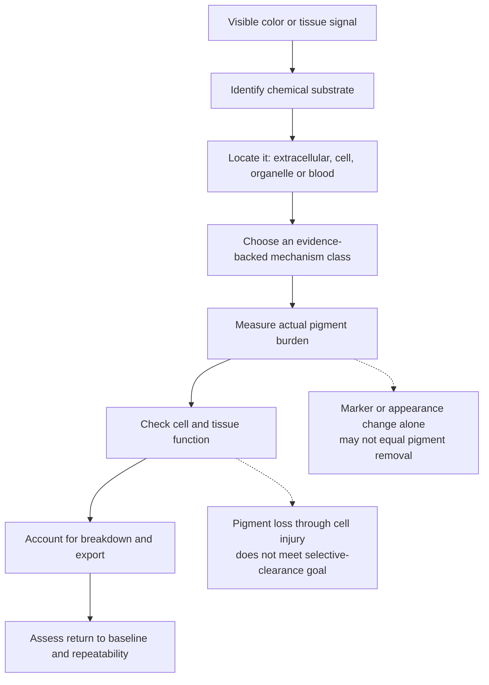
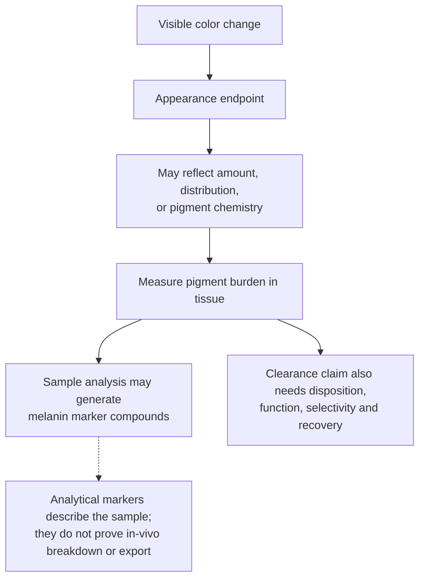
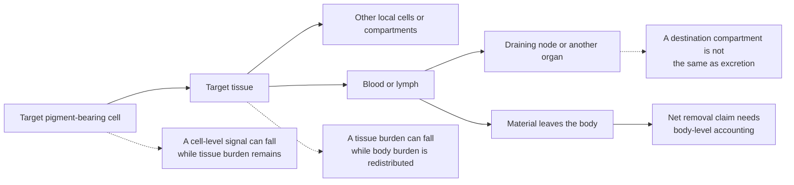
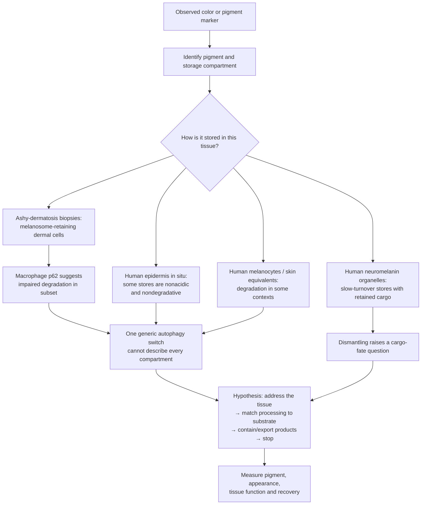
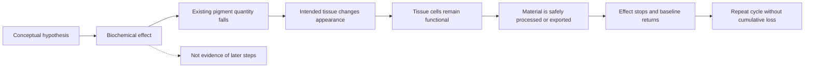

# A framework for selective pigment clearance

*Conceptual research note; evidence status linked to the [tissue pigment atlas](tissue-pigment-atlas.md) and [source register](pigment-evidence-register.md). Reviewed October 11, 2026.*

## The central question

Could an intervention reduce an existing pigment burden in a chosen tissue, leave the surrounding cells functional, and then stop at a controlled endpoint?

The answer cannot be one generic “melanin removal” mechanism. A colored deposit may be melanin in a melanosome, a mixture of residual lipids and proteins in a lipofuscin granule, iron in storage complexes, a homogentisic-acid-derived polymer in connective tissue, bilirubin circulating after red-cell breakdown, or external ink held in dermal cells. Their chemistry, location, physiology, and paths out of tissue differ.

A useful high-level hypothesis is a **shared control framework with tissue- and substrate-specific clearance mechanisms**. One universal treatment across all bodily tissues is not supported by the reviewed evidence.

## Clearance is a chain of distinct outcomes

Each arrow is a separate research question. Lowering new synthesis changes the input to a pigment pool. It does not by itself demonstrate that material already stored in the tissue has disappeared. Likewise, loss of a melanosome protein, a lower optical signal, or a lighter-looking surface does not alone establish molecular pigment removal. In a mouse keratinocyte model, proteins on incorporated melanosomes degraded while melanin content remained unchanged. A skin-cell study and a separate melanophagy study provide mechanism-level evidence for melanosome degradation in specific models; neither establishes the same process in every tissue. [Endpoint study](https://pmc.ncbi.nlm.nih.gov/articles/PMC10739166/), [human skin-cell study](https://doi.org/10.1111/pcmr.12838), [melanophagy study](https://pmc.ncbi.nlm.nih.gov/articles/PMC10998605/).

## Appearance and pigment burden require separate endpoints

A small human skin study designed to produce comparable visible tanning found no significant increase in measured melanin under UVA alone, while UVB-containing exposures increased it. Skin appearance can therefore change without a corresponding increase in pigment mass; this is a skin finding, not evidence of the same optical mechanism in the iris. [Choi et al., 2010](https://pubmed.ncbi.nlm.nih.gov/20147966/).

Some melanin assays deliberately process harvested samples to generate marker compounds before HPLC measurement. For example, alkaline hydrogen peroxide oxidation generates markers used to estimate eumelanin and pheomelanin content in skin and other biological samples. Those assay products describe the sampled pigment; they do not show that the body naturally formed or exported the same compounds. [Ito et al., 2020](https://pmc.ncbi.nlm.nih.gov/articles/PMC7404343/).

Color can also depend on a pigment's chemical state. A human argyria case reported recurrent discoloration after laser treatment; a later case report proposed that ultraviolet exposure could re-darken residual silver, but did not establish that mechanism or quantify total silver. This is case-level metal evidence, not a melanin or iris mechanism. It reinforces that appearance and substrate burden require separate endpoints. [Krase et al., 2017](https://pubmed.ncbi.nlm.nih.gov/28296792/), [Fukayama et al., 2020](https://pmc.ncbi.nlm.nih.gov/articles/PMC9309704/).

## Surface-cell export is a distinct route

In a renewing epithelium, pigment still held inside cells could leave with shed cells. That is biologically different from digesting pigment in place or reducing new synthesis. It remains an inference about material fate unless the pigment itself is followed out of the tissue and tissue function is checked.

| Compartment | Human evidence in this review | What it does not establish |
| --- | --- | --- |
| **Epidermis** | Human studies imaged melanin granules in surface corneocytes and chemically measured eumelanin/pheomelanin in sampled outer stratum corneum; a separate six-person study used UVA-induced pigment fading as a turnover proxy. | A complete source-to-surface mass balance for native melanin, selective clearance, or a controllable pigment-export method. |
| **Gingiva / buccal mucosa** | Human gingival ultrastructure found melanin granules in keratinocytes; biopsy labeling studies measured site-dependent S-phase proliferation. | Complete transit time, melanin mass in exfoliated cells, or a controllable oral pigment-clearance route. |
| **Adult iris** | In the examined adult iris specimens, PCNA and Ki-67 staining did not show positive nuclei. | Zero turnover over a lifetime, pigment disposal, or a route for returning iris color to baseline. |

The skin evidence includes actual melanin measured in the outer corneocyte/stratum-corneum compartment, but surface sampling does not quantify the full native tissue pool or separate all pigment inputs from losses. Oral studies identify melanin within gingival keratinocytes and measure proliferation, but not pigment mass in exfoliated oral cells. Iris histology remains a snapshot. Across these tissues, a surface pigment pool and cell renewal support an export hypothesis; they do not show that a chosen intervention can selectively clear stored pigment while preserving function. [Lu et al., 1996](https://pubmed.ncbi.nlm.nih.gov/8881670/), [Matsunaka et al., 2017](https://doi.org/10.1111/srt.12309), [Maeda, 2017](https://www.mdpi.com/2079-9284/4/4/47), [Squier and Waterhouse, 1967](https://doi.org/10.1016/0003-9969(67)90148-3), [Thomson et al., 1999](https://pubmed.ncbi.nlm.nih.gov/10577752/), [Thomson et al., 2001](https://pubmed.ncbi.nlm.nih.gov/11684035/), [Pfeiffer et al., 2001](https://jamanetwork.com/journals/jamaophthalmology/fullarticle/265260).

## A decrease in one compartment may be redistribution

“Clearance” has nested boundaries. A lower pigment signal in a target cell is a cell-level observation. To claim tissue clearance, material must no longer reside elsewhere in that tissue. To claim body-wide removal, the total body burden must fall rather than shift into blood, lymph, a draining node, or another organ. Actual excretion is a still narrower endpoint.

The arrows are possible accounting routes, not a proposed treatment pathway. Human reports document pigment in multiple destinations: posterior iris pigment can enter aqueous pathways and accumulate in the trabecular meshwork; human anthracosis case series identify carbon-containing pigment in mediastinal lymph-node macrophages. The latter static observations do not prove the route or show net elimination. Human postmortem tissue analysis detected matching tattoo-pigment species in skin and regional lymph nodes in 2 of 4 donors; a separate case found pigment in regional nodes three years after dermabrasion. A mouse biodistribution study detected tattoo particles in hepatic Kupffer cells after one year. In one argyria laser case, treated-skin biopsies showed smaller silver particles, a lower silver signal, and macrophage uptake, but residual silver remained and body-level elimination was not measured. Macrophage handling can itself affect tissue function: a tattoo-ink study reported apoptosis in human-cell culture and persistent inflammation in mouse draining nodes; a 2026 comment and reply debate how those mouse findings translate to ordinary human tattooing. These results concern foreign ink, not endogenous melanin, and are a reason to measure cell and immune function if a transport route is proposed. Skin studies measure melanin at the outer corneocyte/stratum-corneum interface, but do not provide a whole-body mass balance. In colon melanosis, a human retrospective series and a single case report found endoscopic appearance could disappear after anthranoid exposure stopped; the case report lacked follow-up biopsies, so it did not establish pigment mass or destination. Thus a tissue-specific intervention would need to define which boundary its endpoint covers and check likely destination compartments. [Iris pigment-dispersion models](https://pmc.ncbi.nlm.nih.gov/articles/PMC7847180/), [human nodal anthracosis cases](https://pmc.ncbi.nlm.nih.gov/articles/PMC3920429/), [surface corneocyte study](https://pubmed.ncbi.nlm.nih.gov/8881670/), [human skin-and-node tattoo study](https://doi.org/10.1038/s41598-017-11721-z), [mouse tattoo-ink immune study](https://doi.org/10.1073/pnas.2510392122), [model critique](https://doi.org/10.1073/pnas.2611211123), [author reply](https://doi.org/10.1073/pnas.2613440123), [tattoo pigment in regional nodes after dermabrasion](https://pubmed.ncbi.nlm.nih.gov/32650854/), [mouse liver biodistribution study](https://pubmed.ncbi.nlm.nih.gov/28486229/), [tattoo laser biopsy study](https://doi.org/10.1111/1523-1747.ep12478570), [argyria biopsies after laser](https://pmc.ncbi.nlm.nih.gov/articles/PMC9309704/), [melanosis-coli clinical course](https://pubmed.ncbi.nlm.nih.gov/36849146/), [single-case follow-up](https://pmc.ncbi.nlm.nih.gov/articles/PMC11402352/).

## Mechanism classes and their current reach

| Mechanism class | What it changes | Evidence examples in the atlas | What it does not establish |
| --- | --- | --- | --- |
| **Reduce new pigment production** | The rate of new pigment formation | Short-term facial melasma treatment; reduced homogentisic-acid production in alkaptonuria | Removal of established pigment, healthy-body shade control, or a reversible iris cycle |
| **Increase new pigment production** | New melanin production in the treated biological system | Afamelanotide implant for adult EPP increases skin eumelanin; some glaucoma drugs increase iris pigment as a side effect | A chosen cosmetic shade, iris response in uniformly blue eyes, reversal, or selectivity across tissues |
| **Change transfer or packaging** | Movement or storage of pigment between or within cells | Melanosome transfer studies in skin models; human facial appearance studies | Digestion of the melanin molecule itself or the same behavior in oral or ocular tissue |
| **Increase intracellular degradation** | Breakdown of a pigment organelle or its contents | Human keratinocytes loaded with mouse melanoma-derived melanosomes showed lower melanin absorbance in a 2026 model using hydrolyzed conchiolin protein (HCP); earlier human-cell models and largely mouse-cell melanophagy studies; selected retinal bisretinoid reduction in cell/mouse research | A demonstrated intact-human-tissue route, safe pigment export, iris applicability, or a shared clearance pathway for melanin, lipofuscin, and other pigments [Zhao et al.](https://doi.org/10.1111/jocd.70770) |
| **Lower a disease precursor** | Formation of a pathologic deposit over time; may allow partial regression | Alkaptonuria studies report reduced precursor, slower progression, and partial regression in measured eye/ear pigmentation | Complete removal, arbitrary control, or transfer to physiologic iris melanin |
| **Remove a continuing pigment-generating exposure** | Ends an initiating cause and may permit visible deposits to regress over time | Colon melanosis-coli appearance sometimes disappeared after anthranoid cessation in human observational reports | Direct pigment-mass reduction, destination of the material, selective treatment, or transfer to other pigments and tissues |
| **Remove material from the body** | Systemic burden of a specific chemical | Human bilirubin conjugation and tracer-measured excretion; phlebotomy or chelation for diagnosed iron overload | A substrate-specific route does not imply clearance of stored melanin/lipofuscin or arbitrary tissue-targeted cosmetic change |
| **Fragment or remove a deposit physically** | An external pigment or pigmented tissue may be fragmented or physically removed | Tattoo-laser biopsies show pigment-cell disruption and particle fragmentation; one argyria case showed lower silver signal in treated skin with macrophage uptake | Whole-body pigment removal, preservation of pigment-bearing cells, or transfer to endogenous melanin and functional tissues such as the iris |

## Stored pigment may resist degradation—and carry a function

Human skin evidence points to context-dependent turnover, not a simple contradiction. Cultured keratinocytes can lose transferred melanosomes at different rates depending on donor skin phenotype. In cultured human skin substitutes and ex-vivo human skin, autophagy activators lowered measured melanin while inhibitors raised it. This is a two-direction response in models, but no washout/recovery cycle was tested in people. A separate study implicated lysosomal cathepsin V (CTSV): CTSV knockdown suppressed melanosome degradation in cells, and basal-layer CTSV staining was lower in a small comparison of normal and hyperpigmented human skin. That endpoint does not prove CTSV itself breaks down the melanin polymer or that degradation products leave the tissue. Another human-keratinocyte uptake study and electron microscopy/tomography of **human skin in situ** found melanin in compartments that were not highly acidic or degradative, consistent with storage or protection. Compartment, cell state, and skin phenotype therefore matter. None establishes safe, controlled pigment clearance in intact healthy people. [Differential turnover in cultured keratinocytes](https://pubmed.ncbi.nlm.nih.gov/21326292/), [ex-vivo and skin-substitute models](https://doi.org/10.1038/jid.2013.165), [CTSV study](https://pubmed.ncbi.nlm.nih.gov/29654760/), [cultured nondegradative compartments](https://pubmed.ncbi.nlm.nih.gov/29074272/), [human in-situ ultrastructure](https://pubmed.ncbi.nlm.nih.gov/29054596/), [cultured-cell degradation study](https://pubmed.ncbi.nlm.nih.gov/31659857/).

Stored skin melanin also has a native function. Human skin explants showed fewer UV-induced DNA photoproducts in epidermal cells with supranuclear melanin caps. In an experimental human-melanocore model, physically disrupted cores had weaker antioxidant and photoprotective properties than intact cores. This does not quantify harm from a hypothetical controlled intervention, but it means pigment quantity, appearance, and protective function must be measured separately. [Human skin explants](https://pubmed.ncbi.nlm.nih.gov/9579550/), [melanocore integrity model](https://pmc.ncbi.nlm.nih.gov/articles/PMC6056223/). A 2026 human biopsy study in ashy dermatosis found melanosomes retained in dermal fibroblasts and macrophages; a subset showed macrophage p62 accumulation consistent with impaired autophagic degradation. This disease-specific result reinforces that cell type and storage state differ by compartment, without demonstrating a clearance intervention. [Hada et al., 2026](https://pubmed.ncbi.nlm.nih.gov/42410740/).

Neuromelanin is a stronger warning against assuming that pigment is inert waste. Human substantia-nigra tissue studies describe long-lived neuromelanin organelles with reduced lysosomal machinery and accumulated undegraded proteins and lipids. Separate human-brain chemistry research finds that neuromelanin binds metals and arises partly from reactive quinone chemistry. These findings do not show what an intervention would release; they make the fate of co-stored cargo a required research question. [Human organelle study](https://pubmed.ncbi.nlm.nih.gov/29900402/), [human-brain pigment chemistry](https://pubmed.ncbi.nlm.nih.gov/18988735/).

A 2026 high-resolution analysis of **seven postmortem human locus-coeruleus samples** mapped Al, Ca, and Fe mainly to the neuromelanin pigment compartment, distinct from the organelle's protein matrix and lipid bodies. Its small observational sample and semi-quantitative aging trends refine the cargo map; they do not establish a clearance route or predict what a controlled intervention would do. [Berro et al., 2026](https://pmc.ncbi.nlm.nih.gov/articles/PMC13408184/).

Oxidative pigment loss also needs a product-and-function assessment. In isolated pigment granules from human cadaveric retinal pigment epithelium, oxidative melanin breakdown yielded water-soluble carbonyl-containing products; the product fractions generated superoxide under blue light in vitro. The authors frame this as potential phototoxicity. Separately, oxidative bleaching of synthetic DOPA-melanin altered antioxidant/redox properties and increased singlet-oxygen photogeneration. These are isolated-granule and synthetic-pigment models, not evidence that a designed intervention would harm living tissue; they establish that decreased absorbance alone is an incomplete safety endpoint. [Dontsov et al., 2023](https://pubmed.ncbi.nlm.nih.gov/37685907/), [Mokrzyński et al., 2024](https://pubmed.ncbi.nlm.nih.gov/38803190/).

This suggests a **shared research-control architecture**, not one universal melanin-removal molecule:

1. **Address:** identify the target pigment, cell type, and storage compartment.
2. **Process:** match the conceptual mechanism to that substrate and compartment; reducing new synthesis is not stored-pigment clearance.
3. **Handle products:** determine how pigment fragments and associated cargo remain contained, are metabolized, or leave the tissue.
4. **Preserve function:** measure the tissue's normal protective, sensory, or metabolic role alongside pigment burden and appearance.
5. **Stop and recover:** establish a controlled endpoint, return toward baseline, and repeatability without cumulative loss.

The tissue-specific implications are uneven: skin has the strongest current mechanistic evidence for handling existing melanin in tissue models, but also a photoprotection/differentiation constraint; gums have a 73-person topical-only lightness signal plus smaller gel/injection comparisons, but no post-use return or pigment-export evidence; the visible anterior iris has no demonstrated clearance method, and retinal pigment-epithelium findings do not transfer to it; brain neuromelanin is chiefly a cargo-handling and function question, not a cosmetic target. Withdrawal of a pigment-increasing drug also differs by tissue: human iris darkening showed no observed fading over two years in a clinical report and over five years in a single case, while one periocular-skin case lightened within two months. This suggests that pigment fate cannot be extrapolated across epithelia and stable stromal cells; neither observation is an active removal intervention. [Wistrand et al.](https://pubmed.ncbi.nlm.nih.gov/9154289/), [Camras et al.](https://pubmed.ncbi.nlm.nih.gov/10708238/), [Wand et al.](https://jamanetwork.com/journals/jamaophthalmology/fullarticle/265847). These are evidence boundaries, not proposed procedures.

The alkaptonuria example matters because clinical human evidence links a lower chemical precursor to partial regression of an accumulated pigment deposit. It remains a disease-specific pathway: the deposit is not melanin, measured regression was incomplete, and this finding does not supply a general formula for other tissues. [Pigment regression cohort](https://pubmed.ncbi.nlm.nih.gov/32904992/), [randomized disease trial](https://pubmed.ncbi.nlm.nih.gov/32822600/).

## Evidence requirements for tissue-specific feasibility

A candidate target needs evidence at every level below. A strong result at one level cannot substitute for another.

| Evidence level | Question to resolve | Example distinction |
| --- | --- | --- |
| **Identity** | Which molecule or mixture creates the measured color? | Iris stromal melanin, RPE bisretinoids, and bilirubin are different targets. |
| **Compartment** | Is it outside cells, in the cytoplasm, in a named organelle, or in the circulation? | Anterior iris stroma and posterior iris pigment epithelium are separate compartments. |
| **Access** | Can the intended tissue be affected without comparable effects in neighboring or distant tissues? | Skin-cell culture does not demonstrate access limited to the iris. |
| **Mechanism** | Does the intervention inhibit new production, digest existing material, change optical presentation, or physically remove pigment-bearing tissue? | A synthesis marker can fall while stored pigment remains. |
| **Material fate** | What happens to intact pigment, fragments, metabolites, and cellular debris? | Iris pigment released into aqueous pathways may reach outflow tissues; redistribution is not demonstrated removal. |
| **Function** | Does the tissue keep its normal protective, sensory, structural, or metabolic role? | RPE and iris pigment lie in different visual-function contexts. |
| **Selectivity** | Is the effect confined to intended tissue, pigment subtype, and range? | Removing excess iron systemically for disease is not selective cosmetic targeting of one tissue. |
| **Control and recovery** | Can the change stop at a chosen level, return to baseline, and repeat? | Persistent iris darkening after stopping a drug does not show reversibility. |

For the original iris goal, the main unanswered transitions are **controlled darkening of a uniformly blue iris**, **selective removal of pigment already present**, and **restoration of the original optical appearance**. Separately changing a biological pigment measurement would not automatically restore visible blue.

The eye illustrates why **release is not the same as safe export**. In pigment-dispersion disease, pigment released from the **posterior iris pigment epithelium** enters aqueous pathways and can accumulate in the trabecular meshwork. Primary porcine models report that pigment exposure can impair trabecular-meshwork cell phagocytosis and migration, reduce outflow facility, and raise pressure. This is a pathological model of a different iris compartment; it is not evidence that a hypothetical anterior-stromal intervention would cause the same disease. It does establish downstream pigment disposition and eye function as separate endpoints. [Trabecular-meshwork cell model](https://pmc.ncbi.nlm.nih.gov/articles/PMC7847180/), [porcine pressure/outflow model](https://pmc.ncbi.nlm.nih.gov/articles/PMC5915754/). Separately, case reports after cosmetic photoablative iris-laser treatment document secondary pigmentary glaucoma, including one severe bilateral case. They show that physically releasing iris pigment is not equivalent to safely clearing it; case reports do not estimate complication frequency. [Cosmetic-laser case reports](https://pubmed.ncbi.nlm.nih.gov/37771388/), [earlier case report](https://pubmed.ncbi.nlm.nih.gov/33449587/).

## Cross-tissue evidence snapshot

This is a compact map of the strongest reviewed examples, not an exhaustive treatment listing. "Available" always means for the stated indication and delivery method.

| Tissue / target | Strongest reviewed evidence | What it does not establish |
| --- | --- | --- |
| **Epidermal skin** | **C:** treatments for facial melasma and vitiligo; **C + X:** afamelanotide implant increases skin eumelanin in adult EPP. **P:** melanosome degradation in human-cell and 3D skin models. | Cosmetic shade selection, nondestructive clearance of stored melanin in healthy skin, or a return-to-baseline cycle. [FDA label](https://dailymed.nlm.nih.gov/dailymed/lookup.cfm?setid=94f53286-11dd-7fbb-e053-2a95a90a7c48&version=11) |
| **Gingiva / oral mucosa** | **H:** one 73-person double-masked split-mouth study reported a topical-only ascorbyl-glucoside vs placebo difference in relative gingival lightness by week 4; a separate 20-person topical-gel vs injection comparison had a nonsignificant early topical index result; a 2026 topical adjunct followed laser in both arms. | The 2009 lightness endpoint does not quantify pigment mass or export; its companion cell/skin experiments support inhibition of new synthesis, not proven removal of stored pigment. Post-use persistence/return was not assessed. Evidence does not yet establish a predictable reversible color controller. [2009 topical-only trial](https://pubmed.ncbi.nlm.nih.gov/19186973/), [2021 comparison](https://pubmed.ncbi.nlm.nih.gov/33966113/), [2026 laser-adjunct trial](https://pubmed.ncbi.nlm.nih.gov/42147661/), [95-autopsy study](https://pubmed.ncbi.nlm.nih.gov/1747076/) |
| **Esophageal mucosa** | **H:** rare melanocytosis with melanin deposition described in human cases/series. | Natural history and selective clearance are not established; this is distinct from colon lipofuscin-like melanosis. [Case reports/review](https://pubmed.ncbi.nlm.nih.gov/35709783/), [case series](https://pubmed.ncbi.nlm.nih.gov/28445275/) |
| **Nasal / laryngeal mucosa** | **H:** nasal stromal melanocytes in 21/99 autopsy samples in one series; rare laryngeal melanocytes/melanosis with sample-dependent results. | No selective-clearance data; small or historical pathology series do not define a general mucosal pigment burden. [Nasal series](https://pubmed.ncbi.nlm.nih.gov/3661192/), [laryngeal study](https://pubmed.ncbi.nlm.nih.gov/9419104/) |
| **Genital mucosa** | **H:** vulvar melanosis cohort with long-term appearance follow-up; cervical and anorectal pathology series identify site-specific melanocytic findings; two-case endocervical melanin study. | These are lesion natural history or pathology data, not selective pigment-clearance evidence. Normal vaginal-pigment prevalence remains underassessed in this source set. [Vulvar cohort](https://pubmed.ncbi.nlm.nih.gov/32785609/), [cervical series](https://pubmed.ncbi.nlm.nih.gov/24300541/), [anorectal study](https://pubmed.ncbi.nlm.nih.gov/27247367/) |
| **Anterior iris / stroma** | Drug-associated darkening is documented in susceptible eyes. **X:** cosmetic laser-lightening case reports include severe pigmentary glaucoma. | Controlled shade change, safe selective nondestructive pigment reduction, or return to a person's baseline. [U.S. label](https://dailymed.nlm.nih.gov/dailymed/drugInfo.cfm?setid=f4e73059-5ba0-4d73-9ea1-09d8d654e844), [laser case](https://pubmed.ncbi.nlm.nih.gov/37771388/) |
| **Posterior iris / retinal pigment epithelium** | Human anatomy and pathology map distinct compartments; **P:** selected retinal substrate-reduction mechanisms. | Transfer of posterior-iris or retinal findings to the visible anterior-stromal target, or a general human ocular clearance route. [RPE study](https://pmc.ncbi.nlm.nih.gov/articles/PMC3986126/) |
| **Dermis / tattoo ink** | **H:** ashy-dermatosis biopsies show melanosome-retaining dermal cells; **X:** laser removal of exogenous ink, with fragmentation and cell injury documented. | Safe native-melanin clearance or a measured whole-body excretion route. [Hada et al., 2026](https://pubmed.ncbi.nlm.nih.gov/42410740/), [FDA tattoo information](https://www.fda.gov/consumers/consumer-updates/tattoo-removal-options-and-results), [human node study](https://doi.org/10.1038/s41598-017-11721-z) |
| **Hair / nails** | Marketed dyes and bleaches change existing hair shafts; cause-specific nail management and isolated procedural reports exist. | A selectable controller for pigment production in living follicles or a general reversible nail-pigment treatment. [FDA hair-cosmetic information](https://www.fda.gov/cosmetics/cosmetic-products/hair-dyes) |
| **Systemic bilirubin, iron, and ochronotic deposits** | Human tracer recovery for bilirubin; **C:** disease-specific iron depletion and precursor-lowering therapy with partial regression in measured alkaptonuria sites. | A common melanin route: these are distinct chemicals, and clinical treatment is for specific diseases. [Bilirubin tracer study](https://www.jci.org/articles/view/106184), [alkaptonuria cohort](https://pubmed.ncbi.nlm.nih.gov/32904992/) |
| **Inner ear / cochlea** | **H:** melanin mapped in human stria vascularis and Rosenthal's canal; **P:** matched mouse evidence links absent melanin with age-related endocochlear-potential differences. | No human pigment manipulation or evidence that selective reduction preserves cochlear function. [Human temporal-bone study](https://pubmed.ncbi.nlm.nih.gov/25166018/), [mouse comparison](https://pubmed.ncbi.nlm.nih.gov/19141317/) |
| **Heart / pulmonary veins** | **H:** DCT-positive melanocyte-like cells identified in human tissue; **P:** mouse models link DCT/cell dysfunction with arrhythmia susceptibility. | Human cardiac pigment burden and clinical effects are not established; DCT effects do not prove pigment-amount effects. [Primary study](https://pubmed.ncbi.nlm.nih.gov/19855129/) |
| **Adipose / candidate melanocyte lineage** | **H:** adipose-derived human cells expressed melanocyte markers and formed melanin after culture, differentiation, and UVB exposure in a 3D epidermal model; a separate biopsy study found dietary carotenoids in fat. | These findings do not establish a native melanin store in intact adipose tissue or an adipose clearance route. [Ikeda et al.](https://pubmed.ncbi.nlm.nih.gov/34432824/), [Chung et al.](https://pubmed.ncbi.nlm.nih.gov/19587090/) |
| **Leptomeninges** | **H:** normal melanin-bearing melanocytes mapped in human meninges, distinct from neuronal neuromelanin. | Physiological role and selective CNS pigment clearance are not established in the reviewed sources. [Human histology](https://pubmed.ncbi.nlm.nih.gov/6699426/), [normal MRI finding](https://pubmed.ncbi.nlm.nih.gov/8770250/) |
| **Brain / visceral lipofuscin and neuromelanin** | Human tissue studies characterize pigment stores and associated cargo; animal models provide limited reduction evidence. | Selective human clearance, safe release of co-stored cargo, or cosmetic control. [Human neuromelanin organelle study](https://pubmed.ncbi.nlm.nih.gov/29900402/), [rat cardiac study](https://www.sciencedirect.com/science/article/pii/S0014482721001178) |

The evidence map separates three increasingly direct claims: a tissue contains a marker associated with melanocyte lineage; cells derived from that tissue can be induced to make melanin in culture; and the intact tissue contains a measurable native melanin burden. The first two do not establish the third. A 1993 RT-PCR survey found tyrosinase transcripts across normal organ samples but could not identify the expressing cells or measure pigment. [Battyani et al.](https://pubmed.ncbi.nlm.nih.gov/7511806/).

## Evidence ladder for a proposed clearance claim

- **Biochemical effect:** activity or expression of a pathway changes.
- **Pigment quantity:** direct measurement shows less of the stored substrate, not only less synthesis or fewer organelle markers.
- **Appearance:** the named tissue changes in a controlled, spatially uniform way.
- **Function:** the intended pigment-bearing cells and surrounding tissue retain their roles.
- **Material fate:** the products are processed, contained, or exported without harmful accumulation.
- **Return and repetition:** a stopping mechanism restores the person's baseline and remains effective across cycles.

Many current papers answer one or two levels. A cellular mechanism does not imply an established clinical option; a clinical treatment for one disease does not imply a cosmetic option for healthy tissue. The source register labels study models so these evidence levels remain visible.

## Next literature-review steps

1. For each tissue in the atlas, identify the relevant pigment molecule, producing cell, storage compartment, and normal physiological role.
2. Classify the evidence by endpoint: synthesis, transfer, actual pigment burden, appearance, function, export, or reversibility.
3. Record whether the study uses human tissue, cultured human cells, another cell model, animals, observational clinical data, or a controlled clinical intervention.
4. Track unassessed tissues separately from negative results.
5. Update the evidence map when a study demonstrates a later step in the ladder, rather than inferring it from an earlier marker.

This framework is literature organization, not a treatment design. Its current evidence supports tissue-specific research questions; it does not establish a body-wide pigment-clearance capability.
