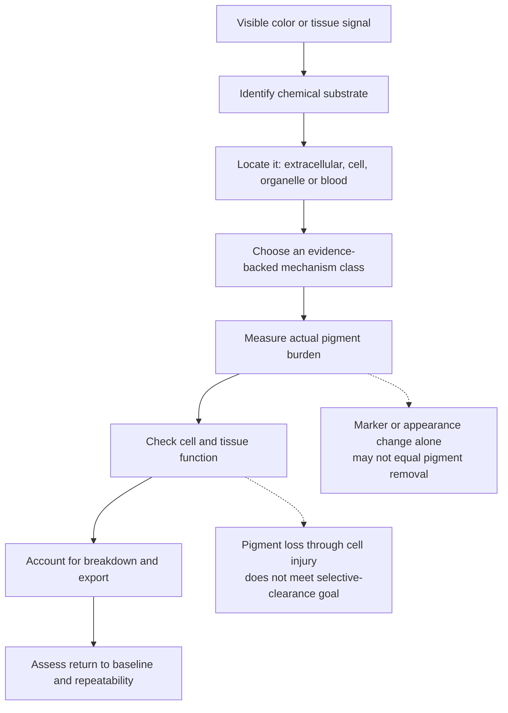
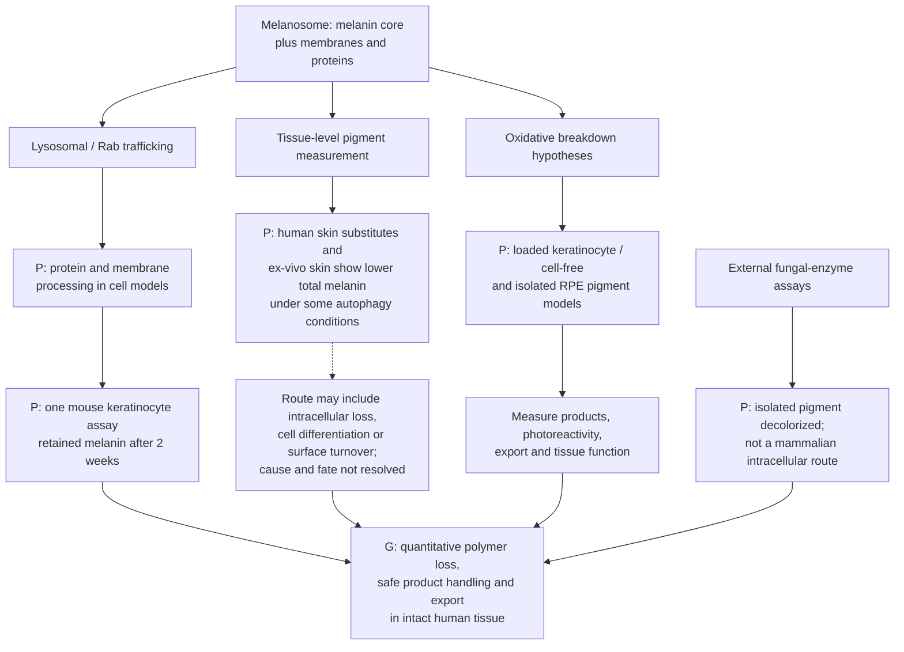
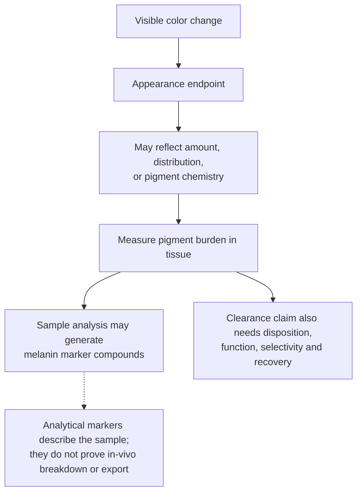
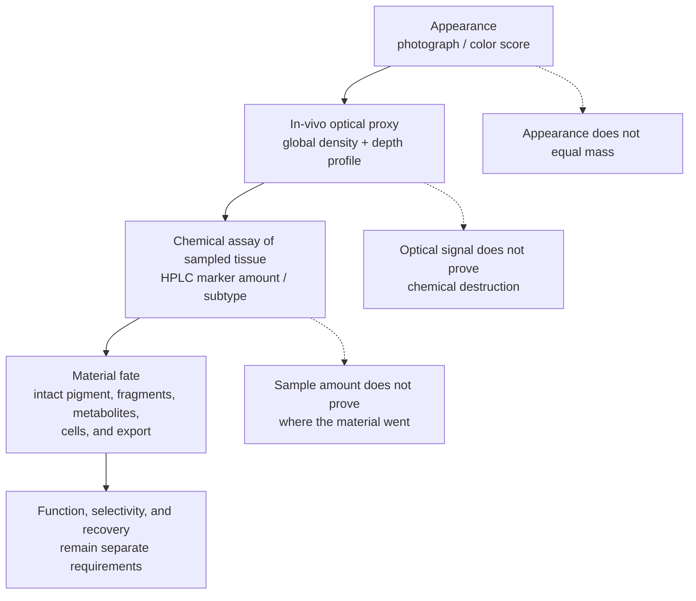
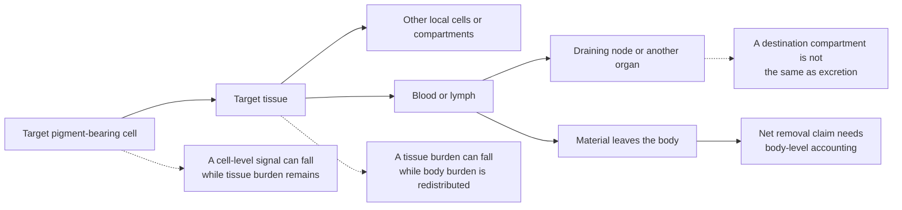
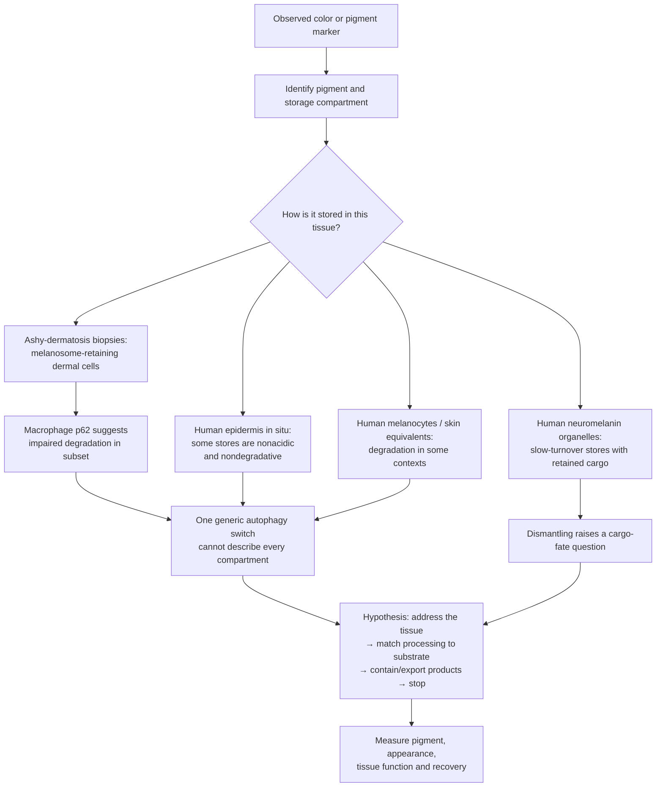
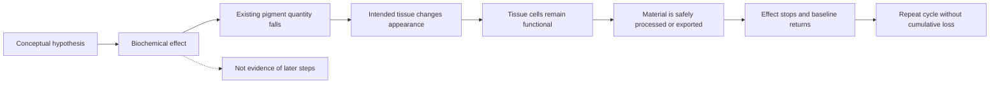

# A framework for selective pigment clearance

*Conceptual research note; evidence status linked to the [tissue pigment atlas](tissue-pigment-atlas.md) and [source register](pigment-evidence-register.md). Reviewed October 11, 2026.*

## The central question

Could an intervention reduce an existing pigment burden in a chosen tissue, leave the surrounding cells functional, and then stop at a controlled endpoint?

The answer cannot be one generic “melanin removal” mechanism. A colored deposit may be melanin in a melanosome, a mixture of residual lipids and proteins in a lipofuscin granule, iron in storage complexes, a homogentisic-acid-derived polymer in connective tissue, bilirubin circulating after red-cell breakdown, or external ink held in dermal cells. Their chemistry, location, physiology, and paths out of tissue differ.

A useful high-level hypothesis is a **shared control framework with tissue- and substrate-specific clearance mechanisms**. One universal treatment across all bodily tissues is not supported by the reviewed evidence.

## Clearance is a chain of distinct outcomes

Each arrow is a separate research question. Lowering new synthesis changes the input to a pigment pool. It does not by itself demonstrate that material already stored in the tissue has disappeared. Likewise, loss of a melanosome protein, a lower optical signal, or a lighter-looking surface does not alone establish molecular pigment removal. In a mouse keratinocyte model, proteins on incorporated melanosomes degraded while melanin content remained unchanged. A skin-cell study and a separate melanophagy study provide mechanism-level evidence for melanosome degradation in specific models; neither establishes the same process in every tissue. [Endpoint study](https://pmc.ncbi.nlm.nih.gov/articles/PMC10739166/), [human skin-cell study](https://doi.org/10.1111/pcmr.12838), [melanophagy study](https://pmc.ncbi.nlm.nih.gov/articles/PMC10998605/).

## A melanosome can be disassembled while its pigment core persists

A melanosome contains a chemically stable melanin core plus membranes and melanosomal proteins. These are different clearance substrates. In a mouse keratinocyte model, Rab7B/42- and LAMP1-positive compartments promoted degradation of melanosomal proteins, while measured melanin content remained unchanged even after two weeks. Earlier in-vitro lysosome work likewise reported breakdown of melanosome constituents without digestion of the melanin moiety. This makes protein-marker loss or fewer intact organelles an insufficient endpoint for pigment removal. [Marubashi and Fukuda, 2020](https://pmc.ncbi.nlm.nih.gov/articles/PMC10739166/), [Otaki and Seiji, 1971](https://pubmed.ncbi.nlm.nih.gov/5556529/).

There is also evidence that total measured pigment can fall in some tissue models: autophagy activation lowered melanin measurements in human skin substitutes and ex-vivo skin, and a 2020 study of hyperpigmented human elbow skin (four ex-vivo specimens) reported lower melanin-positive area after autophagy restoration along with improved epidermal-differentiation marker patterns. This remains a one-direction disease-model result, with no identified pigment products or export balance. A 2026 model of human keratinocytes loaded with mouse melanoma-derived melanosomes reported lower absorbance under a proposed lysosomal-oxidative mechanism. These results are not yet a demonstrated polymer-to-products mass balance in intact living human tissue. Differences in cell differentiation, epidermal shedding, oxidative modification, and assays may explain why studies report different endpoints; that is an inference, not a settled explanation. Oxidative loss also needs a function and product-fate assessment: isolated human RPE granules formed soluble degradation products that generated superoxide under blue light in vitro. [Murase et al., 2013](https://doi.org/10.1038/jid.2013.165), [Zhao et al., 2026](https://doi.org/10.1111/jocd.70770), [Dontsov et al., 2023](https://pubmed.ncbi.nlm.nih.gov/37685907/).

One 2016 HeLa-cell report attributed reduced melanin-associated color intensity to lysosomal/peroxisomal activity, but its available abstract does not resolve direct pigment-mass loss or product disposition. A separate fungal laccase study decolorized isolated synthetic and human-hair melanin outside living human tissue. These are biochemical leads, not established mammalian tissue-clearance routes. [Park et al., 2016](https://doi.org/10.1007/s11010-015-2645-2), [Park et al., 2021](https://pubmed.ncbi.nlm.nih.gov/34346036/).

This distinction defines the next evidence gate: show chemical loss of the melanin core itself, identify breakdown products, measure their fate outside the target compartment, and preserve the tissue's normal function. A lower color or organelle-protein signal is not enough.

## Appearance and pigment burden require separate endpoints

A small human skin study designed to produce comparable visible tanning found no significant increase in measured melanin under UVA alone, while UVB-containing exposures increased it. Skin appearance can therefore change without a corresponding increase in pigment mass; this is a skin finding, not evidence of the same optical mechanism in the iris. [Choi et al., 2010](https://pubmed.ncbi.nlm.nih.gov/20147966/).

A 2026 ex-vivo human-skin study found UVA1-associated visible darkening alongside HPLC marker changes interpreted as eumelanin photooxidation/photodegradation and cross-linking, plus pheomelanin oxidation. Thus chemical modification of existing melanin can accompany a darker appearance; a degradation marker shift does not establish net pigment loss or export. Because the specimens were ex vivo, the study did not measure living-tissue disposition or recovery, and its skin result does not establish an iris mechanism. [Ito et al., 2026](https://doi.org/10.3390/ijms27093973).

Some melanin assays deliberately process harvested samples to generate marker compounds before HPLC measurement. For example, alkaline hydrogen peroxide oxidation generates markers used to estimate eumelanin and pheomelanin content in skin and other biological samples. Those assay products describe the sampled pigment; they do not show that the body naturally formed or exported the same compounds. [Ito et al., 2020](https://pmc.ncbi.nlm.nih.gov/articles/PMC7404343/).

Color can also depend on a pigment's chemical state. A human argyria case reported recurrent discoloration after laser treatment; a later case report proposed that ultraviolet exposure could re-darken residual silver, but did not establish that mechanism or quantify total silver. This is case-level metal evidence, not a melanin or iris mechanism. It reinforces that appearance and substrate burden require separate endpoints. [Krase et al., 2017](https://pubmed.ncbi.nlm.nih.gov/28296792/), [Fukayama et al., 2020](https://pmc.ncbi.nlm.nih.gov/articles/PMC9309704/).

### Measurement hierarchy: color, in-vivo burden proxy, chemical mass, and fate

Appearance endpoints (photographs, colorimetry, or disease scores) can change when pigment amount, depth, geometry, or chemistry changes. In-vivo multiphoton Pseudo-FLIM adds a spatially resolved epidermal estimate: a global fraction of melanin-positive voxels and a depth profile across normalized skin layers. The method has been compared with FLIM and phasor analyses in pigment standards and cell models, and its density estimate correlates with skin-color measures. Authors also report consistency with prior ex-vivo histology/HPLC observations across pigmentation groups; that is not the same as a paired chemical assay of the same site before and after treatment. The optical method is field-of-view limited and detects an image-derived signal, not molecular mass directly. [Peña et al., 2022](https://pmc.ncbi.nlm.nih.gov/articles/PMC8803839/).

HPLC analysis of melanin degradation markers is more chemically specific for pigment amount and subtype in a sampled specimen, but requires harvested tissue and does not preserve its layer map. Imaging and HPLC answer different questions. A lower in-vivo signal or lower marker quantity in a biopsy would still need a material-fate account before it could establish selective clearance: the study must distinguish pigment modification, redistribution, shedding, cellular loss, and export.

A small human HPLC study illustrates that chemical assays can resolve pigment subtype in treated skin: five people with vitiligo had post-PUVA biopsies from depigmented and repigmented patches, and both eumelanin and pheomelanin were quantified. Pigment was still detectable in depigmented areas, including lesions described as long-standing. Since there was no paired pre-treatment chemical baseline and PUVA was used in a repigmentation context, these data do not demonstrate removal of accumulated pigment. [Parsad et al., 2003](https://pubmed.ncbi.nlm.nih.gov/14510999/).

Human treatment monitoring demonstrates why time and depth belong in that measurement plan. In a 20-person occlusive retinoid study, retinol-associated living-epidermis density remained below baseline at the last scan, day 32 (20 days after the 12-day exposure ended); the study did not demonstrate return by that point. A later in-vivo method analysis found that retinoids limited seasonal melanin ascent into upper epidermal layers and interpreted the effect mainly through epidermal renewal. In a separate 2025 observational melasma study, layer-specific TPM scores decreased during treatment, but the treatment phase lacked an untreated comparator. These human signals support noninvasive tracking in skin; they do not establish pigment-core breakdown, safe export, healthy-tissue cosmetic control, or a reversible cycle. [Tancrède-Bohin et al., 2015](https://pubmed.ncbi.nlm.nih.gov/25220296/), [Tancrède-Bohin et al., 2020](https://pmc.ncbi.nlm.nih.gov/articles/PMC7754381/), [Ning et al., 2025](https://doi.org/10.1001/jamadermatol.2025.2790).

## Surface-cell export is a distinct route

In a renewing epithelium, pigment still held inside cells could leave with shed cells. That is biologically different from digesting pigment in place or reducing new synthesis. It remains an inference about material fate unless the pigment itself is followed out of the tissue and tissue function is checked. A 2023 full-thickness human skin-equivalent model offers a distinct physical-removal comparison: ten tape strips reduced visible and measured model pigmentation while increasing transepidermal water loss (TEWL), indicating barrier impairment. It did not quantify pigment carried away on the strips or test living human skin. [Goncalves et al., 2023](https://doi.org/10.1002/btm2.10415).

| Compartment | Evidence in this review | What it does not establish |
| --- | --- | --- |
| **Epidermis** | **H:** melanin in surface corneocytes and sampled outer stratum corneum; a six-person UVA-fading turnover proxy; preliminary histology proposed asymmetric melanin-organelle inheritance in basal keratinocyte mitoses. **P:** a pigmented full-thickness human skin equivalent lightened after tape stripping. | A complete source-to-surface mass balance or controllable biological export. Asymmetric inheritance is a distribution model, not clearance; tape stripping raised TEWL and physically removed surface layers in the model. |
| **Gingiva / buccal mucosa** | Human gingival ultrastructure found melanin granules in keratinocytes; biopsy labeling studies measured site-dependent S-phase proliferation. A small exfoliative study sampled healthy cheek cells, but characterized the observed granules as keratohyalin-like without measuring melanin. | Complete transit time, melanin mass in exfoliated gingival cells, or a controllable oral pigment-clearance route. |
| **Adult iris** | In the examined adult iris specimens, PCNA and Ki-67 staining did not show positive nuclei. | Zero turnover over a lifetime, pigment disposal, or a route for returning iris color to baseline. |

The skin evidence includes actual melanin measured in the outer corneocyte/stratum-corneum compartment, but surface sampling does not quantify the full native tissue pool or separate all pigment inputs from losses. Oral studies identify melanin within gingival keratinocytes and measure proliferation. One small study did examine exfoliated healthy cheek cells, but characterized the observed granules as keratohyalin-like and did not assay melanin; pigment mass in exfoliated gingival cells remains unmeasured. Iris histology remains a snapshot. Across these tissues, a surface pigment pool and cell renewal support an export hypothesis; they do not show that a chosen intervention can selectively clear stored pigment while preserving function. [Lu et al., 1996](https://pubmed.ncbi.nlm.nih.gov/8881670/), [Matsunaka et al., 2017](https://doi.org/10.1111/srt.12309), [Maeda, 2017](https://www.mdpi.com/2079-9284/4/4/47), [Squier and Waterhouse, 1967](https://doi.org/10.1016/0003-9969(67)90148-3), [Thomson et al., 1999](https://pubmed.ncbi.nlm.nih.gov/10577752/), [Thomson et al., 2001](https://pubmed.ncbi.nlm.nih.gov/11684035/), [Pfeiffer et al., 2001](https://jamanetwork.com/journals/jamaophthalmology/fullarticle/265260).

## A decrease in one compartment may be redistribution

“Clearance” has nested boundaries. A lower pigment signal in a target cell is a cell-level observation. To claim tissue clearance, material must no longer reside elsewhere in that tissue. To claim body-wide removal, the total body burden must fall rather than shift into blood, lymph, a draining node, or another organ. Actual excretion is a still narrower endpoint.

The arrows are possible accounting routes, not a proposed treatment pathway. Melanin-specific findings reinforce the boundary: oxidative breakdown of isolated human RPE granules yields soluble, fluorescent products, and product fractions can generate superoxide under blue light in vitro; rare metastatic melanoma melanuria has also been associated with renal melanin deposits and tubular injury. Neither is a safe export mechanism: the first has no living-tissue product-fate test, and the second is a pathological complication. [RPE product study](https://pubmed.ncbi.nlm.nih.gov/37685907/), [renal melanuria case](https://pubmed.ncbi.nlm.nih.gov/18572978/). Human reports document pigment in multiple destinations: posterior iris pigment can enter aqueous pathways and accumulate in the trabecular meshwork; human anthracosis case series identify carbon-containing pigment in mediastinal lymph-node macrophages. The latter static observations do not prove the route or show net elimination. Human postmortem tissue analysis detected matching tattoo-pigment species in skin and regional lymph nodes in 2 of 4 donors; a separate case found pigment in regional nodes three years after dermabrasion. A mouse biodistribution study detected tattoo particles in hepatic Kupffer cells after one year. In one argyria laser case, treated-skin biopsies showed smaller silver particles, a lower silver signal, and macrophage uptake, but residual silver remained and body-level elimination was not measured. Macrophage handling can itself affect tissue function: a tattoo-ink study reported apoptosis in human-cell culture and persistent inflammation in mouse draining nodes; a 2026 comment and reply debate how those mouse findings translate to ordinary human tattooing. These results concern foreign ink, not endogenous melanin, and are a reason to measure cell and immune function if a transport route is proposed. Skin studies measure melanin at the outer corneocyte/stratum-corneum interface, but do not provide a whole-body mass balance. In colon melanosis, a guinea-pig model linked post-withdrawal loss of lamina-propria pigmented macrophages to their migration into regional lymph nodes. Human biopsies support formation of lipofuscin-laden macrophages, and a retrospective series plus one case report document endoscopic disappearance after exposure cessation; the human studies do not establish whether lymph-node migration accounts for resolution or measure whole-body pigment balance. Thus a tissue-specific intervention would need to define which boundary its endpoint covers and check likely destination compartments. [Iris pigment-dispersion models](https://pmc.ncbi.nlm.nih.gov/articles/PMC7847180/), [human nodal anthracosis cases](https://pmc.ncbi.nlm.nih.gov/articles/PMC3920429/), [surface corneocyte study](https://pubmed.ncbi.nlm.nih.gov/8881670/), [human skin-and-node tattoo study](https://doi.org/10.1038/s41598-017-11721-z), [mouse tattoo-ink immune study](https://doi.org/10.1073/pnas.2510392122), [model critique](https://doi.org/10.1073/pnas.2611211123), [author reply](https://doi.org/10.1073/pnas.2613440123), [tattoo pigment in regional nodes after dermabrasion](https://pubmed.ncbi.nlm.nih.gov/32650854/), [mouse liver biodistribution study](https://pubmed.ncbi.nlm.nih.gov/28486229/), [tattoo laser biopsy study](https://doi.org/10.1111/1523-1747.ep12478570), [argyria biopsies after laser](https://pmc.ncbi.nlm.nih.gov/articles/PMC9309704/), [melanosis-coli model](https://pmc.ncbi.nlm.nih.gov/articles/PMC1880689/), [human ultrastructure](https://pubmed.ncbi.nlm.nih.gov/8367190/), [melanosis-coli clinical course](https://pubmed.ncbi.nlm.nih.gov/36849146/), [single-case follow-up](https://pmc.ncbi.nlm.nih.gov/articles/PMC11402352/).

## Mechanism classes and their current reach

| Mechanism class | What it changes | Evidence examples in the atlas | What it does not establish |
| --- | --- | --- | --- |
| **Destroy pigment-producing cells** | Remove or damage melanocytes; remaining skin melanin can be lost as the epidermis renews | Historical monobenzone labeling for extensive vitiligo; human melanocyte cultures found melanogenesis-inhibiting concentrations near cytotoxic concentrations | This is cell loss, not selective pigment clearance; effects may be permanent, irregular, and nonlocal. It does not support reversible modulation or transfer to iris/other tissues. [Historical FDA label](https://www.accessdata.fda.gov/drugsatfda_docs/label/2003/08173slr015_benoquin_lbl.pdf), [Lee et al.](https://pubmed.ncbi.nlm.nih.gov/26440747/), [FDA 2022 review](https://www.fda.gov/media/160999/download?attachment=) |
| **Reduce new pigment production** | The rate of new pigment formation | Short-term facial melasma treatment; reduced homogentisic-acid production in alkaptonuria | Removal of established pigment, healthy-body shade control, or a reversible iris cycle |
| **Increase new pigment production** | New melanin production in the treated biological system | Afamelanotide implant for adult EPP increases skin eumelanin; some glaucoma drugs increase iris pigment as a side effect | A chosen cosmetic shade, iris response in uniformly blue eyes, reversal, or selectivity across tissues |
| **Change transfer or packaging** | Movement or storage of pigment between or within cells | Melanosome transfer studies in skin models; human facial appearance studies; preliminary human-skin evidence proposing asymmetric melanin-organelle inheritance in basal keratinocyte mitoses. [Joly-Tonetti et al.](https://doi.org/10.1111/bjd.16926) | Organelle distribution is not melanin degradation or export; these skin findings do not establish the same behavior in oral or ocular tissue. |
| **Remove pigment-bearing surface layers** | Physically removes stratum-corneum layers containing pigmented corneocytes | Tape stripping lightened pigmented full-thickness human skin equivalents and lowered measured tissue melanin; TEWL increased. [Goncalves et al., 2023](https://doi.org/10.1002/btm2.10415) | Not a selective biological process or a living-person clearance result; the model barrier was impaired and pigment destination was not measured. |
| **Increase intracellular degradation** | Break down pigment inside the pigment-bearing cell | Human keratinocytes loaded with mouse melanoma-derived melanosomes showed lower melanin absorbance in a 2026 HCP model; earlier human-cell and mostly mouse-cell melanophagy studies; selected retinal bisretinoid/lipofuscin changes in cell/mouse models; human donor RPE showed age-associated melanin decline, and intense visible light photobleached RPE in human eyecup assays | No controlled intervention has selectively removed melanin from intact human tissue. Natural RPE aging is cross-sectional, photo-oxidation changes a functional photoprotective pigment, and no tissue-to-body product accounting was measured; no iris applicability or shared pathway across pigment classes. [Zhao et al.](https://doi.org/10.1111/jocd.70770), [Feeney-Burns et al.](https://pubmed.ncbi.nlm.nih.gov/6698741/), [Schmidt and Peisch](https://pubmed.ncbi.nlm.nih.gov/3721785/), [Sarna et al.](https://pubmed.ncbi.nlm.nih.gov/12589778/) |
| **Lower a disease precursor** | Formation of a pathologic deposit over time; may allow partial regression | Alkaptonuria studies report reduced precursor, slower progression, and partial regression in measured eye/ear pigmentation | Complete removal, arbitrary control, or transfer to physiologic iris melanin |
| **Stop an initiating exposure; allow cell egress** | Can halt new pigment-generating injury; a guinea-pig melanosis-coli model showed pigmented macrophage migration to regional nodes after exposure ceased | Human melanosis-coli can become endoscopically invisible after anthranoid cessation; human biopsies confirm pigment-laden macrophages | Human lymph-node destination and net body-level clearance remain unmeasured; this tissue-specific pathology model does not transfer to iris or other pigments |
| **Normal melanogenic metabolite output** | Melanin-pathway intermediates and metabolites measured in urine of healthy subjects | Urinary markers vary with skin pigment-forming biology; eumelanin-related PTCA and pheomelanin-related AHP can be measured after processing urine samples | Supports normal output of pathway products, but not removal of stored tissue pigment: no tissue-to-urine tracer or mass balance. [Wirestrand et al.](https://pubmed.ncbi.nlm.nih.gov/2413694/), [Westerhof et al.](https://doi.org/10.1111/1523-1747.ep12580422), [Wakamatsu et al.](https://pubmed.ncbi.nlm.nih.gov/16524432/) |
| **Uncontrolled pathological release / excretion** | Pigment-related material reaches blood and urine in advanced metastatic melanoma; renal deposition may occur | Human melanuria cases and melanoma cohorts with elevated urinary markers; one renal-biopsy case showed intratubular deposits with tubular injury | A rare disease complication, not selective clearance. Assay-generated markers do not establish in-vivo degradation products, and renal deposition can be harmful. [Wakamatsu et al.](https://pubmed.ncbi.nlm.nih.gov/16524432/), [renal case](https://pubmed.ncbi.nlm.nih.gov/18572978/) |
| **Remove material from the body** | Systemic burden of a specific chemical | Human bilirubin conjugation and tracer-measured excretion; phlebotomy or chelation for diagnosed iron overload | A substrate-specific route does not imply clearance of stored melanin/lipofuscin or arbitrary tissue-targeted cosmetic change |
| **Fragment or remove a deposit physically** | An external pigment or pigmented tissue may be fragmented or physically removed | Tattoo-laser biopsies show pigment-cell disruption and particle fragmentation; one argyria case showed lower silver signal in treated skin with macrophage uptake | Whole-body pigment removal, preservation of pigment-bearing cells, or transfer to endogenous melanin and functional tissues such as the iris |

## Stored pigment may resist degradation—and carry a function

Human skin evidence points to context-dependent turnover, not a simple contradiction. Cultured keratinocytes can lose transferred melanosomes at different rates depending on donor skin phenotype. In cultured human skin substitutes and ex-vivo human skin, autophagy activators lowered measured melanin while inhibitors raised it. This is a two-direction response in models, but no washout/recovery cycle was tested in people. A separate study implicated lysosomal cathepsin V (CTSV): CTSV knockdown suppressed melanosome degradation in cells, and basal-layer CTSV staining was lower in a small comparison of normal and hyperpigmented human skin. That endpoint does not prove CTSV itself breaks down the melanin polymer or that degradation products leave the tissue. Another human-keratinocyte uptake study and electron microscopy/tomography of **human skin in situ** found melanin in compartments that were not highly acidic or degradative, consistent with storage or protection. A preliminary human-histology study proposed that basal progenitor keratinocytes retain much melanin in the self-renewing daughter after mitosis, with regenerative stress shifting toward more symmetric allocation. This is a distribution hypothesis, not a measured pigment-export pathway; it cautions against treating sparse suprabasal melanin as direct proof of local melanin degradation. Compartment, cell state, and skin phenotype therefore matter. None establishes safe, controlled pigment clearance in intact healthy people. [Differential turnover in cultured keratinocytes](https://pubmed.ncbi.nlm.nih.gov/21326292/), [ex-vivo and skin-substitute models](https://doi.org/10.1038/jid.2013.165), [CTSV study](https://pubmed.ncbi.nlm.nih.gov/29654760/), [cultured nondegradative compartments](https://pubmed.ncbi.nlm.nih.gov/29074272/), [human in-situ ultrastructure](https://pubmed.ncbi.nlm.nih.gov/29054596/), [asymmetric-inheritance study](https://doi.org/10.1111/bjd.16926), [cultured-cell degradation study](https://pubmed.ncbi.nlm.nih.gov/31659857/).

Stored skin melanin also has a native function. Human skin explants showed fewer UV-induced DNA photoproducts in epidermal cells with supranuclear melanin caps. In an experimental human-melanocore model, physically disrupted cores had weaker antioxidant and photoprotective properties than intact cores. This does not quantify harm from a hypothetical controlled intervention, but it means pigment quantity, appearance, and protective function must be measured separately. [Human skin explants](https://pubmed.ncbi.nlm.nih.gov/9579550/), [melanocore integrity model](https://pmc.ncbi.nlm.nih.gov/articles/PMC6056223/). A 2026 human biopsy study in ashy dermatosis found melanosomes retained in dermal fibroblasts and macrophages; a subset showed macrophage p62 accumulation consistent with impaired autophagic degradation. This disease-specific result reinforces that cell type and storage state differ by compartment, without demonstrating a clearance intervention. [Hada et al., 2026](https://pubmed.ncbi.nlm.nih.gov/42410740/).

Neuromelanin is a strong test of whether reducing pigment inside a cell also clears it from a tissue. Human substantia-nigra organelles are long-lived, have reduced lysosomal machinery, and contain undegraded proteins, lipids, and metal-binding melanin. In a 2019 rat model that induced human-like neuromelanin, TFEB enhancement lowered intracellular pigment density and attenuated neuronal loss and motor impairment. Lysosomal exocytosis was also detected in neuromelanin-producing cells, but the study did not measure the fraction exported in vivo or where it went. A small postmortem study of 12 neurologically normal humans found more extracellular neuromelanin with age and increased microglial phagocytic activity without pronounced inflammation. Separately, microglia phagocytosed and degraded purified human neuromelanin in vitro, but extracellular pigment activated microglia and caused dopaminergic injury in cell and rat models. These findings show a possible intracellular reduction mechanism in a disease-model animal and a real compartment-shift risk; they do not establish safe, selective clearance from the human brain or body. [Human organelle study](https://pubmed.ncbi.nlm.nih.gov/29900402/), [human-brain pigment chemistry](https://pubmed.ncbi.nlm.nih.gov/18988735/), [Carballo-Carbajal et al., 2019](https://doi.org/10.1038/s41467-019-08858-y), [Korzhevskii et al., 2021](https://pmc.ncbi.nlm.nih.gov/articles/PMC8419629/), [Zhang et al., 2011](https://pubmed.ncbi.nlm.nih.gov/19957214/).

A 2026 high-resolution analysis of **seven postmortem human locus-coeruleus samples** mapped Al, Ca, and Fe mainly to the neuromelanin pigment compartment, distinct from the organelle's protein matrix and lipid bodies. Its small observational sample and semi-quantitative aging trends refine the cargo map; they do not establish a clearance route or predict what a controlled intervention would do. [Berro et al., 2026](https://pmc.ncbi.nlm.nih.gov/articles/PMC13408184/).

Oxidative pigment loss also needs a product-and-function assessment. In isolated pigment granules from human cadaveric retinal pigment epithelium, oxidative melanin breakdown yielded water-soluble carbonyl-containing products; the product fractions generated superoxide under blue light in vitro. The authors frame this as potential phototoxicity. Separately, oxidative bleaching of synthetic DOPA-melanin altered antioxidant/redox properties and increased singlet-oxygen photogeneration. These are isolated-granule and synthetic-pigment models, not evidence that a designed intervention would harm living tissue; they establish that decreased absorbance alone is an incomplete safety endpoint. [Dontsov et al., 2023](https://pubmed.ncbi.nlm.nih.gov/37685907/), [Mokrzyński et al., 2024](https://pubmed.ncbi.nlm.nih.gov/38803190/).

This suggests a **shared research-control architecture**, not one universal melanin-removal molecule:

1. **Address:** identify the target pigment, cell type, and storage compartment.
2. **Process:** match the conceptual mechanism to that substrate and compartment; reducing new synthesis is not stored-pigment clearance.
3. **Handle products:** determine how pigment fragments and associated cargo remain contained, are metabolized, or leave the tissue.
4. **Preserve function:** measure the tissue's normal protective, sensory, or metabolic role alongside pigment burden and appearance.
5. **Stop and recover:** establish a controlled endpoint, return toward baseline, and repeatability without cumulative loss.

The tissue-specific implications are uneven: skin has the strongest current mechanistic evidence for handling existing melanin in tissue models, but also a photoprotection/differentiation constraint; gums have a 73-person topical-only lightness signal plus smaller gel/injection comparisons, but no post-use return or pigment-export evidence; the visible anterior iris has no demonstrated clearance method, and retinal pigment-epithelium findings do not transfer to it; brain neuromelanin is chiefly a cargo-handling and function question, not a cosmetic target. Withdrawal of a pigment-increasing drug also differs by tissue: human iris darkening showed no observed fading over two years in a clinical report and over five years in a single case, while one periocular-skin case lightened within two months. This suggests that pigment fate cannot be extrapolated across epithelia and stable stromal cells; neither observation is an active removal intervention. [Wistrand et al.](https://pubmed.ncbi.nlm.nih.gov/9154289/), [Camras et al.](https://pubmed.ncbi.nlm.nih.gov/10708238/), [Wand et al.](https://jamanetwork.com/journals/jamaophthalmology/fullarticle/265847). These are evidence boundaries, not proposed procedures.

The alkaptonuria example matters because clinical human evidence links a lower chemical precursor to partial regression of an accumulated pigment deposit. It remains a disease-specific pathway: the deposit is not melanin, measured regression was incomplete, and this finding does not supply a general formula for other tissues. [Pigment regression cohort](https://pubmed.ncbi.nlm.nih.gov/32904992/), [randomized disease trial](https://pubmed.ncbi.nlm.nih.gov/32822600/).

## Evidence requirements for tissue-specific feasibility

A candidate target needs evidence at every level below. A strong result at one level cannot substitute for another.

| Evidence level | Question to resolve | Example distinction |
| --- | --- | --- |
| **Identity** | Which molecule or mixture creates the measured color? | Iris stromal melanin, RPE bisretinoids, and bilirubin are different targets. |
| **Compartment** | Is it outside cells, in the cytoplasm, in a named organelle, or in the circulation? | Anterior iris stroma and posterior iris pigment epithelium are separate compartments. |
| **Access** | Can the intended tissue be affected without comparable effects in neighboring or distant tissues? | Skin-cell culture does not demonstrate access limited to the iris. |
| **Mechanism** | Does the intervention inhibit new production, digest existing material, change optical presentation, or physically remove pigment-bearing tissue? | A synthesis marker can fall while stored pigment remains. |
| **Material fate** | What happens to intact pigment, fragments, metabolites, and cellular debris? | Iris pigment released into aqueous pathways may reach outflow tissues; redistribution is not demonstrated removal. |
| **Function** | Does the tissue keep its normal protective, sensory, structural, or metabolic role? | RPE and iris pigment lie in different visual-function contexts. |
| **Selectivity** | Is the effect confined to intended tissue, pigment subtype, and range? | Removing excess iron systemically for disease is not selective cosmetic targeting of one tissue. |
| **Control and recovery** | Can the change stop at a chosen level, return to baseline, and repeat? | Persistent iris darkening after stopping a drug does not show reversibility. |

For the original iris goal, the main unanswered transitions are **controlled darkening of a uniformly blue iris**, **selective removal of pigment already present**, and **restoration of the original optical appearance**. Separately changing a biological pigment measurement would not automatically restore visible blue.

The eye illustrates why **release is not the same as safe export**. In pigment-dispersion disease, pigment released from the **posterior iris pigment epithelium** enters aqueous pathways and can accumulate in the trabecular meshwork. Primary porcine models report that pigment exposure can impair trabecular-meshwork cell phagocytosis and migration, reduce outflow facility, and raise pressure. This is a pathological model of a different iris compartment; it is not evidence that a hypothetical anterior-stromal intervention would cause the same disease. It does establish downstream pigment disposition and eye function as separate endpoints. [Trabecular-meshwork cell model](https://pmc.ncbi.nlm.nih.gov/articles/PMC7847180/), [porcine pressure/outflow model](https://pmc.ncbi.nlm.nih.gov/articles/PMC5915754/). Separately, case reports after cosmetic photoablative iris-laser treatment document secondary pigmentary glaucoma, including one severe bilateral case. They show that physically releasing iris pigment is not equivalent to safely clearing it; case reports do not estimate complication frequency. [Cosmetic-laser case reports](https://pubmed.ncbi.nlm.nih.gov/37771388/), [earlier case report](https://pubmed.ncbi.nlm.nih.gov/33449587/).

## Cross-tissue evidence snapshot

This is a compact map of the strongest reviewed examples, not an exhaustive treatment listing. "Available" always means for the stated indication and delivery method.

| Tissue / target | Strongest reviewed evidence | What it does not establish |
| --- | --- | --- |
| **Epidermal skin** | **C:** treatments for facial melasma and vitiligo; **C + X:** afamelanotide implant increases skin eumelanin in adult EPP. **H:** preliminary human histology proposed asymmetric pigment-organelle inheritance in basal keratinocyte mitoses. **P:** melanosome degradation in human-cell and 3D skin models; tape stripping lightened pigmented full-thickness skin equivalents and lowered measured melanin. | Cosmetic shade selection, nondestructive clearance of stored melanin in healthy skin, or a return-to-baseline cycle. The inheritance proposal concerns distribution, while tape stripping raised TEWL in the model; neither establishes selective biological clearance. [FDA label](https://dailymed.nlm.nih.gov/dailymed/lookup.cfm?setid=94f53286-11dd-7fbb-e053-2a95a90a7c48&version=11), [Joly-Tonetti et al., 2018](https://doi.org/10.1111/bjd.16926), [Goncalves et al., 2023](https://doi.org/10.1002/btm2.10415) |
| **Gingiva / oral mucosa** | **H:** 73-person topical-only lightness signal; a 20-person active-comparator study found reduced histological area fraction of melanin-forming cells; three cases showed fewer keratinocyte melanosomes 40 days after periodontal inflammation resolved; five gingivectomy cases showed repigmentation to baseline over 1.5–3 years. | Histology and organelle counts do not quantify total melanin mass or export. Inflammation and surgical tissue removal confound interpretation; post-use return after nonsurgical pigment modulation and melanin in shed oral cells/saliva remain unmeasured. [2009 topical-only trial](https://pubmed.ncbi.nlm.nih.gov/19186973/), [2021 comparison](https://pubmed.ncbi.nlm.nih.gov/33966113/), [Alves et al., 2015](https://doi.org/10.5005/jp-journals-10024-1718), [Bergamaschi et al., 1993](https://pubmed.ncbi.nlm.nih.gov/8330948/), [95-autopsy study](https://pubmed.ncbi.nlm.nih.gov/1747076/) |
| **Colon mucosa (melanosis coli)** | **H:** human biopsies show lipofuscin-laden macrophages; endoscopic color sometimes disappears after anthranoid cessation. **P:** guinea-pig model links post-withdrawal local decline to migration of pigment-laden macrophages into regional nodes. | Human cell fate, node burden, and body-level pigment balance after disappearance remain unknown; this acquired lipofuscin pathology does not imply melanin clearance or transfer to iris. [Human biopsies](https://pubmed.ncbi.nlm.nih.gov/8367190/), [guinea-pig model](https://pmc.ncbi.nlm.nih.gov/articles/PMC1880689/), [clinical course](https://pubmed.ncbi.nlm.nih.gov/36849146/) |
| **Esophageal mucosa** | **H:** rare melanocytosis with melanin deposition described in human cases/series. | Natural history and selective clearance are not established; this is distinct from colon lipofuscin-like melanosis. [Case reports/review](https://pubmed.ncbi.nlm.nih.gov/35709783/), [case series](https://pubmed.ncbi.nlm.nih.gov/28445275/) |
| **Nasal / laryngeal mucosa** | **H:** nasal stromal melanocytes in 21/99 autopsy samples in one series; rare laryngeal melanocytes/melanosis with sample-dependent results. | No selective-clearance data; small or historical pathology series do not define a general mucosal pigment burden. [Nasal series](https://pubmed.ncbi.nlm.nih.gov/3661192/), [laryngeal study](https://pubmed.ncbi.nlm.nih.gov/9419104/) |
| **Genital mucosa** | **H:** vulvar melanosis cohort with long-term appearance follow-up; cervical and anorectal pathology series identify site-specific melanocytic findings; two-case endocervical melanin study. | These are lesion natural history or pathology data, not selective pigment-clearance evidence. Normal vaginal-pigment prevalence remains underassessed in this source set. [Vulvar cohort](https://pubmed.ncbi.nlm.nih.gov/32785609/), [cervical series](https://pubmed.ncbi.nlm.nih.gov/24300541/), [anorectal study](https://pubmed.ncbi.nlm.nih.gov/27247367/) |
| **Anterior iris / stroma** | Drug-associated darkening is documented in susceptible eyes. **X:** cosmetic laser-lightening case reports include severe pigmentary glaucoma. | Controlled shade change, safe selective nondestructive pigment reduction, or return to a person's baseline. [U.S. label](https://dailymed.nlm.nih.gov/dailymed/drugInfo.cfm?setid=f4e73059-5ba0-4d73-9ea1-09d8d654e844), [laser case](https://pubmed.ncbi.nlm.nih.gov/37771388/) |
| **Posterior iris / retinal pigment epithelium** | Human anatomy and pathology map distinct compartments; **H:** a 15-year treated pigment-dispersion cohort showed declining visible trabecular-meshwork pigmentation; **P:** selected retinal substrate-reduction mechanisms. | The cohort measured a clinical score after laser iridotomy or trabeculectomy, not pigment mass or destination; no transfer to the visible anterior-stromal target or general ocular clearance route. [Human PDS follow-up](https://pubmed.ncbi.nlm.nih.gov/34397796/), [RPE study](https://pmc.ncbi.nlm.nih.gov/articles/PMC3986126/) |
| **Dermis / tattoo ink** | **H:** ashy-dermatosis biopsies show melanosome-retaining dermal cells; **X:** laser removal of exogenous ink, with fragmentation and cell injury documented. | Safe native-melanin clearance or a measured whole-body excretion route. [Hada et al., 2026](https://pubmed.ncbi.nlm.nih.gov/42410740/), [FDA tattoo information](https://www.fda.gov/consumers/consumer-updates/tattoo-removal-options-and-results), [human node study](https://doi.org/10.1038/s41598-017-11721-z) |
| **Hair / nails** | Marketed dyes and bleaches change existing hair shafts; cause-specific nail management and isolated procedural reports exist. | A selectable controller for pigment production in living follicles or a general reversible nail-pigment treatment. [FDA hair-cosmetic information](https://www.fda.gov/cosmetics/cosmetic-products/hair-dyes) |
| **Systemic bilirubin, iron, and ochronotic deposits** | Human tracer recovery for bilirubin; **C:** disease-specific iron depletion and precursor-lowering therapy with partial regression in measured alkaptonuria sites. | A common melanin route: these are distinct chemicals, and clinical treatment is for specific diseases. [Bilirubin tracer study](https://www.jci.org/articles/view/106184), [alkaptonuria cohort](https://pubmed.ncbi.nlm.nih.gov/32904992/) |
| **Inner ear / cochlea** | **H:** melanin mapped in human stria vascularis and Rosenthal's canal; **P:** matched mouse evidence links absent melanin with age-related endocochlear-potential differences. | No human pigment manipulation or evidence that selective reduction preserves cochlear function. [Human temporal-bone study](https://pubmed.ncbi.nlm.nih.gov/25166018/), [mouse comparison](https://pubmed.ncbi.nlm.nih.gov/19141317/) |
| **Heart / pulmonary veins** | **H:** DCT-positive melanocyte-like cells identified in human tissue; **P:** mouse models link DCT/cell dysfunction with arrhythmia susceptibility. | Human cardiac pigment burden and clinical effects are not established; DCT effects do not prove pigment-amount effects. [Primary study](https://pubmed.ncbi.nlm.nih.gov/19855129/) |
| **Adipose / candidate melanocyte lineage** | **H:** adipose-derived human cells expressed melanocyte markers and formed melanin after culture, differentiation, and UVB exposure in a 3D epidermal model; a separate biopsy study found dietary carotenoids in fat. | These findings do not establish a native melanin store in intact adipose tissue or an adipose clearance route. [Ikeda et al.](https://pubmed.ncbi.nlm.nih.gov/34432824/), [Chung et al.](https://pubmed.ncbi.nlm.nih.gov/19587090/) |
| **Leptomeninges** | **H:** normal melanin-bearing melanocytes mapped in human meninges, distinct from neuronal neuromelanin. | Physiological role and selective CNS pigment clearance are not established in the reviewed sources. [Human histology](https://pubmed.ncbi.nlm.nih.gov/6699426/), [normal MRI finding](https://pubmed.ncbi.nlm.nih.gov/8770250/) |
| **Brain / visceral lipofuscin and neuromelanin** | Human tissue studies characterize pigment stores and associated cargo; animal models provide limited reduction evidence. | Selective human clearance, safe release of co-stored cargo, or cosmetic control. [Human neuromelanin organelle study](https://pubmed.ncbi.nlm.nih.gov/29900402/), [rat cardiac study](https://www.sciencedirect.com/science/article/pii/S0014482721001178) |

The evidence map separates three increasingly direct claims: a tissue contains a marker associated with melanocyte lineage; cells derived from that tissue can be induced to make melanin in culture; and the intact tissue contains a measurable native melanin burden. The first two do not establish the third. A 1993 RT-PCR survey found tyrosinase transcripts across normal organ samples but could not identify the expressing cells or measure pigment. [Battyani et al.](https://pubmed.ncbi.nlm.nih.gov/7511806/).

## Evidence ladder for a proposed clearance claim

- **Biochemical effect:** activity or expression of a pathway changes.
- **Pigment quantity:** direct measurement shows less of the stored substrate, not only less synthesis or fewer organelle markers.
- **Appearance:** the named tissue changes in a controlled, spatially uniform way.
- **Function:** the intended pigment-bearing cells and surrounding tissue retain their roles.
- **Material fate:** the products are processed, contained, or exported without harmful accumulation.
- **Return and repetition:** a stopping mechanism restores the person's baseline and remains effective across cycles.

Many current papers answer one or two levels. A cellular mechanism does not imply an established clinical option; a clinical treatment for one disease does not imply a cosmetic option for healthy tissue. The source register labels study models so these evidence levels remain visible.

## Next literature-review steps

1. For each tissue in the atlas, identify the relevant pigment molecule, producing cell, storage compartment, and normal physiological role.
2. Classify the evidence by endpoint: synthesis, transfer, actual pigment burden, appearance, function, export, or reversibility.
3. Record whether the study uses human tissue, cultured human cells, another cell model, animals, observational clinical data, or a controlled clinical intervention.
4. Track unassessed tissues separately from negative results.
5. Update the evidence map when a study demonstrates a later step in the ladder, rather than inferring it from an earlier marker.

This framework is literature organization, not a treatment design. Its current evidence supports tissue-specific research questions; it does not establish a body-wide pigment-clearance capability.
