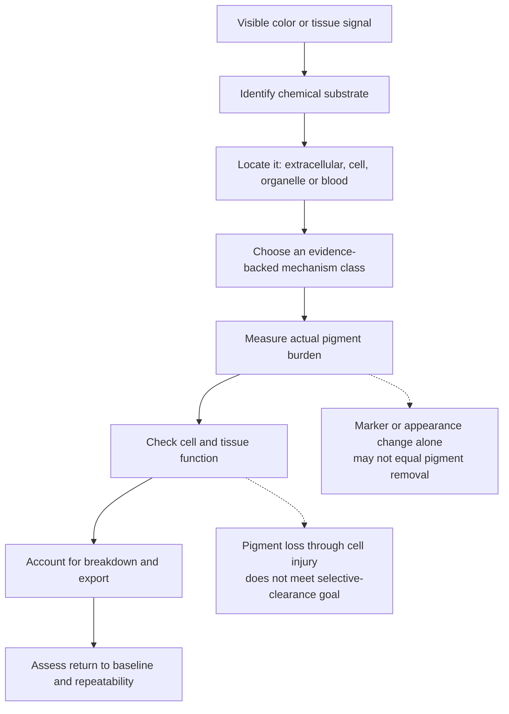
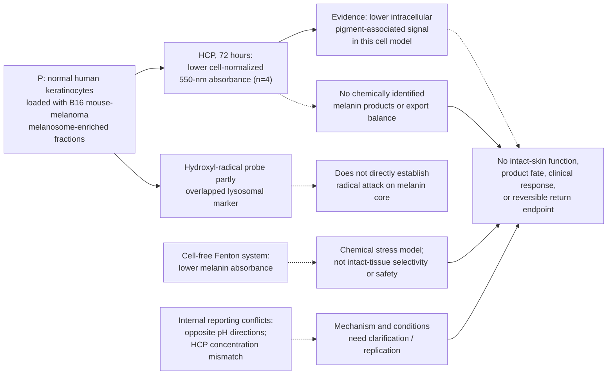
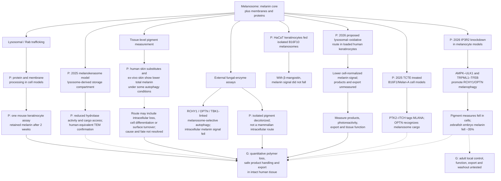
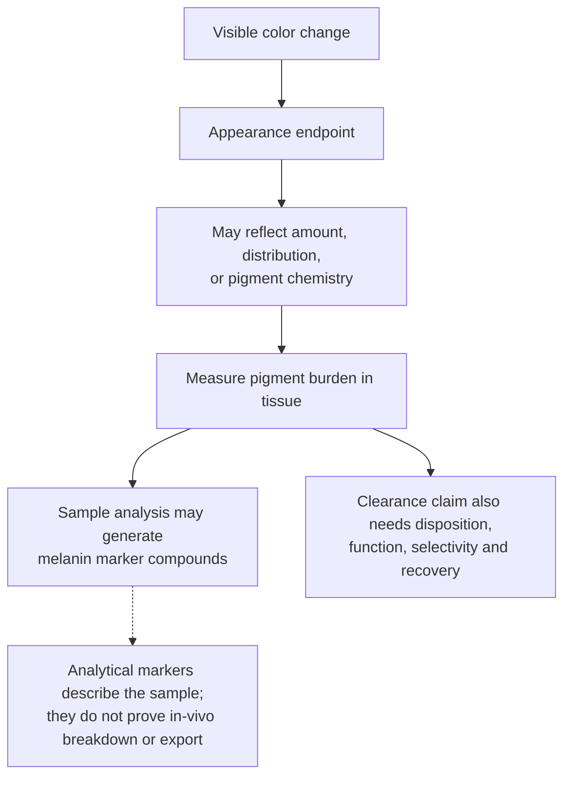
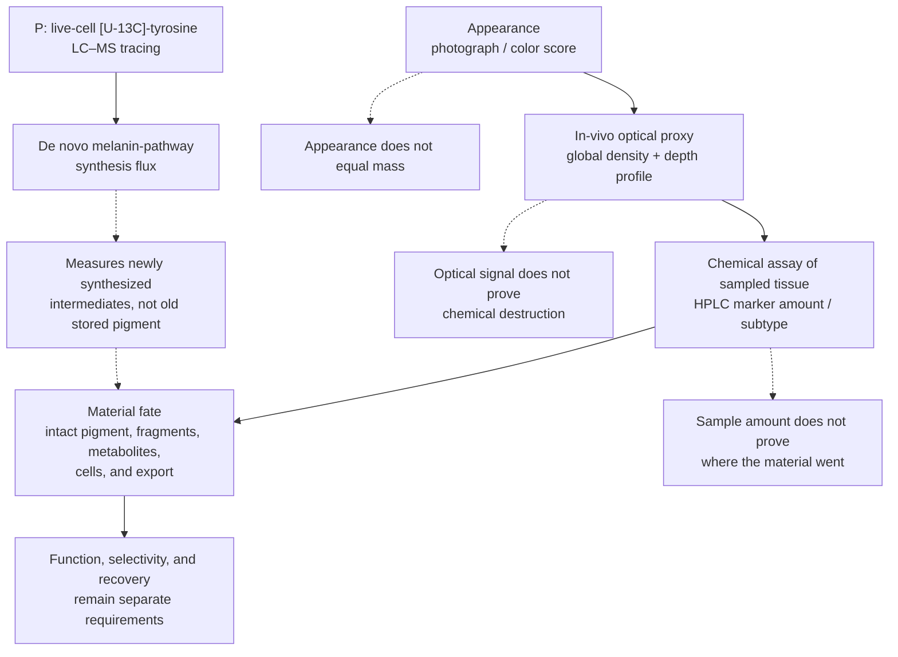
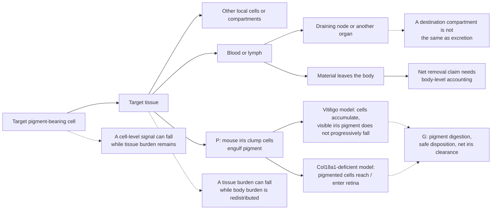
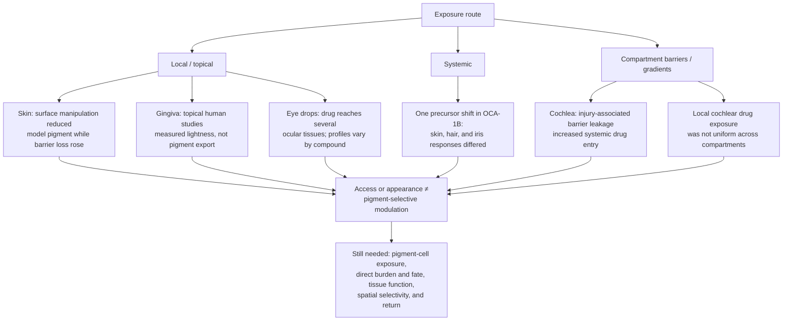
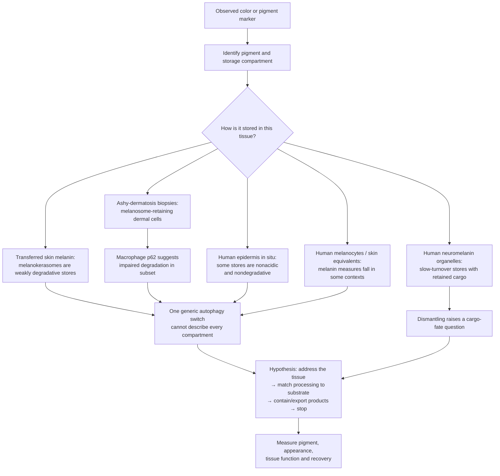

# A framework for selective pigment clearance

*Conceptual research note; evidence status linked to the [tissue pigment atlas](tissue-pigment-atlas.md) and [source register](pigment-evidence-register.md). Reviewed October 11, 2026.*

## The central question

Could an intervention reduce an existing pigment burden in a chosen tissue, leave the surrounding cells functional, and then stop at a controlled endpoint?

The answer cannot be one generic “melanin removal” mechanism. A colored deposit may be melanin in a melanosome, a mixture of residual lipids and proteins in a lipofuscin granule, iron in storage complexes, a homogentisic-acid-derived polymer in connective tissue, bilirubin circulating after red-cell breakdown, or external ink held in dermal cells. Their chemistry, location, physiology, and paths out of tissue differ.

A useful high-level hypothesis is a **shared control framework with tissue- and substrate-specific clearance mechanisms**. One universal treatment across all bodily tissues is not supported by the reviewed evidence.

## Clearance is a chain of distinct outcomes

Each arrow is a separate research question. Lowering new synthesis changes the input to a pigment pool. It does not by itself demonstrate that material already stored in the tissue has disappeared. Likewise, loss of a melanosome protein, a lower optical signal, or a lighter-looking surface does not alone establish molecular pigment removal. In a mouse keratinocyte model, proteins on incorporated melanosomes degraded while melanin content remained unchanged. A 2024 PNAS study found RCHY1/OPTN/TBK1-linked melanophagy and lower intracellular pigment in B16F10 melanoma cells, but the same β-mangostin condition did not lower melanin when isolated B16F10 melanosomes were taken up by HaCaT keratinocytes. A 2026 HCP-treated normal-human-keratinocyte model reported lower cell-normalized 550-nm absorbance after uptake of melanosome-enriched fractions from mouse melanoma. It did not measure pigment in the medium or identify oxidative products; its Methods dose labels and results/figure concentrations do not reconcile, and its Results/abstract and Discussion give opposite pH directions. These cell-context differences and reporting conflicts make the destination cell, assay, and actual pigment fate central; none establishes clearance in intact human tissue. [Endpoint study](https://pmc.ncbi.nlm.nih.gov/articles/PMC10739166/), [2024 melanophagy study](https://pmc.ncbi.nlm.nih.gov/articles/PMC10998605/), [Zhao et al., 2026](https://doi.org/10.1111/jocd.70770), [human skin-cell study](https://doi.org/10.1111/pcmr.12838).

A 2026 human-keratinocyte model adds a skin-specific function measure: KRT5/14 intermediate filaments and microtubules, linked by plectin-1, position melanin-containing organelles above the nucleus, where they shield DNA from UVB in the model. This is not evidence of pigment loss; it shows why a skin safety assessment should track subcellular pigment organization and genomic protection separately from bulk melanin or appearance. [Benito-Martínez et al., 2026](https://pubmed.ncbi.nlm.nih.gov/41398050/).

## A melanosome can be disassembled while its pigment core persists

A melanosome contains a chemically stable melanin core plus membranes and melanosomal proteins. These are different clearance substrates. In a mouse keratinocyte model, Rab7B/42- and LAMP1-positive compartments promoted degradation of melanosomal proteins, while measured melanin content remained unchanged even after two weeks. Earlier in-vitro lysosome work likewise reported breakdown of melanosome constituents without digestion of the melanin moiety. This makes protein-marker loss or fewer intact organelles an insufficient endpoint for pigment removal. [Marubashi and Fukuda, 2020](https://pmc.ncbi.nlm.nih.gov/articles/PMC10739166/), [Otaki and Seiji, 1971](https://pubmed.ncbi.nlm.nih.gov/5556529/). A 2025 primary study provides a related storage-compartment model: after uptake, melanocores acquired lysosomal markers and fused with lysosomes, but mature compartments showed declining cathepsin-B activity and reduced access to new cargo. The authors named these weakly degradative, melanin-retaining structures melanokerasomes. The pathway experiments were mainly in murine keratinocytes fed human melanoma-derived melanocores; reconstructed human pigmented epidermis supplied ultrastructural confirmation. This does not negate degradation reported in other models, but it shows that lysosomal-marker acquisition and trafficking do not by themselves prove melanin-core digestion. The study did not measure chemical products or export. [Neto et al., 2025](https://doi.org/10.1016/j.jid.2024.08.023).

Cell division adds a separate measurement issue. In primary cultures of human iris pigment epithelium isolated from postmortem eyes, pigment gradually diluted as cells divided; cultures from 19 of 24 eyes could be established and were maintained for up to 20 population doublings. The authors interpreted the dilution as inability to produce melanin in vitro. Lower pigment per cell during culture does not establish loss from the whole culture: total pigment, degradation products, and export were not measured. This is posterior IPE culture, not adult anterior-stromal iris in vivo. [Hu et al., 1992](https://pubmed.ncbi.nlm.nih.gov/1634342/).

There is also evidence that total measured pigment can fall in some tissue models: autophagy activation lowered melanin measurements in human skin substitutes and ex-vivo skin, and a 2020 study of hyperpigmented human elbow skin (four ex-vivo specimens) reported lower melanin-positive area after autophagy restoration along with improved epidermal-differentiation marker patterns. This remains a one-direction disease-model result, with no identified pigment products or export balance. A 2026 PLOS Biology study further linked IP3R2 silencing to melanophagy. In melanocyte cell models, knockdown increased melanosome-selective autophagy; pigmentation fell in B16 mouse melanoma cells and pellet-image intensity fell in primary lightly pigmented human melanocytes. Embryo-stage zebrafish knockdown reduced whole-embryo melanin by about 35% at 48 hours post-fertilization, with an mRNA rescue. The human-cell endpoint was not a chemical melanin assay, and the fish result is developmental rather than adult-tissue clearance. The study did not test a human intervention, localized selectivity, product/export balance, function, or return after withdrawal. [Saurav et al., 2026](https://doi.org/10.1371/journal.pbio.3003971). A 2026 model of normal human epidermal keratinocytes loaded with melanosome-enriched fractions from mouse B16 melanoma cells reported lower cell-normalized 550-nm melanin absorbance after HCP exposure. The assay measured the cell layer only; it did not quantify pigment in culture medium or identify degradation products, so loss of absorbance does not establish polymer breakdown or export. Lysosomal and hydroxyl-radical readouts support a proposed proteolysis-then-oxidation mechanism, but the intracellular probe only partly overlapped a lysosomal marker. The Methods call 6.25–25 mg/mL the final HCP concentrations while describing 1 μL added to 99 μL of medium, whereas results/figures report 0.125–0.25 mg/mL. Abstract/results associate stronger hydroxyl-radical signal and lower melanin absorbance with alkaline pH, while the Discussion reverses the pH direction. These conflicts leave the mechanism and quantitative conditions unresolved; the study also used an isolated-cell model and was funded by Osman Biological, with author affiliations at Osman Biological and Beauty Hi-Tech. Separately, a 2024 melanophagy study reduced pigment in mouse melanoma cells but not in HaCaT keratinocytes receiving the isolated melanosomes. A 2025 TCTE-treated B16F1/Melan-A cell study described a different PTK2–ITCH–MLANA–OPTN cascade, with ITCH/OPTN knockdown attenuating the cell-model depigmentation response; it adds another model-specific route, not an in-vivo human result. This contrast argues for model-specific conclusions rather than one general melanosome-clearance pathway. [Park et al., 2025](https://doi.org/10.1080/15548627.2024.2421695). These results are not yet a demonstrated polymer-to-products mass balance in intact living human tissue. Differences in cell differentiation, epidermal shedding, oxidative modification, and assays may explain why studies report different endpoints; that is an inference, not a settled explanation. Oxidative loss also needs a function and product-fate assessment: isolated human RPE granules formed soluble degradation products that generated superoxide under blue light in vitro. [Murase et al., 2013](https://doi.org/10.1038/jid.2013.165), [Zhao et al., 2026](https://doi.org/10.1111/jocd.70770), [PNAS melanophagy study, 2024](https://pmc.ncbi.nlm.nih.gov/articles/PMC10998605/), [Dontsov et al., 2023](https://pubmed.ncbi.nlm.nih.gov/37685907/).

One 2016 HeLa-cell report attributed reduced melanin-associated color intensity to lysosomal/peroxisomal activity, but its available abstract does not resolve direct pigment-mass loss or product disposition. A separate fungal laccase study decolorized isolated synthetic and human-hair melanin outside living human tissue. These are biochemical leads, not established mammalian tissue-clearance routes. [Park et al., 2016](https://doi.org/10.1007/s11010-015-2645-2), [Park et al., 2021](https://pubmed.ncbi.nlm.nih.gov/34346036/).

This distinction defines the next evidence gate: show chemical loss of the melanin core itself, identify breakdown products, measure their fate outside the target compartment, and preserve the tissue's normal function. A lower color or organelle-protein signal is not enough.

## Appearance and pigment burden require separate endpoints

A small human skin study designed to produce comparable visible tanning found no significant increase in measured melanin under UVA alone, while UVB-containing exposures increased it. Skin appearance can therefore change without a corresponding increase in pigment mass; this is a skin finding, not evidence of the same optical mechanism in the iris. [Choi et al., 2010](https://pubmed.ncbi.nlm.nih.gov/20147966/).

A 2026 ex-vivo human-skin study found UVA1-associated visible darkening alongside HPLC marker changes interpreted as eumelanin photooxidation/photodegradation and cross-linking, plus pheomelanin oxidation. Thus chemical modification of existing melanin can accompany a darker appearance; a degradation marker shift does not establish net pigment loss or export. Because the specimens were ex vivo, the study did not measure living-tissue disposition or recovery, and its skin result does not establish an iris mechanism. [Ito et al., 2026](https://doi.org/10.3390/ijms27093973).

Some melanin assays deliberately process harvested samples to generate marker compounds before HPLC measurement. For example, alkaline hydrogen peroxide oxidation generates markers used to estimate eumelanin and pheomelanin content in skin and other biological samples. Those assay products describe the sampled pigment; they do not show that the body naturally formed or exported the same compounds. [Ito et al., 2020](https://pmc.ncbi.nlm.nih.gov/articles/PMC7404343/).

Color can also depend on a pigment's chemical state. A human argyria case reported recurrent discoloration after laser treatment; a later case report proposed that ultraviolet exposure could re-darken residual silver, but did not establish that mechanism or quantify total silver. This is case-level metal evidence, not a melanin or iris mechanism. It reinforces that appearance and substrate burden require separate endpoints. [Krase et al., 2017](https://pubmed.ncbi.nlm.nih.gov/28296792/), [Fukayama et al., 2020](https://pmc.ncbi.nlm.nih.gov/articles/PMC9309704/).

### Measurement hierarchy: color, in-vivo burden proxy, chemical mass, and fate

Appearance endpoints (photographs, colorimetry, or disease scores) can change when pigment amount, depth, geometry, or chemistry changes. In-vivo multiphoton Pseudo-FLIM adds a spatially resolved epidermal estimate: a global fraction of melanin-positive voxels and a depth profile across normalized skin layers. The method has been compared with FLIM and phasor analyses in pigment standards and cell models, and its density estimate correlates with skin-color measures. Authors also report consistency with prior ex-vivo histology/HPLC observations across pigmentation groups; that is not the same as a paired chemical assay of the same site before and after treatment. The optical method is field-of-view limited and detects an image-derived signal, not molecular mass directly. [Peña et al., 2022](https://pmc.ncbi.nlm.nih.gov/articles/PMC8803839/).

Cross-tissue scores also need local validation. A 2014 South Indian study (n=200) and a 2024 multi-ethnic study (n=839) reported associations between skin complexion and gingival pigmentation. A 2025 study (n=261) and a 2026 South Indian study (n=100) found no significant associations; a separate small 2026 procedure trial found no significant correlation between malar dermal and gingival melanin-meter scores at follow-up. The studies differ in population, design, and appearance scales, and the procedure trial notes meter limitations on gingiva. None establishes a universal skin-to-gum conversion or shared mechanism. **Inference:** appearance in one compartment should not substitute for a local measurement in another. [Ponnaiyan et al., 2014](https://pubmed.ncbi.nlm.nih.gov/24603930/), [Koppolu et al., 2024](https://doi.org/10.1186/s12903-024-04189-7), [Jouhar, 2025](https://doi.org/10.12669/pjms.41.5.11824), [Chahal et al., 2026](https://pubmed.ncbi.nlm.nih.gov/41930043/), [Dawar et al., 2026](https://doi.org/10.1016/j.jobcr.2026.101530).

HPLC analysis of melanin degradation markers is more chemically specific for pigment amount and subtype in a sampled specimen, but requires harvested tissue and does not preserve its layer map. Imaging and HPLC answer different questions. A lower in-vivo signal or lower marker quantity in a biopsy would still need a material-fate account before it could establish selective clearance: the study must distinguish pigment modification, redistribution, shedding, cellular loss, and export.

A human-biopsy LC-MS/MS method quantified two eumelanin markers and two pheomelanin markers in a single run, using one 4-mm buttock biopsy from each of 30 volunteers. That study compared skin phototypes rather than treatment change; marker values describe processed tissue and are not a tracer of natural in-vivo melanin breakdown. A focused search for this update did not find a human depigmenting-treatment study pairing serial chemical subtype assays with pigment-output measurement. This is a search-bounded gap, not proof of absence. [Lerche et al., 2019](https://pubmed.ncbi.nlm.nih.gov/31233275/). A complementary [U-13C]-L-tyrosine LC–MS method measured de novo eumelanin and pheomelanin pathway flux in live human and mouse melanocyte models. This separates a new-synthesis rate from an endpoint pigment-content assay, but the precursor tracer does not label old stored polymer or measure its export. [Chen et al., 2021](https://pubmed.ncbi.nlm.nih.gov/33549605/).

Histology also needs an assay-specific interpretation. In a comparison of 12 human donors, Fontana–Masson and Von Kossa undercounted suprabasal melanin granules, while diffuse Fontana–Masson darkening in the stratum corneum appeared even where granules were absent; Warthin–Starry counts more closely tracked TEM. Separately, depth-resolved Raman/fluorescence detected melanin-associated bands in some outer-layer spectra in 10 volunteers, but did not establish the particulate “dust” morphology or follow material fate. For skin, a dark stain, an optical signal, a melanin-associated chemical signature, and pigment export are separate evidence claims. [Joly-Tonetti et al., 2016](https://doi.org/10.1111/exd.13016), [Yakimov et al., 2020](https://doi.org/10.1038/s41598-020-71220-6).

A small human HPLC study illustrates that chemical assays can resolve pigment subtype in treated skin: five people with vitiligo had post-PUVA biopsies from depigmented and repigmented patches, and both eumelanin and pheomelanin were quantified. Pigment was still detectable in depigmented areas, including lesions described as long-standing. Since there was no paired pre-treatment chemical baseline and PUVA was used in a repigmentation context, these data do not demonstrate removal of accumulated pigment. [Parsad et al., 2003](https://pubmed.ncbi.nlm.nih.gov/14510999/).

Human treatment monitoring demonstrates why time and depth belong in that measurement plan. In a 20-person occlusive retinoid study, retinol-associated living-epidermis density remained below baseline at the last scan, day 32 (20 days after the 12-day exposure ended); the study did not demonstrate return by that point. A later in-vivo method analysis found that retinoids limited seasonal melanin ascent into upper epidermal layers and interpreted the effect mainly through epidermal renewal. In a separate 2025 observational melasma study, layer-specific TPM scores decreased during treatment, but the treatment phase lacked an untreated comparator. These human signals support noninvasive tracking in skin; they do not establish pigment-core breakdown, safe export, healthy-tissue cosmetic control, or a reversible cycle. [Tancrède-Bohin et al., 2015](https://pubmed.ncbi.nlm.nih.gov/25220296/), [Tancrède-Bohin et al., 2020](https://pmc.ncbi.nlm.nih.gov/articles/PMC7754381/), [Ning et al., 2025](https://doi.org/10.1001/jamadermatol.2025.2790).

## Surface-cell export is a distinct route

In a renewing epithelium, pigment still held inside cells could leave with shed cells. That is biologically different from digesting pigment in place or reducing new synthesis. Human evidence supports the upstream steps but does not close the export balance: Lu et al. imaged melanin granules in surface corneocytes and found higher counts at exposed than unexposed sites for phototypes II–VI; Matsunaka et al. quantified eumelanin and pheomelanin by HPLC in tape-sampled outer stratum corneum, including a four-person time course after a single 2-MED sunlight exposure in which the surface signal peaked at weeks 11–15; and Man et al. observed substantial melanin extrusion in the outer epidermis of darkly pigmented human skin. These are, respectively, a surface-cell image index, a chemically measured surface pool, and a histologic location—not a measurement of cumulative pigment leaving a defined skin area. The Matsunaka series also combines pigment input after UV exposure with transit and retention. Maeda et al. estimated epidermal turnover at 36.2 ± 6.2 days in six people from fading of UVA-darkened skin; this is an appearance-based turnover proxy, not direct melanin mass. [Lu et al., 1996](https://pubmed.ncbi.nlm.nih.gov/8881670/), [Matsunaka et al., 2017](https://doi.org/10.1111/srt.12309), [Man et al., 2014](https://pmc.ncbi.nlm.nih.gov/articles/PMC4134407/), [Maeda, 2017](https://doi.org/10.3390/cosmetics4040047).

A 2023 full-thickness human skin-equivalent model offers a separate physical-removal comparison: ten tape strips reduced visible and measured model pigmentation while increasing transepidermal water loss (TEWL), indicating barrier impairment. It did not quantify pigment carried away on the strips or test living human skin. [Goncalves et al., 2023](https://doi.org/10.1002/btm2.10415).

### What would close the skin-export gap?

A study of surface export would need to measure the boundary and the remaining tissue pool together. It would quantify melanin-related material in naturally shed surface cells per area and time, distinguish intact pigment from assay-generated or naturally formed markers, and pair that output with an independent estimate of residual tissue burden. It would also track new-pigment input, exposure, barrier integrity, differentiation, and photoprotective function. Tape stripping is useful for collecting outer-layer material, but the removal itself is an imposed physical intervention; it cannot by itself demonstrate normal or selective biological export. A reproducible increase in chemically characterized natural output alongside a fall in residual pigment, with tissue function preserved, would be a much stronger clearance result than visible lightening alone. This is a research endpoint framework, not an available intervention.

| Compartment | Evidence in this review | What it does not establish |
| --- | --- | --- |
| **Epidermis** | **H:** melanin in surface corneocytes; eumelanin/pheomelanin measured in tape-sampled outer stratum corneum (10-person exposed/unexposed comparison; 4-person post-UV time course, surface signal peaking at weeks 11–15); melanin extrusion seen in outer human epidermis; a six-person UVA-fading appearance proxy for turnover. **P:** a pigmented human skin-equivalent lightened after tape stripping. | No measured cumulative natural or treatment-linked melanin flux from a defined skin area, source-to-surface mass balance, or controllable biological export. The time course includes pigment input after UV exposure; the turnover proxy is appearance-based. The human hyperpigmentation biopsy endpoint was stain-positive area, not chemical total melanin; products, export, and withdrawal were not assessed. Asymmetric inheritance is a distribution model, not clearance; tape stripping raised TEWL and physically removed model surface layers. |
| **Gingiva / buccal mucosa** | Human gingival ultrastructure found melanin granules in keratinocytes and fewer observed granules in superficial prickle-cell layers; biopsy labeling studies measured site-dependent S-phase proliferation. Human saliva cell counts and oral-surface geometry yielded a model-derived, rough 2.7-hour estimate for whole-mouth surface-layer turnover—not direct cell tracking or a gingiva-specific transit time [Dawes, 2003](https://pubmed.ncbi.nlm.nih.gov/12711376/); rat BrdU labeling tracked free-gingival cells from basal layers to the surface in 82–85 hours [Breschi et al., 1998](https://pubmed.ncbi.nlm.nih.gov/9527566/). A small human study isolated desquamated oral epithelial cells from saliva and assayed protein/transcript, but did not identify a gingival source or measure melanin. Exfoliative-cytology studies likewise sampled gingiva and cheek without measuring melanin in shed cells. [Aidoukovitch et al., 2022](https://pmc.ncbi.nlm.nih.gov/articles/PMC9789903/). A comparative single-cell atlas integrating 34,969 human and mouse oral-mucosa cells identified melanocytes among human-specific populations in the analyzed datasets; a larger 2026 adult human oral atlas also annotated melanocytes. A separate human periodontium atlas reported MLANA-positive melanocytes at about 0.1% and noted that their rarity limited detection across four studies. **Inference:** mouse oral models may not capture all human oral melanocyte biology, but non-detection can also reflect cell capture and annotation; “human-specific” is dataset-bounded and does not establish absence at every mouse oral site. Neither atlas measures pigment mass or exit. [Luo et al., 2025](https://pubmed.ncbi.nlm.nih.gov/40751276/), [Quinn et al., 2024](https://doi.org/10.1038/s41467-024-49037-y), [Matuck et al., 2026](https://doi.org/10.1016/j.cpblue.2026.100007). One unusual human report of metal-associated gingival discoloration found melanin in epithelium and deeper connective-tissue compartments; silver and sulfur were also detected. Clinical studies include a 73-person topical AS-G lightness signal, a 2025 split-mouth RCT of intragingival vitamin C injection versus scalpel (n=20; stronger early scalpel response but no significant index difference at six months), and mixed small procedure trials: a 2026 laser + topical-AS-G trial (n=20) favored the adjunct at nine months [Gudur et al., 2026](https://pubmed.ncbi.nlm.nih.gov/42147661/); a 2026 microneedling + ascorbic-acid versus scalpel trial (26 randomized, 23 completed) favored scalpel DOPI scores through six months [Dawar et al., 2026](https://doi.org/10.1016/j.jobcr.2026.101530), unlike a 2024 16-person trial that favored microneedling at three months [P et al., 2024](https://pubmed.ncbi.nlm.nih.gov/38752063/). A systematic review of seven microneedling-plus-ascorbic-acid studies (four RCTs, two case series, one case report) rated certainty low to very low and found long-term durability/superiority unconfirmed; it was published August 19, before Dawar's September 2 RCT. [Kusumawardani et al., 2026](https://doi.org/10.1186/s12903-026-09483-0). [Sakai et al., 1988](https://pubmed.ncbi.nlm.nih.gov/3146627/). | Human gingiva-specific transit time, melanin mass in shed cells, fate of deeper connective-tissue pigment, direct chemical pigment mass/export in treatment studies, or a controllable stand-alone topical clearance route. The metal-associated case is a single unusual pathology report. Clinical scores after procedures do not establish selective melanin clearance or a reversible cosmetic cycle. |
| **Adult iris** | In examined adult samples, PCNA/Ki-67 staining showed no positive nuclei. In an 82-eye topical-antibiotic study, aqueous soluble tyrosinase was interpreted as a marker of subclinical melanocyte toxicity/pigment dispersion; no clinically appreciable BAIT/BADI emerged. Rare disease-associated BADI reports describe stromal repigmentation after 3–4 years, alongside pigment dispersion and trabecular-meshwork deposition. [Pfeiffer et al., 2001](https://jamanetwork.com/journals/jamaophthalmology/fullarticle/265260), [Mahanty et al., 2017](https://pmc.ncbi.nlm.nih.gov/articles/PMC5563078/), [Tugal-Tutkun et al., 2009](https://pubmed.ncbi.nlm.nih.gov/19545903/), [Atilgan et al., 2018](https://pmc.ncbi.nlm.nih.gov/articles/PMC6056785/). In a 2024 five-patient mixed BADI/BAIT series, one BADI patient had glaucomatous visual-field changes and one BAIT patient required a tube-shunt implant; this case-level result is not a treatment-risk estimate. [Costa et al., 2024](https://pmc.ncbi.nlm.nih.gov/articles/PMC11623184/). | No observed adult iris proliferation is not proof of zero lifetime turnover. BADI repigmentation is rare disease natural history, not a controlled treatment; neither it nor aqueous tyrosinase quantifies safe melanin export or establishes a cosmetic return mechanism. Pigment in the drainage angle and IOP elevation signal compartment and function risks. |
| **Corneal limbus** | Human donor tissue showed melanocytes and melanin-bearing basal epithelial cells near the corneal epithelial progenitor niche. | Selective pigment modulation or clearance in the ocular surface; this compartment is separate from the iris color target. |

### Tissue exit routes: what moves, and where

The diagram separates surface shedding, local uptake, redistribution, and a measured excretion route. It summarizes observed physiology or models; it is not a proposed treatment pathway.

```mermaid
flowchart TD
    A["Pigment-containing material in a tissue"]
    A --> S["Epidermis"]
    S --> SC["H: melanin measured in<br/>surface corneocytes"]
    SC --> SS["Pigment-bearing surface cells<br/>can leave by desquamation"]
    SS -.-> SG["G: intervention-linked<br/>whole-tissue mass balance"]
    A --> D["Dermal melanin<br/>(UV-B mouse model)"]
    D --> DRF["P: RF study; tyrosinase activity fell;<br/>lymphatic markers rose"]
    DRF --> DSK["Later skin Fontana–Masson<br/>staining was lower"]
    DRF --> DLN["Results/Fig. 4: node staining higher;<br/>abstract: node melanin lower"]
    DSK -.-> DG["G: possible synthesis/transport effects;<br/>no source tracer, node exit,<br/>or whole-body mass balance"]
    DLN -.-> DG
    D --> TI["P: guinea-pig tracer study;<br/>labeled melanoma melanosomes<br/>injected into dermis"]
    TI --> INF["Contact-dermatitis infiltrates<br/>associated with increased<br/>melanin-label elimination"]
    INF -.-> TIG["G: final destination, products,<br/>and whole-body balance"]
    A --> G["Gingiva / buccal mucosa"]
    G --> GE["H: epithelial renewal and<br/>melanin-bearing keratinocytes"]
    GE -.-> GG["G: melanin in exiting oral cells<br/>has not been measured"]
    G --> GM["H: one metal-associated lesion<br/>had epithelial and deeper melanin"]
    GM -.-> GMD["G: deep pigment fate and<br/>net balance unmeasured"]
    A --> IS["Anterior iris stroma<br/>visible-color target"]
    IS --> ISP["P: mouse models show phagocyte<br/>uptake, accumulation or redistribution"]
    ISP -.-> ISG["G: net stromal pigment loss,<br/>destination, and return"]
    A --> IPE["Posterior iris pigment epithelium"]
    IPE --> AQ["H: human PDS study counted<br/>aqueous melanin granules;<br/>mydriasis increased counts"]
    AQ --> TM["PDS pigment reaches anterior structures<br/>including trabecular meshwork"]
    IS --> LAT["H: latanoprost-associated<br/>iris darkening in some eyes"]
    LAT --> LT["POAG surgical series: no TM increase<br/>linked to latanoprost; 4/12 specimens<br/>had recorded iris darkening"]
    LT -.-> LG["G: source-labeled iris-to-TM fate<br/>and whole-eye mass balance"]
    TM -.-> TG["G: whole-eye exit and safe<br/>elimination; outflow function at risk"]
    A --> R["RPE after experimental injury"]
    R --> RP["P: injured mouse retina myeloid cells<br/>take up melanin-containing debris"]
    R --> RC["P: Abca4−/− mouse RPE shows<br/>lipofuscin + measured melanin co-loss"]
    RC --> RC1["RPE-like melanosomes observed<br/>in choriocapillaris lumen"]
    RP -.-> RG["G: whole-eye/body mass balance,<br/>final destination, function, safety"]
    RC -.-> RG
    A --> RL["RPE lipofuscin / bisretinoids"]
    RL --> RLCD["P: β-CD reduced selected bisretinoids<br/>in RPE cultures and mouse eyecups"]
    RL --> PRX["P: acid-labile β-CD polyrotaxane<br/>in A2E-loaded ARPE-19 cells"]
    PRX --> PRXE["Intracellular A2E fell;<br/>excretion reported to culture medium"]
    RLCD -.-> PRXG["G: intact-eye/body fate,<br/>safe disposition, and human efficacy"]
    PRXE -.-> PRXG
    A --> T["Dermal tattoo ink"]
    T --> TN["H: pigment particles found<br/>in regional lymph nodes"]
    TN -.-> TG["Movement to another tissue<br/>is not whole-body removal"]
    T --> TC["P: mouse tattoo ink persists via<br/>macrophage capture–release–recapture"]
    TC -.-> TM["In that model, dermal macrophages<br/>did not migrate to draining nodes"]
    A --> H["Hair follicle / shaft"]
    H --> HS["Pigment is carried in a growing<br/>fiber that is shed or cut"]
    HS -.-> HG["Fiber color change does not<br/>show clearance of another tissue store"]
    A --> B["Bilirubin: a different molecule"]
    B --> BL["H: hepatic conjugation and<br/>measured tracer recovery in urine and feces"]
    BL --> BX["A substrate-specific example<br/>of measurable excretion"]
```

For source details on ocular uptake, tattoo-particle movement, and the bilirubin comparator, see [eye compartments](tissue-pigment-atlas.md#4-eyes-separate-compartments), [dermal pigment procedures](tissue-pigment-atlas.md#dermal-pigment-procedures-local-fading-and-body-fate-are-separate), and [bilirubin](tissue-pigment-atlas.md#10-bilirubin-and-other-color-changes). The skin and oral epithelial evidence is summarized in the table above.

The skin evidence includes actual melanin measured in the outer corneocyte/stratum-corneum compartment. In a four-person time course after a single 2-MED UV exposure, the same site was sampled over 20 weeks and the authors reported a surface melanin peak at weeks 11–15. This is a slowly evolving surface signal; tape samples do not quantify the full native tissue pool, total pigment exported, or all pigment inputs and losses. Oral studies identify melanin within gingival keratinocytes and measure proliferation. Human oral cell output has been counted in saliva and used to calculate a rough whole-mouth surface-layer replacement estimate, while rat BrdU labeling traced gingival epithelial cells to the surface. Exfoliative cytology has sampled gingival smears but measured keratinization and morphology; a 2022 study examined exfoliated gingival cells from 90 participants by cytomorphometry, without assaying melanin; a small cheek-cell study characterized granules as keratohyalin-like. The salivary-cell study makes sample collection and cellular assays feasible, but it did not establish gingival origin or assay melanin; no reviewed study measured melanin mass in shed gingival cells. Human aqueous-melanin counts directly measure disease-associated pigment release from the posterior iris pigment epithelium, but do not show whole-eye exit; this is separate from the anterior-stromal color target. The corneal limbus is an additional ocular-surface pigment compartment with melanocytes near epithelial progenitors, distinct from the iris. Across these tissues, a surface pigment pool and cell renewal support an export hypothesis; they do not show that a chosen intervention can selectively clear stored pigment while preserving function. [Lu et al., 1996](https://pubmed.ncbi.nlm.nih.gov/8881670/), [Matsunaka et al., 2017](https://doi.org/10.1111/srt.12309), [Maeda, 2017](https://www.mdpi.com/2079-9284/4/4/47), [Küchle et al., 1998](https://pubmed.ncbi.nlm.nih.gov/9744376/), [Naik et al., 2022](https://pmc.ncbi.nlm.nih.gov/articles/PMC8936016/), [Squier and Waterhouse, 1967](https://doi.org/10.1016/0003-9969(67)90148-3), [Thomson et al., 1999](https://pubmed.ncbi.nlm.nih.gov/10577752/), [Thomson et al., 2001](https://pubmed.ncbi.nlm.nih.gov/11684035/), [Pfeiffer et al., 2001](https://jamanetwork.com/journals/jamaophthalmology/fullarticle/265260), [Higa et al., 2005](https://pubmed.ncbi.nlm.nih.gov/16080916/).

## A decrease in one compartment may be redistribution

“Clearance” has nested boundaries. A lower pigment signal in a target cell is a cell-level observation. To claim tissue clearance, material must no longer reside elsewhere in that tissue. To claim body-wide removal, the total body burden must fall rather than shift into blood, lymph, a draining node, or another organ. Actual excretion is a still narrower endpoint.

The arrows are possible accounting routes, not a proposed treatment pathway. Melanin-specific findings reinforce the boundary: oxidative breakdown of isolated human RPE granules yields soluble, fluorescent products, and product fractions can generate superoxide under blue light in vitro; rare metastatic melanoma melanuria has also been associated with renal melanin deposits and tubular injury. Neither is a safe export mechanism: the first has no living-tissue product-fate test, and the second is a pathological complication. [RPE product study](https://pubmed.ncbi.nlm.nih.gov/37685907/), [renal melanuria case](https://pubmed.ncbi.nlm.nih.gov/18572978/). Human reports document pigment in multiple destinations: posterior iris pigment can enter aqueous pathways and accumulate in the trabecular meshwork; a separate POAG surgical morphometry study detected no added trabecular pigmentation associated with latanoprost, even though four treated specimens had documented iris darkening. This small cross-sectional result is not source tracing, but it shows that visible iris change and measured meshwork burden need separate endpoints. [Cracknell et al., 2006](https://pubmed.ncbi.nlm.nih.gov/16297910/); human anthracosis case series identify carbon-containing pigment in mediastinal lymph-node macrophages. The latter static observations do not prove the route or show net elimination. Human postmortem tissue analysis detected matching tattoo-pigment species in skin and regional lymph nodes in 2 of 4 donors; a separate case found pigment in regional nodes three years after dermabrasion. A mouse biodistribution study detected tattoo particles in hepatic Kupffer cells after one year. In one argyria laser case, treated-skin biopsies showed smaller silver particles, a lower silver signal, and macrophage uptake, but residual silver remained and body-level elimination was not measured. Macrophage handling can itself affect tissue function: a tattoo-ink study reported apoptosis in human-cell culture and persistent inflammation in mouse draining nodes; a 2026 comment and reply debate how those mouse findings translate to ordinary human tattooing. These results concern foreign ink, not endogenous melanin, and are a reason to measure cell and immune function if a transport route is proposed. Skin studies measure melanin at the outer corneocyte/stratum-corneum interface, but do not provide a whole-body mass balance. In colon melanosis, a guinea-pig model linked post-withdrawal loss of lamina-propria pigmented macrophages to their migration into regional lymph nodes. Human biopsies support formation of lipofuscin-laden macrophages, and a retrospective series plus one case report document endoscopic disappearance after exposure cessation; the human studies do not establish whether lymph-node migration accounts for resolution or measure whole-body pigment balance. Thus a tissue-specific intervention would need to define which boundary its endpoint covers and check likely destination compartments.

Skin provides a directly measured cell-transfer example. In primary human-cell models, differentiated-keratinocyte signals promote RAB3A-dependent melanin exocytosis and transfer; separate experiments show human dermal fibroblasts and macrophages can internalize secreted melanosome clusters. In 14 ashy-dermatosis biopsies, fibroblasts accounted for a greater share of melanosome-containing cells than macrophages in most specimens, a cross-sectional distribution rather than an uptake-rate measurement. Thus a lower signal in a donor melanocyte, or melanin detected in culture medium, can coexist with pigment in recipient keratinocytes, fibroblasts, or macrophages. The recipient compartment must be followed before calling this clearance. None of these studies measured a whole-skin pigment balance or outward excretion. [Cabaço et al., 2022](https://pmc.ncbi.nlm.nih.gov/articles/PMC9460155/), [Ando et al., 2020](https://pmc.ncbi.nlm.nih.gov/articles/PMC7461560/), [Hada et al., 2026](https://doi.org/10.1111/pcmr.70110).

The iris provides an ocular example of this distinction. In a vitiligo-model mouse, melanin-containing clump cells accumulated without progressive visible iris depigmentation; in Col18a1-deficient mice, macrophage-like pigmented cells migrated from the iris toward and sometimes into the retina. These observations show pigment uptake and redistribution in mouse models, not degradation, safe elimination, or a human cosmetic pathway. A proposed iris-clearance measurement would therefore need to follow both the anterior iris and neighboring ocular destinations. [Boissy et al., 1987](https://pubmed.ncbi.nlm.nih.gov/3578491/), [Marneros and Olsen, 2003](https://pubmed.ncbi.nlm.nih.gov/12766032/). A separate mouse retinal laser-injury study followed AO-PS-OCT foci over ten days and registered them with IB4-positive myeloid cells; probable pigment in the confocal transmission channel suggested uptake of melanin-containing RPE debris. This supports uptake as a candidate process and imaging signal source, not pigment digestion, cell exit, net tissue-mass reduction, or safe clearance. [Smart et al., 2026](https://pubmed.ncbi.nlm.nih.gov/42311299/).

[Iris pigment-dispersion models](https://pmc.ncbi.nlm.nih.gov/articles/PMC7847180/), [human nodal anthracosis cases](https://pmc.ncbi.nlm.nih.gov/articles/PMC3920429/), [surface corneocyte study](https://pubmed.ncbi.nlm.nih.gov/8881670/), [human skin-and-node tattoo study](https://doi.org/10.1038/s41598-017-11721-z), [mouse tattoo-ink immune study](https://doi.org/10.1073/pnas.2510392122), [model critique](https://doi.org/10.1073/pnas.2611211123), [author reply](https://doi.org/10.1073/pnas.2613440123), [tattoo pigment in regional nodes after dermabrasion](https://pubmed.ncbi.nlm.nih.gov/32650854/), [mouse liver biodistribution study](https://pubmed.ncbi.nlm.nih.gov/28486229/), [tattoo laser biopsy study](https://doi.org/10.1111/1523-1747.ep12478570), [argyria biopsies after laser](https://pmc.ncbi.nlm.nih.gov/articles/PMC9309704/), [melanosis-coli model](https://pmc.ncbi.nlm.nih.gov/articles/PMC1880689/), [human ultrastructure](https://pubmed.ncbi.nlm.nih.gov/8367190/), [melanosis-coli clinical course](https://pubmed.ncbi.nlm.nih.gov/36849146/), [single-case follow-up](https://pmc.ncbi.nlm.nih.gov/articles/PMC11402352/).

## Tissue access is not cell or pigment selectivity

A route can expose an organ without selectively reaching its pigment-bearing cells. Concentration may vary among compartments inside one organ, and a visible response does not establish where a compound acted. The skin branch draws on a pigmented skin-equivalent tape-stripping model with increased transepidermal water loss; the gum branch on a 73-person topical ascorbyl-glucoside lightness trial; the systemic branch on a five-person OCA-1B nitisinone pilot with different skin, hair, and iris findings. [Goncalves et al., 2023](https://doi.org/10.1002/btm2.10415), [Shimada et al., 2009](https://pubmed.ncbi.nlm.nih.gov/19186973/), [OCA-1B nitisinone pilot](https://insight.jci.org/articles/view/124387).

The examples are route and pharmacokinetic evidence, not pigment treatments. A human one-dose ocular study detected glaucoma agents in multiple tissues, including iris/ciliary body; a separate radiotracer study in pigmented rabbits detected drug-related radioactivity in anterior and posterior eye tissues and recovered 99.5% of dose radioactivity in urine and feces by seven days. That radioactivity tracks drug and metabolites, not melanin. In guinea pigs, noise-related blood-labyrinth-barrier leakage increased systemic dexamethasone entry, while locally applied gentamicin showed nonuniform distribution in inner-ear fluid compartments. These injury- or compound-specific results do not establish safe access for pigment modulation. [Human ocular PK](https://pubmed.ncbi.nlm.nih.gov/22136089/), [Tajika et al., 2011](https://pubmed.ncbi.nlm.nih.gov/21118027/), [Ke et al., 2024](https://pubmed.ncbi.nlm.nih.gov/37987231/), [Salt et al., 2016](https://pubmed.ncbi.nlm.nih.gov/27725177/).

## Mechanism classes and their current reach

| Mechanism class | What it changes | Evidence examples in the atlas | What it does not establish |
| --- | --- | --- | --- |
| **Destroy pigment-producing cells** | Remove or damage melanocytes; remaining skin melanin can be lost as the epidermis renews | Historical monobenzone labeling for extensive vitiligo; human melanocyte cultures found melanogenesis-inhibiting concentrations near cytotoxic concentrations | This is cell loss, not selective pigment clearance; effects may be permanent, irregular, and nonlocal. It does not support reversible modulation or transfer to iris/other tissues. [Historical FDA label](https://www.accessdata.fda.gov/drugsatfda_docs/label/2003/08173slr015_benoquin_lbl.pdf), [Lee et al.](https://pubmed.ncbi.nlm.nih.gov/26440747/), [FDA 2022 review](https://www.fda.gov/media/160999/download?attachment=) |
| **Reduce new pigment production** | The rate of new pigment formation | Short-term facial melasma treatment; reduced homogentisic-acid production in alkaptonuria | Removal of established pigment, healthy-body shade control, or a reversible iris cycle |
| **Increase new pigment production** | New melanin production in the treated biological system | Afamelanotide implant for adult EPP increases skin eumelanin; some glaucoma drugs increase iris pigment as a side effect | A chosen cosmetic shade, iris response in uniformly blue eyes, reversal, or selectivity across tissues |
| **Change transfer or packaging** | Movement or storage of pigment between or within cells | Melanosome transfer studies in skin models; human facial appearance studies; preliminary human-skin evidence proposing asymmetric melanin-organelle inheritance in basal keratinocyte mitoses. [Joly-Tonetti et al.](https://doi.org/10.1111/bjd.16926) | Organelle distribution is not melanin degradation or export; these skin findings do not establish the same behavior in oral or ocular tissue. |
| **Remove pigment-bearing surface layers** | Physically removes stratum-corneum layers containing pigmented corneocytes | Tape stripping lightened pigmented full-thickness human skin equivalents and lowered measured tissue melanin; TEWL increased. [Goncalves et al., 2023](https://doi.org/10.1002/btm2.10415) | Not a selective biological process or a living-person clearance result; the model barrier was impaired and pigment destination was not measured. |
| **Increase intracellular degradation** | Break down pigment inside the pigment-bearing cell | 2024 PNAS melanophagy in B16F10 mouse melanoma cells; 2026 HCP model in normal human keratinocytes loaded with mouse melanoma-derived melanosomes; human donor RPE granules show lysosomal and oxidative melanin loss; Abca4-deficient mouse RPE models show lipofuscin turnover; after SIN-1, measured melanin area also fell by ~20% and RPE-like melanosomes appeared in choriocapillaris; 2025 TCTE–PTK2–ITCH–MLANA–OPTN melanophagy in B16F1/Melan-A cell models; 2026 IP3R2-knockdown melanophagy in melanocyte models, primary human cell-image intensity, and zebrafish embryos; a 2026 solar-lentigo study linked human lesions to IRE1α/p16 and tested dual production/retention effects in cell models. [Park et al.](https://doi.org/10.1080/15548627.2024.2421695), [Saurav et al.](https://doi.org/10.1371/journal.pbio.3003971), [Hwang et al.](https://doi.org/10.1007/s00018-026-06389-6). | Cell and substrate context matter: the 2024 melanophagy condition did not reduce pigment in melanosome-fed HaCaT keratinocytes. The 2025 TCTE pathway is cell-model evidence only. The 2026 Hwang study combines human disease-tissue association with model-only intervention and does not show human pigment clearance or export. The 2026 HCP study reports lower cell-normalized 550-nm absorbance in an isolated loaded-keratinocyte model, but no medium export, identified products, intact-tissue function, or human intervention. Its Methods dose labels do not reconcile with results/figures, and Results/abstract and Discussion disagree on pH direction; the study is company-funded. Lyu et al.'s mouse RPE model instead measured ~20% lower melanin area alongside lipofuscin reduction and reported melanosomes in choriocapillaris: this is possible co-loss/export, not selective clearance or a mass-balanced safe route. Age-related RPE melanin loss may impair photoprotection. No controlled intervention has selectively removed melanin from intact human tissue; no iris applicability or shared pathway across pigment classes. [PNAS melanophagy study](https://pmc.ncbi.nlm.nih.gov/articles/PMC10998605/), [Zhao et al.](https://doi.org/10.1111/jocd.70770), [Feeney, 1978](https://pubmed.ncbi.nlm.nih.gov/669890/), [Dontsov et al., 2023](https://pubmed.ncbi.nlm.nih.gov/37685907/), [Jauch et al., 2025](https://pubmed.ncbi.nlm.nih.gov/41159652/), [Lyu et al., 2023](https://pmc.ncbi.nlm.nih.gov/articles/PMC10194005/); the 2026 study's human-cell endpoint was image intensity, and the fish model was embryonic; it provides no adult human intervention, local selectivity, export balance, safety/function, or washout-return data. |
| **Complex and export stored pigment** | Bind an existing pigment molecule in a carrier complex and promote movement out of the cell | β-cyclodextrin reduction of selected RPE bisretinoids in cell cultures and mouse eyecups; acid-labile β-cyclodextrin polyrotaxanes reduced intracellular A2E and promoted excretion to culture medium in ARPE-19 cells. [Nociari et al., 2014](https://pmc.ncbi.nlm.nih.gov/articles/PMC3986126/), [Tamura et al., 2017](https://pubmed.ncbi.nlm.nih.gov/29120644/) | Substrate-specific preclinical results: β-cyclodextrins did not reduce ceroid lipofuscin in tested neuronal/cardiomyocyte models. Nociari et al. reported no visible RPE histologic toxicity after mouse dosing, but called for visual-acuity follow-up. A separate 48-hour postnatal-mouse retinal-explant study found derivative- and dose-dependent toxicity (RMβCD toxic at 10 mM; HPβCD near control at 10 mM but toxic at 100 mM); it used different materials and a different model. Cell-medium excretion is not whole-eye/body disposition or evidence of safe human clearance. Does not establish a method for melanin or lipofuscin in other tissues. [Prajapati et al., 2021](https://pmc.ncbi.nlm.nih.gov/articles/PMC7967144/). |
| **Lower a disease precursor** | Formation of a pathologic deposit over time; may allow partial regression | Alkaptonuria studies report reduced precursor, slower progression, and partial regression in measured eye/ear pigmentation | Complete removal, arbitrary control, or transfer to physiologic iris melanin |
| **Stop an initiating exposure; allow cell egress** | Can halt new pigment-generating injury; a guinea-pig melanosis-coli model showed pigmented macrophage migration to regional nodes after exposure ceased | Human melanosis-coli can become endoscopically invisible after anthranoid cessation; human biopsies confirm pigment-laden macrophages | Human lymph-node destination and net body-level clearance remain unmeasured; this tissue-specific pathology model does not transfer to iris or other pigments |
| **Normal melanogenic metabolite output** | Melanin-pathway intermediates and metabolites measured in urine of healthy subjects | Urinary markers vary with skin pigment-forming biology; eumelanin-related PTCA and pheomelanin-related AHP can be measured after processing urine samples | Supports normal output of pathway products, but not removal of stored tissue pigment: no tissue-to-urine tracer or mass balance. [Wirestrand et al.](https://pubmed.ncbi.nlm.nih.gov/2413694/), [Westerhof et al.](https://doi.org/10.1111/1523-1747.ep12580422), [Wakamatsu et al.](https://pubmed.ncbi.nlm.nih.gov/16524432/) |
| **Uncontrolled pathological release / excretion** | Pigment-related material reaches blood and urine in advanced metastatic melanoma; renal deposition may occur | Human melanuria cases and melanoma cohorts with elevated urinary markers; one renal-biopsy case showed intratubular deposits with tubular injury | A rare disease complication, not selective clearance. Assay-generated markers do not establish in-vivo degradation products, and renal deposition can be harmful. [Wakamatsu et al.](https://pubmed.ncbi.nlm.nih.gov/16524432/), [renal case](https://pubmed.ncbi.nlm.nih.gov/18572978/) |
| **Remove material from the body** | Systemic burden of a specific chemical | Human bilirubin conjugation and tracer-measured excretion; phlebotomy or chelation for diagnosed iron overload | A substrate-specific route does not imply clearance of stored melanin/lipofuscin or arbitrary tissue-targeted cosmetic change |
| **Fragment or remove a deposit physically** | An external pigment or pigmented tissue may be fragmented or physically removed | Tattoo-laser biopsies show pigment-cell disruption and particle fragmentation; one argyria case showed lower silver signal in treated skin with macrophage uptake | Whole-body pigment removal, preservation of pigment-bearing cells, or transfer to endogenous melanin and functional tissues such as the iris |

## Stored pigment may resist degradation—and carry a function

Human skin evidence points to context-dependent turnover, not a simple contradiction. Cultured keratinocytes can lose transferred melanosomes at different rates depending on donor skin phenotype. In cultured human skin substitutes and ex-vivo human skin, autophagy activators lowered measured melanin while inhibitors raised it. This is a two-direction response in models, but no washout/recovery cycle was tested in people. A separate study implicated lysosomal cathepsin V (CTSV): CTSV knockdown suppressed melanosome degradation in cells, and basal-layer CTSV staining was lower in a small comparison of normal and hyperpigmented human skin. That endpoint does not prove CTSV itself breaks down the melanin polymer or that degradation products leave the tissue. Another human-keratinocyte uptake study and electron microscopy/tomography of **human skin in situ** found melanin in compartments that were not highly acidic or degradative, consistent with storage or protection. A 2025 mechanistic study further described transferred melanocores in lysosome-derived melanokerasomes: mature structures were weakly degradative and retained undigested cargo, with ultrastructural confirmation in a reconstructed human pigmented epidermis. This storage evidence can coexist with reduced melanin measures after autophagy modulation in other models; the studies do not settle whether the melanin core is chemically degraded, redistributed, or exported in intact human skin. [Neto et al., 2025](https://pubmed.ncbi.nlm.nih.gov/39303907/). A preliminary human-histology study proposed that basal progenitor keratinocytes retain much melanin in the self-renewing daughter after mitosis, with regenerative stress shifting toward more symmetric allocation. This is a distribution hypothesis, not a measured pigment-export pathway; it cautions against treating sparse suprabasal melanin as direct proof of local melanin degradation. A 2026 PLOS Biology study adds pathway evidence: IP3R2 silencing increased melanophagy in cell models, with lower pigmentation measures in B16 mouse melanoma cells and lower pellet-image intensity in primary lightly pigmented human melanocytes; embryo-stage zebrafish melanin also fell, with rescue. It does not establish chemically measured pigment loss in the human cells, healthy adult-skin selectivity, safety/function, export, or washout return. [Saurav et al., 2026](https://doi.org/10.1371/journal.pbio.3003971). Compartment, cell state, and skin phenotype therefore matter. None establishes safe, controlled pigment clearance in intact healthy people. [Differential turnover in cultured keratinocytes](https://pubmed.ncbi.nlm.nih.gov/21326292/), [ex-vivo and skin-substitute models](https://doi.org/10.1038/jid.2013.165), [CTSV study](https://pubmed.ncbi.nlm.nih.gov/29654760/), [cultured nondegradative compartments](https://pubmed.ncbi.nlm.nih.gov/29074272/), [human in-situ ultrastructure](https://pubmed.ncbi.nlm.nih.gov/29054596/), [asymmetric-inheritance study](https://doi.org/10.1111/bjd.16926), [cultured-cell degradation study](https://pubmed.ncbi.nlm.nih.gov/31659857/).

Stored skin melanin also has a native function. Human skin explants showed fewer UV-induced DNA photoproducts in epidermal cells with supranuclear melanin caps. In an experimental human-melanocore model, physically disrupted cores had weaker antioxidant and photoprotective properties than intact cores. This does not quantify harm from a hypothetical controlled intervention, but it means pigment quantity, appearance, and protective function must be measured separately. [Human skin explants](https://pubmed.ncbi.nlm.nih.gov/9579550/), [melanocore integrity model](https://pmc.ncbi.nlm.nih.gov/articles/PMC6056223/). A 2026 human biopsy study in ashy dermatosis found melanosomes retained in dermal fibroblasts and macrophages; a subset showed macrophage p62 accumulation consistent with impaired autophagic degradation. This disease-specific result reinforces that cell type and storage state differ by compartment, without demonstrating a clearance intervention. [Hada et al., 2026](https://pubmed.ncbi.nlm.nih.gov/42410740/).

Neuromelanin is a strong test of whether reducing pigment inside a cell also clears it from a tissue. Human substantia-nigra organelles are long-lived, have reduced lysosomal machinery, and contain undegraded proteins, lipids, and metal-binding melanin. In a 2019 rat model that induced human-like neuromelanin, TFEB enhancement lowered intracellular pigment density and attenuated neuronal loss and motor impairment. Lysosomal exocytosis was also detected in neuromelanin-producing cells, but the study did not measure the fraction exported in vivo or where it went. A small postmortem study of 12 neurologically normal humans found more extracellular neuromelanin with age and increased microglial phagocytic activity without pronounced inflammation. Separately, microglia phagocytosed and degraded purified human neuromelanin in vitro, but extracellular pigment activated microglia and caused dopaminergic injury in cell and rat models. These findings show a possible intracellular reduction mechanism in a disease-model animal and a real compartment-shift risk; they do not establish safe, selective clearance from the human brain or body. [Human organelle study](https://pubmed.ncbi.nlm.nih.gov/29900402/), [human-brain pigment chemistry](https://pubmed.ncbi.nlm.nih.gov/18988735/), [Carballo-Carbajal et al., 2019](https://doi.org/10.1038/s41467-019-08858-y), [Korzhevskii et al., 2021](https://pmc.ncbi.nlm.nih.gov/articles/PMC8419629/), [Zhang et al., 2011](https://pubmed.ncbi.nlm.nih.gov/19957214/).

A 2026 high-resolution analysis of **seven postmortem human locus-coeruleus samples** mapped Al, Ca, and Fe mainly to the neuromelanin pigment compartment, distinct from the organelle's protein matrix and lipid bodies. Its small observational sample and semi-quantitative aging trends refine the cargo map; they do not establish a clearance route or predict what a controlled intervention would do. [Berro et al., 2026](https://pmc.ncbi.nlm.nih.gov/articles/PMC13408184/).

Oxidative pigment loss also needs a product-and-function assessment. In isolated pigment granules from human cadaveric retinal pigment epithelium, oxidative melanin breakdown yielded water-soluble carbonyl-containing products; the product fractions generated superoxide under blue light in vitro. The authors frame this as potential phototoxicity. Separately, oxidative bleaching of synthetic DOPA-melanin altered antioxidant/redox properties and increased singlet-oxygen photogeneration. These are isolated-granule and synthetic-pigment models, not evidence that a designed intervention would harm living tissue; they establish that decreased absorbance alone is an incomplete safety endpoint. [Dontsov et al., 2023](https://pubmed.ncbi.nlm.nih.gov/37685907/), [Mokrzyński et al., 2024](https://pubmed.ncbi.nlm.nih.gov/38803190/).

This suggests a **shared research-control architecture**, not one universal melanin-removal molecule:

1. **Address:** identify the target pigment, cell type, and storage compartment.
2. **Process:** match the conceptual mechanism to that substrate and compartment; reducing new synthesis is not stored-pigment clearance.
3. **Handle products:** determine how pigment fragments and associated cargo remain contained, are metabolized, or leave the tissue.
4. **Preserve function:** measure the tissue's normal protective, sensory, or metabolic role alongside pigment burden and appearance.
5. **Stop and recover:** establish a controlled endpoint, return toward baseline, and repeatability without cumulative loss.

The tissue-specific implications are uneven: skin has the strongest current mechanistic evidence for handling existing melanin in tissue models, but also a photoprotection/differentiation constraint; gums have a 73-person topical-only lightness signal plus smaller gel/injection comparisons, but no post-use return or pigment-export evidence; the visible anterior iris has no demonstrated clearance method, and retinal pigment-epithelium findings do not transfer to it; brain neuromelanin is chiefly a cargo-handling and function question, not a cosmetic target. Withdrawal of a pigment-increasing drug also differs by tissue: human iris darkening showed no observed fading over two years in a clinical report and over five years in a single case, while one periocular-skin case lightened within two months. This suggests that pigment fate cannot be extrapolated across epithelia and stable stromal cells; neither observation is an active removal intervention. [Wistrand et al.](https://pubmed.ncbi.nlm.nih.gov/9154289/), [Camras et al.](https://pubmed.ncbi.nlm.nih.gov/10708238/), [Wand et al.](https://jamanetwork.com/journals/jamaophthalmology/fullarticle/265847). These are evidence boundaries, not proposed procedures.

The alkaptonuria example matters because clinical human evidence links a lower chemical precursor to partial regression of an accumulated pigment deposit. It remains a disease-specific pathway: the deposit is not melanin, measured regression was incomplete, and this finding does not supply a general formula for other tissues. [Pigment regression cohort](https://pubmed.ncbi.nlm.nih.gov/32904992/), [randomized disease trial](https://pubmed.ncbi.nlm.nih.gov/32822600/).

The cochlea is a useful reminder not to treat pigment burden and pigment-cell presence as interchangeable. A developmental mouse comparison found normal baseline hearing in albinos without melanin but severe hearing impairment when cochlear melanocytes were absent; an intense-noise guinea-pig study still found greater injury in albinos. A later outbred developmental model found auditory impairment even when Kir4.1-positive strial intermediate cells remained, implicating other neural lineages and synapses. These findings do not test adult pigment clearance. They show why a tissue-specific feasibility claim must measure the pigment, the pigment-bearing cell, the cell's local role, and the organ's function separately. [Motohashi et al., 1994](https://pubmed.ncbi.nlm.nih.gov/7852195/), [Kawaguchi, 1992](https://pubmed.ncbi.nlm.nih.gov/1602357/), [Tan et al., 2025](https://pmc.ncbi.nlm.nih.gov/articles/PMC11762213/).

Oxidative pigment modification also needs an exposure-and-function analysis. In ex-vivo porcine skin, UV-associated lipid peroxidation produced organic radicals and carbonyl intermediates; the authors proposed energy transfer to melanin and secondary excited states that could extend oxidative stress after exposure. This did not measure melanin loss, product export, DNA injury, or living-human effects. It is a reason to distinguish pigment chemistry from safe clearance and to measure delayed tissue effects if oxidation is studied. [Pospíšil et al., 2025](https://pubmed.ncbi.nlm.nih.gov/41088527/).

## Evidence requirements for tissue-specific feasibility

A candidate target needs evidence at every level below. A strong result at one level cannot substitute for another.

| Evidence level | Question to resolve | Example distinction |
| --- | --- | --- |
| **Identity** | Which molecule or mixture creates the measured color? | Iris stromal melanin, RPE bisretinoids, and bilirubin are different targets. |
| **Compartment** | Is it outside cells, in the cytoplasm, in a named organelle, or in the circulation? | Anterior iris stroma and posterior iris pigment epithelium are separate compartments. |
| **Access** | Can the intended tissue be affected without comparable effects in neighboring or distant tissues? | Skin-cell culture does not demonstrate access limited to the iris. |
| **Mechanism** | Does the intervention inhibit new production, digest existing material, change optical presentation, or physically remove pigment-bearing tissue? | A synthesis marker can fall while stored pigment remains. |
| **Material fate** | What happens to intact pigment, fragments, metabolites, and cellular debris? | Iris pigment released into aqueous pathways may reach outflow tissues; redistribution is not demonstrated removal. |
| **Function** | Does the tissue keep its normal protective, sensory, structural, or metabolic role? | RPE and iris pigment lie in different visual-function contexts. |
| **Selectivity** | Is the effect confined to intended tissue, pigment subtype, and range? | Removing excess iron systemically for disease is not selective cosmetic targeting of one tissue. |
| **Control and recovery** | Can the change stop at a chosen level, return to baseline, and repeat? | Persistent iris darkening after stopping a drug does not show reversibility. |

For the original iris goal, the main unanswered transitions are **controlled darkening of a uniformly blue iris**, **selective removal of pigment already present**, and **restoration of the original optical appearance**. Separately changing a biological pigment measurement would not automatically restore visible blue.

The eye illustrates why **release is not the same as safe export**. In primary pigment-dispersion syndrome, a human study counted melanin granules in aqueous humor: 42 affected eyes averaged 2.9 ± 3.7 granules per 0.075 mm³, versus 0.2 ± 0.3 in 40 matched control eyes; pharmacologic dilation raised the affected-eye mean to 6.3 ± 5.3. The count is a direct measure of pigment in the fluid compartment, not whole-eye elimination. The released material comes from the **posterior iris pigment epithelium**, can deposit in the trabecular meshwork, and may impair outflow. Primary porcine models report reduced trabecular-meshwork cell phagocytosis and migration, reduced outflow facility, and raised pressure after pigment exposure. These are pathological findings in a different iris compartment; they do not show that an anterior-stromal intervention would cause the same disease. They do establish downstream pigment disposition and eye function as separate endpoints. A separate 15-year human PDS cohort found declining clinical trabecular-pigmentation scores after treatment of reverse pupillary block, but the score did not measure pigment mass or its final destination. [Küchle et al., 1998](https://pubmed.ncbi.nlm.nih.gov/9744376/), [15-year PDS cohort](https://pubmed.ncbi.nlm.nih.gov/34397796/), [trabecular-meshwork cell model](https://pmc.ncbi.nlm.nih.gov/articles/PMC7847180/), [porcine pressure/outflow model](https://pmc.ncbi.nlm.nih.gov/articles/PMC5915754/). A single-clinic prospective series of 1,176 eyes reported image-based color change after cosmetic photoablative iris laser, but did not provide a randomized comparator, chemical pigment-mass/fate measure, or return-to-baseline test. Its 2017–2020 treatment cohort should not be conflated with the paper's nine-year program timeline. Separate human case reports describe pigment dispersion, severe pigmentary glaucoma, maculopathy, and, in a 2026 two-case report, marked pressure elevations; the corneal HSV/scarring event in one patient was temporally associated, not proven to be laser-caused. These cases show possible harms, not their frequency. A laser procedure is distinct from a reversible molecular modulator. [Grimaldos Ruiz, 2021](https://pmc.ncbi.nlm.nih.gov/articles/PMC8035100/), [2023 case report reviewing series endpoints](https://pmc.ncbi.nlm.nih.gov/articles/PMC10522941/), [Liu et al., 2023](https://pubmed.ncbi.nlm.nih.gov/37771388/), [Jaber et al., 2026](https://pubmed.ncbi.nlm.nih.gov/41982480/).

## Cross-tissue evidence snapshot

This is a compact map of the strongest reviewed examples, not an exhaustive treatment listing. "Available" always means for the stated indication and delivery method.

| Tissue / target | Strongest reviewed evidence | What it does not establish |
| --- | --- | --- |
| **Epidermal skin** | **C:** treatments for facial melasma and topical ruxolitinib for nonsegmental vitiligo repigmentation; **H, randomized withdrawal:** among prior F-VASI90 responders, 29% relapsed below F-VASI75 after withdrawal versus 15% with continuation; 12/16 withdrawal relapsers regained F-VASI75 after rescue. These are disease-severity scores, not direct pigment-mass or healthy-baseline-return evidence. **C + X:** afamelanotide implant increases skin eumelanin in adult EPP. **H:** a five-adult OCA-1B nitisinone pilot found a small inner-bicep reflectometry increase and a visible skin change in one participant; this was disease research, not cosmetic control. **H, biopsy:** a small randomized axillary-hyperpigmentation study found lower Fontana–Masson-positive epidermal area with niacinamide and desonide versus placebo, with no significant change in melanocyte counts. **H + X:** two 2021 microneedle-RF cases reported less post-laser PIH and less dermatitis-associated hyperpigmentation; appearance only. [Kim et al., 2021](https://doi.org/10.3390/molecules26051297). Preliminary human histology also proposed asymmetric pigment-organelle inheritance in basal keratinocyte mitoses. **P:** autophagy/lysosomal modulation changes measured melanin in cell and ex-vivo skin models; transferred melanin can also persist in weakly degradative melanokerasome storage lysosomes; tape stripping lightened pigmented skin equivalents. | Cosmetic shade selection, nondestructive clearance of stored melanin in healthy skin, or a return-to-baseline cycle. The biopsy result is a histological area measure in disease-affected skin, not chemical melanin mass or export; the 2021 RF evidence is two uncontrolled disease cases without pigment-mass or post-use return measures; products and withdrawal were not assessed. Lower melanin staining/absorbance in models does not by itself prove polymer cleavage or export; mature keratinocyte melanokerasomes retain melanin for photoprotection. The inheritance proposal concerns distribution, while tape stripping raised TEWL; none establishes selective biological clearance in living people. [TRuE-V withdrawal study](https://doi.org/10.1093/bjd/ljaf519), [axillary biopsy trial](https://pubmed.ncbi.nlm.nih.gov/23355788/), [FDA label](https://dailymed.nlm.nih.gov/dailymed/lookup.cfm?setid=94f53286-11dd-7fbb-e053-2a95a90a7c48&version=11), [Murase et al., 2013](https://doi.org/10.1038/jid.2013.165), [Neto et al., 2025](https://pubmed.ncbi.nlm.nih.gov/39303907/), [Joly-Tonetti et al., 2018](https://doi.org/10.1111/bjd.16926), [Goncalves et al., 2023](https://doi.org/10.1002/btm2.10415) |
| **Gingiva / oral mucosa** | **H:** 73-person topical-only lightness signal; a 20-person active-comparator study found reduced histological area fraction of melanin-forming cells. [Al-Hajri et al., 2025](https://doi.org/10.1186/s13104-025-07476-w) reports a separate 20-person split-mouth RCT: scalpel caused greater early change than vitamin C injection, but clinical scores did not differ significantly at six months; injection caused less pain/itch; three cases showed fewer keratinocyte melanosomes 40 days after periodontal inflammation resolved; five gingivectomy cases showed repigmentation to baseline over 1.5–3 years. **H, 2026:** a 30-person trial compared local omega-3 injections plus oral supplementation with scalpel depigmentation; both arms' clinical scores fell, scalpel scored better at months 1 and 3, and the between-arm difference was not significant at month 6. The authors acknowledge the oral-use capsule product was not formulated for injection; the study had no component-only arms and conflicting dose descriptions. **P:** primary human gingival keratinocytes loaded with exogenous *Sepia* melanin provide a 2D oral-cell biocompatibility model. | Histology and organelle counts do not quantify total melanin mass or export. The 2025 injection-versus-scalpel trial was small, unblinded, and retrospectively registered; clinical scores do not establish chemical pigment fate or return to baseline. The omega-3 study was small, injection-based, registered after the listed start date, and did not separate local injection from oral supplementation or possible needle effects; a nonsignificant month-6 comparison is not proof of equivalence. Inflammation and surgical tissue removal confound other observations; post-use return and melanin in shed oral cells/saliva remain unmeasured. The cell model does not recreate human melanocyte-to-keratinocyte transfer or test melanin-core degradation/export. Skin melanokerasome/autophagy findings do not establish an equivalent oral clearance pathway. [2009 topical-only trial](https://pubmed.ncbi.nlm.nih.gov/19186973/), [2021 comparison](https://pubmed.ncbi.nlm.nih.gov/33966113/), [Hussien et al., 2026](https://doi.org/10.1186/s12903-026-08354-y), [NCT07067515](https://clinicaltrials.gov/study/NCT07067515), [Alves et al., 2015](https://doi.org/10.5005/jp-journals-10024-1718), [Bergamaschi et al., 1993](https://pubmed.ncbi.nlm.nih.gov/8330948/), [95-autopsy study](https://pubmed.ncbi.nlm.nih.gov/1747076/) |
| **Colon mucosa (melanosis coli)** | **H:** human biopsies show lipofuscin-laden macrophages; endoscopic color sometimes disappears after anthranoid cessation. **P:** guinea-pig model links post-withdrawal local decline to migration of pigment-laden macrophages into regional nodes. | Human cell fate, node burden, and body-level pigment balance after disappearance remain unknown; this acquired lipofuscin pathology does not imply melanin clearance or transfer to iris. [Human biopsies](https://pubmed.ncbi.nlm.nih.gov/8367190/), [guinea-pig model](https://pmc.ncbi.nlm.nih.gov/articles/PMC1880689/), [clinical course](https://pubmed.ncbi.nlm.nih.gov/36849146/) |
| **Esophageal mucosa** | **H:** rare melanocytosis with melanin deposition described in human cases/series. | Natural history and selective clearance are not established; this is distinct from colon lipofuscin-like melanosis. [Case reports/review](https://pubmed.ncbi.nlm.nih.gov/35709783/), [case series](https://pubmed.ncbi.nlm.nih.gov/28445275/) |
| **Nasal / laryngeal mucosa** | **H:** nasal stromal melanocytes in 21/99 autopsy samples in one series; rare laryngeal melanocytes/melanosis with sample-dependent results. | No selective-clearance data; small or historical pathology series do not define a general mucosal pigment burden. [Nasal series](https://pubmed.ncbi.nlm.nih.gov/3661192/), [laryngeal study](https://pubmed.ncbi.nlm.nih.gov/9419104/) |
| **Genital mucosa** | **H:** vulvar melanosis cohort with long-term appearance follow-up; cervical and anorectal pathology series identify site-specific melanocytic findings; two-case endocervical melanin study. | These are lesion natural history or pathology data, not selective pigment-clearance evidence. Normal vaginal-pigment prevalence remains underassessed in this source set. [Vulvar cohort](https://pubmed.ncbi.nlm.nih.gov/32785609/), [cervical series](https://pubmed.ncbi.nlm.nih.gov/24300541/), [anorectal study](https://pubmed.ncbi.nlm.nih.gov/27247367/) |
| **Anterior iris / stroma** | Drug-associated darkening is documented in susceptible eyes. A five-adult OCA-1B nitisinone pilot showed no significant favorable change in its primary iris-transillumination endpoint; exploratory pooled-eye analysis suggested a small increase in transillumination, concentrated in two participants, without a direct pigment-mass assay or post-washout iris endpoint. A cross-sectional PS-AS-OCT study linked stromal MCR with photo-color in 88 brown-iris participants; serial iris-change validity remains untested. A human PDS study directly counted posterior-iris pigment in aqueous humor (2.9 ± 3.7 granules/0.075 mm³ in 42 affected eyes vs 0.2 ± 0.3 in 40 controls; 6.3 ± 5.3 after dilation), documenting disease-associated release into a potentially harmful compartment, not safe clearance or anterior-stromal color control. [Küchle et al., 1998](https://pubmed.ncbi.nlm.nih.gov/9744376/). Adjacent-choroid precedent: a small 2026 PS-OCT study observed choroidal entropy change over one month in acute VKH, but this is disease-associated imaging in a different compartment, not iris or chemical-mass validation. **X:** a single-clinic 1,176-eye cosmetic photoablative series reported image-based color change and 25% transient iritis; independent case reports describe severe pigmentary glaucoma, maculopathy, and later corneal scarring/vision loss in one patient. This is a laser procedure, not a validated reversible biological controller; no chemical pigment-fate or return endpoint was measured. [Grimaldos Ruiz, 2021](https://pmc.ncbi.nlm.nih.gov/articles/PMC8035100/), [Jaber et al., 2026](https://pubmed.ncbi.nlm.nih.gov/41982480/). | Controlled shade change, safe selective nondestructive pigment reduction, or return to a person's baseline. [U.S. label](https://dailymed.nlm.nih.gov/dailymed/drugInfo.cfm?setid=f4e73059-5ba0-4d73-9ea1-09d8d654e844), [PS-AS-OCT iris study](https://pubmed.ncbi.nlm.nih.gov/41432634/), [VKH PS-OCT study](https://pubmed.ncbi.nlm.nih.gov/41533903/), [laser case](https://pubmed.ncbi.nlm.nih.gov/37771388/) |
| **Posterior iris** | Human anatomy and pathology map this separate dense pigment compartment; **H:** a 15-year treated pigment-dispersion cohort showed declining visible trabecular-meshwork pigmentation. | The cohort measured a clinical score after laser iridotomy or trabeculectomy, not pigment mass or destination; no transfer to the visible anterior-stromal target or a general ocular clearance route. [Human PDS follow-up](https://pubmed.ncbi.nlm.nih.gov/34397796/) |
| **Retinal pigment epithelium (RPE)** | **H:** human donor studies show melanin associated with lysosomal/mixed granules, oxidative melanin products in isolated RPE granules, and a histologic source for selected near-infrared autofluorescence signals. **P:** in pigmented Abca4−/− mouse RPE, SIN-1 reduced measured lipofuscin and melanin areas together and RPE-like melanosomes were reported in choriocapillaris; this is possible co-loss/export without a whole-eye mass balance; β-cyclodextrins reduced selected RPE bisretinoids in cell cultures and mouse eyecups, and acid-labile β-CD polyrotaxanes promoted A2E excretion in an ARPE-19 culture model. **H, disease-directed:** tinlarebant Phase 3 sponsor topline supports slower lesion growth / less new bisretinoid accumulation; the U.S. NDA is under Priority Review. **H, disease-directed:** the soraprazan/remofuscin STARTT primary qAF measure did not demonstrate the planned reduction; secondary OCT results were sponsor-reported. **P, imaging:** a 2026 mouse laser-injury AO-PS-OCT study linked retinal foci to myeloid cells and probable melanin-containing debris, suggesting uptake but not net pigment clearance. **H, stress model:** IP3R2 knockdown worsened mitochondrial function and promoted apoptosis in hypoxic ARPE-19 cells. | These are distinct from iris melanin. Tinlarebant aims to reduce new bisretinoid formation, not clear stored material; remofuscin did not demonstrate existing-lipofuscin reduction on the primary human-trial measure. Cyclodextrin findings are substrate-specific preclinical results; they provide no whole-eye/body material disposition or human efficacy, and do not target RPE melanin or other tissue pigments. Nociari et al. reported no visible RPE histologic toxicity after mouse dosing but called for visual-acuity studies. Separate postnatal-mouse retinal explants showed derivative- and dose-dependent toxicity: RMβCD was toxic at 10 mM, while HPβCD was near control at 10 mM but toxic at 100 mM; those ex-vivo conditions differ from the Nociari regimen. β-cyclodextrins did not reduce ceroid lipofuscin in tested neuronal and cardiomyocyte cell models. [Prajapati et al., 2021](https://pmc.ncbi.nlm.nih.gov/articles/PMC7967144/). RPE melanin supports light screening and oxidative protection; age-associated decline is not controlled cosmetic clearance. The IP3R2 result was stress-specific in an RPE cell line and did not test pigmentation or iris melanocytes. [Xu et al., 2025](https://doi.org/10.1016/j.bbrc.2025.151857). [Feeney, 1978](https://pubmed.ncbi.nlm.nih.gov/669890/), [Dontsov et al., 2023](https://pubmed.ncbi.nlm.nih.gov/37685907/), [Jauch et al., 2025](https://pubmed.ncbi.nlm.nih.gov/41159652/), [Lyu et al., 2023](https://pmc.ncbi.nlm.nih.gov/articles/PMC10194005/), [Nociari et al., 2014](https://pmc.ncbi.nlm.nih.gov/articles/PMC3986126/), [Tamura et al., 2017](https://pubmed.ncbi.nlm.nih.gov/29120644/), [DRAGON topline](https://investors.belitebio.com/news-releases/news-release-details/new-hope-people-living-disease-once-deemed-untreatable-belite), [STARTT topline](https://katairo.com/wp-content/uploads/2023/10/20231006_PressRelease_STARTT_ToplineResults.pdf); [AO-PS-OCT / histology study](https://pubmed.ncbi.nlm.nih.gov/42311299/). |
| **Dermis / tattoo ink** | **H:** ashy-dermatosis biopsies show melanosome-retaining dermal cells; **P:** a 1984 guinea-pig tracer study reported increased elimination of labeled melanin from dermis during contact-dermatitis inflammation; a UV-B mouse/RF model reported lower later skin staining with higher lymphatic markers, but tyrosinase activity also fell and Results/Fig. 4 report higher node staining while the abstract reports lower node melanin; mouse tattoo ink can persist through macrophage capture–release–recapture; **X:** lasers fragment exogenous tattoo ink and cause cell injury. | Neither selective native-melanin clearance nor measured whole-body exit is established; the tracer study did not report destination/body balance, RF findings are internally inconsistent, and tattoo-ink behavior cannot be assumed to match native melanin. [Takematsu and Seiji, 1984](https://doi.org/10.1007/BF00511063), [Kim et al., 2022](https://doi.org/10.3390/molecules27020454), [Baranska et al., 2018](https://doi.org/10.1084/jem.20171608), [Hada et al., 2026](https://pubmed.ncbi.nlm.nih.gov/42410740/), [FDA tattoo information](https://www.fda.gov/consumers/consumer-updates/tattoo-removal-options-and-results), [human node study](https://doi.org/10.1038/s41598-017-11721-z) |
| **Hair / nails** | Marketed dyes and bleaches change existing shafts. **H:** a five-adult OCA-1B nitisinone pilot reported hair darkening in 4/5 participants and a rise in an eumelanin marker, with mixed marker trajectories at safety follow-up; rare natural repigmentation also appears within individual hairs; **P:** human follicle organ culture showed opposite-direction mTORC1 responses (TSC2 knockdown lowered pigment; rapamycin increased it in selected gray/white follicles); **H, exploratory:** a 10-person mixed-procedure exosome report observed repigmentation. **H, 2026:** in a 29-person prospective oncology cohort, PD-1/PD-L1-containing regimens were associated with greater vertex-hair grayscale darkening than chemotherapy alone. | No controlled in-vivo follicle controller, reliable response across follicles, or washout/repeatability data; shaft recoloring and follicle pigment production are different outcomes. The 2026 comparison was not randomized, most ICI patients also received chemotherapy, grayscale is not pigment mass, and 7/18 ICI-group participants experienced hair loss. Nail-pigment control remains cause-specific or anecdotal. [FDA hair-cosmetic information](https://www.fda.gov/cosmetics/cosmetic-products/hair-dyes), [Rosenberg et al., 2021](https://elifesciences.org/articles/67437), [Suzuki et al., 2023](https://pubmed.ncbi.nlm.nih.gov/37212043/), [Lueangarun et al., 2025](https://pubmed.ncbi.nlm.nih.gov/41201122/), [Jiang et al., 2026](https://pubmed.ncbi.nlm.nih.gov/42387269/) |
| **Systemic bilirubin, iron, and ochronotic deposits** | Human bilirubin tracer recovery; **C:** disease-specific iron treatment and nitisinone for adult alkaptonuria; **H:** partial regression of HGA-derived eye/ear ochronosis scores and a 19.1% decrease in sampled ear-cartilage pigment. In hemochromatosis, a human series reported lower clinical skin pigmentation and histological siderosis after phlebotomy while histological melanosis did not decrease; a 9-person study tracked skin iron with systemic and liver iron measures. | A shared melanin route: these are different substrates. Visible skin lightening after iron reduction is not evidence of melanin clearance. Nitisinone's U.S. indication is urine-HGA reduction; the pigment cohort was observational and does not establish normal iris-melanin clearance. [Bilirubin tracer study](https://www.jci.org/articles/view/106184), [hemochromatosis skin series](https://pubmed.ncbi.nlm.nih.gov/836692/), [skin-iron study](https://doi.org/10.1016/j.nimb.2006.03.120), [FDA Nityr/Harliku approval letter](https://www.accessdata.fda.gov/drugsatfda_docs/appletter/2025/209449Orig1s018ltr.pdf), [alkaptonuria cohort](https://pubmed.ncbi.nlm.nih.gov/32904992/) |
| **Inner ear / cochlea** | **H:** melanin mapped in human stria vascularis and Rosenthal's canal; **P:** matched mouse evidence links absent melanin with age-related endocochlear-potential differences; separate PVM/M cell-depletion experiments found barrier disruption and hearing-function decline. | Cell depletion is not pigment-specific; no human pigment manipulation or evidence that selective reduction preserves cochlear barrier/function. [Zhang et al., 2012](https://pubmed.ncbi.nlm.nih.gov/22689949/). [Human temporal-bone study](https://pubmed.ncbi.nlm.nih.gov/25166018/), [mouse comparison](https://pubmed.ncbi.nlm.nih.gov/19141317/) |
| **Heart / pulmonary veins** | **H:** DCT-positive melanocyte-like cells identified in human tissue; **P:** mouse models link DCT/cell dysfunction with arrhythmia susceptibility. | Human cardiac pigment burden and clinical effects are not established; DCT effects do not prove pigment-amount effects. [Primary study](https://pubmed.ncbi.nlm.nih.gov/19855129/) |
| **Adipose / candidate melanocyte lineage** | **H:** adipose-derived human cells expressed melanocyte markers and formed melanin after culture, differentiation, and UVB exposure in a 3D epidermal model; a separate biopsy study found dietary carotenoids in fat. | These findings do not establish a native melanin store in intact adipose tissue or an adipose clearance route. [Ikeda et al.](https://pubmed.ncbi.nlm.nih.gov/34432824/), [Chung et al.](https://pubmed.ncbi.nlm.nih.gov/19587090/) |
| **Leptomeninges** | **H:** normal melanin-bearing melanocytes mapped in human meninges, distinct from neuronal neuromelanin. | Physiological role and selective CNS pigment clearance are not established in the reviewed sources. [Human histology](https://pubmed.ncbi.nlm.nih.gov/6699426/), [normal MRI finding](https://pubmed.ncbi.nlm.nih.gov/8770250/) |
| **Brain / visceral lipofuscin and neuromelanin** | Human tissue studies characterize pigment stores and associated cargo; animal models provide limited reduction evidence. | Selective human clearance, safe release of co-stored cargo, or cosmetic control. [Human neuromelanin organelle study](https://pubmed.ncbi.nlm.nih.gov/29900402/), [rat cardiac study](https://www.sciencedirect.com/science/article/pii/S0014482721001178) |

The evidence map separates three increasingly direct claims: a tissue contains a marker associated with melanocyte lineage; cells derived from that tissue can be induced to make melanin in culture; and the intact tissue contains a measurable native melanin burden. The first two do not establish the third. A 1993 RT-PCR survey found tyrosinase transcripts across normal organ samples but could not identify the expressing cells or measure pigment. [Battyani et al.](https://pubmed.ncbi.nlm.nih.gov/7511806/).

## Evidence ladder for a proposed clearance claim

- **Biochemical effect:** activity or expression of a pathway changes.
- **Pigment quantity:** direct measurement shows less of the stored substrate, not only less synthesis or fewer organelle markers.
- **Appearance:** the named tissue changes in a controlled, spatially uniform way.
- **Function:** the intended pigment-bearing cells and surrounding tissue retain their roles.
- **Material fate:** the products are processed, contained, or exported without harmful accumulation.
- **Return and repetition:** a stopping mechanism restores the person's baseline and remains effective across cycles.

Many current papers answer one or two levels. A cellular mechanism does not imply an established clinical option; a clinical treatment for one disease does not imply a cosmetic option for healthy tissue. The source register labels study models so these evidence levels remain visible.

## Next literature-review steps

1. For each tissue in the atlas, identify the relevant pigment molecule, producing cell, storage compartment, and normal physiological role.
2. Classify the evidence by endpoint: synthesis, transfer, actual pigment burden, appearance, function, export, or reversibility.
3. Record whether the study uses human tissue, cultured human cells, another cell model, animals, observational clinical data, or a controlled clinical intervention.
4. Track unassessed tissues separately from negative results.
5. Update the evidence map when a study demonstrates a later step in the ladder, rather than inferring it from an earlier marker.

This framework is literature organization, not a treatment design. Its current evidence supports tissue-specific research questions; it does not establish a body-wide pigment-clearance capability.
