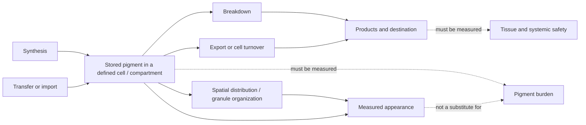

# Selective melanin modulation in an adult iris

*Theoretical research note; evidence reviewed October 11, 2026.*

## Working question

Could visible iris pigmentation be changed in a chosen direction, in a chosen ocular compartment, while preserving cells and function—and could the prior appearance later be restored?

This note focuses on the conceptual control problem. The [tissue pigment atlas](tissue-pigment-atlas.md) holds the cross-tissue evidence and diagrams; the [pigment evidence register](pigment-evidence-register.md) holds study-level models and endpoints.

## A pigment balance is not the same as an appearance measurement

A useful accounting model is:

**change in stored pigment = new synthesis + pigment arriving − pigment degraded − pigment leaving**

Each term can vary by cell type and location. A color image, enzyme activity, gene-expression change, cell count, or melanosome-marker change measures only part of this system. Appearance also depends on where pigment sits, granule organization, surrounding tissue, and light scattering.

For the iris, whole-tissue pigment assays can mix the anterior stroma with other ocular compartments. The visible-color target is chiefly anterior-stromal optics, so an endpoint from iris pigment epithelium or retinal pigment epithelium cannot substitute for it. Donor studies do not establish a validated pigment threshold for a chosen shade. See the atlas diagrams on [iris compartments and endpoints](tissue-pigment-atlas.md).

## Mechanism classes are hypotheses, not interchangeable routes

| Biological level | What could change | What an observed signal would not prove by itself |
| --- | --- | --- |
| **Production** | New pigment synthesis or melanogenic cell state | Loss of pigment already stored in the tissue |
| **Transfer and positioning** | Which cells contain pigment, and where granules sit | Lower total tissue pigment or safe removal |
| **Intracellular processing** | Organelle turnover, lysosomal handling, or pigment chemistry | Complete degradation of the pigment polymer or safe products |
| **Exit from the compartment** | Cell shedding, transport, or another tissue-specific route | Whole-body disposition, selectivity, or return to baseline |
| **Cell removal** | Loss of pigment-bearing cells | Reversible control or preservation of tissue function |

A result in one row cannot stand in for another. For example, fewer melanosome proteins do not necessarily mean less melanin; a lighter image can reflect pigment redistribution or tissue changes; a decrease in synthesis can leave stored pigment intact.

## What current evidence supports

- **Iris production can be modulated in models.** Cultured human uveal melanocytes respond to signals that change new melanin production. A small rabbit study reported a lower endpoint total-melanin measure during an induced response, but did not measure the same tissue before treatment or follow pigment after withdrawal. Adult-mouse ultrastructure supports ongoing melanosome formation, not human iris clearance. The [atlas](tissue-pigment-atlas.md) and [register](pigment-evidence-register.md) contain the study details.
- **Human iris darkening occurs as a drug side effect.** It demonstrates a change in appearance in some eyes, not controllable or reversible selectivity. Iris access after topical dosing also does not establish delivery limited to the intended melanocytes.
- **An OCA2 RNAi patent reports an ex-vivo mouse-iris signal.** It is not DNA editing, and the reported experiment does not establish chemical pigment loss, live-eye safety, or return after stopping. Patent-proposed clinical studies are not results.
- **Skin has stronger model evidence for pigment processing, but it is a different tissue.** Autophagy and other cell-model studies report changes in measured melanin or melanosome handling. They do not establish living-human pigment export or iris applicability.
- **Other eye compartments have separate pigment and safety questions.** RPE melanin, retinal bisretinoids, iris pigment epithelium, anterior-stromal melanin, and pigment in the drainage meshwork are not one interchangeable pool.

Sources for these summaries are indexed in the [atlas](tissue-pigment-atlas.md) and [evidence register](pigment-evidence-register.md), including [Drago et al.](https://pubmed.ncbi.nlm.nih.gov/9986745/), [Lindsey et al.](https://pubmed.ncbi.nlm.nih.gov/11405836/), [Lindquist et al.](https://pubmed.ncbi.nlm.nih.gov/9778406/), [Sadiq et al.](https://pmc.ncbi.nlm.nih.gov/articles/PMC9674870/), and [WO2024201471A1](https://patents.google.com/patent/WO2024201471A1/en).

## Selectivity has several layers

“Selective” would need to mean more than binding a melanogenesis target. Any future claim would need to distinguish:

1. **Tissue selectivity:** the intended iris compartment changes without unintended effects in cornea, ciliary body, trabecular meshwork, retina, skin, hair, or other tissues.
2. **Cell selectivity:** pigment handling changes without killing or destabilizing melanocytes or neighboring cells.
3. **Functional selectivity:** pupil behavior, pressure regulation, retinal health, and vision remain intact.
4. **Pigment selectivity:** a measured pigment burden changes, while degradation products and their destination are identified and acceptable.
5. **Optical control:** color changes predictably and uniformly in both eyes.
6. **Temporal control:** onset, persistence, stopping, recovery, and any repeat cycle are measured.

These are evidence criteria, not a proposed treatment design. The detailed ocular safety and compartment map is in the [atlas](tissue-pigment-atlas.md).

## Evidence gaps to track

- Studies that distinguish lower synthesis from reduction of pre-existing iris melanin.
- Validated longitudinal measurements that pair standardized anterior-iris color with compartment-specific pigment measures.
- Evidence for degradation products, export destination, and safety in living ocular tissue.
- Results that measure iris stromal color separately from iris transillumination, posterior pigment epithelium, and retinal endpoints.
- Withdrawal data showing return to each person's baseline, followed by evidence that repeatability does not accumulate tissue or functional harm.
- Tissue-specific evidence for gums, skin, hair follicles, and other sites rather than extrapolation from one pigment-bearing tissue to another.

## Conclusion

The strongest current iris evidence concerns modulation of **new** pigment production. Selective reduction of **stored** anterior-iris pigment, safe disposition, predictable appearance control, and return to baseline remain unestablished. DNA editing is not required by the question, and an expression change alone would not solve the clearance problem.

*For iris-specific return requirements, see [Bidirectional iris reversibility](bidirectional-reversibility.md). For study records, see the [pigment evidence register](pigment-evidence-register.md).*
