# Tissue pigment atlas: what exists and what remains theoretical

*Literature and official-source review: October 11, 2026. Personal learning project; AI-assisted synthesis.*

The broader research question is whether stored pigment can be reduced to a chosen level in a chosen tissue while preserving its cells and function. The original [reversible iris-color goal](bidirectional-reversibility.md) is one application. DNA editing is not a prerequisite: production, transfer, degradation, and excretion are distinct mechanisms to evaluate.

This atlas groups the major pigment-bearing compartments across the body. It is **not an exhaustive inventory of every cell type or every marketed treatment**. A coverage gap is labeled explicitly. Availability is described for the stated indication and jurisdiction; an experimental result is not a treatment listing.

## Reading the diagrams

| Label | Meaning |
| --- | --- |
| **C — Clinical** | Established clinical use or an official approval for a specified condition. This does not imply approval for general cosmetic use. |
| **H — Human research** | A human study, with its design and limitations stated. This may be a small trial, observational work, or a case report. |
| **P — Preclinical** | Cultured cells, isolated tissue, or animals. Human cells in a dish are still preclinical evidence. |
| **G — Gap** | The reviewed sources do not establish the requested selective, predictable capability. |
| **X — Procedure / comparison** | Surgery, ablation, injections, or another procedure; distinguished from noninvasive biological modulation. |

Solid arrows show an observed relationship, established biology, or an evidence classification. Dashed arrows show a proposed research transition. The diagrams are conceptual maps, not treatment pathways or protocols.

## 1. Body-wide overview

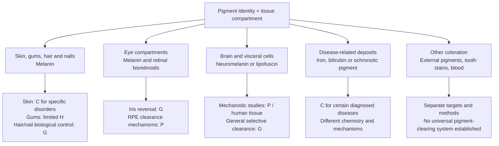

### Comparison by tissue

| Tissue / compartment | Relevant pigment or color source | What is available or demonstrated | What remains unestablished |
| --- | --- | --- | --- |
| **Epidermal skin** | Melanin in melanocytes and keratinocytes | **C:** topical treatment of facial melasma; disease-specific repigmentation in vitiligo. **P:** melanosome degradation and transfer modulation. | A programmable healthy-skin shade cycle or selective removal of all stored melanin. |
| **Dermis** | Deposits in pigment-containing cells; external tattoo pigments are a separate example | **X:** tattoo-removal lasers are FDA-cleared. Pigment chemistry and depth matter. | A universal noninvasive cream that clears dermal deposits; FDA has not approved tattoo-removal creams. |
| **Gums** | Physiologic epithelial melanin, among other causes of discoloration | **H:** small topical ascorbic-acid trial; stronger early response in an injection comparison arm. **X:** epithelial depigmentation procedures. | A routinely established topical, selective, reversible gum-color controller. |
| **Lips and other oral mucosa** | Melanocytic and nonmelanocytic pigmentation | **H:** human pathology evidence identifies different causes and compartments. | Transfer of gum-study results to all oral surfaces or other mucosa. |
| **Hair follicles / hair shaft** | Pigment deposited during fiber growth | Marketed shaft dyes/bleaches exist; **P/H:** follicle biology and observational human repigmentation. | Selectable reversible control of living human follicles; clearing a shaft is different from changing future growth. |
| **Nail matrix / plate** | Melanin can be deposited into the nail plate | Human anatomy evidence; isolated procedural case reports for specific causes. | A validated general topical cosmetic modulator or stored-pigment clearance system. |
| **Anterior iris / stroma** | Melanin in stromal melanocytes plus tissue optics | Drug-associated darkening in susceptible eyes is documented. | Controlled blue → brown → original blue; selective nondestructive clearance. |
| **Posterior iris pigment epithelium** | Dense pigment, chemically distinguishable from the stroma | Human anatomical and chemical mapping. | Selective cosmetic clearing; this is not interchangeable with the visible anterior target. |
| **Retinal pigment epithelium (RPE)** | Functional melanin plus lipofuscin/bisretinoids | **P:** reduction of selected bisretinoids and model-specific lipofuscin degradation. | General human retinal pigment clearance or cosmetic iris-color application. |
| **Choroid / ciliary body** | Uveal melanocytes and pigmented epithelial compartments | Human/anatomical mapping. | A demonstrated selective cosmetic clearing method in the reviewed sources. |
| **Conjunctiva / episclera** | Surface or deeper melanocytic lesions and other deposits | Human clinical/pathological evidence; a postburn laser case report. | A general reversible molecular color modulator. |
| **Brain neurons** | Neuromelanin; lipofuscin is a separate residual-material class | Human tissue studies characterize neuromelanin organelles. | Safe selective clinical clearance, preservation of bound substances, or a cosmetic application. |
| **Heart / liver / adrenal cells** | Lipofuscin | Human tissue studies document accumulation; **P:** cardiac clearance research in old rats. | A selective human visceral lipofuscin-removal treatment demonstrated by this source set. |
| **Liver / heart / pancreas and other iron-overload sites** | Excess stored iron, including ferritin/hemosiderin pools | **C:** iron depletion or chelation for diagnosed overload. | Arbitrary tissue-by-tissue cosmetic targeting or guaranteed reversal of prior damage. |
| **Cartilage / connective tissue in alkaptonuria** | Homogentisic-acid-derived ochronotic pigment | **C/H:** precursor lowering, slower disease progression, and partial pigment regression in human studies. | Complete clearing of every deposit or a mechanism transferable to normal melanin. |
| **Skin / mucosa / whites of eyes in jaundice** | Excess bilirubin | Cause-specific clinical management. | A melanosome-based explanation or an iris-color treatment. |
| **Teeth** | Extrinsic stains and intrinsic chromogens | Dental cleaning/whitening methods exist. | Evidence that tooth whitening demonstrates clearance of living-tissue melanin. |
| **Skeletal muscle / adipose / bone / tendon / other mucosa** | Must be specified by tissue, cell and actual deposit | **Coverage gap:** no dedicated clearance evidence assessment here. | Any claim that this atlas establishes a method for every bodily tissue. |

Sources and model details are linked in the sections below and in the [evidence register](pigment-evidence-register.md). The shared criteria for evaluating a tissue-specific clearance claim are in the [selective clearance framework](selective-clearance-framework.md).

## 2. Skin: production, transfer, clearance, and repigmentation

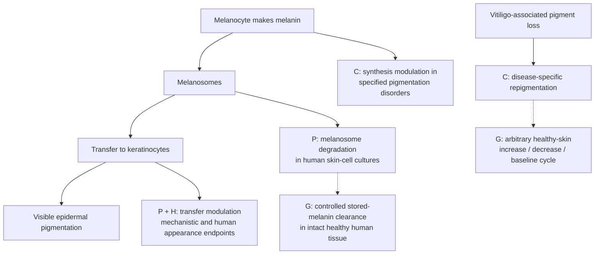

TRI-LUMA is a prescription combination for short-term moderate-to-severe **facial melasma**; its label identifies hydroquinone as a synthesis inhibitor. That indication does not cover every tissue or every form of pigmentation. Ruxolitinib cream has a separate FDA approval for nonsegmental vitiligo. These clinical examples address particular disorders. [Melasma label](https://dailymed.nlm.nih.gov/dailymed/lookup.cfm?setid=a35fa709-5eb5-4429-b38f-f1e0019bf0ee), [vitiligo approval](https://www.fda.gov/drugs/news-events-human-drugs/fda-approves-topical-treatment-addressing-repigmentation-vitiligo-patients-aged-12-and-older).

A primary niacinamide study combined transfer experiments with human facial-pigmentation outcomes. Separately, human skin-cell cultures showed autophagy-associated melanosome degradation and lighter cell pellets. The 2024 melanophagy study identified selective melanosome-autophagy machinery, mainly in a mouse melanoma-cell model; the same effect was not reproduced in its transferred-melanosome keratinocyte model. This makes cell compartment an evidence requirement. [Transfer study](https://pubmed.ncbi.nlm.nih.gov/12100180/), [human-cell degradation study](https://doi.org/10.1111/pcmr.12838), [melanophagy study](https://pmc.ncbi.nlm.nih.gov/articles/PMC10998605/).

**Measurement distinction:** degradation of melanosome-associated proteins can occur without a reduction in melanin itself, as a mouse keratinocyte study demonstrated. A lower organelle-marker signal alone cannot establish pigment clearance. [Primary study](https://pmc.ncbi.nlm.nih.gov/articles/PMC10739166/).

**Critical storage context:** cultured human keratinocytes show donor-dependent melanosome turnover, and autophagy manipulation changed measured melanin in cultured and ex-vivo human skin models. Other cultured-cell uptake studies and human skin electron microscopy found melanin in compartments that were not highly acidic or degradative. This is context-dependent evidence, not a settled universal clearance route. In human skin explants, supranuclear melanin caps correlated with fewer UV-induced DNA photoproducts; an experimental melanocore-disruption model found weaker protection from disrupted cores. Thus a color change alone would not establish safe, selective clearance. [Donor-dependent turnover](https://pubmed.ncbi.nlm.nih.gov/21326292/), [ex-vivo skin model](https://doi.org/10.1038/jid.2013.165), [nondegradative compartments](https://pubmed.ncbi.nlm.nih.gov/29074272/), [in-situ human skin](https://pubmed.ncbi.nlm.nih.gov/29054596/), [human skin explants](https://pubmed.ncbi.nlm.nih.gov/9579550/), [melanocore model](https://pmc.ncbi.nlm.nih.gov/articles/PMC6056223/).

## 3. Gums and oral mucosa

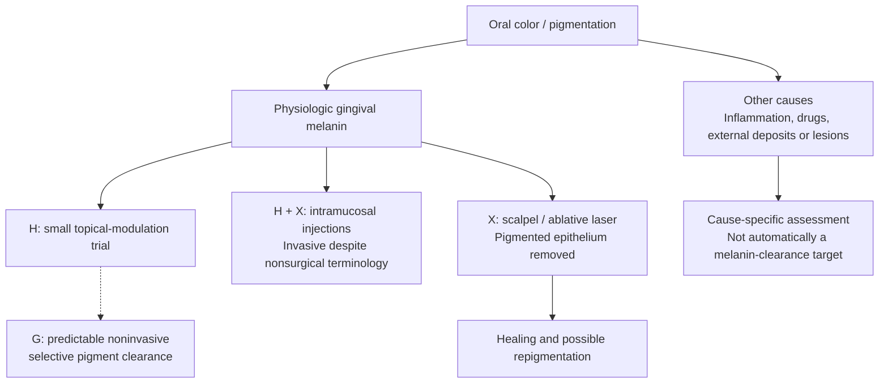

In a 20-person randomized study, topical ascorbic-acid gel had no significant pigmentation-index improvement at one month, whereas injections had an earlier response. Both groups showed reduced melanin-stained area fraction at six months. Its small size and lack of a placebo group limit the conclusion. It supports a **human-research** label, not a proven routinely available gum-lightening product. [Trial](https://pubmed.ncbi.nlm.nih.gov/33966113/).

Scalpel and ablative-laser studies concern removal of pigmented epithelium; recurrence is a relevant outcome. These are procedural comparisons, distinct from preservation of the existing tissue through molecular modulation. Oral pathology also distinguishes melanocytic pigmentation from deposits such as amalgam tattoos. [Procedure trial](https://pubmed.ncbi.nlm.nih.gov/31983845/), [oral pathology series](https://pmc.ncbi.nlm.nih.gov/articles/PMC8141314/). Red, swollen, bleeding gums belong to an inflammatory branch. [NIDCR](https://www.nidcr.nih.gov/health-info/gum-disease).

## 4. Eyes: separate compartments

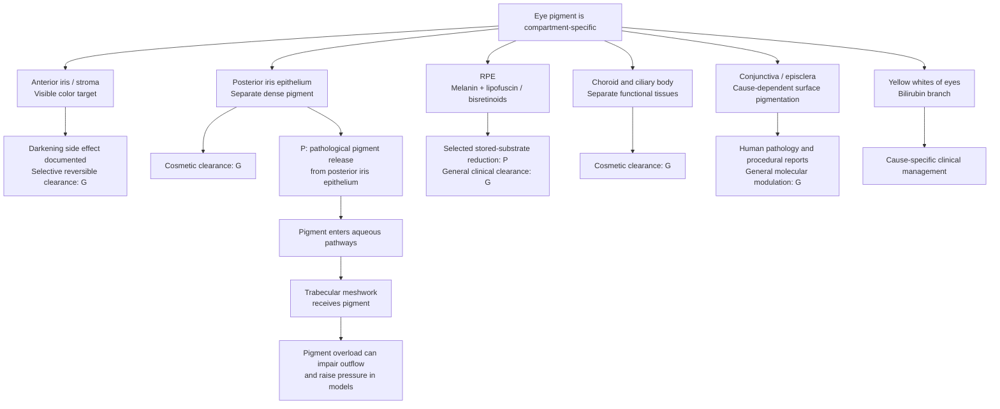

Human iris microscopy and chemical microdissection distinguish anterior/stromal pigmentation from the posterior pigment epithelium. These compartments cannot be combined into one clearance target. [Microscopy](https://pubmed.ncbi.nlm.nih.gov/8602783/), [pigment chemistry](https://pubmed.ncbi.nlm.nih.gov/9778410/).

**Pigment fate is part of the eye constraint.** In pigment-dispersion disease, granules released from the posterior iris pigment epithelium can travel through aqueous pathways and accumulate in the trabecular meshwork. Porcine models show impaired meshwork-cell phagocytosis/migration and reduced outflow after pigment exposure. A small human follow-up cohort found that meshwork pigmentation can attenuate over time after treatment for this disease; it does not establish a nonprocedural cosmetic clearance route. This pathology involves the posterior epithelium, distinct from the anterior stromal color target. [Human PDS cohort](https://pubmed.ncbi.nlm.nih.gov/34397796/), [trabecular-meshwork cell model](https://pmc.ncbi.nlm.nih.gov/articles/PMC7847180/), [porcine outflow model](https://pmc.ncbi.nlm.nih.gov/articles/PMC5915754/).

For the RPE, a 2014 cell/mouse study reduced **selected bisretinoids**, with substrate-specific limitations. A 2023 mouse study reported lipofuscin degradation involving melanin; subsequent scientific discussion addressed alternative pathways and the limits of a universal melanin-required interpretation. These are retinal research mechanisms, not evidence of iris-color reversal. [2014 study](https://pmc.ncbi.nlm.nih.gov/articles/PMC3986126/), [2023 study](https://pmc.ncbi.nlm.nih.gov/articles/PMC10194005/), [comment](https://pmc.ncbi.nlm.nih.gov/articles/PMC10622903/), [reply](https://pmc.ncbi.nlm.nih.gov/articles/PMC10622899/).

Human fetal RPE cultures provide evidence concerning melanin's photoprotective role. Choroid mapping, epithelial anatomy, and ocular-surface pathology are separate evidence categories. [RPE study](https://pmc.ncbi.nlm.nih.gov/articles/PMC1157035/), [human choroid study](https://pmc.ncbi.nlm.nih.gov/articles/PMC6901595/), [NLM epithelial definition](https://www.ncbi.nlm.nih.gov/mesh/D010857), [conjunctival case report](https://pmc.ncbi.nlm.nih.gov/articles/PMC4251888/).

## 5. The original iris cycle

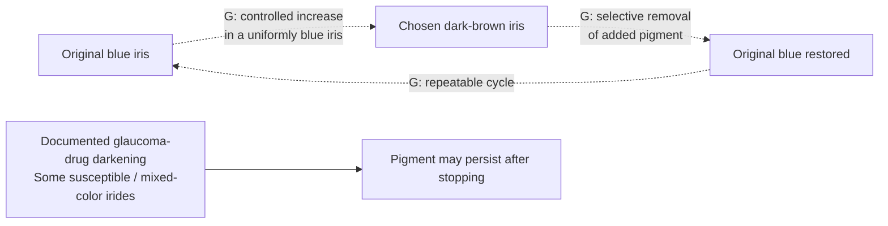

The dashed arrows are the goal, not demonstrated clinical transitions. Official Xalatan information reports no observed color change in uniformly blue eyes in its cited studies. U.S. labeling describes increased iris pigmentation as likely permanent. FDA states that there are no approved eye drops for changing eye color. [UK product information](https://www.medicines.org.uk/emc/product/1616/smpc), [U.S. label](https://dailymed.nlm.nih.gov/dailymed/drugInfo.cfm?setid=f4e73059-5ba0-4d73-9ea1-09d8d654e844), [FDA](https://www.fda.gov/drugs/buying-using-medicine-safely/what-you-should-know-about-eye-drops).

## 6. Hair and nails: living producers versus existing keratin

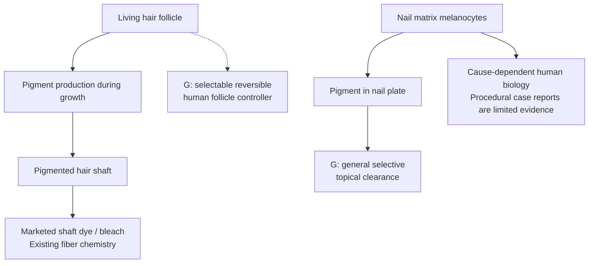

Human-hair experiments show that bleaching can degrade melanin while also damaging fiber proteins. That does not demonstrate clearance in living tissue. Mouse follicle stem-cell research and observational human hair repigmentation concern a different biological system. Hair remains a candidate for the [separate project proposed earlier](hair-scope.md). [FDA hair cosmetics](https://www.fda.gov/cosmetics/cosmetic-products/hair-dyes), [ex vivo fiber study](https://doi.org/10.1111/ics.12495), [mouse follicle study](https://www.nature.com/articles/s41586-023-05960-6), [human observational study](https://elifesciences.org/articles/67437).

Human nail-matrix studies document melanocytes; a drug-induced melanonychia laser report is a case report. Neither establishes a general cosmetic pigment-removal controller. [Nail anatomy study](https://pubmed.ncbi.nlm.nih.gov/8040399/), [case report](https://pubmed.ncbi.nlm.nih.gov/31220366/).

## 7. Brain and visceral lipofuscin: clearance is more than autophagy

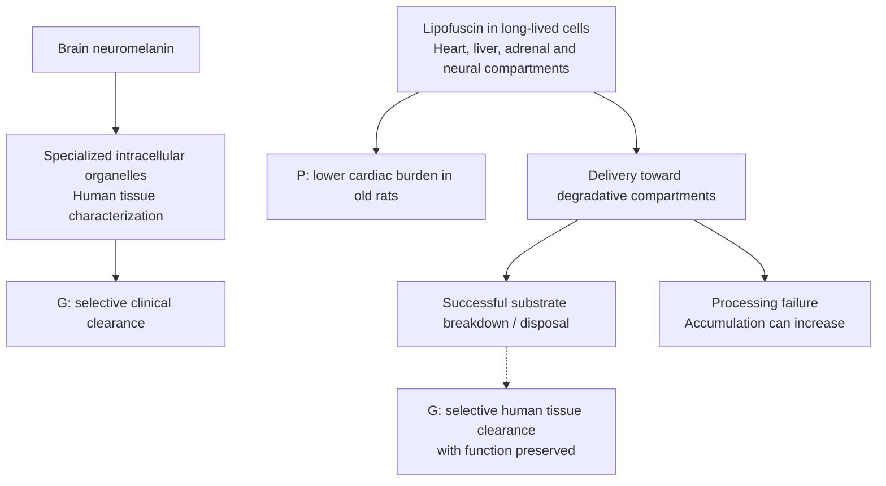

Human brain research characterizes neuromelanin-containing organelles; this is not a demonstrated clinical clearance intervention. Human tissue studies also document lipofuscin in cardiac, hepatic and adrenal cells. A cardiac study reported reduced burden in old rats. Separately, stressed human fibroblast cultures accumulated more lipofuscin when autophagy was activated under impaired processing. **Increasing autophagy is not sufficient evidence that every pigment will be cleared.** [Neuromelanin study](https://pubmed.ncbi.nlm.nih.gov/29900402/), [human visceral-tissue study](https://pubmed.ncbi.nlm.nih.gov/7206299/), [old-rat cardiac study](https://www.sciencedirect.com/science/article/pii/S0014482721001178), [human fibroblast study](https://pubmed.ncbi.nlm.nih.gov/37438887/).

## 8. Iron deposits: an existing disease-treatment example

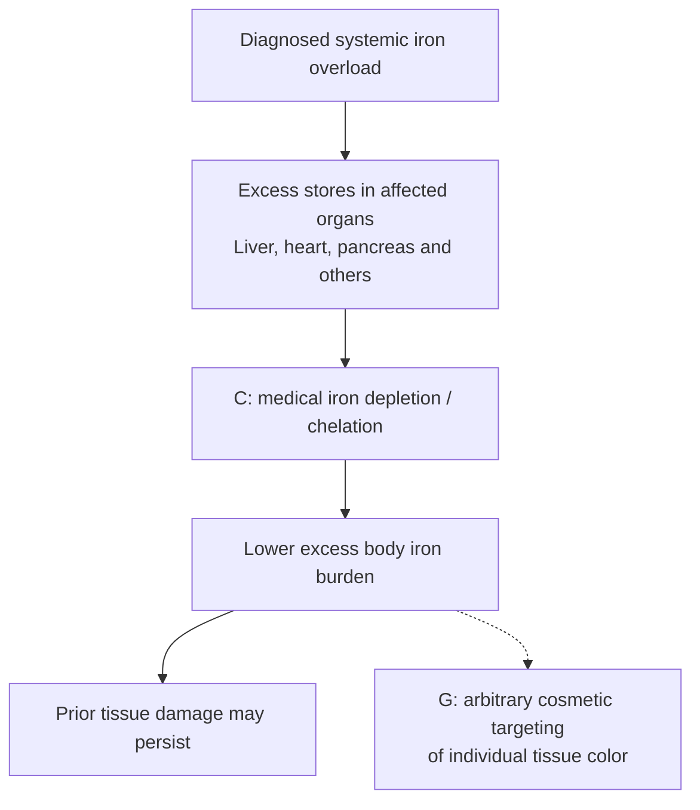

Iron-overload treatment is a real example of reducing an accumulated chemical burden. Its purpose is disease management; iron is also essential to normal physiology. Phlebotomy is a procedure, and chelation is a medical therapy for particular circumstances. Neither is a melanin-clearance mechanism. [NIDDK treatment information](https://www.niddk.nih.gov/health-information/liver-disease/hemochromatosis/treatment).

## 9. Ochronosis: precursor reduction with partial human pigment regression

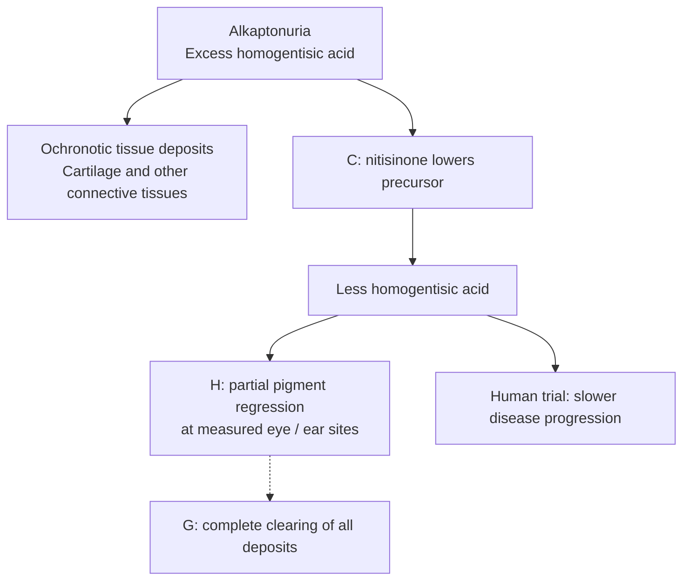

A human observational study reported partial regression in photographed eye/ear pigmentation and a reduction in ear-cartilage biopsy pigment. A randomized trial also found slower disease progression. This is a useful example of existing pigment decreasing after precursor reduction, with incomplete reversal and disease-specific chemistry. It does **not** demonstrate the same behavior for adult iris melanin. FDA's Harliku approval concerns reducing urinary homogentisic acid in adult alkaptonuria. [Pigment study](https://pubmed.ncbi.nlm.nih.gov/32904992/), [SONIA 2 trial](https://pubmed.ncbi.nlm.nih.gov/32822600/), [FDA approval record](https://www.accessdata.fda.gov/scripts/opdlisting/oopd/detailedIndex.cfm?cfgridkey=942723).

## 10. Bilirubin and other color changes

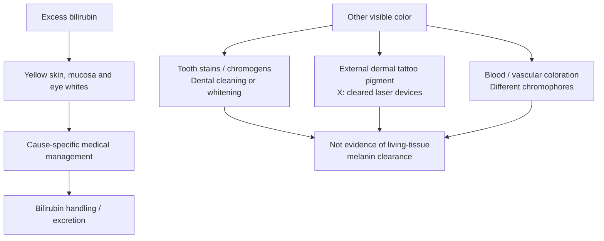

Bilirubin-related yellowing follows a different metabolic pathway from melanin. Tooth whitening and removal of externally introduced tattoo pigment are also distinct capabilities. FDA states that it has not approved tattoo-removal creams. [NIH jaundice information](https://newsinhealth.nih.gov/2022/10/recognizing-jaundice), [ADA tooth whitening](https://www.ada.org/resources/ada-library/oral-health-topics/whitening), [FDA tattoo removal](https://www.fda.gov/consumers/consumer-updates/tattoo-removal-options-and-results), [NHLBI hemoglobin and red cells](https://www.nhlbi.nih.gov/health/anemia/causes).

## 11. Systemic exposures can affect several tissues

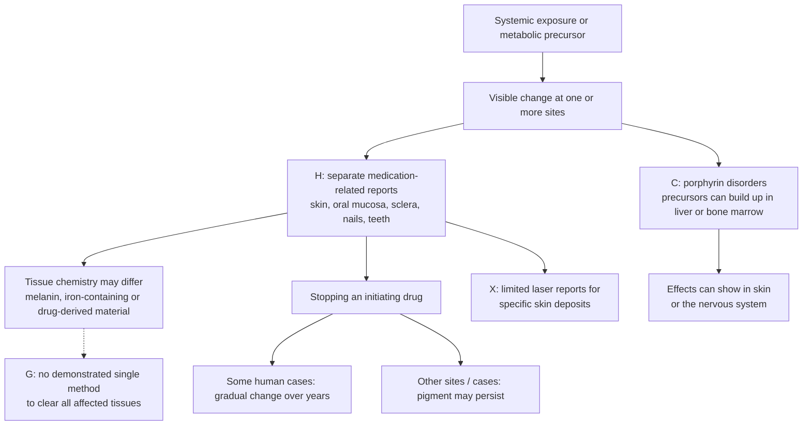

Separate human reports document minocycline-associated discoloration in skin, oral mucosa (including gums), sclera, nails, teeth and other tissues. Tissue analyses show why a shared cause does not guarantee one shared pigment: particular skin and nail deposits have contained iron and calcium, while different patterns can involve melanin. In one case with broad skin and scleral involvement, color slowly moved toward normal over several years after the drug was stopped; a scleral case series reports that pigmentation can also persist. These are adverse-effect observations and case reports, not a controlled or selectable cosmetic color cycle. [Multi-tissue case reports](https://pubmed.ncbi.nlm.nih.gov/9512163/), [skin/gum/nail/sclera case](https://pubmed.ncbi.nlm.nih.gov/36158857/), [skin and nail tissue analysis](https://pubmed.ncbi.nlm.nih.gov/3158285/), [scleral follow-up series](https://pubmed.ncbi.nlm.nih.gov/9186432/).

Porphyria gives a different systems map: depending on type, porphyrins or precursors may accumulate in liver or bone marrow while symptoms affect skin, nervous system, or both. Its disease-specific management is not an example of selectively clearing visible melanin. [NIDDK overview](https://www.niddk.nih.gov/health-information/liver-disease/porphyria).

Silver deposition in argyria is another distinct substrate. Published skin-laser reports are limited clinical case reports; they do not establish a noninvasive whole-body clearance system. [Systematic review](https://pubmed.ncbi.nlm.nih.gov/25845405/).

## Research requirements shared across tissues

A future selective-clearance claim would need to identify the pigment chemically; locate it in the relevant cells or extracellular compartment; measure actual pigment loss separately from reduced synthesis or marker loss; account for breakdown products; and show preservation of tissue function.

A reversible system would additionally need evidence for return to the original appearance, spatial uniformity, and repeat cycles. The reviewed literature offers several tissue-specific footholds. It does not establish selective pigment removal across all bodily tissues.
