# Tissue pigment atlas: what exists and what remains theoretical

*Literature and official-source review: October 11, 2026. Personal learning project; AI-assisted synthesis.*

The broader research question is whether stored pigment can be reduced to a chosen level in a chosen tissue while preserving its cells and function. The original [reversible iris-color goal](bidirectional-reversibility.md) is one application. DNA editing is not a prerequisite: production, transfer, degradation, and excretion are distinct mechanisms to evaluate.

This atlas groups the major pigment-bearing compartments across the body. It is **not an exhaustive inventory of every cell type or every marketed treatment**. A coverage gap is labeled explicitly. Availability is described for the stated indication and jurisdiction; an experimental result is not a treatment listing.

## Reading the diagrams

| Label | Meaning |
| --- | --- |
| **C — Clinical** | Established clinical use or an official approval for a specified condition. This does not imply approval for general cosmetic use. |
| **H — Human research** | A human study, with its design and limitations stated. This may be a small trial, observational work, or a case report. |
| **P — Preclinical** | Cultured cells, isolated tissue, or animals. Human cells in a dish are still preclinical evidence. |
| **G — Gap** | The reviewed sources do not establish the requested selective, predictable capability. |
| **X — Procedure / comparison** | Surgery, ablation, injections, or another procedure; distinguished from noninvasive biological modulation. |

Solid arrows show an observed relationship, established biology, or an evidence classification. Dashed arrows show a proposed research transition. The diagrams are conceptual maps, not treatment pathways or protocols.

## 1. Body-wide overview

```mermaid
flowchart TD
    A["Pigment identity + tissue compartment"]
    A --> B["Skin, gums, hair and nails<br/>Melanin"]
    A --> C["Eye compartments<br/>Melanin and retinal bisretinoids"]
    A --> D["Brain and visceral cells<br/>Neuromelanin or lipofuscin"]
    A --> E["Disease-related deposits<br/>Iron, bilirubin or ochronotic pigment"]
    A --> F["Other coloration<br/>External pigments, tooth stains, blood"]
    A --> G["Inner ear / cochlea<br/>Strial melanin"]
    A --> H["Leptomeninges<br/>Melanin-bearing melanocytes"]
    A --> I["Heart / pulmonary veins<br/>DCT-positive melanocyte-like cells"]
    A --> J["Other mucosal surfaces<br/>Site-specific pigment"]
    A --> K["Adipose tissue<br/>carotenoids; candidate melanocyte progenitors"]
    B --> B1["Skin: C for specific disorders<br/>Gums: limited H<br/>Hair/nail biological control: G"]
    C --> C1["Iris reversal: G<br/>RPE clearance mechanisms: P"]
    D --> D1["Mechanistic studies: P / human tissue<br/>General selective clearance: G"]
    G --> G1["H tissue mapping; P mouse function data<br/>Selective reduction: G"]
    H --> H1["H normal anatomy / imaging<br/>Selective clearance: G"]
    I --> I1["H human cell identity; P mouse function data<br/>Pigment clearance: G"]
    J --> J1["Nasal / laryngeal: localized H findings<br/>Many mucosal sites remain gaps"]
    E --> E1["C for certain diagnosed diseases<br/>Different chemistry and mechanisms"]
    F --> F1["Separate targets and methods<br/>No universal pigment-clearing system established"]
```

### Current intervention map: what can be changed now

This map separates a visible change, disease-directed care, and demonstrated removal of stored pigment. “Available” is indication-specific; a clinical score or color shift does not establish pigment mass loss.

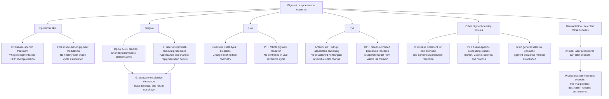

In the United States, the Opzelura label covers repigmentation treatment for nonsegmental vitiligo, while the Scenesse label covers increased pain-free light exposure in adults with erythropoietic protoporphyria. These labels specify disease indications and provide no healthy-tissue shade-control indication. The 73-person gingival ascorbyl-glucoside trial measured lightness, not melanin mass or export. [FDA Opzelura label](https://www.accessdata.fda.gov/drugsatfda_docs/label/2025/215309s007lbl.pdf), [FDA Scenesse label](https://www.accessdata.fda.gov/drugsatfda_docs/label/2024/210797s007lbl.pdf), [Shimada et al., 2009](https://pubmed.ncbi.nlm.nih.gov/19186973/). For the ocular compartment distinction and iris evidence, see [Section 4](#4-eyes-separate-compartments) and [Section 5](#5-the-original-iris-cycle).

### Comparison by tissue

| Tissue / compartment | Relevant pigment or color source | What is available or demonstrated | What remains unestablished |
| --- | --- | --- | --- |
| **Epidermal skin** | Melanin in melanocytes and keratinocytes | **C:** facial melasma treatment and topical ruxolitinib for nonsegmental vitiligo repigmentation; **H, randomized withdrawal:** among participants with ≥90% facial improvement (F-VASI90) after 52 weeks of treatment, relapse below F-VASI75 over the following year occurred in 16/56 (29%) evaluable withdrawal participants and 8/55 (15%) with continued treatment; Kaplan–Meier estimated one-year F-VASI75 maintenance was 65.0% vs 84.3%. Twelve of 16 withdrawal relapsers regained F-VASI75 after rescue. These are disease-severity scores in selected high responders, not direct pigment-mass or healthy-baseline-return measures. **C + X:** afamelanotide implant increases skin eumelanin for adult EPP. **H, disease research:** a five-adult OCA-1B nitisinone pilot found a small inner-bicep reflectometry increase at month 12 and visible skin change in one participant; this was not cosmetic treatment. **H, biopsy:** a randomized nine-week axillary-hyperpigmentation study found decreased Fontana–Masson-positive epidermal area with niacinamide and desonide, but not placebo; melanocyte counts did not significantly change. [Castanedo-Cazares et al., 2013](https://pubmed.ncbi.nlm.nih.gov/23355788/). **P:** autophagy activation lowered measured melanin and inhibition raised it in cultured human skin substitutes/ex-vivo skin; a 2020 ex-vivo hyperpigmented-skin model (n=4) also showed reduced melanin staining and epidermal thickness with improved differentiation markers. Cell studies implicate lysosomal processing/CTSV. A 2023 pigmented full-thickness skin-equivalent model lightened after tape stripping, with lower melanin measures but higher transepidermal water loss (TEWL). A 2026 human-keratinocyte model also reported lower absorbance after uptake of mouse melanoma-derived melanosomes. A 2024 melanophagy study identified an RCHY1/OPTN/TBK1-linked pathway in B16F10 mouse melanoma cells, but β-mangostin did not lower melanin in HaCaT keratinocytes fed isolated B16F10-derived melanosomes, showing cell-context dependence. A 2025 TCTE-treated B16F1/Melan-A cell study described a separate PTK2–ITCH–MLANA–OPTN melanophagy cascade. A 2025 keratinocyte study described lysosome-derived melanokerasomes that retain pigment and become weakly degradative; mechanistic work was mainly in a murine-cell model, with ultrastructural evidence in reconstructed human pigmented epidermis. **P, 2026 melanophagy:** IP3R2 silencing enhanced melanophagy in B16 mouse melanoma cells; primary lightly pigmented human melanocytes showed lower pellet-image pigmentation intensity, and embryo-stage zebrafish had ~35% lower melanin at 48 hpf with rescue. Proposed pathways include AMPK–ULK1 and lysosomal Ca2+–TRPML1–TFEB signaling to RCHY1/OPTN. |The nitisinone result came from a systemic albinism pilot and does not establish a cosmetic skin-return cycle. The randomized withdrawal study is disease-specific: it measured facial severity in selected vitiligo responders, not melanin mass or return to a healthy baseline. The human biopsy finding is disease-context, stain-defined area rather than chemical total melanin; it did not identify products, measure export, or assess withdrawal. Other clearance findings are models, not a living-person cosmetic cycle. [TRuE-V withdrawal study](https://doi.org/10.1093/bjd/ljaf519). The ex-vivo result was one-way and did not track pigment products or export. Tape stripping physically removes the surface barrier; none demonstrates safe selective control, washout return, full product/export balance, or preserved photoprotection. The 2026 loaded-cell model does not establish intact-tissue clearance or identify the oxidized melanin products. The 2024 melanophagy result also did not transfer to the melanosome-fed keratinocyte comparison. The 2025 TCTE pathway remains cell-model evidence, without an in-vivo human treatment or return test. The 2025 storage-compartment study did not demonstrate pigment-core loss or export; lysosomal-marker acquisition can accompany storage rather than clearance. [Neto et al., 2025](https://doi.org/10.1016/j.jid.2024.08.023). [Goncalves et al., 2023](https://doi.org/10.1002/btm2.10415). [Saurav et al., 2026](https://doi.org/10.1371/journal.pbio.3003971). The human-cell endpoint was image intensity, not chemical melanin mass; the fish endpoint was developmental and whole-embryo. No adult human intervention, local selectivity, photoprotection/barrier assessment, pigment-product/export balance, or washout-return test. |
| **Dermis** | Native melanin, tattoo ink, and deposited metals are different targets | **H:** ashy-dermatosis biopsies identify melanosome-retaining fibroblasts and macrophages. **X:** FDA-cleared tattoo-removal lasers; human biopsies document pigment fragmentation and cell injury. | Selective nonprocedural clearance of native melanin or proof that a deposit left the body. |
| **Gums** | Physiologic epithelial melanin, among other causes of discoloration | **H:** a 73-person double-masked split-mouth study reported that topical ascorbyl-glucoside gel improved a relative lightness endpoint versus placebo by week 4; a separate 20-person gel-vs-injection comparison found no significant one-month index change with gel. A 2026 synthesis of mixed vitamin C routes found a short-term one-month score signal but no significant three-month difference amid high heterogeneity. **H + X:** in a 2026 randomized study (20 participants; 10 per arm), DOPI score 0 at nine months was recorded in 8/10 after topical ascorbyl glucoside was added following diode-laser depigmentation versus 1/10 after laser alone (p=.004). This tests a procedural adjunct and a clinical score. **H + X:** a separate 2026 randomized trial (26 randomized, 23 completed) found lower DOPI scores after scalpel than microneedling plus topical ascorbic acid through six months; a smaller 2024 trial had favored microneedling at three months. These procedure comparisons conflict and neither establishes molecular clearance. **X:** epithelial depigmentation procedures. | Pigment mass/export, stand-alone topical clearance, post-use persistence or return, and a predictable reversible gum-color controller remain unestablished. |
| **Lips and other oral mucosa** | Melanocytic and nonmelanocytic pigmentation | **H:** human pathology evidence identifies different causes and compartments. | Transfer of gum-study results to all oral surfaces or other mucosa. |
| **Hair follicles / hair shaft** | Pigment deposited during fiber growth | Marketed shaft dyes/bleaches exist. **H, disease research:** in the same five-adult OCA-1B nitisinone pilot, 4/5 reported hair darkening and a hair eumelanin marker rose; by safety follow-up that marker was near baseline while a pheomelanin marker remained lower. **P/H:** follicle biology and observational human repigmentation. | Selectable reversible control of living human follicles remains unestablished; the nitisinone study was a small systemic albinism pilot with mixed hair-marker trajectories, and clearing a shaft is different from changing future growth. |
| **Nail matrix / plate** | Melanin can be deposited into the nail plate | Human anatomy evidence; isolated procedural case reports for specific causes. | A validated general topical cosmetic modulator or stored-pigment clearance system. |
| **Anterior iris / stroma** | Melanin in stromal melanocytes plus tissue optics | **H:** a single-dose human ocular PK study found topically administered bimatoprost/latanoprost or metabolites in sampled iris/ciliary tissue and other eye compartments; profiles differed by drug. This demonstrates access, not iris-cell selectivity or pigmentation. [Human ocular PK study](https://pubmed.ncbi.nlm.nih.gov/22136089/). In pigmented rabbits, iris-ciliary drug uptake also varied with measured melanin across brown, blue, and albino eyes; that comparison did not manipulate pigment. [Fukuda and Sasaki, 1994](https://pubmed.ncbi.nlm.nih.gov/8090430/). Drug-associated darkening is documented; small human morphometric studies found larger anterior-border melanin granules without a demonstrated increase in total granule number. Rare disease-associated BADI reports show stromal depigmentation with anterior-chamber pigment and trabecular deposition; repigmentation after 3–4 years was reported in a few cases, but no pigment-mass assay or controlled intervention was performed. Human ultrastructure shows turnover-like features and phagocytes that engulf free pigment, without a net-clearance endpoint. In vitiligo-model mice, pigment-containing iris clump cells accumulated without progressive visible iris depigmentation; in a separate matrix-deficiency model, macrophage-like pigmented cells migrated from iris to/into retina. These are animal-model observations of uptake and redistribution, not human clearance. A 2025 cross-sectional study of 88 participants with brown irides found that entropy-derived PS-AS-OCT stromal melanin concentration ratio (MCR) correlated with CIE L*a*b* photo-color values; a three-grade classifier reached 85% accuracy. This is a noninvasive imaging proxy, not an iris chemical-mass assay. **H, disease pilot:** a five-adult OCA-1B nitisinone study found no significant primary iris-transillumination response; an exploratory pooled-eye analysis showed a small change in the direction of greater transillumination (consistent with less pigment), concentrated in two participants. Transillumination is an optical proxy. **P:** human uveal-cell and donor-iris models modulate new melanogenesis; one small rabbit study reported inhibition of induced pigmentation. **X:** cosmetic photoablative laser cases report pigment dispersion and secondary glaucoma. | Human evidence for controlled blue → brown → original blue; selective nondestructive clearance of established pigment; iris change after nitisinone washout; serial MCR sensitivity, validation in blue/mixed irides, and safe disposition of any pigment-bearing phagocytes. |
| **Posterior iris pigment epithelium** | Dense pigment, chemically distinguishable from the stroma | Human anatomical and chemical mapping; a 2025 PS-AS-OCT study mapped regional IPE depolarization in 105 healthy Japanese adults, with imaging parameters associated with ocular biometry. This provides a posterior-compartment baseline, not a direct chemical assay. | Selective cosmetic clearing or longitudinal pigment-change validation; this is not interchangeable with the visible anterior target. |
| **Retinal pigment epithelium (RPE)** | Functional melanin plus lipofuscin/bisretinoids | **H:** normal human donor studies show age-associated loss of RPE melanin; intense visible-light eyecup assays photobleached RPE melanosomes and generated hydrogen peroxide. **H, disease-directed:** tinlarebant is under U.S. FDA Priority Review for Stargardt disease after a sponsor-reported Phase 3 signal consistent with slower lesion growth / less new bisretinoid accumulation. **H, disease-directed:** the remofuscin/soraprazan Phase 2 trial did not demonstrate the planned qAF reduction on its primary measure; the sponsor reported secondary OCT retinal-thinning findings. **P:** selected bisretinoid reduction and model-specific lipofuscin degradation. **P, imaging/model:** a 2026 AO-PS-OCT mouse retinal laser-injury study tracked hyper-reflective foci over ten days; histology co-localized PS-OCT foci with IB4-positive myeloid cells and probable pigment in the confocal-transmission channel, consistent with uptake of melanin-containing RPE debris. This is not a measurement of RPE melanin mass or net export. **H, ocular stress model:** in hypoxic ARPE-19 cells, IP3R2 knockdown worsened mitochondrial function and promoted apoptosis; this is a stress-specific RPE finding, not melanin modulation. | Neither candidate is a cosmetic melanin modulator. Tinlarebant is intended to reduce new bisretinoid formation, not clear stored melanin; remofuscin did not establish existing-lipofuscin clearance in the human trial. RPE melanin supports photoprotection; age-associated decline is not controlled or safe removal and does not apply to visible iris color. |
| **Choroid / ciliary body** | Uveal melanocytes and pigmented epithelial compartments | **H, disease imaging:** a small retrospective PS-OCT study of acute VKH (15 eyes from 8 patients) found lower choroidal polarimetric entropy at baseline than in posterior scleritis, then a rise after one month of treatment; RPE entropy did not significantly change. This is an adjacent-choroid disease signal, not iris measurement or chemical pigment mass. | Selective cosmetic clearance, direct pigment-mass validation, or transfer of the choroidal disease result to iris stroma. [Oshiro et al., 2026](https://pubmed.ncbi.nlm.nih.gov/41533903/). |
| **Inner ear / cochlea** | Melanin in stria-vascularis intermediate melanocytes and Rosenthal's canal | **H:** human temporal-bone mapping. **P:** matched pigmented/albino mice show an age-related endocochlear-potential difference; a separate genetic cell-depletion model found that perivascular macrophage-like melanocytes support the strial barrier and hearing. Drug-delivery models show injury-dependent systemic access and uneven local cochlear distribution. | Selective pigment reduction with preserved cochlear homeostasis or hearing; the depletion result concerns cell loss, not pigment-specific reduction; human pigment amount was not associated with thresholds in the studied sample. Cochlear PK studies concern other drugs, not pigment delivery. [Zhang et al., 2012](https://pubmed.ncbi.nlm.nih.gov/22689949/), [Ke et al., 2024](https://pubmed.ncbi.nlm.nih.gov/37987231/), [Salt et al., 2016](https://pubmed.ncbi.nlm.nih.gov/27725177/). |
| **Conjunctiva / episclera** | Surface or deeper melanocytic lesions and other deposits | Human clinical/pathological evidence; a postburn laser case report. | A general reversible molecular color modulator. |
| **Brain neurons** | Neuromelanin; lipofuscin is a separate residual-material class | **H:** a small normal-aging human substantia-nigra series found more extracellular neuromelanin and higher microglial phagocytic activity with age, without pronounced neuroinflammation. **P:** TFEB lowered intracellular neuromelanin and improved function/pathology in a rat overproduction model; microglia phagocytosed and degraded human neuromelanin in vitro. | No human brain/body mass balance or demonstrated safe clearance. Extracellular neuromelanin can activate microglia and injure dopaminergic neurons in preclinical models; no cosmetic or iris application. |
| **Leptomeninges** | Melanin in non-neuronal meningeal melanocytes | **H:** human histology places most cells over the ventrolateral medulla; normal pigment can be visible on T2 MRI. | Selective removal, safe disposition, or extrapolation to neuronal neuromelanin. |
| **Heart / liver / adrenal cells** | Lipofuscin | Human tissue studies document accumulation; **P:** cardiac clearance research in old rats. | A selective human visceral lipofuscin-removal treatment demonstrated by this source set. |
| **Heart / pulmonary-vein melanocyte-like cells** | Human DCT-positive cells; cardiac melanosomes demonstrated in mice | **H:** melanocyte-like cells identified in human atria and pulmonary veins. **P:** mouse cell/pathway models show rhythm effects with DCT deficiency or cell loss. | A quantified human cardiac melanin store, causal link between pigment amount and human arrhythmia, or any clearance method. |
| **Liver Kupffer cells (tattoo-ink comparison)** | Exogenous tattoo particles, separate from endogenous liver pigments | **P:** a one-year mouse study detected black/red tattoo particles in Kupffer cells; other sampled internal organs were negative by light microscopy. | Human internal-organ distribution, whole-body elimination, or an endogenous pigment-clearance route. |
| **Draining lymph nodes (tattoo ink)** | Exogenous ink particles in phagocytes, separate from endogenous pigment | **H:** postmortem human skin/node study and human node biopsies document ink; **P:** human-cell macrophage and mouse studies show possible cell injury/inflammation. | Human clinical consequences, safe whole-body elimination, or relevance to endogenous melanin. |
| **Liver / heart / pancreas and other iron-overload sites** | Excess stored iron, including ferritin/hemosiderin pools | **C:** iron depletion or chelation for diagnosed overload. | Arbitrary tissue-by-tissue cosmetic targeting or guaranteed reversal of prior damage. |
| **Cartilage / connective tissue in alkaptonuria** | Homogentisic-acid-derived ochronotic pigment | **C/H:** precursor lowering, slower disease progression, and partial pigment regression in human studies. | Complete clearing of every deposit or a mechanism transferable to normal melanin. |
| **Skin / mucosa / whites of eyes in jaundice** | Excess bilirubin | Cause-specific clinical management. | A melanosome-based explanation or an iris-color treatment. |
| **Teeth** | Extrinsic stains and intrinsic chromogens | Dental cleaning/whitening methods exist. | Evidence that tooth whitening demonstrates clearance of living-tissue melanin. |
| **Skeletal muscle** | Age-associated lipofuscin | **H:** human muscle biopsies identify lipofuscin as an aging-associated pigment. | Selective clearance of native muscle lipofuscin while preserving function. |
| **Adipose tissue** | Dietary carotenoids; possible melanocyte-lineage progenitors are a separate question | **H:** carotenoids measured in healthy human fat; concentrations vary by anatomical site and correlate with diet. **P:** human adipose-derived cells expressed melanocyte markers and formed melanin in a UVB-exposed 3D epidermal model after culture/differentiation. | The cell-culture result does not establish a melanin store in intact adipose tissue, or a tissue-selective clearance route. |
| **Bone** | Bone-associated iron in overload; marrow hemosiderin is a separate compartment | **H:** stainable iron at the bone surface is uncommon in routine biopsies and more frequent in verified iron overload. | Selective removal of bone-associated pigment; other bone deposits need separate review. |
| **Tendon** | Ochronotic homogentisic-acid-derived pigment in alkaptonuria | **H:** human case reports document pigmented, damaged tendons; disease-directed precursor lowering does not establish tendon-specific reversal. | Targeted clearance of established tendon pigment. |
| **Pancreatic islets** | Lipofuscin in insulin-producing β-cells; age-associated residual material | **H:** electron-microscopy morphometry of human donors finds age-correlated lipofuscin and supports long β-cell lifespan. | Clearance or selective β-cell pigment reduction with preserved insulin function. |
| **Kidney tubules** | Lipofuscin in proximal tubular epithelial cells | **H:** one incidental human biopsy with ultrastructural confirmation; case-level observation. | General prevalence, tissue-selective clearance, and functional outcomes. |
| **Spleen** | Ferritin and hemosiderin iron stores; lipofuscin reports are a separate target | **H:** iron-storage material characterized in spleens from patients with transfusion-related secondary overload. | Selective splenic clearance independent of systemic iron management. |
| **Airways / lung-draining lymph nodes** | Inhaled carbon and other particles within macrophages | **H:** human bronchoscopy, biopsy, and node studies document anthracotic macrophages. | Safe selective extraction; visible deposits do not measure the full particle burden or associated fibrosis. |
| **Colon mucosa** | Lipofuscin-like pigment in lamina-propria macrophages in melanosis coli; the name does not mean ordinary melanin | **H:** human histology identifies pigment-laden macrophages; observational cases document endoscopic disappearance after the inducing anthraquinone exposure ends. | Direct pigment mass/export after resolution, a selective intervention, or transfer to other pigments and organs. |
| **Esophageal mucosa** | Rare melanocytic proliferation with melanin deposition in squamous mucosa | **H:** human case reports/series document esophageal melanocytosis and distinguish it from melanoma. | Natural history, selective clearance, or generalization to other mucosal surfaces. |
| **Other mucosa** | Site-specific melanin in melanocytes or epithelial cells; many different surfaces | **H:** oral, nasal, laryngeal, vulvar, cervical, anorectal, and rare esophageal findings have been described, but study designs and compartments differ. | No selective clearance assessment; normal vaginal distribution and many other mucosal sites remain underassessed. |

### Additional tissues contain different pigment targets

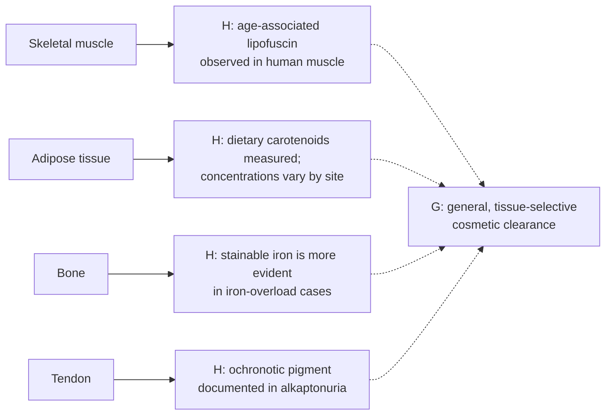

These findings identify different stored materials, not a shared pigment pool: lipofuscin, carotenoids, iron, and ochronotic polymer need separate measurement and disposition models. Clinical management of diagnosed iron overload or alkaptonuria is disease-directed; it does not establish cosmetic, tissue-specific clearance. [Human muscle study](https://pubmed.ncbi.nlm.nih.gov/17376148/), [human adipose carotenoid study](https://pubmed.ncbi.nlm.nih.gov/19587090/), [human bone iron study](https://pubmed.ncbi.nlm.nih.gov/3282446/), [Achilles tendon ochronosis case report](https://pubmed.ncbi.nlm.nih.gov/39027761/).

### Pancreas, kidney, spleen, and airways: distinct internal deposits

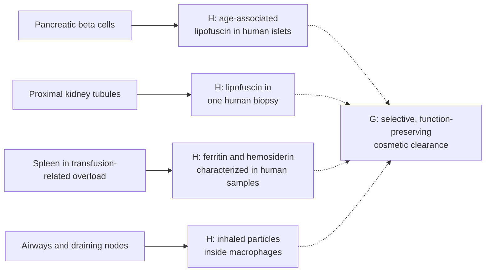

These observations represent different substrates and evidence strengths. Human beta-cell lipofuscin is an age-associated intracellular residue, and the human study used morphometry to estimate cell longevity; it did not test clearance. The kidney finding is an incidental, single-biopsy observation. Splenic ferritin and hemosiderin were characterized in patients with transfusion-related iron overload. Anthracotic carbon is inhaled particulate material in macrophages, not endogenous melanin. None establishes a general-purpose pigment-removal route. [Cnop et al., 2010](https://pubmed.ncbi.nlm.nih.gov/19855953/), [human kidney biopsy report](https://pmc.ncbi.nlm.nih.gov/articles/PMC11093538/), [Weir et al., 1985](https://pubmed.ncbi.nlm.nih.gov/4031104/), [human nodal anthracosis case series](https://pmc.ncbi.nlm.nih.gov/articles/PMC3920429/), [NEJM bronchial case](https://www.nejm.org/doi/full/10.1056/NEJMicm2516602).

### Colon mucosa: a natural-history example with limits

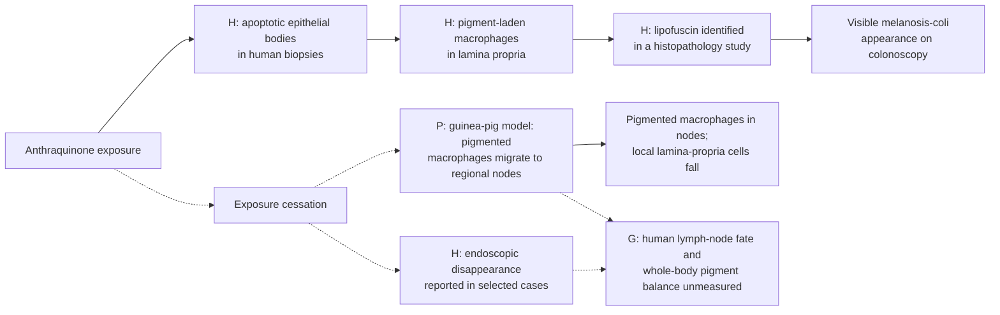

The condition's name is misleading for this project: human histopathology identifies the colonic macrophage pigment as lipofuscin, not melanin. Human biopsies show apoptotic epithelial bodies being taken up by macrophages and processed into pigment in the lamina propria. In a guinea-pig model, stopping danthron exposure was followed by migration of pigment-laden macrophages to regional lymph nodes and sequential loss of those cells from the lamina propria. This suggests a tissue-specific cellular-export route, not chemical removal of lipofuscin from the body. Human clinical evidence is limited to appearance: a retrospective review found 10 disappearance cases among 216 cases, with 4 of those 10 having stopped anthranoid use before disappearance was detected; one additional case showed endoscopic disappearance seven months after senna cessation without a follow-up biopsy. No human study in this source set tracked the pigment into lymph nodes or established a whole-body mass balance. It is not evidence for a general clearance mechanism or a result transferable to iris, skin, or other pigments. [Human ultrastructure study](https://pubmed.ncbi.nlm.nih.gov/8367190/), [guinea-pig model](https://pmc.ncbi.nlm.nih.gov/articles/PMC1880689/), [human histopathology study](https://pmc.ncbi.nlm.nih.gov/articles/PMC4581826/), [longitudinal clinical course study](https://pubmed.ncbi.nlm.nih.gov/36849146/), [single-case endoscopic follow-up](https://pmc.ncbi.nlm.nih.gov/articles/PMC11402352/).

Sources and model details are linked in the sections below and in the [evidence register](pigment-evidence-register.md). The shared criteria for evaluating a tissue-specific clearance claim are in the [selective clearance framework](selective-clearance-framework.md).

### Cell renewal is not the same measurement as pigment clearance

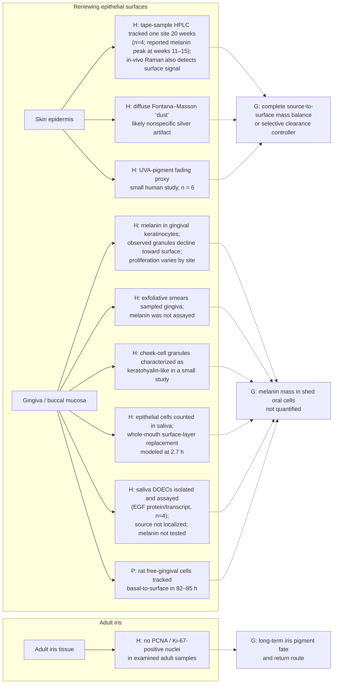

Cell renewal can carry pigment-bearing cells out of a surface layer, but calling that selective pigment clearance remains an inference. Human studies have imaged melanin granules in superficial corneocytes and chemically quantified eumelanin and pheomelanin in tape-sampled outer stratum corneum. In a four-person time course after one 2-MED UV exposure, the same site was sampled across 20 weeks and a surface melanin peak was reported at weeks 11–15. This establishes a measurable and slowly evolving surface-pigment signal compatible with epidermal desquamation, but not the quantity exported, a complete source-to-surface mass balance, or a selective-clearance intervention. A separate six-person human study used fading of UVA-induced forearm pigmentation as an epidermal-turnover proxy. Normal human gingiva ultrastructure identified melanin granules in keratinocytes, and oral biopsies showed site-dependent epithelial S-phase labeling. A saliva-output study counted oral epithelial cells in 17 people and modeled replacement of the whole-mouth surface layer at 2.7 hours using cell-output and tissue-geometry estimates; it did not localize the cells to gingiva or assay their pigment. A 2022 study isolated desquamated oral epithelial cells from unstimulated whole saliva in four systemically healthy nonsmokers and quantified EGF protein and transcript. It demonstrates that a shed-cell fraction can be collected and analyzed, but periodontal status and anatomic source were not established and melanin was not assayed. Thus, sampling is feasible while melanin flux and gingival attribution remain unmeasured. [Aidoukovitch et al., 2022](https://pmc.ncbi.nlm.nih.gov/articles/PMC9789903/). In rats, BrdU-labeled free-gingival-margin cells progressed from basal layers to the surface in about 82–85 hours, but this is not human timing and did not measure melanin flux. A 1959 exfoliative-cytology study sampled gingiva from 20 clinically healthy men but measured keratinization and cell morphology, not melanin. A separate seven-person cheek-cell study characterized observed granules as keratohyalin-like rather than quantifying melanin. The oral studies therefore do not quantify melanin in shed gingival cells or saliva. A human iris histology study found no PCNA- or Ki-67-positive nuclei in the adult iris samples examined; this is a snapshot, not proof of zero lifetime turnover or a pigment-export route. [Lu et al., 1996](https://pubmed.ncbi.nlm.nih.gov/8881670/), [Matsunaka et al., 2017](https://doi.org/10.1111/srt.12309), [Maeda, 2017](https://www.mdpi.com/2079-9284/4/4/47), [Squier and Waterhouse, 1967](https://doi.org/10.1016/0003-9969(67)90148-3), [Thomson et al., 1999](https://pubmed.ncbi.nlm.nih.gov/10577752/), [Thomson et al., 2001](https://pubmed.ncbi.nlm.nih.gov/11684035/), [Dawes, 2003](https://pubmed.ncbi.nlm.nih.gov/12711376/), [Breschi et al., 1998](https://pubmed.ncbi.nlm.nih.gov/9527566/), [Matsui, 1959](https://www.jstage.jst.go.jp/article/joma1947/71/9-2/71_9-2_6089/_article/-char/en), [van Wyk and van der Vyver, 1983](https://pubmed.ncbi.nlm.nih.gov/6192233/), [Pfeiffer et al., 2001](https://jamanetwork.com/journals/jamaophthalmology/fullarticle/265260).


### Surface-pigment signal is not the same as “melanin dust”

The outer skin layer can contain measurable melanin-related material, but the classic diffuse black “melanin dust” seen with Fontana–Masson staining is not reliable proof of degraded melanin particles. In a 2016 comparison using photoprotected human skin from 12 donors across phototypes I–VI, Warthin–Starry staining tracked transmission-electron-microscopy granule counts more closely than Fontana–Masson or Von Kossa; diffuse Fontana–Masson darkening appeared in the stratum corneum even where granules were absent, consistent with nonspecific silver deposition. A separate in-vivo study of 10 volunteers (phototypes II–III) used depth-resolved confocal Raman/fluorescence and detected melanin-associated Raman bands in some outer-layer spectra, including the stratum corneum. That supports a real melanin-associated surface signal, but does not establish the particulate morphology implied by “dust,” identify degradation products, or show where the material goes. Combined with HPLC measurements from tape-sampled outer stratum corneum, the best reading is: surface melanin is measurable; the old diffuse-stain “dust” interpretation is disputed; pigment fate remains untracked. [Joly-Tonetti et al., 2016](https://doi.org/10.1111/exd.13016), [Yakimov et al., 2020](https://doi.org/10.1038/s41598-020-71220-6), [Matsunaka et al., 2017](https://doi.org/10.1111/srt.12309).

## 2. Skin: production, transfer, clearance, and repigmentation

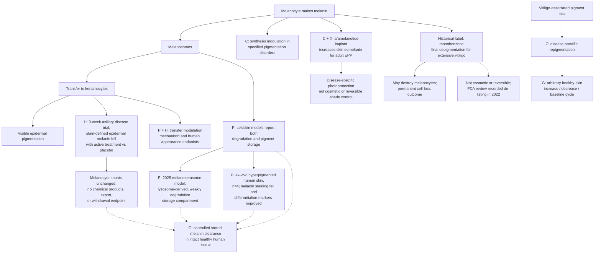

TRI-LUMA is a prescription combination for short-term moderate-to-severe **facial melasma**; its label identifies hydroquinone as a synthesis inhibitor. That indication does not cover every tissue or every form of pigmentation. Ruxolitinib cream has a separate FDA approval for nonsegmental vitiligo. These clinical examples address particular disorders. [Melasma label](https://dailymed.nlm.nih.gov/dailymed/lookup.cfm?setid=a35fa709-5eb5-4429-b38f-f1e0019bf0ee), [vitiligo approval](https://www.fda.gov/drugs/news-events-human-drugs/fda-approves-topical-treatment-addressing-repigmentation-vitiligo-patients-aged-12-and-older). For an increase in skin pigmentation, afamelanotide (SCENESSE) is an FDA-labeled MC1-R agonist for increasing pain-free light exposure in adults with erythropoietic protoporphyria; the EMA describes its action as stimulating skin eumelanin. It is administered as a subcutaneous implant by a trained clinician. This is a disease-specific, procedural skin example, not cosmetic use, iris selectivity, a chosen shade, or a reversible color cycle. [Current U.S. label](https://dailymed.nlm.nih.gov/dailymed/lookup.cfm?setid=94f53286-11dd-7fbb-e053-2a95a90a7c48&version=11), [EMA assessment](https://www.ema.europa.eu/en/medicines/human/EPAR/scenesse).

A historical counterexample helps separate lightening from selective clearance. A 2003 U.S. label described monobenzone only for final depigmentation in extensive vitiligo and warned that it could destroy melanocytes, produce frequently irreversible or distant irregular depigmentation, and leave lifelong skin sensitivity; the label explicitly said it was not cosmetic skin bleach. An FDA review in 2022 recorded the manufacturer's report that the product was no longer manufactured or distributed and had been de-listed. In cultured human epidermal melanocytes, concentrations of monobenzone that inhibited melanogenesis were similar to concentrations that were cytotoxic. This is a cell-loss comparator, not a reversible pigment-clearance system. [Historical FDA label](https://www.accessdata.fda.gov/drugsatfda_docs/label/2003/08173slr015_benoquin_lbl.pdf), [FDA 2022 review](https://www.fda.gov/media/160999/download?attachment=), [Lee et al., 2016](https://pubmed.ncbi.nlm.nih.gov/26440747/).

A 2026 study of 18 ex-vivo human skin specimens found visible darkening after UVA1 exposure alongside HPLC marker changes interpreted as eumelanin photodegradation/cross-linking and pheomelanin oxidation. This shows that a darker appearance can accompany chemical modification of existing pigment. It did not measure net pigment export or test living people; the authors included industry employees and a consultant. This is a photochemistry result, not a depigmentation method. [Ito et al., 2026](https://doi.org/10.3390/ijms27093973).

A primary niacinamide study combined transfer experiments with human facial-pigmentation outcomes. Separately, the epidermis has the clearest current research foothold for handling pigment that is already stored: keratinocytes can process transferred melanosomes through lysosomal/autophagic pathways. In cultured ex-vivo human skin and reconstructed skin substitutes, autophagy activators lowered measured melanin while inhibitors raised it. This is a two-direction response in tissue models, not a demonstrated reversible cycle: the study did not treat living people or show that pigment returned to baseline after an intervention was withdrawn. [Transfer study](https://pubmed.ncbi.nlm.nih.gov/12100180/), [Murase et al., 2013](https://doi.org/10.1038/jid.2013.165).

A later disease-model study adds a tissue-level endpoint. In human hyperpigmented skin, autophagy markers were lower; in ex-vivo elbow skin from four donors, restoring autophagy over five days reduced melanin-positive area and epidermal thickness while improving epidermal-differentiation marker patterns. This is an ex-vivo, one-direction result in hyperpigmented skin, not a living-person cosmetic intervention. It did not identify melanin catabolites, establish export from the specimen, or test washout return. [Murase et al., 2020](https://pmc.ncbi.nlm.nih.gov/articles/PMC7460956/).

A later human-cell study found that the synthetic autophagy inducer PTPD-12 increased flux and melanosome degradation in cultured human melanocytes and keratinocytes containing transferred melanosomes, with lighter cell pellets. Autophagy also participates in melanocyte biology, so a broad switch cannot be assumed to reduce pigment in every cell type. [Kim et al., 2020](https://doi.org/10.1111/pcmr.12838). A lysosomal cathepsin-V study found lower basal-layer CTSV signal in one human hyperpigmented skin sample compared with one normal sample and suppressed melanosome degradation after CTSV knockdown in cells; this is a mechanistic clue, not a human treatment result. [Homma et al., 2018](https://pubmed.ncbi.nlm.nih.gov/29654760/). A 2025 study adds an important counterpoint to treating lysosomal fusion as synonymous with pigment digestion. In its main mechanistic model, murine keratinocytes took up melanocores and matured them into juxtanuclear, lysosome-marker-positive compartments the authors named melanokerasomes. Cathepsin-B activity fell after melanin uptake, and mature compartments became less accessible to newly endocytosed cargo; transmission electron microscopy also showed similar structures in reconstructed human pigmented epidermis. The authors interpret these as weakly degradative storage lysosomes that retain melanin. Because the functional experiments were mainly in a murine-cell model and did not quantify melanin-core breakdown products or export, this refines the storage-versus-degradation question without resolving pigment fate in living human skin. [Neto et al., 2025](https://doi.org/10.1016/j.jid.2024.08.023).

The 2024 melanophagy study identified selective melanosome-autophagy machinery mainly in a mouse melanoma-cell model; the same effect was not reproduced in its transferred-melanosome keratinocyte model. This reinforces the need to specify cell compartment. [Melanophagy study](https://pmc.ncbi.nlm.nih.gov/articles/PMC10998605/). A 2025 preclinical study also reported reduced melanin accumulation and increased autophagy in normal human melanocytes and 3D MelanoDerm skin equivalents; mechanistic work also used melanoma cells. The work was industry-sponsored and did not test a treatment in people. [Geyfman et al., 2025](https://pubmed.ncbi.nlm.nih.gov/39305105/).

A 2026 PLOS Biology study adds a stronger melanophagy mechanism in skin pigment cells. IP3R2 knockdown enhanced melanosome-selective autophagy in melanocyte models through pathways involving AMPK–ULK1 and lysosomal Ca2+–TRPML1–TFEB signaling, with increased RCHY1/OPTN regulators. Pigmentation measures fell in B16 mouse melanoma cells and in primary lightly pigmented human melanocytes; the human-cell readout was pellet-image intensity rather than chemically measured melanin. In embryo-stage zebrafish, IP3R2 morpholino knockdown reduced measured melanin by about 35% at 48 hours post-fertilization, and mRNA rescue restored pigmentation. This identifies a regulatable pathway, not a demonstrated bidirectional pigment switch: the study did not test adult human skin, localized dosing, post-withdrawal rebound, pigment-product disposition, or preserved photoprotection. [Saurav et al., 2026](https://doi.org/10.1371/journal.pbio.3003971).

A 2025 cell study identified a distinct upstream melanophagy route in TCTE-treated B16F1 cells: PTK2 phosphorylation activated ITCH, which ubiquitinated melanosomal MLANA for OPTN recognition. Knockdown of ITCH or OPTN attenuated the model's depigmentation response. The cascade offers a second cell-level mechanism, but the mechanistic work was in cell lines and did not establish a human treatment, a tissue-wide pigment balance, or a reversible appearance cycle. [Park et al., 2025](https://doi.org/10.1080/15548627.2024.2421695).

### Noninvasive imaging separates epidermal amount from its depth profile

Two complementary human studies show that skin melanin can be followed in vivo at cellular and layer scales. Peña et al. developed a 3D multiphoton Pseudo-FLIM analysis that segments the epidermis and estimates both a global melanin-density fraction and a depth profile across 12 thickness-normalized layers. The method was compared with conventional FLIM and phasor analyses in synthetic melanin, human melanocyte/keratinocyte cocultures, and human skin. The authors report that the in-vivo density measure tracks skin-color ITA and agrees with prior ex-vivo histology/HPLC evidence across constitutive pigmentation; these are cross-method and population-level comparisons, not paired serial HPLC assays of the same treated tissue. The paper reanalyzed several human cohorts, including 37 women in its constitutive-pigmentation study and an occlusive retinoid time course. [Peña et al., 2022](https://pmc.ncbi.nlm.nih.gov/articles/PMC8803839/).

In the 20-person retinoid occlusion study, multiphoton melanin density in living epidermis was lower on the retinol-treated area at days 12, 18, and 32; day 32 was 20 days after the 12-day exposure ended. The retinoic-acid area showed a significant decrease only at day 12. The retinol-associated signal remained lower at the last observation, so this is a monitored one-direction response, not a demonstrated return-to-baseline cycle. A separate one-year study of 30 women found that retinoids limited the seasonal ascent of melanin into suprabasal epidermal layers; the authors interpret the pattern mainly through epidermal renewal. Layer redistribution and turnover can change the measured optical density without showing chemical destruction or safe export of pigment. [Tancrède-Bohin et al., 2015](https://pubmed.ncbi.nlm.nih.gov/25220296/), [Tancrède-Bohin et al., 2020](https://pmc.ncbi.nlm.nih.gov/articles/PMC7754381/).

A 2025 single-center observational melasma study used in-vivo two-photon microscopy (TPM) to score epidermal melanin by layer before and during treatment. Of 60 participants, 53 completed 12 weeks; five stopped because of hydroquinone allergy and two were lost to follow-up. Scores fell in all five epidermal layers among completers, alongside fewer activated melanocytes. The treatment phase had no untreated comparator, and the studied lesions were a disease model. The investigators discuss several possible mechanisms, including reduced synthesis, melanosome degradation, and melanocyte injury; their imaging outcome does not distinguish among these or track pigment products leaving tissue. TPM therefore strengthens **noninvasive treatment-response monitoring**, not proof of selective melanin-core clearance or reversibility. Its field of view and imaging depth are limited. [Ning et al., 2025](https://doi.org/10.1001/jamadermatol.2025.2790).

### Human biopsies show a fall in stain-defined epidermal melanin

A small randomized human trial measured epidermal melanin directly in tissue samples from axillary hyperpigmentation. Twenty-four women with phototypes III–V received niacinamide, desonide, or placebo in a nine-week left–right axilla design, with biopsies at baseline and study end. Fontana–Masson-positive epidermal area fell in the niacinamide-treated axillae (14.1 ± 8.5 to 4.9 ± 2.2) and desonide-treated axillae (14.5 ± 8.7 to 4.7 ± 2.7; both p<.001); it did not significantly change with placebo (15.5 ± 8.7 to 14.2 ± 7.4, p=.6). Melanocyte counts did not significantly change. This is a human tissue-level signal beyond colorimetry, but it is a stain-area endpoint in an inflammatory pigmentation condition, not a chemical measurement of total melanin. The study did not identify pigment products, measure export, or follow withdrawal. Reduced synthesis/transfer or resolution of inflammation could explain the result; the experiment does not isolate degradation of pre-existing melanin. [Castanedo-Cazares et al., 2013](https://pubmed.ncbi.nlm.nih.gov/23355788/). A separate 8-week melasma trial reported reduced epidermal Fontana–Masson-positive area in 11 post-treatment biopsies from niacinamide-treated sites, but did not obtain a paired post-treatment biopsy from the hydroquinone comparison side; it likewise lacked a pigment-fate or withdrawal endpoint. [Navarrete-Solís et al., 2011](https://pmc.ncbi.nlm.nih.gov/articles/PMC3142702/).

Chemical subtype measurement is feasible in a biopsy, but the method has not yet supplied a human treatment mass balance. Lerche et al. developed a single-run LC-MS/MS assay for two eumelanin markers (PTCA, PDCA) and two pheomelanin markers (TDCA, TTCA); 30 volunteers each provided one 4-mm buttock biopsy, and the study compared marker levels across skin-phototype groups. These processed-sample markers characterize pigment in the biopsy; they do not show that the same molecules formed in vivo as degradation products or left the body. A focused search for this update did not locate a human depigmenting-treatment study with paired pre/post chemical subtype markers plus a tissue-to-output export measure. This is a search-bounded gap, not proof that no such study exists. [Lerche et al., 2019](https://pubmed.ncbi.nlm.nih.gov/31233275/).

HPLC measurement of melanin degradation markers in a harvested sample is more chemically specific, but it destroys the sample and loses spatial distribution. Multiphoton imaging supplies the complementary in-vivo layer map, while appearance measures remain separate. Neither endpoint alone accounts for breakdown products, export, neighboring compartments, skin function, or post-treatment return.

A small human biopsy study shows what chemical pigment assays can add—and where they stop. Five people with vitiligo had biopsies from depigmented and repigmented patches after PUVA; HPLC quantified eumelanin and pheomelanin separately, and pigment remained detectable in long-standing depigmented lesions. Because samples were taken after treatment and the clinical context was disease-related repigmentation, the study is not a before/after clearance experiment and does not trace pigment products or export. [Parsad et al., 2003](https://pubmed.ncbi.nlm.nih.gov/14510999/).

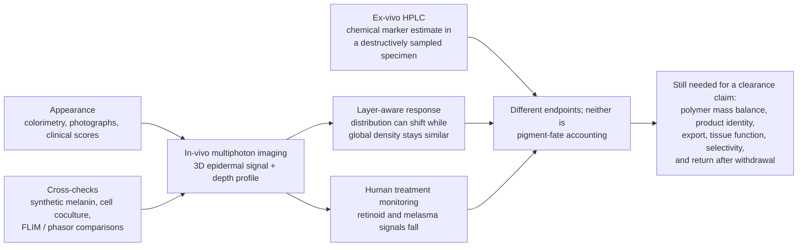

### Epidermal pigment has cell-specific storage and exit routes

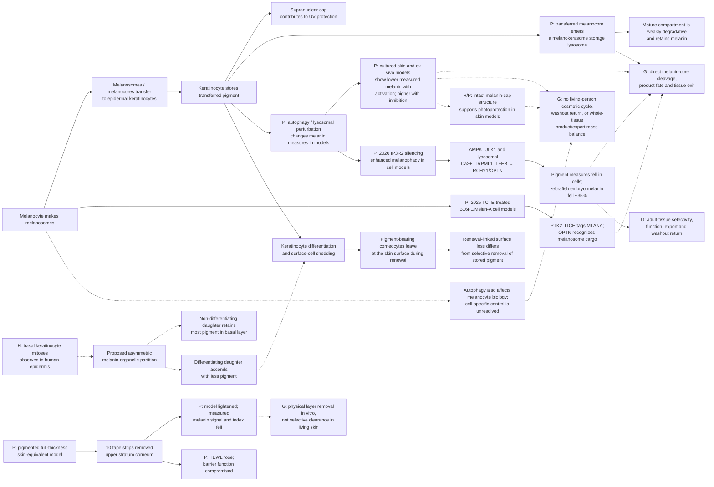

The skin result is therefore both promising and constrained. Keratinocyte-specific processing is a plausible research target because melanosomes are transferred into these surface cells and natural epidermal renewal carries pigment-bearing corneocytes outward. However, cultured tissue shows pathway responsiveness, not selective extraction from healthy living skin. Autophagy and lysosomal activity also support keratinocyte differentiation, while the melanin cap helps protect nuclear DNA from UV injury. Pigment reduction would need to be evaluated alongside barrier/differentiation, photoprotection, breakdown-product fate, and actual export—not color alone. [Human epidermal differentiation study](https://pubmed.ncbi.nlm.nih.gov/29526763/), [human skin explant photoprotection](https://pubmed.ncbi.nlm.nih.gov/9579550/), [melanocore integrity model](https://pmc.ncbi.nlm.nih.gov/articles/PMC6056223/).

A 2025 mechanistic study adds a storage route: in keratinocyte models, melanin-containing phagosomes matured through endosomal stages, fused with lysosomes, and formed melanokerasomes. Mature melanokerasomes retained undigested cargo and were weakly degradative; a reconstructed human pigmented epidermis supplied ultrastructural evidence for the compartment. This does not show that every epidermal melanin pool is indestructible. It does mean that lysosomal markers or melanosomal-protein loss cannot, by themselves, establish breakdown of the melanin polymer. The models demonstrate storage and positioning for photoprotection, not a living-person clearance route. [Neto et al., 2025](https://pubmed.ncbi.nlm.nih.gov/39303907/).

A 2023 pigmented full-thickness human skin-equivalent model offers a separate physical-removal comparison. The construct accumulated melanin in the stratum corneum as culture time lengthened; ten tape strips then made the model lighter and reduced measured tissue melanin staining/index, while TEWL increased, indicating impaired barrier function. This shows that removing pigment-bearing surface layers changes color and model-level pigment measures at the cost of barrier integrity. It does not show a selective biological clearance route, pigment fate on the removed strips, or a safe intervention in living people. [Goncalves et al., 2023](https://doi.org/10.1002/btm2.10415).

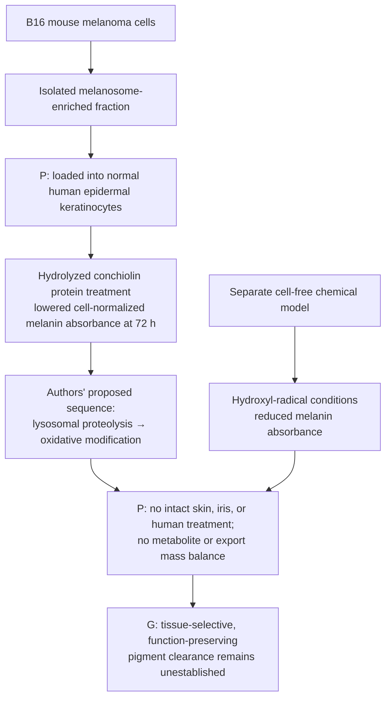

A 2026 in-vitro study loaded normal human epidermal keratinocytes with melanosome-enriched fractions isolated from B16 mouse melanoma cells. Hydrolyzed conchiolin protein (HCP) treatment lowered cell-normalized intracellular melanin absorbance after 72 hours, and the authors proposed lysosomal proteolysis followed by hydroxyl-radical oxidative modification. A separate cell-free oxidation system also reduced absorbance. The experiment isolates post-transfer pigment handling, but it did not test intact skin or a person, identify breakdown products, or account for pigment export; lower optical absorbance does not provide a whole-tissue mass balance. The paper also reports opposite pH directions in its results and discussion, leaving that aspect of the mechanism unresolved. It was funded by Osman Biological Co. These findings are a preclinical human-cell foothold, not evidence of safe cosmetic skin treatment or a transferable iris mechanism. [Zhao et al., 2026](https://doi.org/10.1111/jocd.70770).

**Melanosome breakdown is not automatically melanin-polymer breakdown:** in a mouse keratinocyte assay, Rab7B/42- and LAMP1-positive compartments degraded melanosomal proteins, but cellular melanin content did not fall even after two weeks. Classic isolated-organelle work also distinguished degradable melanosome constituents from the resistant melanin core. Thus, loss of PMEL/TYR or other organelle markers alone cannot establish pigment clearance. [Marubashi and Fukuda, 2020](https://pmc.ncbi.nlm.nih.gov/articles/PMC10739166/), [Otaki and Seiji, 1971](https://pubmed.ncbi.nlm.nih.gov/5556529/).

This does not fully resolve the contrasting tissue-model results: autophagy manipulation lowered total measured melanin in human skin substitutes/ex-vivo skin, and a 2026 loaded-human-keratinocyte model reported lower melanin absorbance with a proposed lysosomal-oxidative sequence. A preliminary human-histology study proposed asymmetric inheritance of melanin organelles during basal keratinocyte mitosis as one explanation for strong basal retention; it cautions that sparse melanin in upper layers alone does not prove melanin-polymer degradation. The inheritance proposal does not exclude degradation in other cells or models. Direct polymer cleavage, chemically identified products, and their export from intact living human tissue remain unresolved. [Murase et al., 2013](https://doi.org/10.1038/jid.2013.165), [Joly-Tonetti et al., 2018](https://doi.org/10.1111/bjd.16926), [Zhao et al., 2026](https://doi.org/10.1111/jocd.70770).

**Appearance versus pigment mass:** In a small human in-situ comparison designed to produce comparable visible tanning, UVA alone did not significantly increase measured melanin, whereas UVB-containing exposures did. This shows that visible skin color can change without a corresponding increase in pigment mass. It is skin-specific evidence; it does not establish the same optical mechanism or a clearance route in the iris. [Choi et al., 2010](https://pubmed.ncbi.nlm.nih.gov/20147966/).

**Critical storage context:** cultured human keratinocytes show donor-dependent melanosome turnover, and autophagy manipulation changed measured melanin in cultured and ex-vivo human skin models. Other cultured-cell uptake studies and human skin electron microscopy found melanin in compartments that were not highly acidic or degradative. This is context-dependent evidence, not a settled universal clearance route. In human skin explants, supranuclear melanin caps correlated with fewer UV-induced DNA photoproducts; an experimental melanocore-disruption model found weaker protection from disrupted cores. Thus a color change alone would not establish safe, selective clearance. [Donor-dependent turnover](https://pubmed.ncbi.nlm.nih.gov/21326292/), [ex-vivo skin model](https://doi.org/10.1038/jid.2013.165), [nondegradative compartments](https://pubmed.ncbi.nlm.nih.gov/29074272/), [in-situ human skin](https://pubmed.ncbi.nlm.nih.gov/29054596/), [human skin explants](https://pubmed.ncbi.nlm.nih.gov/9579550/), [melanocore model](https://pmc.ncbi.nlm.nih.gov/articles/PMC6056223/).

A 2026 human-biopsy study of 14 people with ashy dermatosis found greater melanosome uptake in dermal fibroblasts than in macrophages. In a seven-case marker subset, increased macrophage p62 was interpreted as evidence consistent with impaired autophagic degradation. This disease-specific pathology suggests that persistent dermal melanosomes can involve multiple cell types; it does not establish a treatment or generalize to normal dermis. [Hada et al., 2026](https://pubmed.ncbi.nlm.nih.gov/42410740/).

### Dermal pigment procedures: local fading and body fate are separate

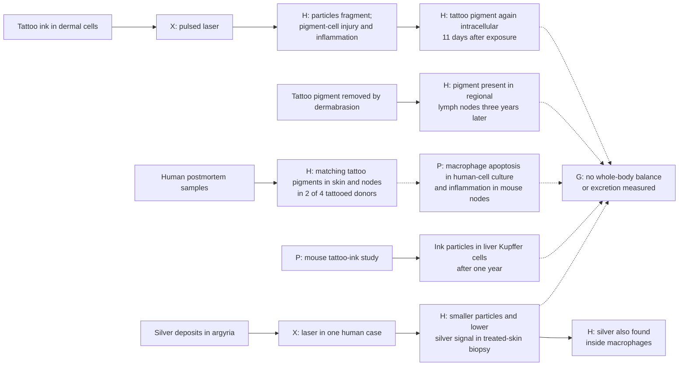

Human tattoo biopsies show that laser-associated lightening can involve disruption of pigment-containing cells, smaller particles, and inflammation; pigment was again intracellular 11 days later. A postmortem human tissue study detected matching tattoo-pigment species in skin and regional nodes in two of four tattooed donors. A separate human case found tattoo pigment in regional lymph nodes three years after the tattoo had been removed by dermabrasion; surface removal therefore did not ensure pigment left the body. A 2026 pathology review of 90 lymph nodes already selected for tattoo-ink deposition found no unifying histologic pattern beyond the ink; 11 specimens came from patients with hematologic neoplasms, but this selected series cannot estimate risk or establish causation. These human findings are small-sample or case evidence and concern ink, not melanin. [Human tattoo biopsy study](https://doi.org/10.1111/1523-1747.ep12478570), [human skin-and-node study](https://doi.org/10.1038/s41598-017-11721-z), [regional lymph-node case](https://pubmed.ncbi.nlm.nih.gov/32650854/).

A separate one-year mouse biodistribution study detected tattoo particles in liver Kupffer cells; it did not detect particles in other sampled internal organs by light microscopy. This is preclinical distribution evidence, not human pharmacokinetics or clearance. [Sepehri et al., 2017](https://pubmed.ncbi.nlm.nih.gov/28486229/).

A 2025 study found persistent inflammation in mouse draining lymph nodes after tattooing and macrophage apoptosis in both mouse experiments and human monocyte-derived macrophage culture; it also reported vaccine-specific immune effects in mice. A 2026 letter questioned how closely the extensive mouse-footpad exposure represents ordinary tattooing. The authors replied that human macrophage and lymph-node observations support mechanistic relevance but agreed clinical effects need further study. This is a preclinical signal about heterogeneous foreign inks, not evidence that native melanin clearance would have the same effects. [Capucetti et al., 2025](https://doi.org/10.1073/pnas.2510392122), [Kluger, 2026](https://doi.org/10.1073/pnas.2611211123), [Gonzalez reply, 2026](https://doi.org/10.1073/pnas.2613440123).

A single generalized-argyria case provides stronger local tissue measurements: after laser treatment, a treated-skin biopsy showed smaller silver-containing particles and markedly lower silver signals, while some residual silver was found in macrophages and on elastic fibers. The authors proposed partial macrophage clearance; the patient had long-lasting visible improvement, but no whole-body silver accounting. It is a metal-deposit case report using a procedure, not evidence for melanin or iris reversal. [Fukayama et al., 2020](https://pmc.ncbi.nlm.nih.gov/articles/PMC9309704/). A separate human case reported recurrence after Q-switched laser treatment. The 2020 authors proposed that ultraviolet exposure might re-darken residual silver through a chemical-state change, but this explanation remains speculative; it illustrates that visible color can shift while metal remains. [Krase et al., 2017](https://pubmed.ncbi.nlm.nih.gov/28296792/).

## 3. Gums and oral mucosa

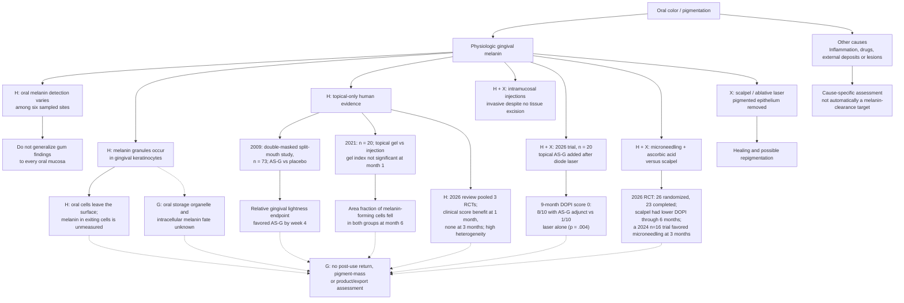

### A gum color can span more than one tissue layer

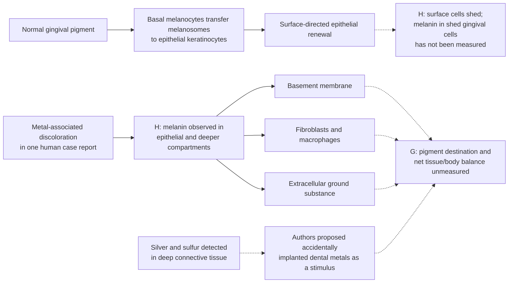

A 1988 human report of gingival discoloration beneath a metallic crown found melanin in epithelial cells and along basement membranes, as well as in fibroblasts, macrophages, and intercellular ground substance; silver and sulfur were also detected in deep connective tissue. The authors proposed that inadvertently implanted dental metals influenced local melanin metabolism. This is a single, unusual pathology report, not a map of ordinary physiologic gum pigmentation, and it did not measure pigment fate. **Inference:** surface shedding alone would not explain the fate of pigment observed in deeper connective tissue. [Sakai et al., 1988](https://pubmed.ncbi.nlm.nih.gov/3146627/).

Gingiva now has a small but meaningful topical-only human evidence signal. In a double-masked, split-mouth study of 73 people, a topical ascorbyl-glucoside gel was compared with placebo for 12 weeks; the abstract reports a significant relative difference in the spectrophotometric gingival-lightness endpoint by week 4. The same paper reports tyrosinase inhibition and reduced new melanin formation in separate cell/skin models. **Inference:** reduced synthesis plus normal epithelial turnover could account for some appearance change, but the clinical study did not separate that from loss of pre-existing pigment. It measured visible lightness, not pigment mass or export, and did not establish what happened after treatment stopped. [Shimada et al., 2009](https://pubmed.ncbi.nlm.nih.gov/19186973/).

Two small human tissue pilots each analyzed eight selected gingival sites collected during depigmentation surgery. Whole-tissue RT-PCR reported higher tyrosinase (TYR) gene expression at sites with greater DOPI pigmentation in 2022, and higher TRP-1 expression at severe versus moderate sites in 2025; these assays did not isolate melanocytes. A separate 2025 study sampled eight sites after scalpel depigmentation and then administered monthly local vitamin C injections for six months; at one year it reported lower TYR and TRP-1 transcript levels and minimal clinical repigmentation. The study had no control arm and conducted no statistical testing, so the changes cannot be attributed to vitamin C separately from tissue removal, healing, or time. Whole-tissue transcript levels are not a chemical melanin-mass or export assay. This is a surgery-associated injection regimen, not standalone nonsurgical pigment clearance or a reversible color cycle. [Sanadi and Deshmukh, 2022](https://pmc.ncbi.nlm.nih.gov/articles/PMC9802523/), [Deshmukh et al., 2025](https://pubmed.ncbi.nlm.nih.gov/39897280/), [Sanadi et al., 2025](https://pmc.ncbi.nlm.nih.gov/articles/PMC12283051/).

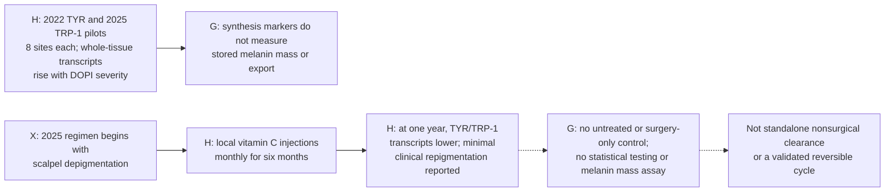

Results differ across studies and endpoints. A separate randomized study with 20 participants found no significant one-month pigmentation-index change in the topical-gel group, while its injection group responded earlier; the reported histological area fraction of melanin-forming cells was lower at six months in both groups. This is a cell-area endpoint, not a chemical measurement of total melanin or pigment export. In a 2026 randomized trial (20 participants, 10 per arm), the nine-month Dummett Oral Pigmentation Index (DOPI) score-0 category occurred in 8/10 participants receiving topical ascorbyl glucoside after diode-laser depigmentation versus 1/10 after laser alone (p=.004). Both arms received laser; the clinical ordinal score does not quantify melanin mass or fate, and the small trial did not establish a post-use return cycle. This supports further study of an adjunctive recurrence-delay signal, not stand-alone topical clearance or a reversible color controller. [El-Mofty et al., 2021](https://pubmed.ncbi.nlm.nih.gov/33966113/), [Gudur et al., 2026](https://pubmed.ncbi.nlm.nih.gov/42147661/).

A separate parallel-group randomized trial (26 participants randomized, 23 completed) compared scalpel depigmentation with microneedling plus topical ascorbic acid. Both groups improved at one month, but the scalpel group had lower DOPI at 1, 3, and 6 months and lower GMMS at 3 months; repigmentation occurred in both. A smaller 2024 randomized study (16 participants, eight per group) instead favored microneedling plus ascorbic acid at months 1 and 3. The differing results may reflect small samples, protocols, or measurement differences; that is an inference. These are procedural comparisons using clinical/reflectance scores, not tests of standalone topical treatment or chemically measured pigment removal. [P et al., 2024](https://pubmed.ncbi.nlm.nih.gov/38752063/), [Dawar et al., 2026](https://doi.org/10.1016/j.jobcr.2026.101530).

A 2026 systematic review of eight gingival vitamin C studies pooled three randomized trials using clinical pigmentation scores. It found a statistically significant difference at one month but no significant difference at three months, where heterogeneity was high. The included interventions and comparators were mixed, so these results do not establish durable efficacy for topical-only application. Neither the review nor these indices show pigment mass, product fate, or return to an individual's baseline color. [Valecha et al., 2026](https://pmc.ncbi.nlm.nih.gov/articles/PMC13472467/).

Scalpel and ablative-laser studies concern removal of pigmented epithelium; recurrence is a relevant outcome. These are procedural comparisons, distinct from preservation of the existing tissue through molecular modulation. Oral pathology also distinguishes melanocytic pigmentation from deposits such as amalgam tattoos. [Procedure trial](https://pubmed.ncbi.nlm.nih.gov/31983845/), [oral pathology series](https://pmc.ncbi.nlm.nih.gov/articles/PMC8141314/). Red, swollen, bleeding gums belong to an inflammatory branch. [NIDCR](https://www.nidcr.nih.gov/health-info/gum-disease).

Ultrastructural examination of 60 normal human gingival specimens found melanin granules in keratinocytes and reported fewer observed granules in prickle cells toward the superficial layers. This is a depth gradient, not a measurement of total melanin being destroyed or exported. Exfoliative-cytology studies have sampled oral surface cells, but their endpoints leave the pigment question open: a study of gingival smears from 20 clinically healthy men measured keratinization and cell morphology, while a separate seven-person cheek-cell study found granules that stained like keratohyalin and proposed they were normal granules or their disintegration products. Neither study quantified melanin in shed cells. The cheek-only ultrastructure study does not close the gingival pigment-export gap. [Squier and Waterhouse, 1967](https://doi.org/10.1016/0003-9969(67)90148-3), [Matsui, 1959](https://www.jstage.jst.go.jp/article/joma1947/71/9-2/71_9-2_6089/_article/-char/en), [van Wyk and van der Vyver, 1983](https://pubmed.ncbi.nlm.nih.gov/6192233/).

A histochemical study of 95 autopsies sampled six oral sites and found marked site variation: melanin was detected in 28.4% of mandibular gingival samples and 51.6% of labial samples; 24.2% of subjects had no detectable pigment at any sampled oral site. This supports treating gingiva as a distinct compartment rather than assuming one oral-mucosa baseline. The study measured presence, not pigment export or function. [Barrett and Beynon, 1991](https://pubmed.ncbi.nlm.nih.gov/1747076/).

The skin–gum comparison exposes a key evidence gap. Both tissues contain melanin-bearing keratinocytes, but the skin literature includes cell and reconstructed-epidermis evidence about autophagic processing and melanokerasome storage; the gingival studies reviewed here have not established an equivalent oral storage compartment or direct melanin-core degradation. Shared epithelial structure is not proof of shared pigment fate. Oral epithelial turnover is measurable, but without quantifying pigment in shed cells or saliva it does not establish net melanin export. This is a gap in the reviewed evidence, not proof that oral keratinocytes lack these pathways. [Neto et al., 2025](https://pubmed.ncbi.nlm.nih.gov/39303907/), [gingival ultrastructure](https://doi.org/10.1016/0003-9969(67)90148-3), [human oral epithelial output](https://pubmed.ncbi.nlm.nih.gov/12711376/).

### Gum measurements stop short of pigment export

The human gum studies reviewed here measure clinical color indices or histological area fraction of melanin-forming cells. In the 20-person topical-gel versus intramucosal-injection study, that cell-area fraction fell in both groups by month 6, while the topical group’s pigmentation index had not changed significantly at month 1. The study had two active groups, no untreated comparator, and no follow-up after treatment to assess return. It did not assay total melanin chemically, trace breakdown products, or measure pigment in exfoliated cells or saliva. A human saliva-output study counted oral epithelial cells in 17 people and calculated a rough 2.7-hour replacement estimate for the whole-mouth surface layer; that is not a gingiva-specific basal-to-surface transit time. A rat BrdU study tracked free-gingival-margin cells from basal layers to the surface in about 82–85 hours. These findings support cell exit as a real oral route, but neither study measured melanin in departing cells or saliva; the human estimate also does not localize cell origin by oral site. [Dawes, 2003](https://pubmed.ncbi.nlm.nih.gov/12711376/), [Breschi et al., 1998](https://pubmed.ncbi.nlm.nih.gov/9527566/). The clinical gum study itself did not assay total melanin, breakdown products, or pigment export. [El-Mofty et al., 2021](https://pubmed.ncbi.nlm.nih.gov/33966113/).

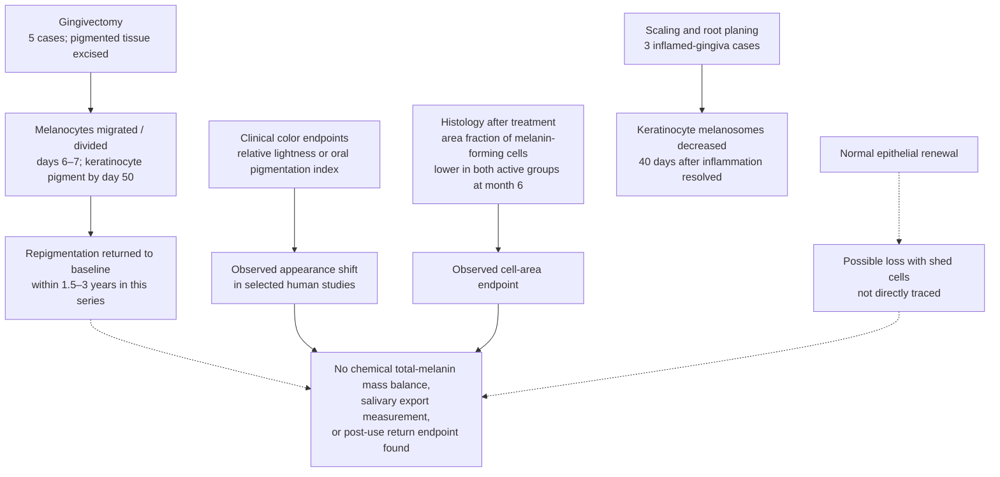


A three-case ultrastructural report compared inflamed gingiva with homologous areas 40 days after scaling and root planing. Melanosome counts in keratinocytes were lower after inflammation resolved. The authors raised inflammation as a possible influence on gingival melanin intensity; the study did not quantify visible color, total melanin chemistry, or export. This is a small disease-context observation, not a pigment-control intervention. [Alves et al., 2015](https://doi.org/10.5005/jp-journals-10024-1718).

A five-person surgical gingivectomy series followed repigmentation for five years. Transmission electron microscopy showed melanocytes migrating and dividing at days 6–7; keratinocytes were reported without pigmented material until day 50. Clinical pigmentation returned to baseline by 1.5 years in two people and by 3 years in the other three. This describes repigmentation after removal of pigmented tissue, not selective clearance or a nonsurgical color switch. [Bergamaschi et al., 1993](https://pubmed.ncbi.nlm.nih.gov/8330948/).

## 4. Eyes: separate compartments

```mermaid
flowchart TD
    E["Eye pigment is compartment-specific"]
    E --> A["Anterior iris / stroma<br/>Visible color target"]
    E --> B["Posterior iris epithelium<br/>Separate dense pigment"]
    E --> C["RPE<br/>Melanin + lipofuscin / bisretinoids"]
    E --> D["Choroid and ciliary body<br/>Separate functional tissues"]
    E --> F["Conjunctiva / episclera<br/>Cause-dependent surface pigmentation"]
    E --> G["Corneal limbus<br/>Pigmented basal epithelial niche"]
    E --> Y["Yellow whites of eyes<br/>Bilirubin branch"]
    A --> A1["H: darkening side effect documented<br/>P: new melanogenesis modulated in models<br/>Selective reversible clearance: G"]
    A --> PK1["H: a human single-dose study detected<br/>topical drugs in iris/ciliary body"]
    PK1 --> PK2["Other ocular tissues also exposed;<br/>distribution differed by drug"]
    PK2 -.-> PK3["G: iris-cell-selective exposure,<br/>shade control, and reversal"]
    A --> A2["H: PS-AS-OCT stromal MCR<br/>correlates with photo color cross-sectionally<br/>(88 brown-iris participants)"]
    A2 -.-> A3["G: serial-change sensitivity,<br/>blue/mixed-eye validation,<br/>direct pigment-mass calibration"]
    A --> A4["P: pigment-laden iris<br/>clump cells in mouse models"]
    A4 --> A5["Vitiligo model: phagocytes accumulate,<br/>visible iris pigment does not progressively fall"]
    A4 --> A6["Matrix-deficiency model:<br/>pigmented cells reach / enter retina"]
    A5 -.-> A7["G: melanin digestion,<br/>safe disposition and net iris clearance"]
    A6 -.-> A7
    B --> B1["Cosmetic clearance: G"]
    B --> B2["H: regional PS-AS-OCT IPE<br/>depolarization mapped in healthy adults"]
    B2 -.-> B3["G: longitudinal pigment change,<br/>disposition, or cosmetic clearance"]
    B --> P["P: pathological pigment release<br/>from posterior iris epithelium"]
    P --> Q["Pigment enters aqueous pathways"]
    Q --> T["Trabecular meshwork<br/>receives pigment"]
    T --> T1["Outflow impairment in models;<br/>secondary glaucoma reported after cosmetic laser"]
    L["X: cosmetic photoablative iris laser"] --> Q
    L --> L1["H: case reports of serious<br/>pigmentary glaucoma"]
    C --> C1["H/P: age-associated RPE melanin loss<br/>in lysosomal / mixed granules"]
    C --> C2["RPE melanin contributes to<br/>photoreceptor-disc waste processing"]
    C2 --> C3["P: lipofuscin reduction in<br/>mouse disease models"]
    C1 -.-> C4["G: human intervention with direct<br/>pigment, fate and function endpoints"]
    C3 -.-> C4
    D --> D1["Cosmetic clearance: G"]
    D --> D2["H: 2026 PS-OCT disease study<br/>15 eyes from 8 acute VKH patients"]
    D2 --> D3["Choroidal entropy rose after 1 month;<br/>RPE signal did not significantly change"]
    D3 --> D4["Adjacent-choroid optical signal only:<br/>not direct pigment mass or iris validation"]
    F --> F1["Human pathology and procedural reports<br/>General molecular modulation: G"]
    G --> G1["H: melanocytes and melanin-bearing basal<br/>epithelial cells near corneal progenitors"]
    G --> G2["Ocular-surface compartment;<br/>not the iris-color target"]
    G --> G3["Selective pigment clearance: G"]
    Y --> Y1["Cause-specific clinical management"]
```

Topical ocular access is distinct from pigment clearance. In pigmented rabbits, a single radiolabeled difluprednate eye-drop exposure produced drug-related radioactivity in cornea, iris/ciliary body, conjunctiva, and anterior and posterior retina/choroid; 99.5% of dose radioactivity was recovered in urine and feces by seven days. This tracks the ophthalmic drug and its metabolites, not melanin or pigment fragments, and is not evidence of pigment export. [Tajika et al., 2011](https://pubmed.ncbi.nlm.nih.gov/21118027/).

Human iris microscopy and chemical microdissection distinguish anterior/stromal pigmentation from the posterior pigment epithelium. These compartments cannot be combined into one clearance target. PS-AS-OCT offers a measurement hypothesis for both layers: one cross-sectional study found that entropy-derived stromal MCR tracked CIE L*a*b* photo-color values among 88 participants with brown irides, while a separate study mapped posterior IPE depolarization regionally in 105 healthy Japanese adults. These are distinct compartments and cohorts. Neither iris study followed a pigment-changing intervention or validated serial signal changes against chemical pigment change; the brown-iris cohort also does not establish performance for an initially blue iris. A 2026 retrospective PS-OCT study provides an adjacent-choroid precedent: in 15 eyes from 8 acute VKH patients, choroidal polarimetric entropy rose from 0.296 ± 0.047 to 0.350 ± 0.075 one month after treatment (p=.001), while RPE entropy did not significantly change. This is a small disease cohort; inflammation and treatment-related structural recovery may affect the signal, and this is neither chemical pigment mass nor iris validation. The imaging readout is therefore a candidate noninvasive proxy for future monitoring, not proof of reversible iris pigment clearance. [Li et al., 2025 online / 2026 print](https://pubmed.ncbi.nlm.nih.gov/41432634/), [Li et al., 2025 IPE mapping](https://pubmed.ncbi.nlm.nih.gov/40131585/), [Oshiro et al., 2026](https://pubmed.ncbi.nlm.nih.gov/41533903/), [PS-OCT melanin-suspension calibration study](https://pmc.ncbi.nlm.nih.gov/articles/PMC7658243/).

A focused literature search for this update did not locate a primary study testing IP3R2-mediated melanophagy in human iris stromal melanocytes or iris pigment epithelium. This is a search-bounded evidence gap, not proof the biology is absent. Skin-cell findings should not be assumed to transfer: human ocular melanocytes and RPE differ in melanogenic properties, and the hypoxic ARPE-19 result concerns another compartment and function. [Smith-Thomas et al., 1996](https://pubmed.ncbi.nlm.nih.gov/8950502/), [Saurav et al., 2026](https://doi.org/10.1371/journal.pbio.3003971), [Xu et al., 2025](https://doi.org/10.1016/j.bbrc.2025.151857).

Mouse clump-cell observations separate pigment uptake from clearance. In a vitiligo model, iris/ciliary clump cells accumulated large melanin-containing phagosomes, but gross iris pigmentation did not progressively decline over the animals' lives. In a separate Col18a1-deficient model, posterior IPE disruption released pigment and macrophage-like cells migrated out of the iris, lined the retinal surface, and sometimes penetrated the retina. A mouse strain survey also found small age-associated pigment dispersion in wild-type C57BL/6J irides. These models document phagocytosis and, under pathology, movement of pigment-bearing cells; they do not identify melanin breakdown products or safe export. [Boissy et al., 1987](https://pubmed.ncbi.nlm.nih.gov/3578491/), [Marneros and Olsen, 2003](https://pubmed.ncbi.nlm.nih.gov/12766032/), [Anderson et al., 2008](https://pubmed.ncbi.nlm.nih.gov/18715234/).

Human donor-tissue studies also identify a separate pigmented corneal limbus: basal K19-positive epithelial cells contain melanin caps, with sporadic dendritic melanocytes among them. This is an ocular-surface niche adjacent to corneal epithelial progenitors, not the central clear cornea or the visible iris target; the study did not examine pigment turnover or clearance. [Iris microscopy](https://pubmed.ncbi.nlm.nih.gov/8602783/), [iris pigment chemistry](https://pubmed.ncbi.nlm.nih.gov/9778410/), [Higa et al., 2005](https://pubmed.ncbi.nlm.nih.gov/16080916/).

### Retinal pigment epithelium: melanin loss and lipofuscin turnover are different targets

The retinal pigment epithelium (RPE) is a support layer at the back of the eye, distinct from the visible anterior iris stroma. Its melanin-rich melanosomes, age-accumulating bisretinoid/lipofuscin granules, and mixed melanolipofuscin granules are different pigment pools. In 30 human eyes spanning nine decades, enzyme cytochemistry and ultrastructure found melanin-containing granules within the lysosomal system, consistent with modification or degradation. The cross-sectional donor study did not measure a rate of loss or trace the resulting material out of the RPE. [Feeney, 1978](https://pubmed.ncbi.nlm.nih.gov/669890/). A 2026 mouse retinal laser-injury study paired ten days of in-vivo AO-PS-OCT with registered ex-vivo immunohistochemistry/confocal imaging. Hyper-reflective foci in the PS-OCT channel co-localized with IB4-positive myeloid cells, while probable pigment was seen in the confocal transmission channel; the authors proposed uptake of melanin-containing RPE debris as one source of the signal. This supports pigment-debris uptake as a candidate process and a cell-sensitive imaging readout, but does not demonstrate melanin digestion, export, net tissue-pigment reduction, or safe clearance. The study concerns injured mouse retina, not the human iris. [Smart et al., 2026](https://pubmed.ncbi.nlm.nih.gov/42311299/).

A separate 2025 ARPE-19 cell study exposed RPE cells to 1% oxygen. Hypoxia increased IP3R2 expression and mitochondrial calcium flux before significant apoptosis; IP3R2 knockdown further impaired mitochondrial function and promoted apoptosis in that stress model. This is an ocular-cell function signal, not a melanin-clearance result, a normal-eye safety estimate, or evidence about iris melanocytes. It makes tissue-compartment-specific function an essential constraint on any hypothetical IP3R2-related approach. [Xu et al., 2025](https://doi.org/10.1016/j.bbrc.2025.151857).

In rhesus-monkey RPE, electron microscopy found fewer melanosomes with age and lysosome-like organelles containing melanin in different stages of loss. The authors interpreted these as autophagic melano-lysosomes and considered the decline potentially detrimental because RPE melanin protects against light toxicity and oxidative stress. This is age-associated animal tissue evidence, not a controlled intervention. [Gouras et al., 2011](https://pubmed.ncbi.nlm.nih.gov/22056912/).

Oxidation can destroy RPE melanin chemically, but that does not establish safe clearance. Dontsov et al. generated melanin-decay products by exposing isolated human and bovine RPE melanosomes to superoxide. A later human donor-granule study found water-soluble products after visible-light exposure of isolated melanolipofuscin; some products could generate superoxide under light in the study's assays. These were isolated-granule experiments, not treatment of living eyes, and the target melanin normally screens light and contributes antioxidant protection. [Dontsov et al., 2017](https://pubmed.ncbi.nlm.nih.gov/28941459/), [Dontsov et al., 2023](https://pubmed.ncbi.nlm.nih.gov/37685907/).

A measurement foothold does not yet solve the monitoring problem. A 2025 study used high-resolution and super-resolution autofluorescence imaging in retinal sections from seven human donors aged 80–89; near-infrared signals at selected wavelengths were associated mainly with melanolipofuscin in the RPE cell body, while melanosomes in apical processes also emitted near-infrared signal. This is a histologic basis for interpreting a potential imaging marker, not a validated live measure of pigment mass or longitudinal clearance. [Jauch et al., 2025](https://pubmed.ncbi.nlm.nih.gov/41159652/).

A separate preclinical result concerns **lipofuscin**, not melanin. In Abca4-deficient mouse models, Lyu et al. reported a melanin-supported pathway for reducing photoreceptor-disc-derived lipofuscin-related material in RPE; a synthetic chemiexcitation approach also restored a reduction in an albino model. This is a disease-model mechanism for a different pigment target, not iris-color control or a human cosmetic treatment. It shows why a pigment-removal concept must name the chemical substrate and preserve beneficial material in the same cell. [Lyu et al., 2023](https://pmc.ncbi.nlm.nih.gov/articles/PMC10194005/).


### RPE research separates slower accumulation from attempted clearance

The retinal pigment epithelium contains **two different targets**: functional melanin that screens light and supports redox handling, and bisretinoid-rich lipofuscin that accumulates in disorders such as Stargardt disease. Clinical work on the latter is useful for understanding intervention endpoints, but it is not a route to changing visible iris color.

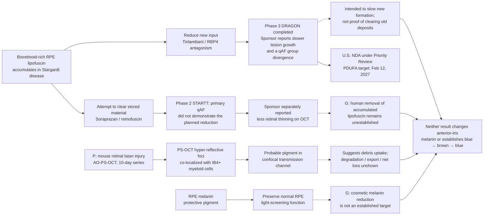

**Input reduction:** tinlarebant is an oral RBP4 antagonist intended to lower retinol delivery to the eye and reduce formation of new vitamin-A-derived bisretinoids. A 2026 pharmacology study found competitive retinol displacement from RBP4 and disruption of RBP4–transthyretin association; single-dose mouse experiments lowered plasma RBP4. The completed, 24-month DRAGON Phase 3 trial enrolled 104 people aged 12–20 with Stargardt disease. Belite Bio reported a 35.7% reduction in the rate of definitely-decreased-autofluorescence (DDAF) lesion growth versus placebo (p=0.0033). In an August 2026 company update, the sponsor also described month-25 qAF as approximately 2% lower than baseline in treated participants versus an approximately 20% increase with placebo. These are disease-progression / accumulation-related outcomes, not direct evidence that a pre-existing pigment store was removed. The detailed Phase 3 results available in the reviewed source set remain sponsor-reported. Belite Bio reported FDA acceptance of the U.S. NDA for Priority Review, with a February 12, 2027 target action date; as of this atlas review, the candidate remained investigational. [Tinlarebant pharmacology study](https://pubmed.ncbi.nlm.nih.gov/42810809/), [DRAGON registry](https://clinicaltrials.gov/study/NCT05244304), [Phase 3 topline report](https://investors.belitebio.com/news-releases/news-release-details/new-hope-people-living-disease-once-deemed-untreatable-belite), [August 2026 qAF and regulatory update](https://investors.belitebio.com/news-releases/news-release-details/belite-bio-reports-unaudited-second-quarter-2026-financial), [FDA Priority Review announcement](https://investors.belitebio.com/news-releases/news-release-details/belite-bio-announces-us-food-and-drug-administration-acceptance).

**Attempted removal:** the 24-month, randomized, double-masked STARTT Phase 2 study assigned 87 adults with Stargardt disease to oral soraprazan/remofuscin or placebo. The sponsor's October 2023 topline report said the qAF primary measure was highly variable and did not show significant changes from baseline in either group; the same release reported less retinal thinning in treated participants on secondary OCT measures. Without a peer-reviewed full results report in the reviewed sources, the structural result should remain sponsor-reported and secondary. It does not establish that the drug removed existing lipofuscin, and even successful RPE lipofuscin reduction would not demonstrate removal of protective RPE melanin or anterior-iris pigment. [STARTT trial registry](https://www.clinicaltrialsregister.eu/ctr-search/trial/2018-001496-20/GB), [STARTT design and baseline report](https://pmc.ncbi.nlm.nih.gov/articles/PMC10445898/), [sponsor topline results](https://katairo.com/wp-content/uploads/2023/10/20231006_PressRelease_STARTT_ToplineResults.pdf).

Cosmetic photoablative iris-laser treatment is a procedural comparator, not a selective biological modulator. Case reports document pigment dispersion and secondary pigmentary glaucoma; after four sessions, one bilateral case had intraocular pressures of 50 and 42 mmHg, with visual-field defects and glare still present at follow-up despite urgent treatment. These case reports establish possible severe harm, not its frequency. [Ning et al.](https://pubmed.ncbi.nlm.nih.gov/33449587/), [Swampillai et al.](https://pubmed.ncbi.nlm.nih.gov/36175318/), [Liu et al.](https://pubmed.ncbi.nlm.nih.gov/37771388/).

A small 1983 ophthalmic report of people with vitiligo described linear pigment deposition in both corneas in one patient after a year of monobenzone use. Among 15 additional patients, 11 of whom used monobenzone, two had conjunctival melanosis; the authors said these findings might be related to use. This uncontrolled report cannot establish causality or risk frequency, but it illustrates why unintended ocular effects must be examined when a skin-directed intervention is not proven tissue-confined. It is not evidence for an iris-lightening route. [Hedges et al., 1983](https://pubmed.ncbi.nlm.nih.gov/6849655/).

**Pigment fate is part of the eye constraint.** In pigment-dispersion disease, granules released from the posterior iris pigment epithelium can travel through aqueous pathways and accumulate in the trabecular meshwork. Porcine models show impaired meshwork-cell phagocytosis/migration and reduced outflow after pigment exposure. A 15-year follow-up of 21 treated eyes in 11 patients found the median trabecular-meshwork pigmentation score fell from 16 at baseline to 12; quadrant-specific clinical grading reductions ranged from 18% to 37%. Ten eyes had laser peripheral iridotomy and eleven had trabeculectomy. These were cause-directed clinical interventions for pigment-dispersion disease. The score measured visible meshwork pigmentation, not pigment mass or its destination, and the procedures do not establish a nonprocedural cosmetic clearance route. This pathway concerns posterior-epithelial pigment and the drainage angle, distinct from the anterior stromal color target. [Human PDS cohort](https://pubmed.ncbi.nlm.nih.gov/34397796/), [trabecular-meshwork cell model](https://pmc.ncbi.nlm.nih.gov/articles/PMC7847180/), [porcine outflow model](https://pmc.ncbi.nlm.nih.gov/articles/PMC5915754/).

### Culture-associated pigment dilution in posterior iris epithelium is not in-vivo clearance

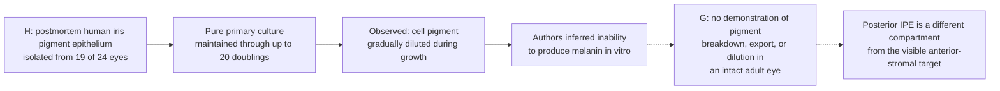

Hu et al. isolated human iris pigment epithelium (IPE) from postmortem donor eyes and established pure cultures from 19 of 24 eyes. The cultured cells remained viable and proliferated through as many as 20 population doublings; pigment gradually diluted as the cells divided. The authors interpreted this as an inability to produce melanin in vitro. This is a culture-state observation in the posterior IPE, not a measurement of melanin degradation or export, a demonstration that intact adult iris cells dilute pigment, or evidence of a visible anterior-stromal color change. It offers a cell-biology model for pigment partition during division, but does not establish a treatment or a reversible eye-color route. [Hu et al., 1992](https://pubmed.ncbi.nlm.nih.gov/1634342/).

### Posterior-iris pigment transport is not anterior-iris clearance

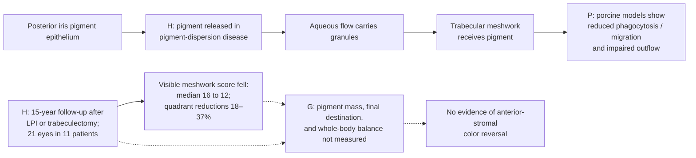

The longitudinal score is a useful sign that pigment appearance in the drainage compartment can change after the source process is treated. It does not reveal whether macrophages degraded, moved, or exported the pigment, and the study did not measure a cosmetic iris-color endpoint. [Zhou et al., 2021](https://pubmed.ncbi.nlm.nih.gov/34397796/), [trabecular-meshwork cell model](https://pmc.ncbi.nlm.nih.gov/articles/PMC7847180/).

For the RPE, a 2014 cell/mouse study reduced **selected bisretinoids**, with substrate-specific limitations. A 2023 mouse study reported lipofuscin degradation involving melanin; subsequent scientific discussion addressed alternative pathways and the limits of a universal melanin-required interpretation. These are retinal research mechanisms, not evidence of iris-color reversal. [2014 study](https://pmc.ncbi.nlm.nih.gov/articles/PMC3986126/), [2023 study](https://pmc.ncbi.nlm.nih.gov/articles/PMC10194005/), [comment](https://pmc.ncbi.nlm.nih.gov/articles/PMC10622903/), [reply](https://pmc.ncbi.nlm.nih.gov/articles/PMC10622899/).

### Oxidative breakdown can alter melanin and produce photoreactive products

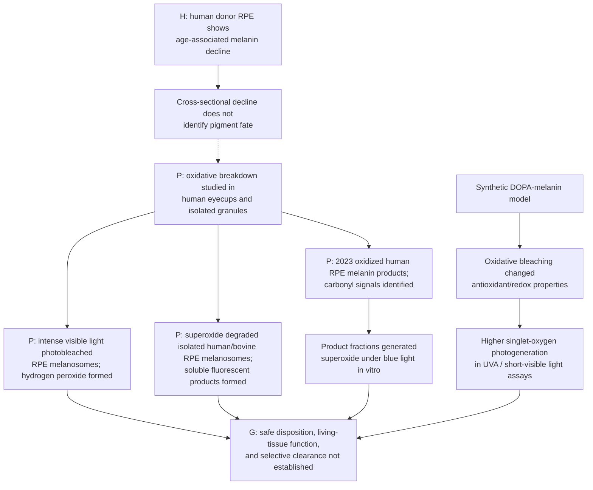

Several postmortem human RPE series show an age-associated decline in native melanin. A 50-eye morphometry study found "pure" melanin declined while complex melanin granules rose; another analysis of 61 normal eyes measured lower soluble melanin in older donors (95 μg/mg dry weight at ages 14–50 versus 22 μg/mg above 70). ESR analysis across human RPE donors found an approximately 2.5-fold decline from the first to ninth decade. These are cross-sectional age comparisons, not a tracked cellular clearance process: they do not identify where pigment-derived material went or separate photooxidation, conversion into complex melanolipofuscin, and other age-related changes. In human eyecup assays, intense visible light photobleached melanosomes and generated hydrogen peroxide. The authors proposed cumulative photo-oxidation may contribute and raised concern that aging-associated pigment change could weaken photoprotection. This is RPE-aging evidence, not a safe or controllable route in the anterior iris stroma. [Feeney-Burns et al., 1984](https://pubmed.ncbi.nlm.nih.gov/6698741/), [Schmidt and Peisch, 1986](https://pubmed.ncbi.nlm.nih.gov/3721785/), [Sarna et al., 2003](https://pubmed.ncbi.nlm.nih.gov/12589778/).

An oxidative breakdown route may lower melanin's optical signal while changing the pigment and producing new material. In an earlier in-vitro study, superoxide degraded isolated human/bovine RPE melanosomes into transparent soluble material containing fluorescent melanin-decay products. The same study found lower paramagnetic-center levels in human melanolipofuscin granules than in melanosomes across 150 eyes, interpreted as age-related melanin destruction; this observation does not reveal product destination in living tissue. Dontsov et al. later isolated RPE pigment granules from human cadaver eyes and identified water-soluble melanin-degradation products with carbonyl signals that generated superoxide under blue-light exposure in vitro. The authors describe potential photoreactivity, not demonstrated clinical harm. A separate synthetic DOPA-melanin study found oxidative bleaching changed redox/antioxidant properties and increased singlet-oxygen photogeneration. These results show why degradation must be assessed alongside product identity, disposition, and tissue function; none tested a pigment-clearing intervention in living people, and none is evidence for iris reversibility. [Dontsov et al., 2017](https://pubmed.ncbi.nlm.nih.gov/28941459/), [Dontsov et al., 2023](https://pubmed.ncbi.nlm.nih.gov/37685907/), [Mokrzyński et al., 2024](https://pubmed.ncbi.nlm.nih.gov/38803190/).

Human fetal RPE cultures provide evidence concerning melanin's photoprotective role. Choroid mapping, epithelial anatomy, and ocular-surface pathology are separate evidence categories. [RPE study](https://pmc.ncbi.nlm.nih.gov/articles/PMC1157035/), [human choroid study](https://pmc.ncbi.nlm.nih.gov/articles/PMC6901595/), [NLM epithelial definition](https://www.ncbi.nlm.nih.gov/mesh/D010857), [conjunctival case report](https://pmc.ncbi.nlm.nih.gov/articles/PMC4251888/).

## 5. The original iris cycle

Human iris chemistry found very low pigment content in blue irides and variation in melanin type across color groups. Histology found no significant difference in stromal melanocyte counts among blue, hazel, and brown irides. In cultured human uveal melanocytes, growing cells shifted toward pheomelanic pigmentation, while cultures after senescence showed increased pigment content, mainly eumelanin. Those are culture-state observations, not evidence of pigment turnover in an intact adult iris. **Inference:** a return-to-blue claim should measure the visible anterior-stromal pigment state and standardized optical appearance; melanocyte counts or a whole-eye pigment measure alone are inadequate endpoints. [Iris histology](https://pubmed.ncbi.nlm.nih.gov/8602782/), [human iris pigment chemistry](https://pubmed.ncbi.nlm.nih.gov/9778410/).

### Natural iris-color changes do not establish pigment clearance

```mermaid
flowchart TD
    A["H: Louisville twin study<br/>color grades from age 6 to <24"] --> B["3.8–8.6% changed ≥2 grade units<br/>over 3–9-year intervals"]
    A --> C["Adult-mother follow-up subset:<br/>9% lightened ≥2 grade units"]
    D["H: 27-year follow-up of<br/>594 former schoolchildren"] --> E["24.3% lightened; 17.2% darkened;<br/>overall change not significant"]
    F["H: human iris specimens from<br/>cataract patients aged 70–84"] --> G["Melanosome complexes observed;<br/>clinical significance unresolved"]
    B --> H["Endpoints: graded appearance<br/>or ultrastructural morphology"]
    C --> H
    E --> H
    G --> H
    H --> I["No direct tracking of stored<br/>melanin amount or fate"]
    I --> J["G: natural history does not establish<br/>selective reversible pigment clearance"]
```

Longitudinal color-grading studies show that a minority of people have iris-color shifts after early childhood, including lightening in some adults. In the Louisville Twin Study, 1,513 individuals were assessed and 1,386 were examined at least twice; among white twins from age 6 to under 24, 3.8%–8.6% changed at least two color-grade units over 3–9-year intervals. In a separate adult-mother subset, 9% lightened by at least two units. A 27-year follow-up of former schoolchildren reported lightening in 24.3% and darkening in 17.2% of 594 re-examined participants, but the overall age-related change was not statistically significant. These studies graded visible color and did not measure iris melanin amount or destination. Electron microscopy of iris specimens from cataract patients aged 70–84 found melanosome complexes in stromal melanocytes; the authors left the clinical significance unresolved. These observations show that appearance and cell ultrastructure can vary with age. They do not establish degradation or export of established pigment, a controllable lightening mechanism, or a return-to-baseline cycle. [Bito et al., 1997](https://pubmed.ncbi.nlm.nih.gov/9152135/), [Meyer-König, 1977](https://doi.org/10.1016/S0047-2484(77)80099-7), [Sugita et al., 1986](https://pubmed.ncbi.nlm.nih.gov/3761741/).

### Human iris ultrastructure shows pigment processing, not net clearance

```mermaid
flowchart TD
    H["H: 31 human peripheral iridectomy specimens<br/>from a 6-month paired-eye study"] --> T["Turnover graded from electron-microscope<br/>morphology—not pigment mass"]
    T --> T1["4/30 specimens: obvious features;<br/>6/30: no features observed"]
    H --> C["Clump cells marked in 10 specimens;<br/>virtually absent in the others"]
    C --> F["Stromal clump cells are described<br/>as phagocytes that engulf debris,<br/>including free melanin granules"]
    F -.-> D["Intracellular breakdown and final<br/>pigment destination were not measured"]
    H --> R["Free stromal granules were rare,<br/>not abundant, and unrelated to treatment;<br/>authors suspected handling / surgery artifact"]
    H --> X["One eye visibly darkened;<br/>clump cells were obvious, but its<br/>turnover score was below some specimens"]
    Q["H: 82 cataract-surgery eyes after topical<br/>moxifloxacin, ciprofloxacin, or tobramycin"] --> Q1["Aqueous soluble TYR activity / immunoblot;<br/>interpreted as subclinical iris melanocyte toxicity"]
    Q1 --> Q2["No clinical BAIT / BADI in the study;<br/>TYR is not a pigment-mass or safe-clearance assay"]
    Q2 -.-> G
    T1 -.-> G["G: net anterior-stromal pigment loss,<br/>safe export, and fading remain unshown"]
    D -.-> G
    R -.-> G
    X -.-> G
```

The Mainz II study is a human biological foothold, not a reversal result. Seventeen glaucoma patients were recruited; 14 completed six months of unilateral latanoprost, and 31 peripheral iris specimens were examined by masked light and electron microscopy. The investigators scored premelanosomes, immature or partly melanized granules, and morphological signs such as giant granules or clumping as “turnover.” Only 4 of 30 scored specimens showed obvious turnover features, while 6 showed none. Clump cells were marked in 10 of 31 specimens and virtually absent in others; these stromal phagocytes are known to engulf debris, including free melanin granules. The study did not track what happened after engulfment or measure total pigment balance. Extracellular granules were rare and not abundant, were not associated with latanoprost, and the authors suspected some may have been released during surgery or tissue processing. The one eye with marked visible darkening had obvious clump cells, but its stromal turnover score was lower than in some other specimens. Thus, uptake and turnover-like morphology are plausible processes to investigate; neither is proof that pigment mass leaves the iris or that color would lighten. [Pfeiffer et al., 2003 (Mainz II)](https://jamanetwork.com/journals/jamaophthalmology/fullarticle/414988). A separate clinical study measured aqueous tyrosinase activity after topical antibiotic exposure in 82 cataract-surgery eyes: 27 received preservative-free moxifloxacin, 29 ciprofloxacin with preservative, and 26 preservative-containing tobramycin as control. Higher mean activity occurred in the ciprofloxacin group; immunoblotting detected soluble tyrosinase in antibiotic-exposed samples. The authors interpreted this as subclinical iris-melanocyte toxicity and pigment dispersion, but no participant developed clinically appreciable BAIT or BADI. The formulations differed, and moxifloxacin itself could inhibit the tyrosinase assay. This is an injury-associated leakage signal, not a direct measure of iris melanin mass, safe export, or a color-lightening method. [Mahanty et al., 2017](https://pmc.ncbi.nlm.nih.gov/articles/PMC5563078/).

A 1993 review of adult vertebrate eye pigmentation likewise concluded that the amount of melanin turnover in iris, choroid, and retinal pigment epithelium was unknown. Its comparative literature and animal ultrastructure help explain the question, but do not provide a human iris clearance rate. [Schraermeyer, 1993](https://pubmed.ncbi.nlm.nih.gov/8248016/).

### Disease-associated iris depigmentation can later repigment

```mermaid
flowchart LR
    A["H: BADI presents with acute<br/>stromal depigmentation"] --> B["Pigment enters anterior chamber;<br/>heavy trabecular-meshwork deposits"]
    B --> C["26-new-case series:<br/>dispersion resolved in 1–16 weeks<br/>(median 9 weeks)"]
    B --> D["IOP elevation in 8 steroid-treated eyes;<br/>controlled with glaucoma medication"]
    C -.-> E["Two patients from earlier report:<br/>stromal repigmentation at 4 years"]
    E -.-> G["G: cause, pigment mass/flux,<br/>and mechanism of return unmeasured"]
    F["Separate case report:<br/>stromal repigmentation over 3 years"] -.-> G
    D -.-> G
```

Bilateral acute depigmentation of the iris (BADI) is a rare, disease-associated exception to the usual persistence of medication-associated iris darkening. A retrospective series reported 26 new patients plus four-year follow-up of two previously reported patients: pigment dispersion resolved in 1–16 weeks (median 9 weeks), and those two patients had repigmentation of the iris stroma after four years. A separate single-case report described stromal repigmentation over three years. The 2009 series found heavy pigment in the trabecular meshwork in all cases; eight steroid-treated eyes had elevated intraocular pressure, controlled with glaucoma medication. The cause remains unknown. These reports document clinical appearance returning in a few disease cases, but did not measure pigment mass, trace the deposited material, or test a controlled return mechanism. They do not establish safe cosmetic reversibility. [Tugal-Tutkun et al., 2009](https://pubmed.ncbi.nlm.nih.gov/19545903/), [Atilgan et al., 2018](https://pmc.ncbi.nlm.nih.gov/articles/PMC6056785/).

### Human uveal melanocytes can modulate new pigment production

```mermaid
flowchart TD
    A["P: cultured human uveal melanocytes<br/>retain melanogenic capacity"] --> B["P: cAMP-elevating / PKC signals increased<br/>melanin, tyrosinase activity, and cell counts"]
    C["P: latanoprost increased new melanin"] --> C1["α-methyl-p-tyrosine prevented<br/>the induced synthesis increase"]
    D["P: human donor-iris organ culture<br/>tyrosinase mRNA rose in 6 of 30 sets"]
    D --> E["Five responders were brown,<br/>one hazel; none of the blue cultures responded"]
    F["P: 12-rabbit, six-month study<br/>reported lower endpoint melanin in one<br/>inhibitor + inducer cohort vs inducer alone"]
    F --> F1["n=3 in that cohort; 'blue' was an ear-marked<br/>group, and abstract/table values conflict"]
    G["P: inhibitor-only rabbit cohort"] --> G1["No significant between-eye difference<br/>in measured endpoint melanin"]
    B --> H["G: established anterior-stromal pigment<br/>not shown to be cleared"]
    E --> H
    F1 --> H
    G1 --> H
    H --> I["G: human iris lightening, safe pigment fate,<br/>washout return, and repeatable color cycle"]
```

The human-cell evidence makes **new-pigment production** a real experimental control point: cultured donor-derived uveal melanocytes make melanin; cell-culture signals can increase melanin and tyrosinase activity; and α-methyl-p-tyrosine prevented a latanoprost-induced synthesis increase. In a separate 7-day donor-iris organ culture, tyrosinase mRNA rose in 6 of 30 culture sets, with five responders from brown irides and one from a hazel iris; none of the blue-iris cultures responded. Neighboring epithelial cells and fibroblasts can also alter ocular melanocyte enzyme activity in culture, with results dependent on cell type and culture conditions. [Hu et al., 1995](https://pubmed.ncbi.nlm.nih.gov/7706042/), [Hu et al., 1997](https://pubmed.ncbi.nlm.nih.gov/9196391/), [Drago et al., 1999](https://pubmed.ncbi.nlm.nih.gov/9986745/), [Lindsey et al., 2001](https://pubmed.ncbi.nlm.nih.gov/11405836/), [Smith-Thomas et al., 2001](https://pubmed.ncbi.nlm.nih.gov/11549114/), [Smith-Thomas et al., 2004](https://pubmed.ncbi.nlm.nih.gov/15051478/).

Target-selectivity caveat: the 1999 study calls its α-methyl-p-tyrosine preparation a tyrosinase inhibitor, while current U.S. labeling for metyrosine describes tyrosine-hydroxylase inhibition as its established pharmacology in catecholamine biosynthesis. The ocular experiments do not establish an iris-specific target or a melanin-only effect. [DailyMed metyrosine label](https://dailymed.nlm.nih.gov/dailymed/drugInfo.cfm?setid=1b7897b4-7681-4b99-8883-d5dc33f86c01).

A 2022 rabbit study provides a low-confidence in-vivo signal for suppressing an induced pigment increase. In one cohort of three rabbits, a co-treated eye had a lower endpoint melanin measurement than the fellow eye exposed to the pigment-inducing drug alone (9.56 vs 13.73 μg/g; p=.022). The study also reported mixed photographic outcomes and no significant endpoint melanin difference between eyes in its inhibitor-only cohort. Its group names came from colors painted on the rabbits' ears, not iris color. The abstract reports 3.73 μg/g for the control eye while the results text and table report 13.73 μg/g. A 2026 APAO abstract by overlapping authors describes the same n=12 design and matching measurements, reporting the table-consistent 13.73 μg/g; it appears to be a conference presentation of this study, not an independent replication. [APAO 2026 abstract book](https://2026.apaophth.org/wp-content/uploads/sites/8/abstract-book_all-in-one_v2.pdf). The small sample, internal value discrepancy, lack of a baseline tissue assay, no post-withdrawal follow-up, and systemic signs in the inhibitor-only cohort limit inference and safety claims. This is evidence about inhibition during an induced response, not proof that stored pigment was actively degraded or exported. No human iris-lightening result or return-to-blue cycle was tested. [Sadiq et al., 2022](https://pmc.ncbi.nlm.nih.gov/articles/PMC9674870/).

### A systemic precursor shift produced different skin, hair, and iris signals

A one-year pilot tested oral nitisinone in five adults with molecularly confirmed OCA-1B, an albinism subtype with residual tyrosinase activity. The disease-directed hypothesis was that raising tyrosine could increase pigment synthesis. Nitisinone raised steady-state plasma tyrosine approximately tenfold, but the response varied across tissues and endpoints:

```mermaid
flowchart TD
    N["Systemic nitisinone<br/>in five adults with OCA-1B"] --> T["Plasma tyrosine rose<br/>about tenfold"]
    T --> S["Skin: small inner-bicep<br/>reflectometry increase at month 12;<br/>visible change in 1 of 5"]
    T --> H["Hair: 4 of 5 reported darkening;<br/>eumelanin marker rose"]
    T --> I["Iris: primary transillumination<br/>endpoint showed no significant<br/>favorable response"]
    I --> IX["Exploratory paired-eye model:<br/>about 1-point more transillumination<br/>(consistent with less pigment), p = .01;<br/>largest change in 2 of 5"]
    I --> IM["Fundus photos showed<br/>no pigmentation change"]
    T --> W["After discontinuation:<br/>plasma tyrosine returned to baseline"]
    W --> WH["Hair eumelanin marker was<br/>near baseline at safety follow-up;<br/>pheomelanin marker remained lower"]
    W --> WI["Iris return after washout<br/>was not established"]
    S --> G["Responses differed by tissue;<br/>a systemic substrate shift was not<br/>a tissue-selective color controller"]
    H --> G
    IX --> G
    IM --> G
    WH --> G
    WI --> G
```

At month 12, the inner-bicep melanin index increased by 1.72 points (95% CI 0.03–3.41; p=.047), while only one participant had a visible skin change; the outer-forearm result was not statistically significant. Hair melanin index increased (17.3 points; p=.01), and four participants reported increased hair pigmentation. Chemical hair markers diverged: the eumelanin marker PTCA rose at month 12 and was near baseline at safety follow-up, while the pheomelanin marker 4-AHP remained lower.

The iris result needs both analyses stated. The paper's primary iris-transillumination endpoint was summarized as showing no significant favorable change. A longitudinal model pooling both eyes found an approximately one-point increase in transillumination (p=.01), which is directionally consistent with less iris pigment; the largest changes were in two participants, while three had minimal or no change. Transillumination is an optical proxy, not chemical melanin mass. The paper says all analyses were exploratory and did not adjust for multiple comparisons. No change in fundus pigmentation was identified, and post-discontinuation iris return was not established. One participant restarted nitisinone during follow-up, further limiting interpretation of a simple washout trajectory. This study is a small OCA-1B research pilot, not evidence for changing the color of healthy eyes. [One-year nitisinone pilot in OCA-1B](https://insight.jci.org/articles/view/124387).

### Human iris darkening may involve granule geometry, not a higher granule count

```mermaid
flowchart TD
    A["H: paired iridectomies from<br/>2 eyes with visible latanoprost darkening"] --> B["No significant change in cell density<br/>or counted mature / immature granules"]
    B --> C["Anterior-border granules were larger;<br/>granule area and cytoplasmic occupancy rose"]
    D["H: morphometry in 15 darkened cases<br/>and 15 untreated controls"] --> E["Anterior-border granules were larger;<br/>total granule count did not differ"]
    C --> F["Visible iris color depends on pigment<br/>and how granules are arranged / sized"]
    E --> F
    F -.-> I["Inference: an appearance shift may not<br/>equal an increase in total pigment mass"]
    I -.-> G["G: total melanin mass, polymer chemistry,<br/>degradation, and reversibility not established"]
```

Two morphometric studies of human peripheral iridectomies provide a useful distinction between **granule size** and **granule count**. In a quantitative subgroup of two eyes with visible darkening after six months of latanoprost, stromal cellularity and the numbers of immature melanosomes and mature melanin granules did not differ significantly from fellow-eye controls. Granules were larger, especially in anterior-border melanocytes, where measured granule area and the fraction of cytoplasm occupied by melanin also increased. A later series examined 15 latanoprost-darkened irides and 15 untreated controls: total granule number did not differ from brown or mixed-color controls, while anterior-border granules were significantly larger. These structural observations support an **inference** that optical appearance can shift through granule size or packing without a demonstrated increase in granule count. They do not measure total melanin mass or chemistry and do not show degradation, export, or return to baseline. The two reports came from the same research group; the two-case subgroup was drawn from an earlier clinical series, not an independent replication. [Cracknell et al., 2003](https://pubmed.ncbi.nlm.nih.gov/14609560/), [Cracknell et al., 2007](https://pubmed.ncbi.nlm.nih.gov/17292473/).

### Inherited HERC2–OCA2 regulation is not adult iris control

```mermaid
flowchart LR
    SNP["H: HERC2 rs12913832<br/>strongly associated with iris color"]
    --> ENH["P: allele-dependent enhancer activity<br/>and chromatin looping"]
    --> OCA2["P: OCA2 expression differs in<br/>cultured human epidermal melanocytes"]
    SNP --> OTHER["H: same locus also associates<br/>with skin and hair pigmentation"]
    OCA2 -.-> IRIS["Plausible link to inherited iris color;<br/>functional assay did not use iris cells"]
    IRIS -.-> GAP["G: adult iris selectivity, reversibility,<br/>and intervention safety untested"]
    OTHER --> GAP
```

Human association and functional studies identify the HERC2 intron-86 variant rs12913832 and nearby OCA2 as major contributors to inherited blue/brown iris-color variation. The original association study proposed that the variant alters OCA2 expression, particularly in iris melanocytes. A later functional study demonstrated allele-dependent enhancer activity, chromatin looping, and OCA2 expression differences in cultured neonatal **epidermal** melanocytes—not iris-derived cells. A population study also found the same variant associated with skin and hair coloration. The locus may have a stronger effect on iris color, but it is not evidence of iris-exclusive regulation or a reversible adult control point. [Sturm et al., 2008](https://pmc.ncbi.nlm.nih.gov/articles/PMC2427173/), [Visser et al., 2012](https://pmc.ncbi.nlm.nih.gov/articles/PMC3290780/), [Branicki et al., 2009](https://pubmed.ncbi.nlm.nih.gov/19208107/).


```mermaid
flowchart LR
    A["Original blue iris"]
    B["Chosen dark-brown iris"]
    C["Original blue restored"]
    A -.->|"G: controlled increase<br/>in a uniformly blue iris"| B
    B -.->|"G: selective removal<br/>of added pigment"| C
    C -.->|"G: repeatable cycle"| A
    D["Documented glaucoma-drug darkening<br/>Some susceptible / mixed-color irides"]
    D --> E["Pigment may persist after stopping"]
```

The dashed arrows are the goal, not demonstrated clinical transitions. Official Xalatan information reports no observed color change in uniformly blue eyes in its cited studies. U.S. labeling describes increased iris pigmentation as likely permanent. Human follow-up reported no fading over two years after stopping, and a separate one-person photographic case found no appreciable change over five years. In contrast, one case of periocular-skin darkening visibly improved within a month and was significantly lighter by two months after stopping; epidermis is a renewing surface tissue, so this is not an iris reversal result. FDA states that there are no approved eye drops for changing eye color. The FDA-approved CustomFlex artificial iris is a surgically implanted device indicated for full or partial aniridia from congenital or acquired defects; its labeling says it is not indicated when the only reason is to change eye color. That is medical reconstruction, not a nonsurgical cosmetic modulator. [FDA approval record](https://www.accessdata.fda.gov/scripts/cdrh/cfdocs/cfpma/pma.cfm?id=P170039), [FDA-approved labeling](https://www.accessdata.fda.gov/cdrh_docs/pdf17/P170039C.pdf). A 2024 FDA warning letter also documented online claims that LightEyez eye drops would lighten iris color by inhibiting melanin, and classified the marketed products as unapproved new drugs; FDA reported that its testing found the specific batch it tested adulterated. This is evidence about regulatory status and that batch’s quality, not proof the claimed mechanism works or an estimate of risk across products. [FDA LightEyez warning letter](https://www.fda.gov/inspections-compliance-enforcement-and-criminal-investigations/warning-letters/lighteyez-limited-665450-02152024). [UK product information](https://www.medicines.org.uk/emc/product/1616/smpc), [U.S. label](https://dailymed.nlm.nih.gov/dailymed/drugInfo.cfm?setid=f4e73059-5ba0-4d73-9ea1-09d8d654e844), [Wistrand et al.](https://pubmed.ncbi.nlm.nih.gov/9154289/), [Camras et al.](https://pubmed.ncbi.nlm.nih.gov/10708238/), [periocular-skin case](https://jamanetwork.com/journals/jamaophthalmology/fullarticle/265847), [FDA](https://www.fda.gov/drugs/buying-using-medicine-safely/what-you-should-know-about-eye-drops).

## 6. Hair and nails: living producers versus existing keratin

```mermaid
flowchart TD
    H["Living hair follicle"] --> HP["Pigment production during growth"]
    HP --> HS["Newly pigmented hair shaft"]
    HS --> HC["Marketed shaft dye / bleach<br/>changes existing fiber chemistry"]
    H --> R["P: rapamycin / mTORC1 inhibition increased<br/>pigmentation in selected gray/white HFs ex vivo"]
    H --> M["P: TSC2 knockdown / mTORC1 activation<br/>reduced follicle pigmentation ex vivo"]
    R -.-> HG["G: controlled in-vivo follicle modulation,<br/>safety, washout and repeatability"]
    M -.-> HG
    H --> EX["H: 2025 n = 10 mixed-procedure<br/>exosome observational report"]
    EX --> EXG["Repigmentation reported;<br/>cause and effect not established"]
    EXG -.-> HG
    N["Nail matrix melanocytes"] --> NP["Pigment in nail plate"]
    NP --> NG["G: general selective<br/>topical clearance"]
    N --> ND["Cause-dependent human biology<br/>Procedural case reports are limited evidence"]
```

Human-hair experiments show that bleaching can degrade melanin while also damaging fiber proteins. This is existing-shaft chemistry, not follicle control. An ex-vivo study showed opposite-direction responses to mTORC1 modulation in human scalp follicles: TSC2 knockdown reduced follicle pigmentation, while mTORC1 inhibition with rapamycin increased pigmentation in selected gray/white follicles that still contained melanocytes. This is the closest reviewed example of bidirectional human-tissue melanin modulation, but it was short-term organ culture, donor-dependent, and not treatment in a person. No washout or repeated-switch experiment showed reversibility. [Suzuki et al., 2023](https://pubmed.ncbi.nlm.nih.gov/37212043/).

A 2025 cross-sectional report described repigmentation in 10 patients receiving rose-stem-cell-derived exosomes with varied procedures. The mixed interventions and lack of a control group prevent attribution to the exosomes; the reported follow-up does not establish durable or repeatable control. Together with rare spontaneous within-shaft reversals, this makes hair a promising but distinct research topic: follicular pigment production can change, while a grown shaft is inert and must be recolored or replaced. [Lueangarun et al., 2025](https://pubmed.ncbi.nlm.nih.gov/41201122/), [Rosenberg et al., 2021](https://elifesciences.org/articles/67437).

Hair remains a candidate for the [separate project proposed earlier](hair-scope.md). [FDA hair cosmetics](https://www.fda.gov/cosmetics/cosmetic-products/hair-dyes), [ex vivo fiber study](https://doi.org/10.1111/ics.12495), [mouse follicle study](https://www.nature.com/articles/s41586-023-05960-6).

### Human hair can show temporary follicle pigment reversal

```mermaid
flowchart LR
    T["One growing hair shaft records<br/>pigment output over time"] --> D["Distal tip: earlier segment<br/>pigmented"]
    D --> W["Later-formed segment<br/>gray / white"]
    W --> P["Proximal root-side segment:<br/>pigment returned"]
    P --> I["Inference: follicle changed<br/>pigment production during growth"]
    I --> G["Not removal of stored pigment<br/>from iris or other tissues"]
```

Rosenberg et al. digitized 397 hairs from 14 healthy donors and documented rare cases where an individual hair contained a gray/white segment followed by a repigmented segment. Similar transitions were seen in scalp, pubic, and beard hairs, and the sequence could occur within one anagen growth phase. Since the shaft records pigment as the follicle formed each segment, this is evidence for temporary plasticity in follicular pigment production, not recoloring an emerged shaft or removing pigment already stored in another tissue. The cohort was recruited from people who self-reported some gray or two-colored hairs; participants with two-colored hair were specifically asked to provide all such hairs. Only 14 participants were identified over 2.5 years of active recruitment, so these observations cannot estimate prevalence in the population. Stress associations came from retrospective time-anchored histories in a small number of cases; they do not establish a controllable cause. [Rosenberg et al., 2021](https://elifesciences.org/articles/67437).

Human nail-matrix studies document melanocytes; a drug-induced melanonychia laser report is a case report. Neither establishes a general cosmetic pigment-removal controller. [Nail anatomy study](https://pubmed.ncbi.nlm.nih.gov/8040399/), [case report](https://pubmed.ncbi.nlm.nih.gov/31220366/).

## 7. Brain and visceral lipofuscin: clearance is more than autophagy

```mermaid
flowchart TD
    B["Brain neuromelanin"] --> BO["Long-lived autolysosome-like organelle"]
    BO --> NM["Pigment compartment<br/>Al, Ca, Fe mapped in human LC"]
    BO --> PM["Protein matrix"]
    BO --> LB["Lipid bodies"]
    BO --> TF["P: TFEB lowered intracellular NM<br/>in a human-like NM rat model"]
    TF --> X["Lysosomal exocytosis observed in cells;<br/>in-vivo exported fraction not measured"]
    X --> E["Extracellular neuromelanin"]
    E --> M["P: microglia phagocytose and<br/>degrade human NM in vitro"]
    E --> I["P: extracellular NM activates microglia"]
    I --> N["Oxidative / inflammatory mediators;<br/>dopaminergic injury in culture and rat models"]
    M -.-> G["G: brain/body pigment fate,<br/>safe cargo disposition and export unresolved"]
    X -.-> G
    L["Lipofuscin in long-lived cells<br/>Heart, liver, adrenal and neural compartments"]
    L --> R["P: lower cardiac burden in old rats"]
    L --> A["Delivery toward degradative compartments"]
    A --> S["Successful substrate breakdown / disposal"]
    A --> F["Processing failure<br/>Accumulation can increase"]
    S -.-> G2["G: selective human tissue clearance<br/>with function preserved"]
```

Human neuromelanin-containing organelles are long-lived and hold a melanic matrix, lipids, proteins and metals. In a small postmortem study of 12 neurologically normal people aged 25–78, extracellular neuromelanin accumulations were present in both age groups and more numerous with age; microglial phagocytic activity also rose, without pronounced neuroinflammation. This is evidence for an age-associated extracellular pool, not proof that material leaves the brain or body. A 2026 elemental-mapping study of seven postmortem locus-coeruleus samples localized several metals mainly to the pigment compartment, alongside a protein matrix and lipid bodies. [Korzhevskii et al., 2021](https://pmc.ncbi.nlm.nih.gov/articles/PMC8419629/), [human locus-coeruleus elemental map](https://pmc.ncbi.nlm.nih.gov/articles/PMC13408184/), [neuromelanin organelle study](https://pubmed.ncbi.nlm.nih.gov/29900402/).

A 2019 rat model that induced human-like neuromelanin found that TFEB enhancement lowered intracellular pigment density and attenuated neurodegeneration and motor impairment. The work also detected TFEB-induced lysosomal exocytosis in neuromelanin-producing cells, but did not quantify how much pigment was exported in vivo or track its destination. This is a model-specific result in a pathological overproduction context, not a human clearance method. Separately, purified human neuromelanin was phagocytosed and degraded by microglia in vitro, while extracellular neuromelanin activated microglia and promoted dopaminergic injury in culture and after injection into rat brain. A lower signal inside a neuron can therefore coexist with material entering a potentially harmful extracellular or immune-cell compartment. [Carballo-Carbajal et al., 2019](https://doi.org/10.1038/s41467-019-08858-y), [Zhang et al., 2011](https://pubmed.ncbi.nlm.nih.gov/19957214/).

Human tissue studies also document lipofuscin in cardiac, hepatic and adrenal cells. A cardiac study reported reduced burden in old rats. Separately, stressed human fibroblast cultures accumulated more lipofuscin when autophagy was activated under impaired processing. **Increasing autophagy is not sufficient evidence that every pigment will be cleared.** [human visceral-tissue study](https://pubmed.ncbi.nlm.nih.gov/7206299/), [old-rat cardiac study](https://www.sciencedirect.com/science/article/pii/S0014482721001178), [human fibroblast study](https://pubmed.ncbi.nlm.nih.gov/37438887/).

## 8. Iron deposits: an existing disease-treatment example

```mermaid
flowchart TD
    I["Diagnosed systemic iron overload"] --> O["Excess stored iron in affected organs"]
    O --> C["C: phlebotomy or, in selected settings, chelation"]
    C --> L["H: systemic iron burden lowered"]
    L --> U["Prior tissue damage may persist"]
    L --> SI["H: skin iron tracked systemic and liver iron<br/>in a 9-patient treatment series"]
    L --> P["H: clinical skin pigmentation and<br/>histological siderosis decreased<br/>in a 100-case study after phlebotomy"]
    P --> M["Histological melanosis did not decrease"]
    M -.-> G["Visible change did not demonstrate<br/>melanin loss"]
    L -.-> X["G: arbitrary cosmetic targeting<br/>of individual tissue color"]
```

Iron-overload treatment is a disease-directed example of lowering a stored chemical burden, and iron is also essential to normal physiology. Phlebotomy is a procedure; chelation is used in selected medical settings. In a 100-case idiopathic-hemochromatosis study, treated comparisons showed lower clinical skin pigmentation and histological siderosis after phlebotomy, while histological melanosis did not decrease. **Inference:** visible skin lightening in that disease can occur without a detected decrease in melanosis; it should not be described as melanin clearance. A separate nine-person hereditary-hemochromatosis study mapped skin iron during the phlebotomy program and found it tracked systemic and liver iron measures, but the cohort was small and later follow-up sparse. Neither study establishes a cosmetic method or a transferable melanin-clearance route. [Chevrant-Breton et al., 1977](https://pubmed.ncbi.nlm.nih.gov/836692/), [Guinote et al., 2006](https://doi.org/10.1016/j.nimb.2006.03.120).
## 9. Ochronosis: precursor reduction with partial human pigment regression

```mermaid
flowchart TD
    A["Alkaptonuria<br/>Excess homogentisic acid"] --> P["Ochronotic tissue deposits<br/>Cartilage and other connective tissues"]
    A --> N["C: nitisinone lowers precursor"]
    N --> H["Less homogentisic acid"]
    H --> R["H: photographed eye/ear scores improved;<br/>ear-biopsy pigment fell 19.1%"]
    R -.-> G["G: complete clearing of all deposits"]
    H --> D["Human trial: slower disease progression"]
```

A human observational cohort included 80 patients at baseline, with variable follow-up that fell to 40 by year 3. Photographed eye and ear ochronosis scores decreased after nitisinone; ear-cartilage biopsies showed a 19.1% pigment decrease at the later measured visit (P < .05). Follow-up was observational and incomplete, and did not measure whole-body pigment balance. This is a human example of partial regression of HGA-derived ochronotic pigment after precursor reduction; it does **not** establish a route for melanin or adult iris-color reversal. A randomized trial separately found slower disease progression. [Ranganath et al., 2020](https://pubmed.ncbi.nlm.nih.gov/32904992/), [SONIA 2 trial](https://pubmed.ncbi.nlm.nih.gov/32822600/), [FDA Nityr/Harliku approval letter](https://www.accessdata.fda.gov/drugsatfda_docs/appletter/2025/209449Orig1s018ltr.pdf).

## 10. Bilirubin and other color changes

```mermaid
flowchart TD
    H["Heme turnover"] --> B["Unconjugated bilirubin"]
    B --> U["H: UGT1A1 in human liver<br/>conjugates bilirubin"]
    U --> C["Conjugated bilirubin"]
    C --> L["Hepatic elimination into bile"]
    L --> G["Gut metabolism"]
    G --> F["Fecal products"]
    B --> T["H: tracer study in 13 healthy adults"]
    T --> R["96% mean recovery of injected tracer<br/>in feces + urine over 7 days"]
    B --> J["Excess bilirubin"]
    J --> Y["Jaundice: yellow skin, mucosa<br/>and eye whites"]
    Y --> M["Cause-specific medical management"]
    R --> S["Substrate-specific metabolic route<br/>and human tracer accounting"]
    S --> X["Does not establish clearance of stored<br/>melanin or lipofuscin"]
    O["Other visible color"] --> D["Tooth stains / chromogens<br/>Dental cleaning or whitening"]
    O --> P["External dermal tattoo pigment<br/>X: cleared laser devices"]
    O --> V["Blood / vascular coloration<br/>Different chromophores"]
    D --> X
    P --> X
    V --> X
```

Bilirubin is a useful narrow comparator because both hepatic handling and whole-body tracer recovery have been measured in people. In 13 healthy adults, an injected unconjugated-bilirubin tracer was followed for seven days; mean cumulative radioactivity recovered in feces and urine was 96% of the dose. A separate human donor-liver and primary-hepatocyte study linked UGT1A1 abundance with bilirubin-conjugating activity and documented substantial donor variation. These studies describe a specialized route for bilirubin. They do not show selective clearance of stored melanin or lipofuscin, or a way to change skin, gum, or iris color. Tooth whitening and removal of external tattoo ink remain different capabilities; FDA states that it has not approved tattoo-removal creams. [Berk et al., human tracer study](https://www.jci.org/articles/view/106184), [Ritter et al., human liver UGT1A1 study](https://pubmed.ncbi.nlm.nih.gov/10421657/), [NIH jaundice information](https://newsinhealth.nih.gov/2022/10/recognizing-jaundice), [ADA tooth whitening](https://www.ada.org/resources/ada-library/oral-health-topics/whitening), [FDA tattoo removal](https://www.fda.gov/consumers/consumer-updates/tattoo-removal-options-and-results), [NHLBI hemoglobin and red cells](https://www.nhlbi.nih.gov/health/anemia/causes).

### Normal urinary melanogenic markers and unresolved tissue-pigment fate

```mermaid
flowchart LR
    M["Melanocytes making pigment<br/>and related pathway products"] --> S["Some intermediates / metabolites<br/>enter circulation and urine"]
    S --> N["Healthy-subject studies<br/>detect urinary markers"]
    N --> I["Marker levels can reflect<br/>skin pigment-forming activity"]
    U["Urine sample"] --> A["Laboratory permanganate oxidation<br/>or hydrolysis"]
    A --> P["PTCA / 4-AHP assay markers"]
    P -.-> Q["Generated during analysis;<br/>not proof of in-vivo pigment fragments"]
    T["Stored melanin in a tissue"] -.->|not traced| X["Direct tissue-to-urine<br/>mass balance is not established"]
    N --> E["Normal pathway-product excretion is evidenced;<br/>clearance of an existing tissue pool remains unresolved"]
    H["1993 report of soluble melanin-like<br/>material in healthy urine"] --> C["Source specificity uncertain;<br/>precursors can polymerize in urine"]
    C --> X
```

Normal physiology includes urinary output of melanogenesis-related products. In healthy people across skin types, urinary 6-hydroxy-5-methoxyindole-2-carboxylic acid differed with skin pigmentation while 5-S-cysteinyldopa did not; a separate comparison identified another urinary indole as the best marker of skin pigment formation. A later method study measured eumelanin-related PTCA and other markers in urine from 10 control subjects, but generated PTCA through permanganate oxidation of the urine sample. These studies support normal excretion of melanin-pathway products and detectable urinary pigment-related signal. They do not trace previously stored pigment from a named tissue into urine, quantify tissue-to-body mass balance, or demonstrate selective removal. [Wirestrand et al., 1985](https://pubmed.ncbi.nlm.nih.gov/2413694/), [Westerhof et al., 1987](https://doi.org/10.1111/1523-1747.ep12580422), [Wakamatsu et al., 2006](https://pubmed.ncbi.nlm.nih.gov/16524432/).

A small 1993 biochemical report interpreted spectroscopy and isolation results as soluble melanins in healthy adults' urine. Its abstract reports precipitation after prolonged acid treatment and notes that melanin-like material can also form in urine in vitro when precursors oxidatively polymerize. Without chemical source attribution or tracing a tissue pigment pool into urine, this finding does not establish a physiological route for clearing stored skin or iris melanin. [Hegedus and Nayak, 1993](https://pubmed.ncbi.nlm.nih.gov/7511438/).

### Melanuria in metastatic melanoma: pathological release, not a clearance model

```mermaid
flowchart TD
    M["Advanced metastatic melanoma<br/>rare diffuse melanosis / melanuria"] --> P["Skin, nails, oral mucosa darken;<br/>pigment-related urine findings"]
    P --> K["Renal tubular melanin deposits<br/>and injury reported in one case"]
    P --> G["Pathological high-burden event;<br/>not selective cosmetic clearance"]
    U["Urine sample analyzed in a lab"] --> A["Chemical oxidation / hydrolysis<br/>produces assay markers PTCA / 4-AHP"]
    A --> E["Assay markers do not trace<br/>in-vivo pigment breakdown and export"]
```

Metastatic melanoma is a rare pathological comparator for pigment-related material reaching blood and urine. In one study, urinary PTCA, 4-AHP, and melanogenesis-related markers were higher in 45 melanoma patients than in 10 controls. PTCA and 4-AHP are measured after chemically processing the urine sample, so these assays do not show that the same products formed in vivo or came from normal tissue stores. One clinical report documented diffuse darkening of skin, nails, and oral mucosa together with melanuria. A separate case of metastatic melanoma with melanuria had intratubular melanin deposits and tubular injury on kidney histology. This is not evidence that normal skin, gum, or iris melanin can be selectively mobilized for safe renal excretion. [Wakamatsu et al., 2006](https://pubmed.ncbi.nlm.nih.gov/16524432/), [Takasaki et al., 2003](https://pubmed.ncbi.nlm.nih.gov/12950724/), [Piana and Longo, 2019](https://www.nejm.org/doi/full/10.1056/NEJMicm1810151), [acute kidney injury case, 2008](https://pubmed.ncbi.nlm.nih.gov/18572978/).

## 11. Systemic exposures can affect several tissues

```mermaid
flowchart TD
    A["Systemic exposure or metabolic precursor"] --> B["Visible change at one or more sites"]
    B --> C["H: separate medication-related reports<br/>skin, oral mucosa, sclera, nails, teeth"]
    B --> D["C: porphyrin disorders<br/>precursors can build up in liver or bone marrow"]
    C --> E["Tissue chemistry may differ<br/>melanin, iron-containing or drug-derived material"]
    D --> F["Effects can show in skin<br/>or the nervous system"]
    C --> G["Stopping an initiating drug"]
    G --> H["Some human cases: gradual change over years"]
    G --> I["Other sites / cases: pigment may persist"]
    C --> X["X: limited laser reports for<br/>specific skin deposits"]
    E -.-> U["G: no demonstrated single method<br/>to clear all affected tissues"]
```

Separate human reports document minocycline-associated discoloration in skin, oral mucosa (including gums), sclera, nails, teeth and other tissues. Tissue analyses show why a shared cause does not guarantee one shared pigment: particular skin and nail deposits have contained iron and calcium, while different patterns can involve melanin. In one case with broad skin and scleral involvement, color slowly moved toward normal over several years after the drug was stopped; a scleral case series reports that pigmentation can also persist. These are adverse-effect observations and case reports, not a controlled or selectable cosmetic color cycle. [Multi-tissue case reports](https://pubmed.ncbi.nlm.nih.gov/9512163/), [skin/gum/nail/sclera case](https://pubmed.ncbi.nlm.nih.gov/36158857/), [skin and nail tissue analysis](https://pubmed.ncbi.nlm.nih.gov/3158285/), [scleral follow-up series](https://pubmed.ncbi.nlm.nih.gov/9186432/).

Porphyria gives a different systems map: depending on type, porphyrins or precursors may accumulate in liver or bone marrow while symptoms affect skin, nervous system, or both. Its disease-specific management is not an example of selectively clearing visible melanin. [NIDDK overview](https://www.niddk.nih.gov/health-information/liver-disease/porphyria).

Silver deposition in argyria is another distinct substrate. Published skin-laser reports are limited clinical case reports; they do not establish a noninvasive whole-body clearance system. [Systematic review](https://pubmed.ncbi.nlm.nih.gov/25845405/).

## 12. Inner ear: melanin in a hearing-critical compartment

```mermaid
flowchart TD
    S["Cochlear stria vascularis"] --> I["Melanocyte-like intermediate cells<br/>contribute to endocochlear potential"]
    I --> M["Cells produce and export melanin"]
    H["H: human temporal bones, n = 46"] --> HD["Melanin in stria + Rosenthal's canal;<br/>age/group differences, no threshold association"]
    P["P: genetically matched mouse comparison"] --> PD["In mice over 2 years, absent melanin<br/>coincided with more EP decline / cell loss"]
    P --> B["P: PVM/M cell depletion<br/>increased strial-barrier permeability"]
    B --> F["Endocochlear potential and<br/>auditory responses fell"]
    F -.-> X["Cell loss is not pigment-selective;<br/>function-preserving pigment reduction<br/>remains untested"]
    M -.-> R["Melanin's own protective role<br/>remains unresolved"]
    HD -.-> G["G: selective pigment reduction<br/>with hearing function preserved"]
    PD -.-> G
    R -.-> G
```

The cochlear stria vascularis contains melanin-producing intermediate cells, and human temporal-bone studies also identify pigment in Rosenthal's canal. In one 46-specimen study, pigmentation differed between the study's African-American and Caucasian donor groups and strial pigment increased with age; pigment amount was not associated with hearing thresholds in that sample. A genetically matched mouse comparison found that, after two years of age, endocochlear-potential decline and marginal-cell loss were more common in albino mice. This does not prove that melanin itself is essential or that changing pigment would alter human hearing. A separate mouse study found that perivascular-resident macrophage-like melanocytes (PVM/Ms), which have both melanocyte and macrophage characteristics, help maintain the strial fluid-blood barrier: genetic PVM/M depletion increased tracer permeability and reduced endocochlear potential and auditory brainstem responses. This is cell-depletion evidence, not pigment-specific manipulation, and it makes cell/barrier function a separate endpoint from pigment amount. No selective cochlear pigment-reduction method is established here. [Sun et al., 2014](https://pubmed.ncbi.nlm.nih.gov/25166018/), [Ohlemiller et al., 2009](https://pubmed.ncbi.nlm.nih.gov/19141317/), [Zhang et al., 2012](https://pubmed.ncbi.nlm.nih.gov/22689949/). Separate drug-distribution experiments illustrate an access constraint: noise-associated barrier leakage in guinea pigs increased systemic dexamethasone entry, while local gentamicin exposure was uneven between vestibular and scala-tympani compartments. These are drug PK models, not pigment-delivery studies; barrier leakage followed acoustic injury. [Ke et al., 2024](https://pubmed.ncbi.nlm.nih.gov/37987231/), [Salt et al., 2016](https://pubmed.ncbi.nlm.nih.gov/27725177/).

## 13. Leptomeninges: normal melanin outside neurons

```mermaid
flowchart LR
    L["Leptomeninges"] --> M["H: melanin-containing dendritic cells<br/>confirmed as melanocytes"]
    M --> D["Most concentrated over ventrolateral medulla;<br/>isolated cells elsewhere in sampled brains"]
    M --> I["Normal melanin can produce<br/>T2 MRI hypointensity"]
    I --> C["May resemble a pigmented<br/>meningeal abnormality"]
    M -.-> G["G: selective removal and safe disposition<br/>with CNS function preserved"]
    N["Neuronal neuromelanin"] --> X["Different cell and storage compartment;<br/>do not treat as one pigment pool"]
```

Human histology and ultrastructure identified leptomeningeal pigment cells as melanocytes, based on their dendritic morphology and melanosomes. In 15 brains, they were concentrated over the ventrolateral medulla; a small subset averaged 325 cells/mm² there. A separate imaging study found that normal meningeal melanin can create T2-weighted hypointensity that resembles disease. The studies establish a non-neuronal CNS pigment compartment, not its normal physiological role or a selective clearance route. That compartment is distinct from neuronal neuromelanin. [Goldgeier et al., 1984](https://pubmed.ncbi.nlm.nih.gov/6699426/), [Gebarski and Blaivas, 1996](https://pubmed.ncbi.nlm.nih.gov/8770250/).

## 14. Heart and pulmonary veins: melanocyte-like cells with uncertain human pigment burden

```mermaid
flowchart TD
    H["Human atria / pulmonary veins"] --> HC["H: DCT-positive<br/>melanocyte-like cells identified"]
    M["Mouse cardiac melanocyte-like cells"] --> MM["P: melanosomes and pigmented cells observed"]
    M --> D["P: DCT deficiency or loss of these cells<br/>changes arrhythmia susceptibility in mice"]
    D --> U["Mechanism is not proof that<br/>melanin amount drives the phenotype"]
    HC --> G["G: human pigment burden, clinical role,<br/>and selective clearance unresolved"]
    MM --> G
    U --> G
```

A primary study identified DCT-positive melanocyte-like cells in human pulmonary veins and atria; ultrastructural melanosomes and pigmented cardiac cells were shown in mice. Mouse DCT-deficient or cell-deficient models had altered susceptibility to atrial arrhythmias. Because DCT also participates in calcium and reactive-species regulation, these results do not show that reducing melanin itself causes arrhythmia, and the contribution of these cells to clinical human arrhythmias remains undetermined. No human cardiac pigment-reduction or clearance method is established. [Levin et al., 2009](https://pubmed.ncbi.nlm.nih.gov/19855129/).

## 15. Esophageal mucosa: rare melanocytosis is site-specific

```mermaid
flowchart TD
    E["Esophageal squamous mucosa"] --> M["H: rare melanocytic proliferation<br/>with melanin deposition"]
    M --> D["Histology helps distinguish<br/>melanocytosis from melanoma"]
    M -.-> G["G: natural history and selective<br/>clearance not established"]
    C["Colon melanosis coli"] --> L["H: lipofuscin-like pigment<br/>in macrophages"]
    L --> X["Different pigment and cell compartment;<br/>do not generalize by name"]
```

Esophageal melanocytosis is a rare human mucosal finding described as non-atypical melanocytic proliferation with melanin deposits. Case reports and small series emphasize its distinction from primary esophageal melanoma; they do not establish a predictable natural history or a selective pigment-clearance method. It is chemically distinct from colon melanosis coli, whose macrophage pigment has been identified as lipofuscin-like material. [Dubail et al., 2022](https://pubmed.ncbi.nlm.nih.gov/35709783/), [Ohnuma et al., 2017](https://pubmed.ncbi.nlm.nih.gov/28445275/), [colon histopathology](https://pmc.ncbi.nlm.nih.gov/articles/PMC4581826/).

## 16. Candidate melanocyte-lineage signals are not evidence of pigment stores

```mermaid
flowchart LR
    O["Normal human organ samples"] --> R["H: tyrosinase transcripts detected by RT-PCR<br/>in several organs"]
    R --> U["Cell identity unresolved;<br/>transcript assay did not measure melanin"]
    A["Human subcutaneous adipose-derived cells"] --> C["P: melanocyte markers in cultured cells"]
    C --> D["Melanocyte-specific culture + 3D epidermis + UVB<br/>produced melanin deposits in the model"]
    D --> V["Shows cell differentiation potential;<br/>not a pigmented adipose store in vivo"]
    U --> G["G: organ-specific pigment burden<br/>and selective clearance remain unestablished"]
    V --> G
```

A sensitive 1993 RT-PCR study detected tyrosinase transcripts in normal samples of skin, lymph nodes, stomach antrum, colon, kidney, lung, testis, ovary, breast, and peripheral nerve. The authors said the expressing cells still needed identification; the assay did not localize cells or quantify tissue melanin. A later human adipose-derived stem-cell study found melanocyte markers in cultured cells and generated melanin after differentiation in a three-dimensional epidermal model with UVB exposure. That supports progenitor potential under model conditions, not a native melanin deposit in adipose tissue. These findings justify candidate-tissue research, not a claim that all marker-positive organs contain accumulated melanin. [Battyani et al., 1993](https://pubmed.ncbi.nlm.nih.gov/7511806/), [Ikeda et al., 2021](https://pubmed.ncbi.nlm.nih.gov/34432824/).

## 17. Nasal and laryngeal mucosa: localized, sample-dependent evidence

```mermaid
flowchart LR
    N["Nasal / paranasal mucosa"] --> NH["H: melanocytes in 21 of 99<br/>autopsy specimens in one Japanese series"]
    NH --> NS["Mostly subepithelial stroma near<br/>glands and sinuses"]
    NS --> NG["Site and sampling matter;<br/>no clearance endpoint"]
    L["Laryngeal mucosa"] --> LB["H: melanocytes in a vocal-cord biopsy;<br/>none in 15 whole-larynx autopsies"]
    L --> LC["H: 4 melanosis cases had more<br/>melanocytes than 16 controls"]
    LB --> LG["Small, differing samples;<br/>no clearance endpoint"]
    LC --> LG
    NG --> G["G: tissue-selective pigment reduction<br/>not established"]
    LG --> G
```

A Japanese pathology series found stromal melanocytes in 21 of 99 autopsy specimens of nasal cavity/paranasal sinus, commonly around glands and sinuses; intraepithelial dendritic melanocytes were seen in 2 of the 21 positive cases. The series also included 79 surgical specimens from chronic sinusitis or nasal-polyps cases, so its result is a histology observation, not a population estimate. [Uehara et al., 1987](https://pubmed.ncbi.nlm.nih.gov/3661192/).

Laryngeal findings are sparse and sampling-dependent. A 1976 report found melanocytes in a vocal-cord biopsy but none in extensive sections from 15 larynges at autopsy. A 1997 retrospective series described four laryngeal-melanosis cases; the melanosis samples had more melanocytes than 16 controls, with a small, nonsignificant trend between smoking and control groups. These reports do not establish a general laryngeal pigment burden, health role, or clearance capability. [Busuttil, 1976](https://doi.org/10.1001/archotol.1976.00780060089012), [Gonzalez-Vela et al., 1997](https://pubmed.ncbi.nlm.nih.gov/9419104/).

## 18. Genital mucosa: different sites, different evidence

```mermaid
flowchart TD
    G["Genital mucosa"] --> V["Vulvar melanosis cohort<br/>129 patients; long follow-up"]
    V --> VN["About 30% changed in size/color,<br/>then stabilized"]
    VN --> VE["Natural history of appearance;<br/>not a clearance intervention"]
    G --> C["Cervix: visible pigmented lesions"]
    C --> CN["33 of 2,118; mostly blue nevi;<br/>one melanotic macule"]
    G --> A["Anorectal mucosa"]
    A --> AN["Low baseline melanocyte density<br/>measured in surgical controls"]
    G --> E["Endocervix"]
    E --> EN["Melanin-confirmed cells<br/>in two case specimens"]
    G --> X["Vaginal normal-pigment distribution"]
    X --> XN["Dedicated prevalence data<br/>remain limited in this review"]
    VE --> N["Different lesions and cell compartments;<br/>no general pigment-clearance route"]
    CN --> N
    AN --> N
    EN --> N
    XN --> N
```

A 20-year single-center cohort followed 129 patients with vulvar melanosis for 5–20 years. About 30% of lesions enlarged or changed color before stabilizing; no malignant evolution was documented. This is natural history of visible lesions, not a test of deliberate removal or pigment mass. A prospective cervical series found visible pigmented lesions in 33 of 2,118 cervices; most were blue nevi, and one was a melanotic macule. A two-case endocervical report confirmed melanin-containing cells but found no pigment in the endocervical epithelium. [Vulvar cohort](https://pubmed.ncbi.nlm.nih.gov/32785609/), [cervical lesions](https://pubmed.ncbi.nlm.nih.gov/24300541/), [endocervical cases](https://pubmed.ncbi.nlm.nih.gov/7405906/).

In a surgical-pathology anorectal series, 24 control specimens had low densities of melanocytes that varied by glandular versus squamous compartment and by stain; controls included some hemorrhoids and other pathology, so they are not a population survey. These data identify a local cell population and support compartment-specific diagnosis, not a healthy-tissue color treatment. Dedicated normal vaginal-pigment prevalence was not established by the sources reviewed here. [Nazarian et al., 2016](https://pubmed.ncbi.nlm.nih.gov/27247367/).

## 19. Human pigment trajectories after intervention

A color or imaging change after starting or stopping an intervention can mean several different things: a signal changed, active disease shifted, pigment-bearing cells were replaced, pigment itself fell, or only the optical appearance changed. These outcomes are not interchangeable. The cases below show how strongly the trajectory depends on the tissue, pigment chemistry, and intervention.

```mermaid
flowchart LR
    A["Human pigment trajectory after an intervention"] --> B["Anterior iris<br/>drug withdrawn"]
    B --> B1["No appreciable fading at 2 years;<br/>one case followed for 5 years"]
    A --> C["Periocular skin<br/>drug withdrawn"]
    C --> C1["Visible lightening by 2 months;<br/>single case"]
    A --> D["Facial melasma<br/>active treatment ended"]
    D --> D1["All 21 follow-up completers<br/>had reappearance by 12 weeks"]
    A --> E["Gingiva<br/>pigmented epithelium removed"]
    E --> E1["Repigmentation by 9 months<br/>in many participants"]
    A --> F["Alkaptonuria<br/>precursor lowered"]
    F --> F1["Partial eye / ear regression;<br/>ear-cartilage pigment also measured"]
    A --> V["Facial vitiligo<br/>prior F-VASI90 responders"]
    V --> V1["52-week randomized comparison:<br/>relapse 16/56 withdrawal (29%)<br/>vs 8/55 continuation (15%)"]
    V1 --> V2["After withdrawal relapse,<br/>12/16 regained F-VASI75<br/>after rescue (median 85 days)"]
    B1 --> G["Appearance observations do not<br/>measure pigment mass or destination"]
    C1 --> G
    D1 --> G
    E1 --> G
    F1 --> H["A measured reduction in one<br/>disease-specific pigment system"]
    V1 --> G
    V2 --> G
    A --> K["Choroid in acute VKH<br/>disease-associated change"]
    K --> K1["PS-OCT entropy rose after 1 month<br/>of corticosteroid treatment"]
    K1 --> K2["Choroidal signal only:<br/>not direct pigment mass or iris data"]
```

| Tissue and human evidence | What was observed | What the endpoint establishes—and does not |
| --- | --- | --- |
| **Anterior iris:** latanoprost-associated darkening after discontinuation | Clinical follow-up reported no observed change over two years; one serial-photograph case showed no appreciable fading over five years. | The drug-associated appearance persisted after the signal stopped in these observations. This was not an active clearance test or a direct chemical measurement of iris pigment. [Wistrand et al., 1997](https://pubmed.ncbi.nlm.nih.gov/9154289/), [Camras et al., 2000](https://pubmed.ncbi.nlm.nih.gov/10708238/). |
| **Periocular skin:** pigmentation after latanoprost discontinuation | A single case visibly improved within one month and was significantly lighter by two months. | Appearance can change after withdrawal in adjacent skin. The case did not measure pigment mass and cannot establish a route for the non-shedding iris stroma. [Wand et al., 2001](https://jamanetwork.com/journals/jamaophthalmology/fullarticle/265847). |
| **Facial skin:** treated melasma followed after treatment stopped | In a split-face randomized trial, 28 participants completed 12 weeks of treatment and 21 completed a further 12-week follow-up; all 21 follow-up completers had reappearance of pigmentation by the end. | This is recurrence of an active pigmentary condition after treatment, not proof that the same stored pigment returned, and not return to an individual's original healthy baseline. [Split-face randomized trial](https://pubmed.ncbi.nlm.nih.gov/33017045/). |
| **Facial skin with nonsegmental vitiligo:** prior high responders to ruxolitinib | In the TRuE-V long-term extension, patients with ≥90% facial improvement (F-VASI90) after 52 weeks were randomized to continue ruxolitinib or withdraw to vehicle for another 52 weeks. Relapse below F-VASI75 occurred in 16/56 evaluable withdrawal participants (29%) and 8/55 continuing participants (15%); Kaplan–Meier estimated one-year maintenance of F-VASI75 was 65.0% after withdrawal and 84.3% with continuation. Of 16 withdrawal relapsers, 12 regained F-VASI75 after rescue (median 85 days). | A selected-responder, disease-control trajectory based on facial severity scores; it does not measure melanin mass, return to healthy baseline, or a repeated cosmetic cycle. The study authors noted higher discontinuation in the withdrawal arm and possible attrition bias. [TRuE-V randomized withdrawal study, 2026](https://doi.org/10.1093/bjd/ljaf519). |
| **Gingiva:** surgical de-epithelialization for physiologic pigmentation | In a 20-person study, repigmentation was observed by nine months in 85.71% of the wheatish-complexioned group and all dark-complexioned participants; none was reported in the fair-complexioned group. | This is clinical repigmentation after removal of surface tissue. It is not a noninvasive reversal study, and neither pigment mass nor the source of repigmenting cells was measured. [Kaur et al., 2010](https://pmc.ncbi.nlm.nih.gov/articles/PMC3110462/). |
| **Eye and ear tissues in alkaptonuria:** homogentisic-acid precursor lowering | An observational human study reported partial regression of photographed eye/ear pigmentation and lower pigment in an ear-cartilage biopsy. | This is the clearest reviewed human example of measured reduction in an existing tissue pigment burden, but it concerns disease-specific ochronotic pigment, is partial, and does not show melanin clearance. [Ranganath et al., 2020](https://pubmed.ncbi.nlm.nih.gov/32904992/). |
| **Choroid in acute Vogt–Koyanagi–Harada disease:** PS-OCT before and after treatment | In a retrospective study, choroidal polarimetric entropy in 15 eyes from 8 patients was 0.296 ± 0.047 at baseline and 0.350 ± 0.075 one month after treatment (p=.001); baseline entropy was lower than in 5 eyes from 3 patients with posterior scleritis. RPE entropy did not significantly change. | A noninvasive disease-associated optical signal changed longitudinally in choroid. It does not establish chemical pigment loss or recovery; inflammation and treatment-related structural change can affect the signal. Choroid is not iris stroma. [Oshiro et al., 2026](https://pubmed.ncbi.nlm.nih.gov/41533903/). |

**Inference:** human evidence supports several distinct trajectories—persistence, recurrence, visible fading, repigmentation, and partial measured loss. It does not support one shared “color off switch.” The strongest reviewed example of measured stored-pigment reduction is tied to a specific precursor–deposit system in alkaptonuria. That result cannot be generalized to native melanin in skin, gums, iris, or other organs. A useful clearance claim needs both a tissue-appropriate appearance endpoint and a direct pigment amount/chemistry or disposition endpoint, plus function and recovery measurements.

## Research requirements shared across tissues

A future selective-clearance claim would need to identify the pigment chemically; locate it in the relevant cells or extracellular compartment; measure actual pigment loss separately from reduced synthesis or marker loss; account for breakdown products; and show preservation of tissue function.

A reversible system would additionally need evidence for return to the original appearance, spatial uniformity, and repeat cycles. The reviewed literature offers several tissue-specific footholds. It does not establish selective pigment removal across all bodily tissues.
