# Tissue pigment atlas: what exists and what remains theoretical

*Literature and official-source review: October 11, 2026. Personal learning project; AI-assisted synthesis.*

The broader research question is whether stored pigment can be reduced to a chosen level in a chosen tissue while preserving its cells and function. The original [reversible iris-color goal](bidirectional-reversibility.md) is one application. DNA editing is not a prerequisite: production, transfer, degradation, and excretion are distinct mechanisms to evaluate.

This atlas groups the major pigment-bearing compartments across the body. It is **not an exhaustive inventory of every cell type or every marketed treatment**. A coverage gap is labeled explicitly. Availability is described for the stated indication and jurisdiction; an experimental result is not a treatment listing.

## Reading the diagrams

| Label | Meaning |
| --- | --- |
| **C — Clinical** | Established clinical use or an official approval for a specified condition. This does not imply approval for general cosmetic use. |
| **H — Human research** | A human study, with its design and limitations stated. This may be a small trial, observational work, or a case report. |
| **P — Preclinical** | Cultured cells, isolated tissue, or animals. Human cells in a dish are still preclinical evidence. |
| **G — Gap** | The reviewed sources do not establish the requested selective, predictable capability. |
| **X — Procedure / comparison** | Surgery, ablation, injections, or another procedure; distinguished from noninvasive biological modulation. |

Solid arrows show an observed relationship, established biology, or an evidence classification. Dashed arrows show a proposed research transition. The diagrams are conceptual maps, not treatment pathways or protocols.

## 1. Body-wide overview

```mermaid
flowchart TD
    A["Pigment identity + tissue compartment"]
    A --> B["Skin, gums, hair and nails<br/>Melanin"]
    A --> C["Eye compartments<br/>Melanin and retinal bisretinoids"]
    A --> D["Brain and visceral cells<br/>Neuromelanin or lipofuscin"]
    A --> E["Disease-related deposits<br/>Iron, bilirubin or ochronotic pigment"]
    A --> F["Other coloration<br/>External pigments, tooth stains, blood"]
    A --> G["Inner ear / cochlea<br/>Strial melanin"]
    A --> H["Leptomeninges<br/>Melanin-bearing melanocytes"]
    A --> I["Heart / pulmonary veins<br/>DCT-positive melanocyte-like cells"]
    A --> J["Other mucosal surfaces<br/>Site-specific pigment"]
    A --> K["Adipose tissue<br/>carotenoids; candidate melanocyte progenitors"]
    B --> B1["Skin: C for specific disorders<br/>Gums: limited H<br/>Hair/nail biological control: G"]
    C --> C1["Iris reversal: G<br/>RPE clearance mechanisms: P"]
    D --> D1["Mechanistic studies: P / human tissue<br/>General selective clearance: G"]
    G --> G1["H tissue mapping; P mouse function data<br/>Selective reduction: G"]
    H --> H1["H normal anatomy / imaging<br/>Selective clearance: G"]
    I --> I1["H human cell identity; P mouse function data<br/>Pigment clearance: G"]
    J --> J1["Nasal / laryngeal: localized H findings<br/>Many mucosal sites remain gaps"]
    E --> E1["C for certain diagnosed diseases<br/>Different chemistry and mechanisms"]
    F --> F1["Separate targets and methods<br/>No universal pigment-clearing system established"]
```

### Comparison by tissue

| Tissue / compartment | Relevant pigment or color source | What is available or demonstrated | What remains unestablished |
| --- | --- | --- | --- |
| **Epidermal skin** | Melanin in melanocytes and keratinocytes | **C:** facial melasma treatment and vitiligo repigmentation; **C + X:** afamelanotide implant increases skin eumelanin for adult EPP. **P:** autophagy activation lowered measured melanin and inhibition raised it in cultured human skin substitutes and ex-vivo human skin; cell studies implicate lysosomal processing/CTSV. A 2026 human-keratinocyte model also reported lower absorbance after uptake of mouse melanoma-derived melanosomes. | These are models, not a living-person cosmetic cycle. No washout return, safe selective control, full product/export balance, or preservation of photoprotection has been demonstrated. The 2026 model does not establish intact-tissue clearance. |
| **Dermis** | Native melanin, tattoo ink, and deposited metals are different targets | **H:** ashy-dermatosis biopsies identify melanosome-retaining fibroblasts and macrophages. **X:** FDA-cleared tattoo-removal lasers; human biopsies document pigment fragmentation and cell injury. | Selective nonprocedural clearance of native melanin or proof that a deposit left the body. |
| **Gums** | Physiologic epithelial melanin, among other causes of discoloration | **H:** a 73-person double-masked split-mouth study reported that topical ascorbyl-glucoside gel improved a relative lightness endpoint versus placebo by week 4; a separate 20-person gel-vs-injection comparison found no significant one-month index change with gel. **X:** epithelial depigmentation procedures. | Pigment mass/export, post-use persistence or return, and a predictable reversible gum-color controller remain unestablished. |
| **Lips and other oral mucosa** | Melanocytic and nonmelanocytic pigmentation | **H:** human pathology evidence identifies different causes and compartments. | Transfer of gum-study results to all oral surfaces or other mucosa. |
| **Hair follicles / hair shaft** | Pigment deposited during fiber growth | Marketed shaft dyes/bleaches exist; **P/H:** follicle biology and observational human repigmentation. | Selectable reversible control of living human follicles; clearing a shaft is different from changing future growth. |
| **Nail matrix / plate** | Melanin can be deposited into the nail plate | Human anatomy evidence; isolated procedural case reports for specific causes. | A validated general topical cosmetic modulator or stored-pigment clearance system. |
| **Anterior iris / stroma** | Melanin in stromal melanocytes plus tissue optics | Drug-associated darkening is documented; **X:** cosmetic photoablative laser cases report pigment dispersion and secondary glaucoma. | Controlled blue → brown → original blue; selective nondestructive clearance. |
| **Posterior iris pigment epithelium** | Dense pigment, chemically distinguishable from the stroma | Human anatomical and chemical mapping. | Selective cosmetic clearing; this is not interchangeable with the visible anterior target. |
| **Retinal pigment epithelium (RPE)** | Functional melanin plus lipofuscin/bisretinoids | **P:** reduction of selected bisretinoids and model-specific lipofuscin degradation. | General human retinal pigment clearance or cosmetic iris-color application. |
| **Choroid / ciliary body** | Uveal melanocytes and pigmented epithelial compartments | Human/anatomical mapping. | A demonstrated selective cosmetic clearing method in the reviewed sources. |
| **Inner ear / cochlea** | Melanin in stria-vascularis intermediate melanocytes and Rosenthal's canal | **H:** human temporal-bone mapping. **P:** matched pigmented/albino mice show an age-related endocochlear-potential difference. | Selective pigment reduction with preserved cochlear homeostasis or hearing; human pigment amount was not associated with thresholds in the studied sample. |
| **Conjunctiva / episclera** | Surface or deeper melanocytic lesions and other deposits | Human clinical/pathological evidence; a postburn laser case report. | A general reversible molecular color modulator. |
| **Brain neurons** | Neuromelanin; lipofuscin is a separate residual-material class | Human tissue studies characterize neuromelanin organelles. | Safe selective clinical clearance, preservation of bound substances, or a cosmetic application. |
| **Leptomeninges** | Melanin in non-neuronal meningeal melanocytes | **H:** human histology places most cells over the ventrolateral medulla; normal pigment can be visible on T2 MRI. | Selective removal, safe disposition, or extrapolation to neuronal neuromelanin. |
| **Heart / liver / adrenal cells** | Lipofuscin | Human tissue studies document accumulation; **P:** cardiac clearance research in old rats. | A selective human visceral lipofuscin-removal treatment demonstrated by this source set. |
| **Heart / pulmonary-vein melanocyte-like cells** | Human DCT-positive cells; cardiac melanosomes demonstrated in mice | **H:** melanocyte-like cells identified in human atria and pulmonary veins. **P:** mouse cell/pathway models show rhythm effects with DCT deficiency or cell loss. | A quantified human cardiac melanin store, causal link between pigment amount and human arrhythmia, or any clearance method. |
| **Liver Kupffer cells (tattoo-ink comparison)** | Exogenous tattoo particles, separate from endogenous liver pigments | **P:** a one-year mouse study detected black/red tattoo particles in Kupffer cells; other sampled internal organs were negative by light microscopy. | Human internal-organ distribution, whole-body elimination, or an endogenous pigment-clearance route. |
| **Draining lymph nodes (tattoo ink)** | Exogenous ink particles in phagocytes, separate from endogenous pigment | **H:** postmortem human skin/node study and human node biopsies document ink; **P:** human-cell macrophage and mouse studies show possible cell injury/inflammation. | Human clinical consequences, safe whole-body elimination, or relevance to endogenous melanin. |
| **Liver / heart / pancreas and other iron-overload sites** | Excess stored iron, including ferritin/hemosiderin pools | **C:** iron depletion or chelation for diagnosed overload. | Arbitrary tissue-by-tissue cosmetic targeting or guaranteed reversal of prior damage. |
| **Cartilage / connective tissue in alkaptonuria** | Homogentisic-acid-derived ochronotic pigment | **C/H:** precursor lowering, slower disease progression, and partial pigment regression in human studies. | Complete clearing of every deposit or a mechanism transferable to normal melanin. |
| **Skin / mucosa / whites of eyes in jaundice** | Excess bilirubin | Cause-specific clinical management. | A melanosome-based explanation or an iris-color treatment. |
| **Teeth** | Extrinsic stains and intrinsic chromogens | Dental cleaning/whitening methods exist. | Evidence that tooth whitening demonstrates clearance of living-tissue melanin. |
| **Skeletal muscle** | Age-associated lipofuscin | **H:** human muscle biopsies identify lipofuscin as an aging-associated pigment. | Selective clearance of native muscle lipofuscin while preserving function. |
| **Adipose tissue** | Dietary carotenoids; possible melanocyte-lineage progenitors are a separate question | **H:** carotenoids measured in healthy human fat; concentrations vary by anatomical site and correlate with diet. **P:** human adipose-derived cells expressed melanocyte markers and formed melanin in a UVB-exposed 3D epidermal model after culture/differentiation. | The cell-culture result does not establish a melanin store in intact adipose tissue, or a tissue-selective clearance route. |
| **Bone** | Bone-associated iron in overload; marrow hemosiderin is a separate compartment | **H:** stainable iron at the bone surface is uncommon in routine biopsies and more frequent in verified iron overload. | Selective removal of bone-associated pigment; other bone deposits need separate review. |
| **Tendon** | Ochronotic homogentisic-acid-derived pigment in alkaptonuria | **H:** human case reports document pigmented, damaged tendons; disease-directed precursor lowering does not establish tendon-specific reversal. | Targeted clearance of established tendon pigment. |
| **Pancreatic islets** | Lipofuscin in insulin-producing β-cells; age-associated residual material | **H:** electron-microscopy morphometry of human donors finds age-correlated lipofuscin and supports long β-cell lifespan. | Clearance or selective β-cell pigment reduction with preserved insulin function. |
| **Kidney tubules** | Lipofuscin in proximal tubular epithelial cells | **H:** one incidental human biopsy with ultrastructural confirmation; case-level observation. | General prevalence, tissue-selective clearance, and functional outcomes. |
| **Spleen** | Ferritin and hemosiderin iron stores; lipofuscin reports are a separate target | **H:** iron-storage material characterized in spleens from patients with transfusion-related secondary overload. | Selective splenic clearance independent of systemic iron management. |
| **Airways / lung-draining lymph nodes** | Inhaled carbon and other particles within macrophages | **H:** human bronchoscopy, biopsy, and node studies document anthracotic macrophages. | Safe selective extraction; visible deposits do not measure the full particle burden or associated fibrosis. |
| **Colon mucosa** | Lipofuscin-like pigment in lamina-propria macrophages in melanosis coli; the name does not mean ordinary melanin | **H:** human histology identifies pigment-laden macrophages; observational cases document endoscopic disappearance after the inducing anthraquinone exposure ends. | Direct pigment mass/export after resolution, a selective intervention, or transfer to other pigments and organs. |
| **Esophageal mucosa** | Rare melanocytic proliferation with melanin deposition in squamous mucosa | **H:** human case reports/series document esophageal melanocytosis and distinguish it from melanoma. | Natural history, selective clearance, or generalization to other mucosal surfaces. |
| **Other mucosa** | Site-specific melanin in melanocytes or epithelial cells; many different surfaces | **H:** oral, nasal, laryngeal, vulvar, cervical, anorectal, and rare esophageal findings have been described, but study designs and compartments differ. | No selective clearance assessment; normal vaginal distribution and many other mucosal sites remain underassessed. |

### Additional tissues contain different pigment targets

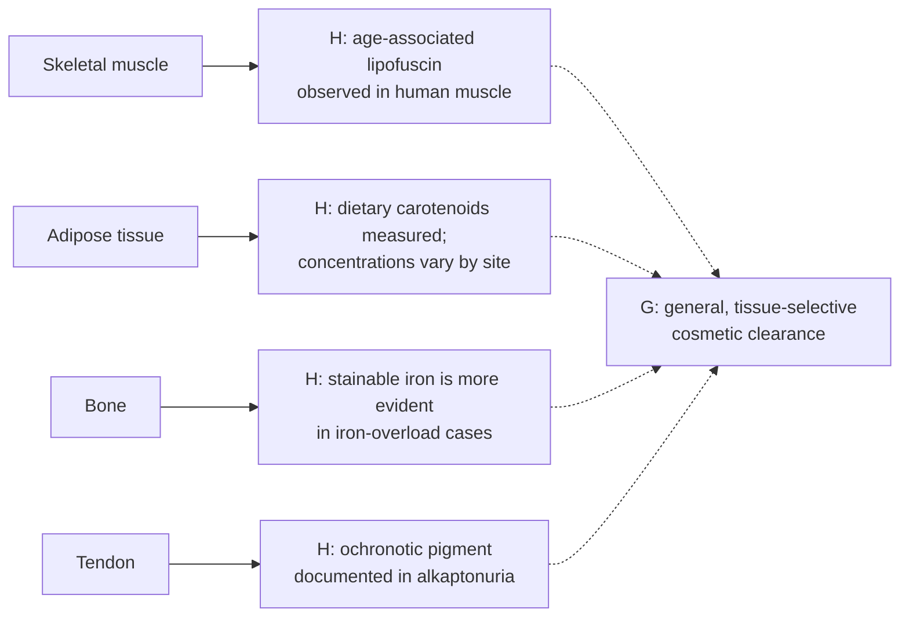

These findings identify different stored materials, not a shared pigment pool: lipofuscin, carotenoids, iron, and ochronotic polymer need separate measurement and disposition models. Clinical management of diagnosed iron overload or alkaptonuria is disease-directed; it does not establish cosmetic, tissue-specific clearance. [Human muscle study](https://pubmed.ncbi.nlm.nih.gov/17376148/), [human adipose carotenoid study](https://pubmed.ncbi.nlm.nih.gov/19587090/), [human bone iron study](https://pubmed.ncbi.nlm.nih.gov/3282446/), [Achilles tendon ochronosis case report](https://pubmed.ncbi.nlm.nih.gov/39027761/).

### Pancreas, kidney, spleen, and airways: distinct internal deposits

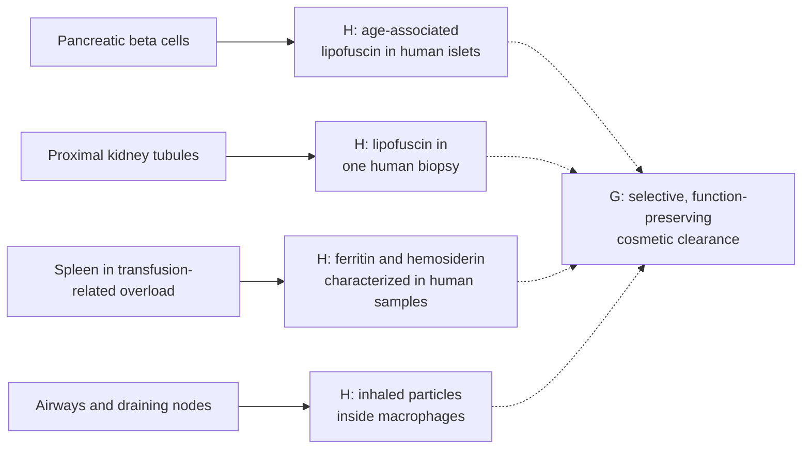

These observations represent different substrates and evidence strengths. Human beta-cell lipofuscin is an age-associated intracellular residue, and the human study used morphometry to estimate cell longevity; it did not test clearance. The kidney finding is an incidental, single-biopsy observation. Splenic ferritin and hemosiderin were characterized in patients with transfusion-related iron overload. Anthracotic carbon is inhaled particulate material in macrophages, not endogenous melanin. None establishes a general-purpose pigment-removal route. [Cnop et al., 2010](https://pubmed.ncbi.nlm.nih.gov/19855953/), [human kidney biopsy report](https://pmc.ncbi.nlm.nih.gov/articles/PMC11093538/), [Weir et al., 1985](https://pubmed.ncbi.nlm.nih.gov/4031104/), [human nodal anthracosis case series](https://pmc.ncbi.nlm.nih.gov/articles/PMC3920429/), [NEJM bronchial case](https://www.nejm.org/doi/full/10.1056/NEJMicm2516602).

### Colon mucosa: a natural-history example with limits

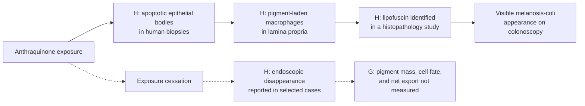

The condition's name is misleading for this project: a human histopathology study identified the colonic macrophage pigment as lipofuscin, not melanin. A retrospective colonoscopy review identified 10 disappearance cases among 216 melanosis-coli cases; 4 of the 10 had stopped anthranoid use before disappearance was observed. A separate single-patient report documented endoscopic disappearance seven months after senna cessation, without follow-up biopsy to measure the pigment or trace its fate. This is evidence of cause-associated appearance resolution in one colonic condition, not proof of a selective pigment-clearing mechanism or a result transferable to iris, skin, or other pigments. [Human histopathology study](https://pmc.ncbi.nlm.nih.gov/articles/PMC4581826/), [longitudinal clinical course study](https://pubmed.ncbi.nlm.nih.gov/36849146/), [single-case endoscopic follow-up](https://pmc.ncbi.nlm.nih.gov/articles/PMC11402352/).

Sources and model details are linked in the sections below and in the [evidence register](pigment-evidence-register.md). The shared criteria for evaluating a tissue-specific clearance claim are in the [selective clearance framework](selective-clearance-framework.md).

### Cell renewal is not the same measurement as pigment clearance

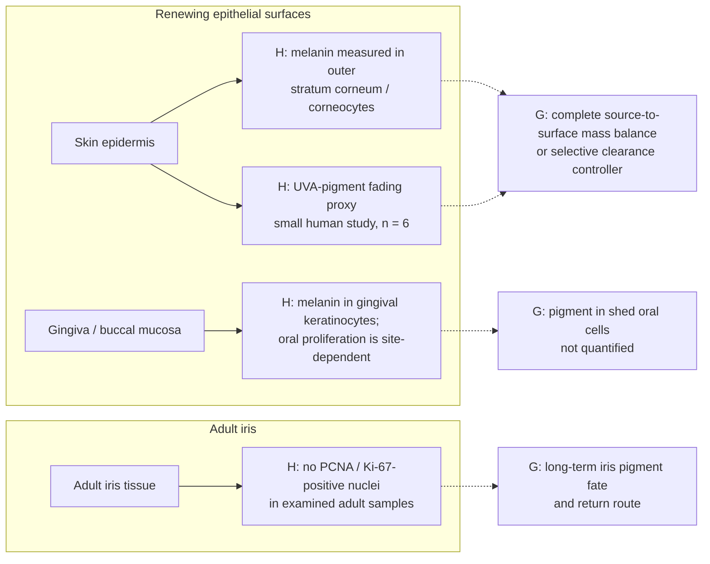

Cell renewal can carry pigment-bearing cells out of a surface layer, but calling that selective pigment clearance remains an inference. Human studies have imaged melanin granules in superficial corneocytes and chemically quantified eumelanin and pheomelanin in tape-sampled outer stratum corneum. This establishes a measurable pigment pool at the skin surface, compatible with epidermal desquamation, but does not provide a complete source-to-surface mass balance for native pigment or demonstrate a selective-clearance intervention. A separate six-person human study used fading of UVA-induced forearm pigmentation as an epidermal-turnover proxy. Normal human gingiva ultrastructure identified melanin granules in keratinocytes, and oral biopsies showed site-dependent epithelial S-phase labeling; neither tracked pigment into exfoliated oral cells. A human iris histology study found no PCNA- or Ki-67-positive nuclei in the adult iris samples examined; this is a snapshot, not proof of zero lifetime turnover or a pigment-export route. [Lu et al., 1996](https://pubmed.ncbi.nlm.nih.gov/8881670/), [Matsunaka et al., 2017](https://doi.org/10.1111/srt.12309), [Maeda, 2017](https://www.mdpi.com/2079-9284/4/4/47), [Squier and Waterhouse, 1967](https://doi.org/10.1016/0003-9969(67)90148-3), [Thomson et al., 1999](https://pubmed.ncbi.nlm.nih.gov/10577752/), [Thomson et al., 2001](https://pubmed.ncbi.nlm.nih.gov/11684035/), [Pfeiffer et al., 2001](https://jamanetwork.com/journals/jamaophthalmology/fullarticle/265260).

## 2. Skin: production, transfer, clearance, and repigmentation

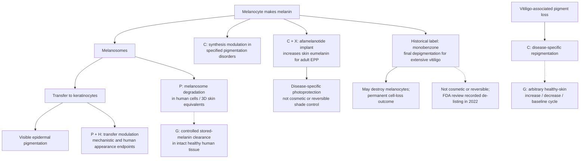

TRI-LUMA is a prescription combination for short-term moderate-to-severe **facial melasma**; its label identifies hydroquinone as a synthesis inhibitor. That indication does not cover every tissue or every form of pigmentation. Ruxolitinib cream has a separate FDA approval for nonsegmental vitiligo. These clinical examples address particular disorders. [Melasma label](https://dailymed.nlm.nih.gov/dailymed/lookup.cfm?setid=a35fa709-5eb5-4429-b38f-f1e0019bf0ee), [vitiligo approval](https://www.fda.gov/drugs/news-events-human-drugs/fda-approves-topical-treatment-addressing-repigmentation-vitiligo-patients-aged-12-and-older). For an increase in skin pigmentation, afamelanotide (SCENESSE) is an FDA-labeled MC1-R agonist for increasing pain-free light exposure in adults with erythropoietic protoporphyria; the EMA describes its action as stimulating skin eumelanin. It is administered as a subcutaneous implant by a trained clinician. This is a disease-specific, procedural skin example, not cosmetic use, iris selectivity, a chosen shade, or a reversible color cycle. [Current U.S. label](https://dailymed.nlm.nih.gov/dailymed/lookup.cfm?setid=94f53286-11dd-7fbb-e053-2a95a90a7c48&version=11), [EMA assessment](https://www.ema.europa.eu/en/medicines/human/EPAR/scenesse).

A historical counterexample helps separate lightening from selective clearance. A 2003 U.S. label described monobenzone only for final depigmentation in extensive vitiligo and warned that it could destroy melanocytes, produce frequently irreversible or distant irregular depigmentation, and leave lifelong skin sensitivity; the label explicitly said it was not cosmetic skin bleach. An FDA review in 2022 recorded the manufacturer's report that the product was no longer manufactured or distributed and had been de-listed. In cultured human epidermal melanocytes, concentrations of monobenzone that inhibited melanogenesis were similar to concentrations that were cytotoxic. This is a cell-loss comparator, not a reversible pigment-clearance system. [Historical FDA label](https://www.accessdata.fda.gov/drugsatfda_docs/label/2003/08173slr015_benoquin_lbl.pdf), [FDA 2022 review](https://www.fda.gov/media/160999/download?attachment=), [Lee et al., 2016](https://pubmed.ncbi.nlm.nih.gov/26440747/).

A 2026 study of 18 ex-vivo human skin specimens found visible darkening after UVA1 exposure alongside HPLC marker changes interpreted as eumelanin photodegradation/cross-linking and pheomelanin oxidation. This shows that a darker appearance can accompany chemical modification of existing pigment. It did not measure net pigment export or test living people; the authors included industry employees and a consultant. This is a photochemistry result, not a depigmentation method. [Ito et al., 2026](https://doi.org/10.3390/ijms27093973).

A primary niacinamide study combined transfer experiments with human facial-pigmentation outcomes. Separately, the epidermis has the clearest current research foothold for handling pigment that is already stored: keratinocytes can process transferred melanosomes through lysosomal/autophagic pathways. In cultured ex-vivo human skin and reconstructed skin substitutes, autophagy activators lowered measured melanin while inhibitors raised it. This is a two-direction response in tissue models, not a demonstrated reversible cycle: the study did not treat living people or show that pigment returned to baseline after an intervention was withdrawn. [Transfer study](https://pubmed.ncbi.nlm.nih.gov/12100180/), [Murase et al., 2013](https://doi.org/10.1038/jid.2013.165).

A later human-cell study found that the synthetic autophagy inducer PTPD-12 increased flux and melanosome degradation in cultured human melanocytes and keratinocytes containing transferred melanosomes, with lighter cell pellets. Autophagy also participates in melanocyte biology, so a broad switch cannot be assumed to reduce pigment in every cell type. [Kim et al., 2020](https://doi.org/10.1111/pcmr.12838). A lysosomal cathepsin-V study found lower basal-layer CTSV signal in one human hyperpigmented skin sample compared with one normal sample and suppressed melanosome degradation after CTSV knockdown in cells; this is a mechanistic clue, not a human treatment result. [Homma et al., 2018](https://pubmed.ncbi.nlm.nih.gov/29654760/).

The 2024 melanophagy study identified selective melanosome-autophagy machinery mainly in a mouse melanoma-cell model; the same effect was not reproduced in its transferred-melanosome keratinocyte model. This reinforces the need to specify cell compartment. [Melanophagy study](https://pmc.ncbi.nlm.nih.gov/articles/PMC10998605/). A 2025 preclinical study also reported reduced melanin accumulation and increased autophagy in normal human melanocytes and 3D MelanoDerm skin equivalents; mechanistic work also used melanoma cells. The work was industry-sponsored and did not test a treatment in people. [Geyfman et al., 2025](https://pubmed.ncbi.nlm.nih.gov/39305105/).

### Epidermal pigment has cell-specific storage and exit routes

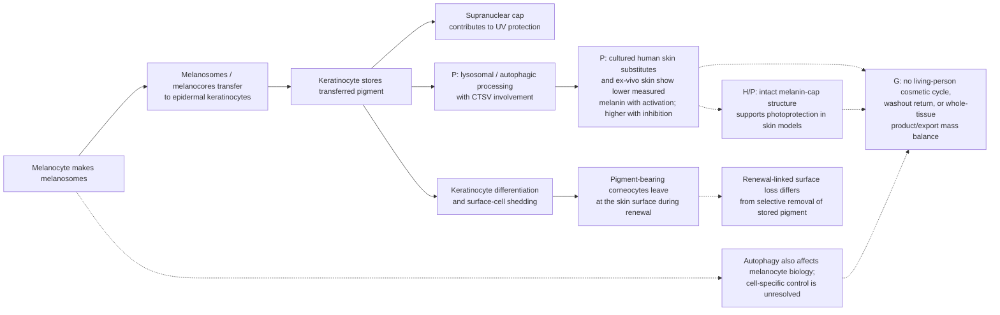

The skin result is therefore both promising and constrained. Keratinocyte-specific processing is a plausible research target because melanosomes are transferred into these surface cells and natural epidermal renewal carries pigment-bearing corneocytes outward. However, cultured tissue shows pathway responsiveness, not selective extraction from healthy living skin. Autophagy and lysosomal activity also support keratinocyte differentiation, while the melanin cap helps protect nuclear DNA from UV injury. Pigment reduction would need to be evaluated alongside barrier/differentiation, photoprotection, breakdown-product fate, and actual export—not color alone. [Human epidermal differentiation study](https://pubmed.ncbi.nlm.nih.gov/29526763/), [human skin explant photoprotection](https://pubmed.ncbi.nlm.nih.gov/9579550/), [melanocore integrity model](https://pmc.ncbi.nlm.nih.gov/articles/PMC6056223/).

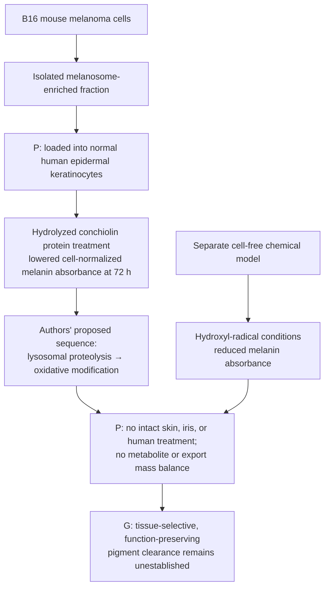

A 2026 in-vitro study loaded normal human epidermal keratinocytes with melanosome-enriched fractions isolated from B16 mouse melanoma cells. Hydrolyzed conchiolin protein (HCP) treatment lowered cell-normalized intracellular melanin absorbance after 72 hours, and the authors proposed lysosomal proteolysis followed by hydroxyl-radical oxidative modification. A separate cell-free oxidation system also reduced absorbance. The experiment isolates post-transfer pigment handling, but it did not test intact skin or a person, identify breakdown products, or account for pigment export; lower optical absorbance does not provide a whole-tissue mass balance. The paper also reports opposite pH directions in its results and discussion, leaving that aspect of the mechanism unresolved. It was funded by Osman Biological Co. These findings are a preclinical human-cell foothold, not evidence of safe cosmetic skin treatment or a transferable iris mechanism. [Zhao et al., 2026](https://doi.org/10.1111/jocd.70770).

**Melanosome breakdown is not automatically melanin-polymer breakdown:** in a mouse keratinocyte assay, Rab7B/42- and LAMP1-positive compartments degraded melanosomal proteins, but cellular melanin content did not fall even after two weeks. Classic isolated-organelle work also distinguished degradable melanosome constituents from the resistant melanin core. Thus, loss of PMEL/TYR or other organelle markers alone cannot establish pigment clearance. [Marubashi and Fukuda, 2020](https://pmc.ncbi.nlm.nih.gov/articles/PMC10739166/), [Otaki and Seiji, 1971](https://pubmed.ncbi.nlm.nih.gov/5556529/).

This does not fully resolve the contrary tissue-model results: autophagy manipulation lowered total measured melanin in human skin substitutes/ex-vivo skin, and a 2026 loaded-human-keratinocyte model reported lower melanin absorbance with a proposed lysosomal-oxidative sequence. Different models and endpoints may capture different processes. Direct polymer cleavage, chemically identified products, and their export from intact living human tissue remain unresolved. [Murase et al., 2013](https://doi.org/10.1038/jid.2013.165), [Zhao et al., 2026](https://doi.org/10.1111/jocd.70770).

**Appearance versus pigment mass:** In a small human in-situ comparison designed to produce comparable visible tanning, UVA alone did not significantly increase measured melanin, whereas UVB-containing exposures did. This shows that visible skin color can change without a corresponding increase in pigment mass. It is skin-specific evidence; it does not establish the same optical mechanism or a clearance route in the iris. [Choi et al., 2010](https://pubmed.ncbi.nlm.nih.gov/20147966/).

**Critical storage context:** cultured human keratinocytes show donor-dependent melanosome turnover, and autophagy manipulation changed measured melanin in cultured and ex-vivo human skin models. Other cultured-cell uptake studies and human skin electron microscopy found melanin in compartments that were not highly acidic or degradative. This is context-dependent evidence, not a settled universal clearance route. In human skin explants, supranuclear melanin caps correlated with fewer UV-induced DNA photoproducts; an experimental melanocore-disruption model found weaker protection from disrupted cores. Thus a color change alone would not establish safe, selective clearance. [Donor-dependent turnover](https://pubmed.ncbi.nlm.nih.gov/21326292/), [ex-vivo skin model](https://doi.org/10.1038/jid.2013.165), [nondegradative compartments](https://pubmed.ncbi.nlm.nih.gov/29074272/), [in-situ human skin](https://pubmed.ncbi.nlm.nih.gov/29054596/), [human skin explants](https://pubmed.ncbi.nlm.nih.gov/9579550/), [melanocore model](https://pmc.ncbi.nlm.nih.gov/articles/PMC6056223/).

A 2026 human-biopsy study of 14 people with ashy dermatosis found greater melanosome uptake in dermal fibroblasts than in macrophages. In a seven-case marker subset, increased macrophage p62 was interpreted as evidence consistent with impaired autophagic degradation. This disease-specific pathology suggests that persistent dermal melanosomes can involve multiple cell types; it does not establish a treatment or generalize to normal dermis. [Hada et al., 2026](https://pubmed.ncbi.nlm.nih.gov/42410740/).

### Dermal pigment procedures: local fading and body fate are separate

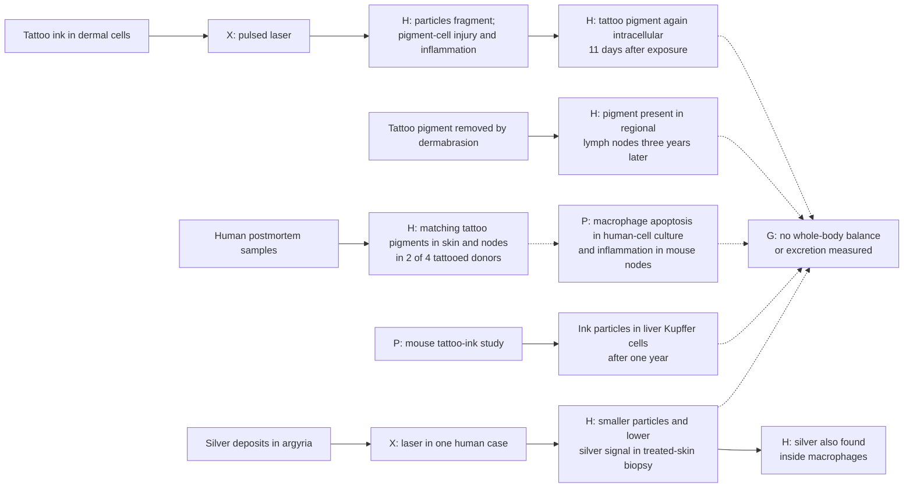

Human tattoo biopsies show that laser-associated lightening can involve disruption of pigment-containing cells, smaller particles, and inflammation; pigment was again intracellular 11 days later. A postmortem human tissue study detected matching tattoo-pigment species in skin and regional nodes in two of four tattooed donors. A separate human case found tattoo pigment in regional lymph nodes three years after the tattoo had been removed by dermabrasion; surface removal therefore did not ensure pigment left the body. A 2026 pathology review of 90 lymph nodes already selected for tattoo-ink deposition found no unifying histologic pattern beyond the ink; 11 specimens came from patients with hematologic neoplasms, but this selected series cannot estimate risk or establish causation. These human findings are small-sample or case evidence and concern ink, not melanin. [Human tattoo biopsy study](https://doi.org/10.1111/1523-1747.ep12478570), [human skin-and-node study](https://doi.org/10.1038/s41598-017-11721-z), [regional lymph-node case](https://pubmed.ncbi.nlm.nih.gov/32650854/).

A separate one-year mouse biodistribution study detected tattoo particles in liver Kupffer cells; it did not detect particles in other sampled internal organs by light microscopy. This is preclinical distribution evidence, not human pharmacokinetics or clearance. [Sepehri et al., 2017](https://pubmed.ncbi.nlm.nih.gov/28486229/).

A 2025 study found persistent inflammation in mouse draining lymph nodes after tattooing and macrophage apoptosis in both mouse experiments and human monocyte-derived macrophage culture; it also reported vaccine-specific immune effects in mice. A 2026 letter questioned how closely the extensive mouse-footpad exposure represents ordinary tattooing. The authors replied that human macrophage and lymph-node observations support mechanistic relevance but agreed clinical effects need further study. This is a preclinical signal about heterogeneous foreign inks, not evidence that native melanin clearance would have the same effects. [Capucetti et al., 2025](https://doi.org/10.1073/pnas.2510392122), [Kluger, 2026](https://doi.org/10.1073/pnas.2611211123), [Gonzalez reply, 2026](https://doi.org/10.1073/pnas.2613440123).

A single generalized-argyria case provides stronger local tissue measurements: after laser treatment, a treated-skin biopsy showed smaller silver-containing particles and markedly lower silver signals, while some residual silver was found in macrophages and on elastic fibers. The authors proposed partial macrophage clearance; the patient had long-lasting visible improvement, but no whole-body silver accounting. It is a metal-deposit case report using a procedure, not evidence for melanin or iris reversal. [Fukayama et al., 2020](https://pmc.ncbi.nlm.nih.gov/articles/PMC9309704/). A separate human case reported recurrence after Q-switched laser treatment. The 2020 authors proposed that ultraviolet exposure might re-darken residual silver through a chemical-state change, but this explanation remains speculative; it illustrates that visible color can shift while metal remains. [Krase et al., 2017](https://pubmed.ncbi.nlm.nih.gov/28296792/).

## 3. Gums and oral mucosa

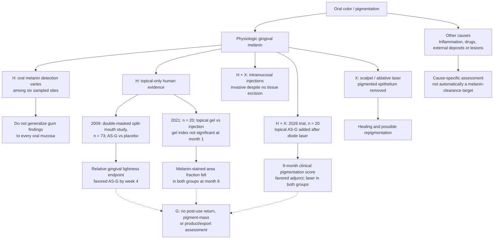

Gingiva now has a small but meaningful topical-only human evidence signal. In a double-masked, split-mouth study of 73 people, a topical ascorbyl-glucoside gel was compared with placebo for 12 weeks; the abstract reports a significant relative difference in the spectrophotometric gingival-lightness endpoint by week 4. The same paper reports tyrosinase inhibition and reduced new melanin formation in separate cell/skin models. **Inference:** reduced synthesis plus normal epithelial turnover could account for some appearance change, but the clinical study did not separate that from loss of pre-existing pigment. It measured visible lightness, not pigment mass or export, and did not establish what happened after treatment stopped. [Shimada et al., 2009](https://pubmed.ncbi.nlm.nih.gov/19186973/).

Results differ across studies and endpoints. A separate randomized study with 20 participants found no significant one-month pigmentation-index change in the topical-gel group, while its injection group responded earlier; the melanin-stained area fraction was lower at six months in both groups. A 2026 randomized study of 20 participants found a lower nine-month clinical pigmentation score when topical ascorbyl glucoside was added after diode-laser depigmentation than after laser alone. Both arms received laser, and the study measured a clinical score rather than pigment mass or fate. Together, these studies justify tracking noninvasive topical modulation as a research lead for gingiva, but do not establish a predictable reversible color controller or a pigment-export route. [El-Mofty et al.](https://pubmed.ncbi.nlm.nih.gov/33966113/), [Gudur et al.](https://pubmed.ncbi.nlm.nih.gov/42147661/).

Scalpel and ablative-laser studies concern removal of pigmented epithelium; recurrence is a relevant outcome. These are procedural comparisons, distinct from preservation of the existing tissue through molecular modulation. Oral pathology also distinguishes melanocytic pigmentation from deposits such as amalgam tattoos. [Procedure trial](https://pubmed.ncbi.nlm.nih.gov/31983845/), [oral pathology series](https://pmc.ncbi.nlm.nih.gov/articles/PMC8141314/). Red, swollen, bleeding gums belong to an inflammatory branch. [NIDCR](https://www.nidcr.nih.gov/health-info/gum-disease).

Ultrastructural examination of normal human gingiva found melanin granules in keratinocytes. This identifies an epithelial pigment pool, but does not quantify pigment in exfoliated cells or establish a selective export mechanism. [Squier and Waterhouse, 1967](https://doi.org/10.1016/0003-9969(67)90148-3).

A histochemical study of 95 autopsies sampled six oral sites and found marked site variation: melanin was detected in 28.4% of mandibular gingival samples and 51.6% of labial samples; 24.2% of subjects had no detectable pigment at any sampled oral site. This supports treating gingiva as a distinct compartment rather than assuming one oral-mucosa baseline. The study measured presence, not pigment export or function. [Barrett and Beynon, 1991](https://pubmed.ncbi.nlm.nih.gov/1747076/).

## 4. Eyes: separate compartments

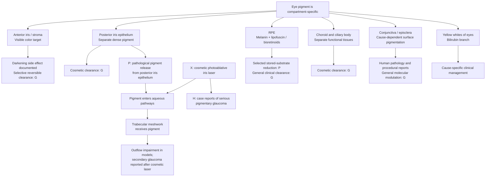

Human iris microscopy and chemical microdissection distinguish anterior/stromal pigmentation from the posterior pigment epithelium. These compartments cannot be combined into one clearance target. [Microscopy](https://pubmed.ncbi.nlm.nih.gov/8602783/), [pigment chemistry](https://pubmed.ncbi.nlm.nih.gov/9778410/).

Cosmetic photoablative iris-laser treatment is a procedural comparator, not a selective biological modulator. Case reports document pigment dispersion and secondary pigmentary glaucoma; after four sessions, one bilateral case had intraocular pressures of 50 and 42 mmHg, with visual-field defects and glare still present at follow-up despite urgent treatment. These case reports establish possible severe harm, not its frequency. [Ning et al.](https://pubmed.ncbi.nlm.nih.gov/33449587/), [Swampillai et al.](https://pubmed.ncbi.nlm.nih.gov/36175318/), [Liu et al.](https://pubmed.ncbi.nlm.nih.gov/37771388/).

A small 1983 ophthalmic report of people with vitiligo described linear pigment deposition in both corneas in one patient after a year of monobenzone use. Among 15 additional patients, 11 of whom used monobenzone, two had conjunctival melanosis; the authors said these findings might be related to use. This uncontrolled report cannot establish causality or risk frequency, but it illustrates why unintended ocular effects must be examined when a skin-directed intervention is not proven tissue-confined. It is not evidence for an iris-lightening route. [Hedges et al., 1983](https://pubmed.ncbi.nlm.nih.gov/6849655/).

**Pigment fate is part of the eye constraint.** In pigment-dispersion disease, granules released from the posterior iris pigment epithelium can travel through aqueous pathways and accumulate in the trabecular meshwork. Porcine models show impaired meshwork-cell phagocytosis/migration and reduced outflow after pigment exposure. A small human follow-up cohort found that meshwork pigmentation can attenuate over time after treatment for this disease; it does not establish a nonprocedural cosmetic clearance route. This pathology involves the posterior epithelium, distinct from the anterior stromal color target. [Human PDS cohort](https://pubmed.ncbi.nlm.nih.gov/34397796/), [trabecular-meshwork cell model](https://pmc.ncbi.nlm.nih.gov/articles/PMC7847180/), [porcine outflow model](https://pmc.ncbi.nlm.nih.gov/articles/PMC5915754/).

For the RPE, a 2014 cell/mouse study reduced **selected bisretinoids**, with substrate-specific limitations. A 2023 mouse study reported lipofuscin degradation involving melanin; subsequent scientific discussion addressed alternative pathways and the limits of a universal melanin-required interpretation. These are retinal research mechanisms, not evidence of iris-color reversal. [2014 study](https://pmc.ncbi.nlm.nih.gov/articles/PMC3986126/), [2023 study](https://pmc.ncbi.nlm.nih.gov/articles/PMC10194005/), [comment](https://pmc.ncbi.nlm.nih.gov/articles/PMC10622903/), [reply](https://pmc.ncbi.nlm.nih.gov/articles/PMC10622899/).

### Oxidative breakdown can alter melanin and produce photoreactive products

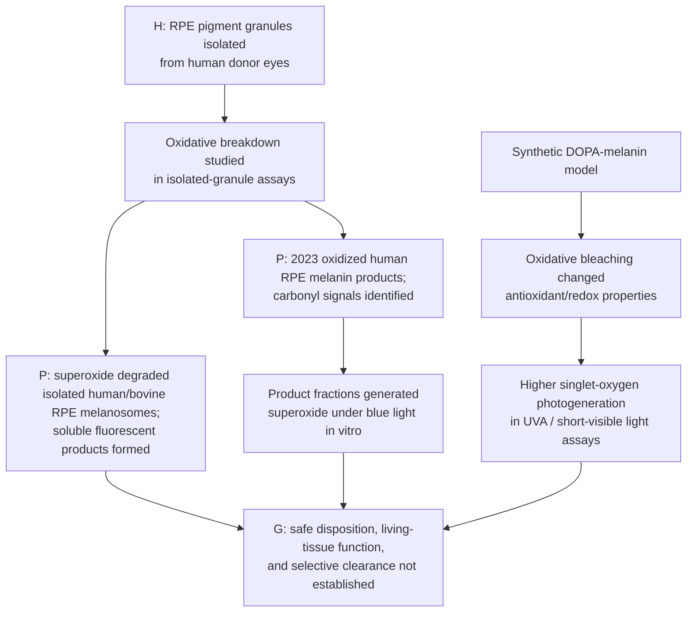

An oxidative breakdown route may lower melanin's optical signal while changing the pigment and producing new material. In an earlier in-vitro study, superoxide degraded isolated human/bovine RPE melanosomes into transparent soluble material containing fluorescent melanin-decay products. The same study found lower paramagnetic-center levels in human melanolipofuscin granules than in melanosomes across 150 eyes, interpreted as age-related melanin destruction; this observation does not reveal product destination in living tissue. Dontsov et al. later isolated RPE pigment granules from human cadaver eyes and identified water-soluble melanin-degradation products with carbonyl signals that generated superoxide under blue-light exposure in vitro. The authors describe potential photoreactivity, not demonstrated clinical harm. A separate synthetic DOPA-melanin study found oxidative bleaching changed redox/antioxidant properties and increased singlet-oxygen photogeneration. These results show why degradation must be assessed alongside product identity, disposition, and tissue function; none tested a pigment-clearing intervention in living people, and none is evidence for iris reversibility. [Dontsov et al., 2017](https://pubmed.ncbi.nlm.nih.gov/28941459/), [Dontsov et al., 2023](https://pubmed.ncbi.nlm.nih.gov/37685907/), [Mokrzyński et al., 2024](https://pubmed.ncbi.nlm.nih.gov/38803190/).

Human fetal RPE cultures provide evidence concerning melanin's photoprotective role. Choroid mapping, epithelial anatomy, and ocular-surface pathology are separate evidence categories. [RPE study](https://pmc.ncbi.nlm.nih.gov/articles/PMC1157035/), [human choroid study](https://pmc.ncbi.nlm.nih.gov/articles/PMC6901595/), [NLM epithelial definition](https://www.ncbi.nlm.nih.gov/mesh/D010857), [conjunctival case report](https://pmc.ncbi.nlm.nih.gov/articles/PMC4251888/).

## 5. The original iris cycle

Human iris chemistry found very low pigment content in blue irides and variation in melanin type across color groups. Histology found no significant difference in stromal melanocyte counts among blue, hazel, and brown irides. **Inference:** a return-to-blue claim should measure the visible anterior-stromal pigment state and standardized optical appearance; melanocyte counts or a whole-eye pigment measure alone are inadequate endpoints. [Iris histology](https://pubmed.ncbi.nlm.nih.gov/8602782/), [human iris pigment chemistry](https://pubmed.ncbi.nlm.nih.gov/9778410/).


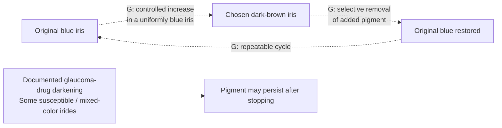

The dashed arrows are the goal, not demonstrated clinical transitions. Official Xalatan information reports no observed color change in uniformly blue eyes in its cited studies. U.S. labeling describes increased iris pigmentation as likely permanent. Human follow-up reported no fading over two years after stopping, and a separate one-person photographic case found no appreciable change over five years. In contrast, one case of periocular-skin darkening visibly improved within a month and was significantly lighter by two months after stopping; epidermis is a renewing surface tissue, so this is not an iris reversal result. FDA states that there are no approved eye drops for changing eye color. [UK product information](https://www.medicines.org.uk/emc/product/1616/smpc), [U.S. label](https://dailymed.nlm.nih.gov/dailymed/drugInfo.cfm?setid=f4e73059-5ba0-4d73-9ea1-09d8d654e844), [Wistrand et al.](https://pubmed.ncbi.nlm.nih.gov/9154289/), [Camras et al.](https://pubmed.ncbi.nlm.nih.gov/10708238/), [periocular-skin case](https://jamanetwork.com/journals/jamaophthalmology/fullarticle/265847), [FDA](https://www.fda.gov/drugs/buying-using-medicine-safely/what-you-should-know-about-eye-drops).

## 6. Hair and nails: living producers versus existing keratin

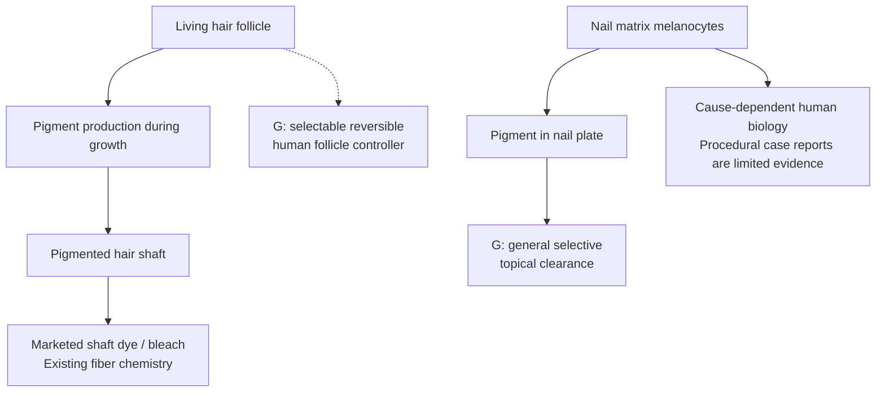

Human-hair experiments show that bleaching can degrade melanin while also damaging fiber proteins. That does not demonstrate clearance in living tissue. Mouse follicle stem-cell research and observational human hair repigmentation concern a different biological system. Hair remains a candidate for the [separate project proposed earlier](hair-scope.md). [FDA hair cosmetics](https://www.fda.gov/cosmetics/cosmetic-products/hair-dyes), [ex vivo fiber study](https://doi.org/10.1111/ics.12495), [mouse follicle study](https://www.nature.com/articles/s41586-023-05960-6), [human observational study](https://elifesciences.org/articles/67437).

Human nail-matrix studies document melanocytes; a drug-induced melanonychia laser report is a case report. Neither establishes a general cosmetic pigment-removal controller. [Nail anatomy study](https://pubmed.ncbi.nlm.nih.gov/8040399/), [case report](https://pubmed.ncbi.nlm.nih.gov/31220366/).

## 7. Brain and visceral lipofuscin: clearance is more than autophagy

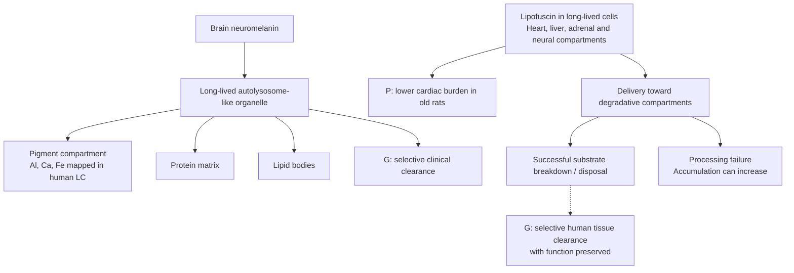

Human brain research characterizes neuromelanin-containing organelles; this is not a demonstrated clinical clearance intervention. A 2026 elemental-mapping study of seven postmortem locus-coeruleus samples localized several metals mainly to the pigment compartment, alongside a protein matrix and lipid bodies. The sample is small and observational; it sharpens the cargo map but cannot predict a clearance intervention. Human tissue studies also document lipofuscin in cardiac, hepatic and adrenal cells. A cardiac study reported reduced burden in old rats. Separately, stressed human fibroblast cultures accumulated more lipofuscin when autophagy was activated under impaired processing. **Increasing autophagy is not sufficient evidence that every pigment will be cleared.** [Neuromelanin organelle study](https://pubmed.ncbi.nlm.nih.gov/29900402/), [human locus-coeruleus elemental map](https://pmc.ncbi.nlm.nih.gov/articles/PMC13408184/), [human visceral-tissue study](https://pubmed.ncbi.nlm.nih.gov/7206299/), [old-rat cardiac study](https://www.sciencedirect.com/science/article/pii/S0014482721001178), [human fibroblast study](https://pubmed.ncbi.nlm.nih.gov/37438887/).

## 8. Iron deposits: an existing disease-treatment example

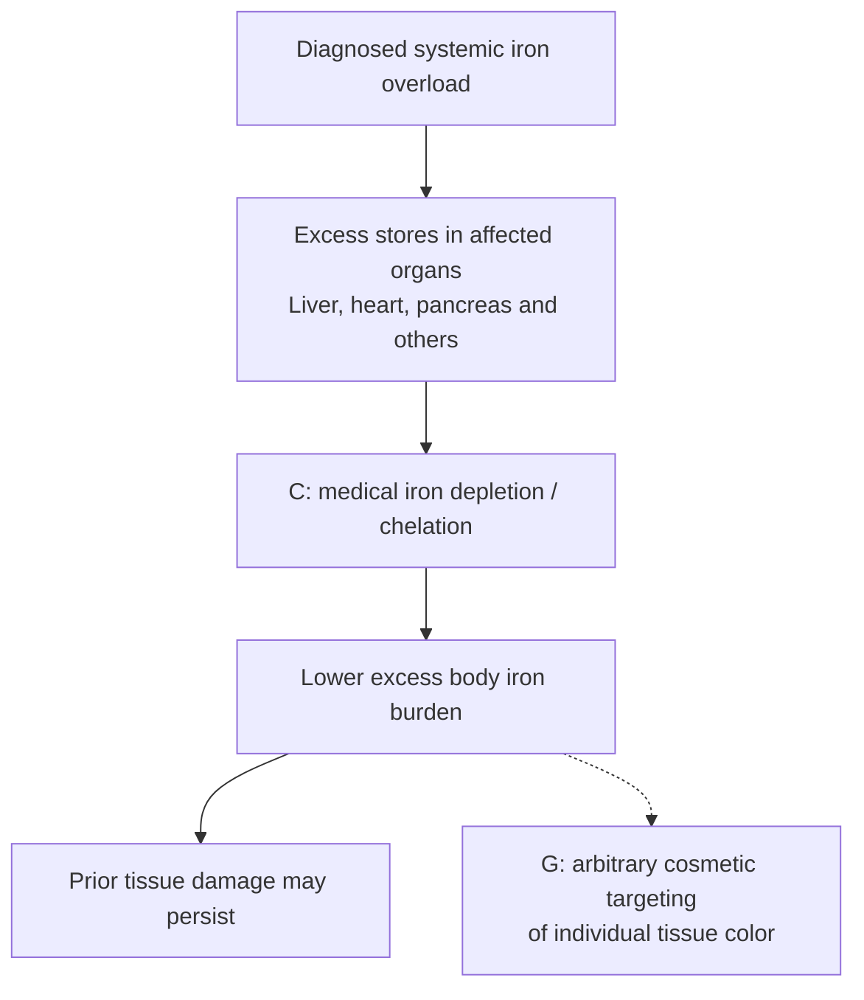

Iron-overload treatment is a real example of reducing an accumulated chemical burden. Its purpose is disease management; iron is also essential to normal physiology. Phlebotomy is a procedure, and chelation is a medical therapy for particular circumstances. Neither is a melanin-clearance mechanism. [NIDDK treatment information](https://www.niddk.nih.gov/health-information/liver-disease/hemochromatosis/treatment).

## 9. Ochronosis: precursor reduction with partial human pigment regression

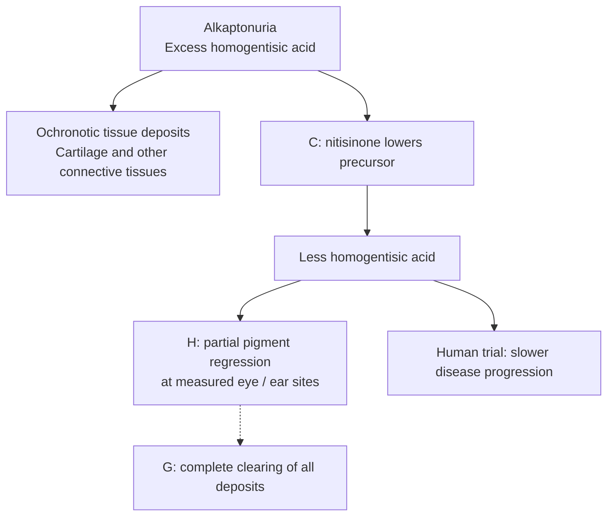

A human observational study reported partial regression in photographed eye/ear pigmentation and a reduction in ear-cartilage biopsy pigment. A randomized trial also found slower disease progression. This is a useful example of existing pigment decreasing after precursor reduction, with incomplete reversal and disease-specific chemistry. It does **not** demonstrate the same behavior for adult iris melanin. FDA's Harliku approval concerns reducing urinary homogentisic acid in adult alkaptonuria. [Pigment study](https://pubmed.ncbi.nlm.nih.gov/32904992/), [SONIA 2 trial](https://pubmed.ncbi.nlm.nih.gov/32822600/), [FDA approval record](https://www.accessdata.fda.gov/scripts/opdlisting/oopd/detailedIndex.cfm?cfgridkey=942723).

## 10. Bilirubin and other color changes

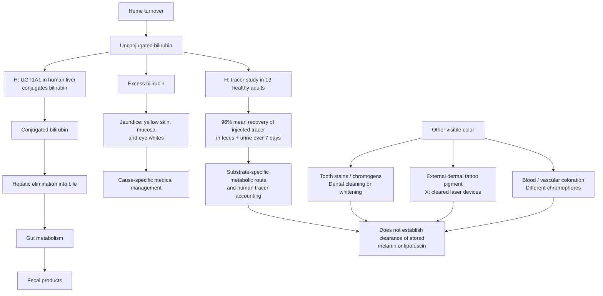

Bilirubin is a useful narrow comparator because both hepatic handling and whole-body tracer recovery have been measured in people. In 13 healthy adults, an injected unconjugated-bilirubin tracer was followed for seven days; mean cumulative radioactivity recovered in feces and urine was 96% of the dose. A separate human donor-liver and primary-hepatocyte study linked UGT1A1 abundance with bilirubin-conjugating activity and documented substantial donor variation. These studies describe a specialized route for bilirubin. They do not show selective clearance of stored melanin or lipofuscin, or a way to change skin, gum, or iris color. Tooth whitening and removal of external tattoo ink remain different capabilities; FDA states that it has not approved tattoo-removal creams. [Berk et al., human tracer study](https://www.jci.org/articles/view/106184), [Ritter et al., human liver UGT1A1 study](https://pubmed.ncbi.nlm.nih.gov/10421657/), [NIH jaundice information](https://newsinhealth.nih.gov/2022/10/recognizing-jaundice), [ADA tooth whitening](https://www.ada.org/resources/ada-library/oral-health-topics/whitening), [FDA tattoo removal](https://www.fda.gov/consumers/consumer-updates/tattoo-removal-options-and-results), [NHLBI hemoglobin and red cells](https://www.nhlbi.nih.gov/health/anemia/causes).

### Melanuria: pathological pigment traffic, not a normal clearance route

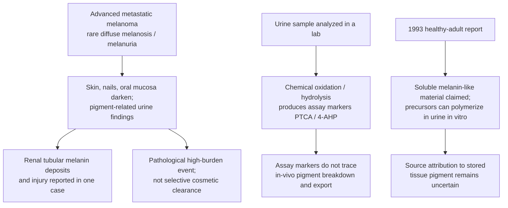

Metastatic melanoma is a rare pathological comparator for pigment-related material reaching blood and urine. In one study, urinary PTCA, 4-AHP, and melanogenesis-related markers were higher in 45 melanoma patients than in 10 controls. PTCA and 4-AHP are measured after chemically processing the urine sample, so these assays do not show that the same products formed in vivo or came from normal tissue stores. One clinical report documented diffuse darkening of skin, nails, and oral mucosa together with melanuria. A separate case of metastatic melanoma with melanuria had intratubular melanin deposits and tubular injury on kidney histology. This is not evidence that normal skin, gum, or iris melanin can be selectively mobilized for safe renal excretion. [Wakamatsu et al., 2006](https://pubmed.ncbi.nlm.nih.gov/16524432/), [Takasaki et al., 2003](https://pubmed.ncbi.nlm.nih.gov/12950724/), [Piana and Longo, 2019](https://www.nejm.org/doi/full/10.1056/NEJMicm1810151), [acute kidney injury case, 2008](https://pubmed.ncbi.nlm.nih.gov/18572978/).

A 1993 biochemical report interpreted spectroscopy and isolation results as soluble melanins in healthy adults' urine. Its abstract also notes that melanin-like material can form in urine in vitro when precursors oxidatively polymerize. Without tracing a tissue pigment pool into urine, this older report does not establish a physiological route for clearing stored skin or iris melanin. [Hegedus and Nayak, 1993](https://pubmed.ncbi.nlm.nih.gov/7511438/).

## 11. Systemic exposures can affect several tissues

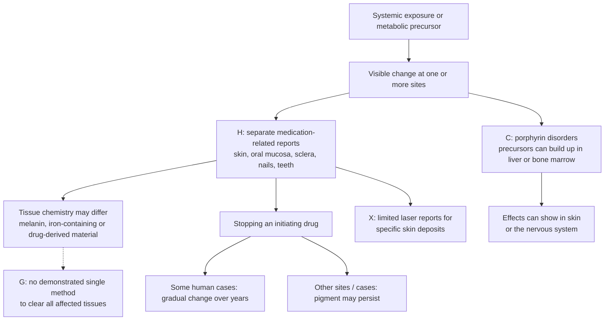

Separate human reports document minocycline-associated discoloration in skin, oral mucosa (including gums), sclera, nails, teeth and other tissues. Tissue analyses show why a shared cause does not guarantee one shared pigment: particular skin and nail deposits have contained iron and calcium, while different patterns can involve melanin. In one case with broad skin and scleral involvement, color slowly moved toward normal over several years after the drug was stopped; a scleral case series reports that pigmentation can also persist. These are adverse-effect observations and case reports, not a controlled or selectable cosmetic color cycle. [Multi-tissue case reports](https://pubmed.ncbi.nlm.nih.gov/9512163/), [skin/gum/nail/sclera case](https://pubmed.ncbi.nlm.nih.gov/36158857/), [skin and nail tissue analysis](https://pubmed.ncbi.nlm.nih.gov/3158285/), [scleral follow-up series](https://pubmed.ncbi.nlm.nih.gov/9186432/).

Porphyria gives a different systems map: depending on type, porphyrins or precursors may accumulate in liver or bone marrow while symptoms affect skin, nervous system, or both. Its disease-specific management is not an example of selectively clearing visible melanin. [NIDDK overview](https://www.niddk.nih.gov/health-information/liver-disease/porphyria).

Silver deposition in argyria is another distinct substrate. Published skin-laser reports are limited clinical case reports; they do not establish a noninvasive whole-body clearance system. [Systematic review](https://pubmed.ncbi.nlm.nih.gov/25845405/).

## 12. Inner ear: melanin in a hearing-critical compartment

```mermaid
flowchart TD
    S["Cochlear stria vascularis"] --> I["Melanocyte-like intermediate cells<br/>contribute to endocochlear potential"]
    I --> M["Cells produce and export melanin"]
    H["H: human temporal bones, n = 46"] --> HD["Melanin in stria + Rosenthal's canal;<br/>age/group differences, no threshold association"]
    P["P: genetically matched mouse comparison"] --> PD["In mice over 2 years, absent melanin<br/>coincided with more EP decline / cell loss"]
    M -.-> R["Melanin's own protective role<br/>remains unresolved"]
    HD -.-> G["G: selective pigment reduction<br/>with hearing function preserved"]
    PD -.-> G
    R -.-> G
```

The cochlear stria vascularis contains melanin-producing intermediate cells, and human temporal-bone studies also identify pigment in Rosenthal's canal. In one 46-specimen study, pigmentation differed between the study's African-American and Caucasian donor groups and strial pigment increased with age; pigment amount was not associated with hearing thresholds in that sample. A genetically matched mouse comparison found that, after two years of age, endocochlear-potential decline and marginal-cell loss were more common in albino mice. This does not prove that melanin itself is essential or that changing pigment would alter human hearing. It does make cochlear cell function and pigment burden separate endpoints. No selective cochlear pigment-reduction method is established here. [Sun et al., 2014](https://pubmed.ncbi.nlm.nih.gov/25166018/), [Ohlemiller et al., 2009](https://pubmed.ncbi.nlm.nih.gov/19141317/).

## 13. Leptomeninges: normal melanin outside neurons

```mermaid
flowchart LR
    L["Leptomeninges"] --> M["H: melanin-containing dendritic cells<br/>confirmed as melanocytes"]
    M --> D["Most concentrated over ventrolateral medulla;<br/>isolated cells elsewhere in sampled brains"]
    M --> I["Normal melanin can produce<br/>T2 MRI hypointensity"]
    I --> C["May resemble a pigmented<br/>meningeal abnormality"]
    M -.-> G["G: selective removal and safe disposition<br/>with CNS function preserved"]
    N["Neuronal neuromelanin"] --> X["Different cell and storage compartment;<br/>do not treat as one pigment pool"]
```

Human histology and ultrastructure identified leptomeningeal pigment cells as melanocytes, based on their dendritic morphology and melanosomes. In 15 brains, they were concentrated over the ventrolateral medulla; a small subset averaged 325 cells/mm² there. A separate imaging study found that normal meningeal melanin can create T2-weighted hypointensity that resembles disease. The studies establish a non-neuronal CNS pigment compartment, not its normal physiological role or a selective clearance route. That compartment is distinct from neuronal neuromelanin. [Goldgeier et al., 1984](https://pubmed.ncbi.nlm.nih.gov/6699426/), [Gebarski and Blaivas, 1996](https://pubmed.ncbi.nlm.nih.gov/8770250/).

## 14. Heart and pulmonary veins: melanocyte-like cells with uncertain human pigment burden

```mermaid
flowchart TD
    H["Human atria / pulmonary veins"] --> HC["H: DCT-positive<br/>melanocyte-like cells identified"]
    M["Mouse cardiac melanocyte-like cells"] --> MM["P: melanosomes and pigmented cells observed"]
    M --> D["P: DCT deficiency or loss of these cells<br/>changes arrhythmia susceptibility in mice"]
    D --> U["Mechanism is not proof that<br/>melanin amount drives the phenotype"]
    HC --> G["G: human pigment burden, clinical role,<br/>and selective clearance unresolved"]
    MM --> G
    U --> G
```

A primary study identified DCT-positive melanocyte-like cells in human pulmonary veins and atria; ultrastructural melanosomes and pigmented cardiac cells were shown in mice. Mouse DCT-deficient or cell-deficient models had altered susceptibility to atrial arrhythmias. Because DCT also participates in calcium and reactive-species regulation, these results do not show that reducing melanin itself causes arrhythmia, and the contribution of these cells to clinical human arrhythmias remains undetermined. No human cardiac pigment-reduction or clearance method is established. [Levin et al., 2009](https://pubmed.ncbi.nlm.nih.gov/19855129/).

## 15. Esophageal mucosa: rare melanocytosis is site-specific

```mermaid
flowchart TD
    E["Esophageal squamous mucosa"] --> M["H: rare melanocytic proliferation<br/>with melanin deposition"]
    M --> D["Histology helps distinguish<br/>melanocytosis from melanoma"]
    M -.-> G["G: natural history and selective<br/>clearance not established"]
    C["Colon melanosis coli"] --> L["H: lipofuscin-like pigment<br/>in macrophages"]
    L --> X["Different pigment and cell compartment;<br/>do not generalize by name"]
```

Esophageal melanocytosis is a rare human mucosal finding described as non-atypical melanocytic proliferation with melanin deposits. Case reports and small series emphasize its distinction from primary esophageal melanoma; they do not establish a predictable natural history or a selective pigment-clearance method. It is chemically distinct from colon melanosis coli, whose macrophage pigment has been identified as lipofuscin-like material. [Dubail et al., 2022](https://pubmed.ncbi.nlm.nih.gov/35709783/), [Ohnuma et al., 2017](https://pubmed.ncbi.nlm.nih.gov/28445275/), [colon histopathology](https://pmc.ncbi.nlm.nih.gov/articles/PMC4581826/).

## 16. Candidate melanocyte-lineage signals are not evidence of pigment stores

```mermaid
flowchart LR
    O["Normal human organ samples"] --> R["H: tyrosinase transcripts detected by RT-PCR<br/>in several organs"]
    R --> U["Cell identity unresolved;<br/>transcript assay did not measure melanin"]
    A["Human subcutaneous adipose-derived cells"] --> C["P: melanocyte markers in cultured cells"]
    C --> D["Melanocyte-specific culture + 3D epidermis + UVB<br/>produced melanin deposits in the model"]
    D --> V["Shows cell differentiation potential;<br/>not a pigmented adipose store in vivo"]
    U --> G["G: organ-specific pigment burden<br/>and selective clearance remain unestablished"]
    V --> G
```

A sensitive 1993 RT-PCR study detected tyrosinase transcripts in normal samples of skin, lymph nodes, stomach antrum, colon, kidney, lung, testis, ovary, breast, and peripheral nerve. The authors said the expressing cells still needed identification; the assay did not localize cells or quantify tissue melanin. A later human adipose-derived stem-cell study found melanocyte markers in cultured cells and generated melanin after differentiation in a three-dimensional epidermal model with UVB exposure. That supports progenitor potential under model conditions, not a native melanin deposit in adipose tissue. These findings justify candidate-tissue research, not a claim that all marker-positive organs contain accumulated melanin. [Battyani et al., 1993](https://pubmed.ncbi.nlm.nih.gov/7511806/), [Ikeda et al., 2021](https://pubmed.ncbi.nlm.nih.gov/34432824/).

## 17. Nasal and laryngeal mucosa: localized, sample-dependent evidence

```mermaid
flowchart LR
    N["Nasal / paranasal mucosa"] --> NH["H: melanocytes in 21 of 99<br/>autopsy specimens in one Japanese series"]
    NH --> NS["Mostly subepithelial stroma near<br/>glands and sinuses"]
    NS --> NG["Site and sampling matter;<br/>no clearance endpoint"]
    L["Laryngeal mucosa"] --> LB["H: melanocytes in a vocal-cord biopsy;<br/>none in 15 whole-larynx autopsies"]
    L --> LC["H: 4 melanosis cases had more<br/>melanocytes than 16 controls"]
    LB --> LG["Small, differing samples;<br/>no clearance endpoint"]
    LC --> LG
    NG --> G["G: tissue-selective pigment reduction<br/>not established"]
    LG --> G
```

A Japanese pathology series found stromal melanocytes in 21 of 99 autopsy specimens of nasal cavity/paranasal sinus, commonly around glands and sinuses; intraepithelial dendritic melanocytes were seen in 2 of the 21 positive cases. The series also included 79 surgical specimens from chronic sinusitis or nasal-polyps cases, so its result is a histology observation, not a population estimate. [Uehara et al., 1987](https://pubmed.ncbi.nlm.nih.gov/3661192/).

Laryngeal findings are sparse and sampling-dependent. A 1976 report found melanocytes in a vocal-cord biopsy but none in extensive sections from 15 larynges at autopsy. A 1997 retrospective series described four laryngeal-melanosis cases; the melanosis samples had more melanocytes than 16 controls, with a small, nonsignificant trend between smoking and control groups. These reports do not establish a general laryngeal pigment burden, health role, or clearance capability. [Busuttil, 1976](https://doi.org/10.1001/archotol.1976.00780060089012), [Gonzalez-Vela et al., 1997](https://pubmed.ncbi.nlm.nih.gov/9419104/).

## 18. Genital mucosa: different sites, different evidence

```mermaid
flowchart TD
    G["Genital mucosa"] --> V["Vulvar melanosis cohort<br/>129 patients; long follow-up"]
    V --> VN["About 30% changed in size/color,<br/>then stabilized"]
    VN --> VE["Natural history of appearance;<br/>not a clearance intervention"]
    G --> C["Cervix: visible pigmented lesions"]
    C --> CN["33 of 2,118; mostly blue nevi;<br/>one melanotic macule"]
    G --> A["Anorectal mucosa"]
    A --> AN["Low baseline melanocyte density<br/>measured in surgical controls"]
    G --> E["Endocervix"]
    E --> EN["Melanin-confirmed cells<br/>in two case specimens"]
    G --> X["Vaginal normal-pigment distribution"]
    X --> XN["Dedicated prevalence data<br/>remain limited in this review"]
    VE --> N["Different lesions and cell compartments;<br/>no general pigment-clearance route"]
    CN --> N
    AN --> N
    EN --> N
    XN --> N
```

A 20-year single-center cohort followed 129 patients with vulvar melanosis for 5–20 years. About 30% of lesions enlarged or changed color before stabilizing; no malignant evolution was documented. This is natural history of visible lesions, not a test of deliberate removal or pigment mass. A prospective cervical series found visible pigmented lesions in 33 of 2,118 cervices; most were blue nevi, and one was a melanotic macule. A two-case endocervical report confirmed melanin-containing cells but found no pigment in the endocervical epithelium. [Vulvar cohort](https://pubmed.ncbi.nlm.nih.gov/32785609/), [cervical lesions](https://pubmed.ncbi.nlm.nih.gov/24300541/), [endocervical cases](https://pubmed.ncbi.nlm.nih.gov/7405906/).

In a surgical-pathology anorectal series, 24 control specimens had low densities of melanocytes that varied by glandular versus squamous compartment and by stain; controls included some hemorrhoids and other pathology, so they are not a population survey. These data identify a local cell population and support compartment-specific diagnosis, not a healthy-tissue color treatment. Dedicated normal vaginal-pigment prevalence was not established by the sources reviewed here. [Nazarian et al., 2016](https://pubmed.ncbi.nlm.nih.gov/27247367/).

## 19. Human pigment trajectories after intervention

A visible color change after stopping an intervention can mean several different things: a signal stopped, active disease returned, pigment-bearing cells were replaced, pigment itself fell, or only the optical appearance changed. These outcomes are not interchangeable. The cases below show how strongly the trajectory depends on the tissue, pigment chemistry, and intervention.

```mermaid
flowchart LR
    A["Human pigment trajectory after an intervention"] --> B["Anterior iris<br/>drug withdrawn"]
    B --> B1["No appreciable fading at 2 years;<br/>one case followed for 5 years"]
    A --> C["Periocular skin<br/>drug withdrawn"]
    C --> C1["Visible lightening by 2 months;<br/>single case"]
    A --> D["Facial melasma<br/>active treatment ended"]
    D --> D1["All 21 follow-up completers<br/>had reappearance by 12 weeks"]
    A --> E["Gingiva<br/>pigmented epithelium removed"]
    E --> E1["Repigmentation by 9 months<br/>in many participants"]
    A --> F["Alkaptonuria<br/>precursor lowered"]
    F --> F1["Partial eye / ear regression;<br/>ear-cartilage pigment also measured"]
    B1 --> G["Appearance observations do not<br/>measure pigment mass or destination"]
    C1 --> G
    D1 --> G
    E1 --> G
    F1 --> H["A measured reduction in one<br/>disease-specific pigment system"]
```

| Tissue and human evidence | What was observed | What the endpoint establishes—and does not |
| --- | --- | --- |
| **Anterior iris:** latanoprost-associated darkening after discontinuation | Clinical follow-up reported no observed change over two years; one serial-photograph case showed no appreciable fading over five years. | The drug-associated appearance persisted after the signal stopped in these observations. This was not an active clearance test or a direct chemical measurement of iris pigment. [Wistrand et al., 1997](https://pubmed.ncbi.nlm.nih.gov/9154289/), [Camras et al., 2000](https://pubmed.ncbi.nlm.nih.gov/10708238/). |
| **Periocular skin:** pigmentation after latanoprost discontinuation | A single case visibly improved within one month and was significantly lighter by two months. | Appearance can change after withdrawal in adjacent skin. The case did not measure pigment mass and cannot establish a route for the non-shedding iris stroma. [Wand et al., 2001](https://jamanetwork.com/journals/jamaophthalmology/fullarticle/265847). |
| **Facial skin:** treated melasma followed after treatment stopped | In a split-face randomized trial, 28 participants completed 12 weeks of treatment and 21 completed a further 12-week follow-up; all 21 follow-up completers had reappearance of pigmentation by the end. | This is recurrence of an active pigmentary condition after treatment, not proof that the same stored pigment returned, and not return to an individual's original healthy baseline. [Split-face randomized trial](https://pubmed.ncbi.nlm.nih.gov/33017045/). |
| **Gingiva:** surgical de-epithelialization for physiologic pigmentation | In a 20-person study, repigmentation was observed by nine months in 85.71% of the wheatish-complexioned group and all dark-complexioned participants; none was reported in the fair-complexioned group. | This is clinical repigmentation after removal of surface tissue. It is not a noninvasive reversal study, and neither pigment mass nor the source of repigmenting cells was measured. [Kaur et al., 2010](https://pmc.ncbi.nlm.nih.gov/articles/PMC3110462/). |
| **Eye and ear tissues in alkaptonuria:** homogentisic-acid precursor lowering | An observational human study reported partial regression of photographed eye/ear pigmentation and lower pigment in an ear-cartilage biopsy. | This is the clearest reviewed human example of measured reduction in an existing tissue pigment burden, but it concerns disease-specific ochronotic pigment, is partial, and does not show melanin clearance. [Ranganath et al., 2020](https://pubmed.ncbi.nlm.nih.gov/32904992/). |

**Inference:** human evidence supports several distinct trajectories—persistence, recurrence, visible fading, repigmentation, and partial measured loss. It does not support one shared “color off switch.” The strongest reviewed example of measured stored-pigment reduction is tied to a specific precursor–deposit system in alkaptonuria. That result cannot be generalized to native melanin in skin, gums, iris, or other organs. A useful clearance claim needs both a tissue-appropriate appearance endpoint and a direct pigment amount/chemistry or disposition endpoint, plus function and recovery measurements.

## Research requirements shared across tissues

A future selective-clearance claim would need to identify the pigment chemically; locate it in the relevant cells or extracellular compartment; measure actual pigment loss separately from reduced synthesis or marker loss; account for breakdown products; and show preservation of tissue function.

A reversible system would additionally need evidence for return to the original appearance, spatial uniformity, and repeat cycles. The reviewed literature offers several tissue-specific footholds. It does not establish selective pigment removal across all bodily tissues.
